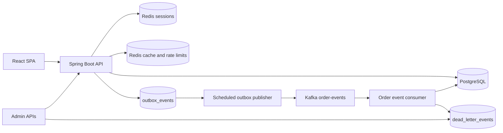
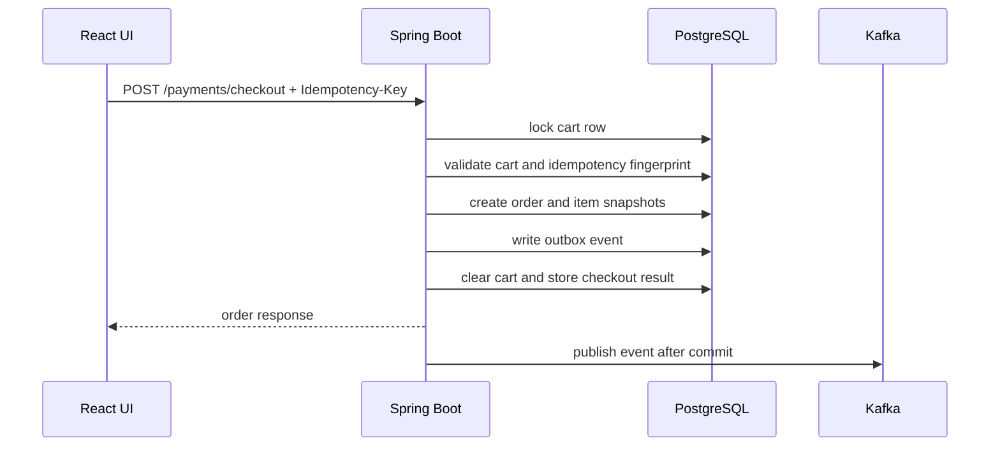

# Luc1fer's Food Bank

<p align="center">
  <strong>A production-shaped food ordering platform built around the hardest part of ordering software: making checkout correct.</strong>
</p>

<p align="center">
  
  
  
  
  
  
</p>

<p align="center">
  Browse restaurants, build a cart, simulate payment, track orders, receive notifications, and recover failed async work from admin APIs.
</p>

---

## What Makes It Interesting

Most demo food apps stop at CRUD. This one goes deeper into the failure modes that matter in real ordering systems:

- **Idempotent checkout** with durable request records and conflict detection
- **Cart-level concurrency control** using PostgreSQL row locks
- **Transactional outbox** so order changes and events commit together
- **Kafka-based async processing** with consumer-side deduplication
- **Persistent dead-letter storage and replay** for failed consumers
- **Failed outbox inspection and retry** for operator recovery
- **Redis-backed sessions, cache, and rate limiting**
- **Actuator, Prometheus metrics, structured logs, and trace correlation**
- **Focused tests** for checkout rollback, duplicate requests, order state transitions, outbox behavior, and security controls

The theme of the project is simple:

> Keep the critical business transaction correct first. Distribute side effects only after the database commit.

---

## Product Snapshot

| Area | What is included |
| --- | --- |
| Customer experience | Sign up, log in, browse restaurants, search menus, manage cart, checkout, view orders, cancel eligible orders, view notifications |
| Admin operations | Move orders through a guarded state machine, inspect failed outbox events, retry failed publishes, replay dead-lettered events |
| Reliability | Idempotency keys, row locking, transactional outbox, at-least-once event handling, deduplication tables, replay paths |
| Observability | `X-Trace-Id`, structured logs, Actuator health, Prometheus metrics, readiness and liveness probes |
| Local development | Docker Compose for PostgreSQL, Redis, and Kafka; H2 fallback profile; React dev server proxy |

---

## Architecture



### Checkout Flow



---

## Tech Stack

| Layer | Stack |
| --- | --- |
| Frontend | React, Ant Design, Create React App, browser session cookies |
| Backend | Java 17, Spring Boot, Spring MVC, Spring Security, Spring Data JDBC, Gradle |
| Data | PostgreSQL, Flyway migrations, H2 fallback profile |
| Runtime state | Redis for Spring Session, cache, and distributed rate-limit counters |
| Messaging | Kafka, transactional outbox table, consumer deduplication table, dead-letter replay |
| Observability | Spring Boot Actuator, Micrometer, Prometheus endpoint, structured JSON logs, `X-Trace-Id` |
| Verification | JUnit, Spring Boot tests, Testcontainers, GitHub Actions |

---

## Quick Start

### Prerequisites

- Java 17
- Node 20
- Docker Desktop or another Docker-compatible runtime

### 1. Start local infrastructure

```sh
(cd backend && docker compose up -d)
```

This starts:

| Service | Local address |
| --- | --- |
| PostgreSQL | `localhost:5433` |
| Redis | `localhost:6379` |
| Kafka | `localhost:9092` |

### 2. Install frontend dependencies

```sh
(cd frontend && npm ci --legacy-peer-deps)
```

### 3. Run the backend with demo data

```sh
(cd backend && FLYWAY_LOCATIONS=classpath:db/migration,classpath:db/demo ./gradlew bootRun)
```

Flyway applies the schema from `backend/src/main/resources/db/migration`. The extra `db/demo` location seeds demo restaurants, menus, and the demo account.

### 4. Run the frontend dev server

```sh
(cd frontend && npm start)
```

Open:

- Frontend dev server: [http://localhost:3000](http://localhost:3000)
- Backend / embedded UI: [http://localhost:8080](http://localhost:8080)
- Swagger UI: [http://localhost:8080/swagger-ui/index.html](http://localhost:8080/swagger-ui/index.html)

### Demo Account

| Field | Value |
| --- | --- |
| Email | `demo@laifood.com` |
| Password | `demo123` |
| Roles | `ROLE_USER`, `ROLE_ADMIN` |

---

## Lightweight H2 Mode

Use this when you want a smaller backend run without PostgreSQL or Kafka. Redis is still configured as the cache/session backend.

```sh
(cd backend && SPRING_PROFILES_ACTIVE=h2 ./gradlew bootRun)
```

The `h2` profile runs Flyway migrations and includes the demo seed callback by default.

---

## Core API Map

### Customer APIs

| Method | Path | Purpose |
| --- | --- | --- |
| `POST` | `/signup` | Create a customer account |
| `POST` | `/login` | Start a server-side session |
| `POST` | `/logout` | End the session |
| `GET` | `/me` | Read current session user |
| `GET` | `/restaurants/menu` | List restaurants with their menus (HTTP-cacheable, see [Catalog Caching](#catalog-caching)) |
| `GET` | `/restaurant/{restaurantId}/menu` | List menu items; `404` for an unknown restaurant (HTTP-cacheable) |
| `GET` | `/cart` | Read current cart |
| `POST` | `/cart` | Add menu item to cart |
| `PUT` | `/cart/items/{orderItemId}` | Update quantity |
| `DELETE` | `/cart/items/{orderItemId}` | Remove item |
| `POST` | `/cart/checkout` | Checkout cart with idempotency key |
| `POST` | `/payments/checkout` | Payment-style checkout with idempotency key |
| `GET` | `/orders` | List current user's orders |
| `POST` | `/orders/{orderId}/cancel` | Cancel an eligible order |
| `GET` | `/notifications` | List order notifications |

### Admin and Recovery APIs

| Method | Path | Purpose |
| --- | --- | --- |
| `PATCH` | `/orders/{orderId}/status` | Move order through the status state machine |
| `GET` | `/admin/outbox/events/failed?limit=50` | Inspect failed outbox events |
| `POST` | `/admin/outbox/events/{eventId}/retry` | Reset failed outbox event to `PENDING` |
| `PATCH` | `/admin/menu-items/{menuItemId}` | Update a menu item's `name`, `description` or `price`; evicts that restaurant's cached menu after commit |
| `PATCH` | `/admin/restaurants/{restaurantId}` | Update a restaurant's `name`, `address`, `phone` or `image_url`; evicts the cached restaurant list after commit |
| `POST` | `/dead-letters/{deadLetterEventId}/replay` | Replay a stored dead-letter event |

### Operational APIs

| Method | Path | Purpose |
| --- | --- | --- |
| `GET` | `/actuator/health` | Aggregate health |
| `GET` | `/actuator/health/liveness` | Liveness probe |
| `GET` | `/actuator/health/readiness` | Readiness probe |
| `GET` | `/actuator/metrics` | Metric discovery |
| `GET` | `/actuator/prometheus` | Prometheus scrape endpoint |
| `GET` | `/v3/api-docs` | OpenAPI JSON |
| `GET` | `/swagger-ui/index.html` | Swagger UI |

API errors use a consistent JSON shape and include a trace id:

```json
{
  "code": "VALIDATION_FAILED",
  "message": "Request validation failed",
  "trace_id": "trace-12345",
  "status": 400,
  "path": "/signup",
  "timestamp": "2026-05-07T05:00:00Z"
}
```

---

## Correctness Model

### Checkout

- Checkout requires an `Idempotency-Key` header.
- The backend stores one durable idempotency record per customer, checkout scope, and key.
- Repeating the same logical request returns the stored order result.
- Reusing the same key with a different request fingerprint returns a conflict.
- Checkout locks the cart row, creates the order, snapshots order items, writes the outbox event, clears the cart, and stores the idempotency result in one database transaction.
- If the transaction fails before commit, all checkout writes roll back together.

### Order State

Allowed transitions:

```text
PLACED -> PAID / CANCELLED
PAID -> ACCEPTED / CANCELLED
ACCEPTED -> PREPARING / CANCELLED
PREPARING -> COMPLETED
COMPLETED and CANCELLED are terminal
```

Status changes and their outbox events commit together. Invalid transitions fail without side effects.

### Outbox and Kafka

- Order events are inserted into `outbox_events` inside the same transaction as the order change.
- A scheduled publisher claims `PENDING` or stale `PROCESSING` rows with `FOR UPDATE SKIP LOCKED`.
- Successful publish marks the row `PUBLISHED`.
- Retryable failures return to `PENDING` until `app.outbox.max-attempts`.
- Max-attempt failures become `FAILED` and require admin retry after the root cause is fixed.
- Consumers use `processed_events` to deduplicate at-least-once Kafka delivery.
- Notification creation also has a database uniqueness safety net.

### Catalog Caching

The public catalog reads (`GET /restaurants/menu`, `GET /restaurant/{restaurantId}/menu`) go through a two-level cache (`backend/src/main/java/.../cache`):

| Level | Store | Lifetime | Scope |
| --- | --- | --- | --- |
| L1 | Caffeine, bounded, `recordStats` | `app.cache.l1.ttl` (30s) | one instance |
| L2 | Redis, typed JSON | `spring.cache.redis.time-to-live` (10m) +/- `app.cache.l2.ttl-jitter` (15%) | all instances |

- **Granular keys.** `restaurants::all` holds the restaurant list (basic fields) and `menu::<restaurantId>` holds one menu. `GET /restaurants/menu` is composed from them, with the same JSON shape as before. Redis keys are `onlineorder:cache:<version>:<cache>::<key>`, for example `onlineorder:cache:v1:menu::3`.
- **Typed serialization.** Each cache has its own Jackson serializer bound to `CatalogRestaurantDto` or `CatalogMenuItemDto`: no default typing and no `@class` in Redis. When a cached DTO changes shape, bump its version in `CatalogCaches`; old and new code then use different keys during a rolling deploy, and an entry that cannot be read is treated as a miss.
- **Stampede, avalanche, penetration.** Cached methods use `@Cacheable(sync = true)`, and the L1 loads each key once per instance while concurrent callers wait (single flight). Redis TTLs are jittered so entries loaded together do not expire together. A menu request is first checked against the cached restaurant list, so unknown restaurant ids get `404` without a database query and are never cached.
- **Invalidation.** Admin writes update the database and delete the affected entries only after the transaction commits (`TransactionSynchronization#afterCommit`); a rollback deletes nothing. Deletion order is Redis, then the local L1, then a Redis pub/sub message (`onlineorder:cache:invalidation`) that makes the other instances drop their L1 copy. Instances clear their L1 whenever the subscription is (re)established, since messages sent while disconnected are lost; the L1 TTL bounds anything else that is missed.
- **Why cache-aside with delete-after-commit, not write-through.** Writing the new value into the cache from the write path means rebuilding the cached view (a whole menu) in the transaction, and two concurrent writers can store their snapshots out of order so the older one wins until the TTL. Deleting lets the next read rebuild from committed data. Deleting before the commit would let a reader cache the old row again. The remaining race is a reader that loaded the old row just before the commit and stores it just after the delete; a delayed double delete (`app.cache.delayed-double-delete`, 1s, `0` disables) removes that entry.
- **Redis failures.** A failed Redis read is a miss and a failed write, delete or publish is skipped; each is logged and counted in `onlineorder.cache.errors`, and requests are served from the database and L1. Startup does not need Redis: the invalidation subscription is retried in the background.
- **Hung or slow Redis.** A Redis that hangs instead of refusing connections makes every call wait for the 500ms command timeout (`spring.data.redis.timeout`). Without protection, every L1 miss would pay it twice (read and write-back), so a cold `GET /restaurants/menu`, composed of N+1 entries, would wait about (N+1) x 1s. A circuit breaker shared by the caches (`RemoteCacheCircuitBreaker`) therefore makes reads and write-backs skip Redis for `app.cache.l2.circuit-breaker.open-duration` (5s) after any Redis error, or after 3 consecutive calls slower than `slow-call-threshold` (200ms). Then one request probes Redis while the others keep skipping it, and a successful probe closes the breaker. An entry that cannot be deserialized does not count, since Redis answered. Deletes and invalidation broadcasts always go to Redis, because they keep it consistent with the database. A loaded value is written back after the single-flight section, so callers waiting for the same key are not held for the Redis write. `CatalogRedisHangIntegrationTests` pauses its Redis container and holds cold catalog reads of 43 restaurants to a 2.5s budget; before the breaker they took about 44s.
- **What an outage still breaks.** Sessions also live in Redis, so during an outage authenticated requests (cart, checkout, admin catalog writes) fail in the session filter. Anonymous catalog reads never touch the session store.
- **HTTP caching.** Both endpoints send `Cache-Control: max-age=30, public` (`app.catalog.http-max-age`) and a strong `ETag` (SHA-256 of the JSON body), and answer a matching `If-None-Match` with `304`. Only these responses override Spring Security's `no-store`; CSP and the other security headers are unchanged.
- **Staleness budget after an admin write.** The writing instance serves the new data once the request returns (the rare reader race above lasts until the delayed second delete). Other instances drop their L1 copy when the pub/sub message arrives, or after the L1 TTL if it is lost. Browsers and shared caches may reuse a response for up to `max-age`.
- **Prices and checkout.** The cache only serves the catalog. Adding to the cart reads the menu item from the database and snapshots its price on the cart line (adding the same item again re-snapshots it), and checkout charges the cart-line snapshots. A price change therefore never reprices existing cart lines, and a client showing a cached menu for up to `max-age` still gets the current price when it adds the item.
- **Metrics.** Micrometer's cache meters with a `level` tag:
  - `cache.gets{level="l1", result="hit"|"miss"}`, plus `cache.puts`, `cache.evictions` and `cache.size` for L1.
  - `cache.gets{level="l2", result="hit"|"miss"|"error"|"skipped"}`: `error` is a Redis read that failed or timed out, and `skipped` is one not attempted because the breaker is open. A non-zero `skipped` rate means Redis is being bypassed.
  - `cache.load{level="l2", result="success"|"failure"}`: values loaded from the database because neither level had them. This is the database load. During an outage every L1 miss is an L2 `error` or `skipped` followed by a load, so the L2 miss count alone would look healthy.
  - `cache.puts{level="l2"}`, `cache.evictions{level="l2"}`, `onlineorder.cache.invalidations.received` and `onlineorder.cache.errors`.

  Overall hit ratio (reads that did not reach the database): `1 - sum(rate(cache_load_total{level="l2"}[5m])) / sum(rate(cache_gets_total{level="l1"}[5m]))`.

Read benchmark with `load-tests/catalog-read.js`: 50 VUs for 30s in a closed loop, half `GET /restaurants/menu` and half `GET /restaurant/{id}/menu`, on the demo data, PostgreSQL 16 and Redis 7.4. k6, the JVM and Docker Desktop shared one laptop with other builds running, so compare the rows rather than reading the numbers as capacity. Each cell shows two alternating rounds.

| Build | Throughput | p95 | p99 |
| --- | --- | --- | --- |
| Before: one Redis key for the whole catalog, menu endpoint uncached | 18.6k / 24.5k req/s | 5.32 / 3.67 ms | 9.45 / 7.08 ms |
| After: two-level cache | 51.0k / 60.6k req/s | 1.76 / 1.45 ms | 2.81 / 2.31 ms |
| After, with `If-None-Match` (every response a `304`) | 70.7k / 71.5k req/s | 1.13 / 1.13 ms | 1.65 / 1.61 ms |

In the second "after" round, L1 answered 11.9M cache reads with 12 misses, and only 4 reads reached PostgreSQL (L2 misses). To repeat it: `BASE_URL=http://localhost:8080 VUS=50 DURATION=30s k6 run load-tests/catalog-read.js`, adding `CONDITIONAL=true` for the `304` case.

### Security and Abuse Controls

- Authentication uses server-side sessions backed by Redis.
- Customer accounts track status, failed login count, lockout time, last login, and audit timestamps.
- Login lookup is case-insensitive.
- Anonymous routes are rate-limited by remote IP.
- Authenticated checkout and admin routes are rate-limited by user identity.
- Redis rate-limit store failures fail open and emit metrics instead of blocking core flows.

---

## Testing and Verification

Run the normal backend verification path:

```sh
(cd backend && ./gradlew test -x buildFrontend -x syncFrontendBuild --no-daemon)
```

Build the React app:

```sh
(cd frontend && npm run build)
```

Build the backend jar with embedded frontend assets:

```sh
(cd backend && ./gradlew bootJar --no-daemon)
```

The test suite covers:

- checkout idempotency, rollback, and concurrent checkout behavior
- order status transition rules and rollback behavior
- outbox publish success, retryable failure, max-attempt failure, and admin retry
- Kafka consumer deduplication and notification idempotency
- dead-letter replay behavior
- two-level catalog cache: L1/L2 hits, single-flight loading, TTL jitter, typed Redis round trips, pub/sub invalidation between instances, eviction only after commit, HTTP `ETag`/`304`, fallback to the database when Redis refuses connections, and latency bounds when Redis hangs (paused container)
- authentication, login lockout, session handling, and rate limiting
- API contract and operational metrics behavior

Some integration tests use Testcontainers and require Docker. Tests annotated with `@Testcontainers(disabledWithoutDocker = true)` may skip when Docker is unavailable.

---

## Project Layout

```text
.
|-- frontend/                         React + Ant Design client
|-- backend/                          Spring Boot application
|   |-- src/main/java/.../controller   HTTP API surface
|   |-- src/main/java/.../service      business logic and transactions
|   |-- src/main/java/.../messaging    Kafka, outbox, DLT handling
|   |-- src/main/java/.../observability metrics and tracing
|   |-- src/main/resources/db          Flyway migrations and demo seed data
|   `-- src/test/java                  unit and integration tests
|-- load-tests/                        k6 order-flow load test
|-- Dockerfile                         full source build image
`-- README.md
```

---

## Useful Commands

| Task | Command |
| --- | --- |
| Start infrastructure | `cd backend && docker compose up -d` |
| Run backend tests | `cd backend && ./gradlew test -x buildFrontend -x syncFrontendBuild --no-daemon` |
| Run backend with demo seed | `cd backend && FLYWAY_LOCATIONS=classpath:db/migration,classpath:db/demo ./gradlew bootRun` |
| Run backend with H2 profile | `cd backend && SPRING_PROFILES_ACTIVE=h2 ./gradlew bootRun` |
| Start frontend dev server | `cd frontend && npm start` |
| Build frontend | `cd frontend && npm run build` |
| Copy frontend build into backend | `cd frontend && npm run deploy:backend` |
| Build executable jar | `cd backend && ./gradlew bootJar --no-daemon` |
| Run load test | `k6 run load-tests/order-flow.js` |

---

## Honest Boundaries

This project is intentionally strong on backend correctness patterns, but it is still a demo application:

- Payment is simulated with local request validation. There is no real payment provider, authorization, capture, webhook, or settlement flow.
- There is no inventory reservation or stock decrement model.
- Kafka delivery is treated as at-least-once with consumer-side idempotency, not end-to-end exactly-once delivery.
- Failed outbox rows require explicit admin retry after the underlying cause is fixed.
- H2 is a lightweight local fallback, not the production-shaped runtime.
- Catalog edits are limited to admin updates of existing restaurants and menu items. There is no create or delete API, so rows changed directly in the database show up once the cached entries expire. The demo seed matches rows by name, so renaming a demo restaurant or item makes the next startup with `db/demo` insert the original again.
- The architecture is a deliberate monolith. Service decomposition is deferred until the core transaction is correct and observable.

---

## Why This Repo Exists

Luc1fer's Food Bank is built to show how a familiar product surface - ordering food - can carry serious backend engineering ideas without becoming a microservice maze.

The result is a compact full-stack app where the frontend is usable, the backend is observable, and the checkout path is treated like real money is on the line.
