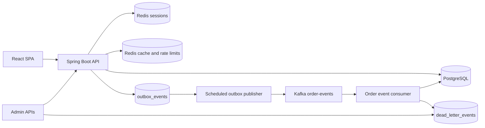
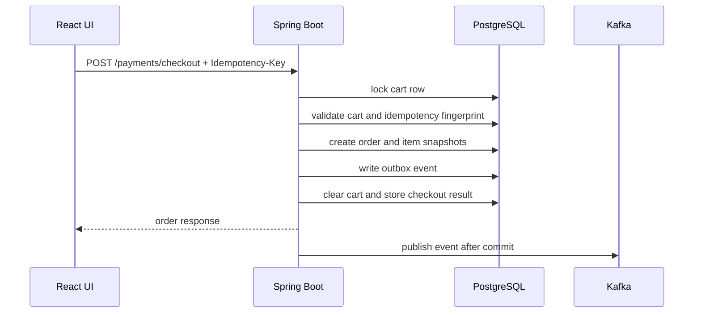

# Luc1fer's Food Bank

<p align="center">
  <strong>A production-shaped food ordering platform built around the hardest part of ordering software: making checkout correct.</strong>
</p>

<p align="center">
  
  
  
  
  
  
</p>

<p align="center">
  Browse restaurants, build a cart, simulate payment, track orders, receive notifications, and recover failed async work from admin APIs.
</p>

---

## What Makes It Interesting

Most demo food apps stop at CRUD. This one goes deeper into the failure modes that matter in real ordering systems:

- **Idempotent checkout** with durable request records and conflict detection
- **Cart-level concurrency control** using PostgreSQL row locks
- **Transactional outbox** so order changes and events commit together
- **Kafka-based async processing** with consumer-side deduplication
- **Persistent dead-letter storage and replay** for failed consumers
- **Failed outbox inspection and retry** for operator recovery
- **Redis-backed sessions, cache, and rate limiting**
- **Actuator, Prometheus metrics, structured logs, and trace correlation**
- **Focused tests** for checkout rollback, duplicate requests, order state transitions, outbox behavior, and security controls

The theme of the project is simple:

> Keep the critical business transaction correct first. Distribute side effects only after the database commit.

---

## Product Snapshot

| Area | What is included |
| --- | --- |
| Customer experience | Sign up, log in, browse restaurants, search menus, manage cart, checkout, view orders, cancel eligible orders, view notifications |
| Admin operations | Move orders through a guarded state machine, inspect failed outbox events, retry failed publishes, replay dead-lettered events |
| Reliability | Idempotency keys, row locking, transactional outbox, at-least-once event handling, deduplication tables, replay paths |
| Observability | `X-Trace-Id`, structured logs, Actuator health, Prometheus metrics, readiness and liveness probes |
| Local development | Docker Compose for PostgreSQL, Redis, and Kafka; H2 fallback profile; React dev server proxy |

---

## Architecture



### Checkout Flow



---

## Tech Stack

| Layer | Stack |
| --- | --- |
| Frontend | React, Ant Design, Create React App, browser session cookies |
| Backend | Java 17, Spring Boot, Spring MVC, Spring Security, Spring Data JDBC, Gradle |
| Data | PostgreSQL, Flyway migrations, H2 fallback profile |
| Runtime state | Redis for Spring Session, cache, and distributed rate-limit counters |
| Messaging | Kafka, transactional outbox table, consumer deduplication table, dead-letter replay |
| Observability | Spring Boot Actuator, Micrometer, Prometheus endpoint, structured JSON logs, `X-Trace-Id` |
| Verification | JUnit, Spring Boot tests, Testcontainers, GitHub Actions |

---

## Quick Start

### Prerequisites

- Java 17
- Node 20
- Docker Desktop or another Docker-compatible runtime

### 1. Start local infrastructure

```sh
(cd backend && docker compose up -d)
```

This starts:

| Service | Local address |
| --- | --- |
| PostgreSQL | `localhost:5433` |
| Redis | `localhost:6379` |
| Kafka | `localhost:9092` |

### 2. Install frontend dependencies

```sh
(cd frontend && npm ci --legacy-peer-deps)
```

### 3. Run the backend with demo data

```sh
(cd backend && FLYWAY_LOCATIONS=classpath:db/migration,classpath:db/demo ./gradlew bootRun)
```

Flyway applies the schema from `backend/src/main/resources/db/migration`. The extra `db/demo` location seeds demo restaurants, menus, and the demo account.

### 4. Run the frontend dev server

```sh
(cd frontend && npm start)
```

Open:

- Frontend dev server: [http://localhost:3000](http://localhost:3000)
- Backend / embedded UI: [http://localhost:8080](http://localhost:8080)
- Swagger UI: [http://localhost:8080/swagger-ui/index.html](http://localhost:8080/swagger-ui/index.html)

### Demo Account

| Field | Value |
| --- | --- |
| Email | `demo@laifood.com` |
| Password | `demo123` |
| Roles | `ROLE_USER`, `ROLE_ADMIN` |

---

## Lightweight H2 Mode

Use this when you want a smaller backend run without PostgreSQL or Kafka. Redis is still configured as the cache/session backend.

```sh
(cd backend && SPRING_PROFILES_ACTIVE=h2 ./gradlew bootRun)
```

The `h2` profile runs Flyway migrations and includes the demo seed callback by default.

---

## Core API Map

### Customer APIs

| Method | Path | Purpose |
| --- | --- | --- |
| `POST` | `/signup` | Create a customer account |
| `POST` | `/login` | Start a server-side session |
| `POST` | `/logout` | End the session |
| `GET` | `/me` | Read current session user |
| `GET` | `/restaurants/menu` | List restaurants |
| `GET` | `/restaurant/{restaurantId}/menu` | List menu items |
| `GET` | `/cart` | Read current cart |
| `POST` | `/cart` | Add menu item to cart |
| `PUT` | `/cart/items/{orderItemId}` | Update quantity |
| `DELETE` | `/cart/items/{orderItemId}` | Remove item |
| `POST` | `/cart/checkout` | Checkout cart with idempotency key |
| `POST` | `/payments/checkout` | Payment-style checkout with idempotency key |
| `GET` | `/orders` | List current user's orders |
| `POST` | `/orders/{orderId}/cancel` | Cancel an eligible order |
| `GET` | `/notifications` | List order notifications |

### Admin and Recovery APIs

| Method | Path | Purpose |
| --- | --- | --- |
| `PATCH` | `/orders/{orderId}/status` | Move order through the status state machine |
| `GET` | `/admin/outbox/events/failed?limit=50` | Inspect failed outbox events |
| `POST` | `/admin/outbox/events/{eventId}/retry` | Reset failed outbox event to `PENDING` |
| `POST` | `/dead-letters/{deadLetterEventId}/replay` | Replay a stored dead-letter event |

### Operational APIs

| Method | Path | Purpose |
| --- | --- | --- |
| `GET` | `/actuator/health` | Aggregate health |
| `GET` | `/actuator/health/liveness` | Liveness probe |
| `GET` | `/actuator/health/readiness` | Readiness probe |
| `GET` | `/actuator/metrics` | Metric discovery |
| `GET` | `/actuator/prometheus` | Prometheus scrape endpoint |
| `GET` | `/v3/api-docs` | OpenAPI JSON |
| `GET` | `/swagger-ui/index.html` | Swagger UI |

API errors use a consistent JSON shape and include a trace id:

```json
{
  "code": "VALIDATION_FAILED",
  "message": "Request validation failed",
  "trace_id": "trace-12345",
  "status": 400,
  "path": "/signup",
  "timestamp": "2026-05-07T05:00:00Z"
}
```

---

## Correctness Model

### Checkout

- Checkout requires an `Idempotency-Key` header.
- The backend stores one durable idempotency record per customer, checkout scope, and key.
- Repeating the same logical request returns the stored order result.
- Reusing the same key with a different request fingerprint returns a conflict.
- Checkout locks the cart row, creates the order, snapshots order items, writes the outbox event, clears the cart, and stores the idempotency result in one database transaction.
- If the transaction fails before commit, all checkout writes roll back together.

### Order State

Allowed transitions:

```text
PLACED -> PAID / CANCELLED
PAID -> ACCEPTED / CANCELLED
ACCEPTED -> PREPARING / CANCELLED
PREPARING -> COMPLETED
COMPLETED and CANCELLED are terminal
```

Status changes and their outbox events commit together. Invalid transitions fail without side effects.

### Outbox and Kafka

- Order events are inserted into `outbox_events` inside the same transaction as the order change.
- A scheduled publisher claims `PENDING` or stale `PROCESSING` rows with `FOR UPDATE SKIP LOCKED`.
- Successful publish marks the row `PUBLISHED`.
- Retryable failures return to `PENDING` until `app.outbox.max-attempts`.
- Max-attempt failures become `FAILED` and require admin retry after the root cause is fixed.
- Consumers use `processed_events` to deduplicate at-least-once Kafka delivery.
- Notification creation also has a database uniqueness safety net.

### Security and Abuse Controls

- Authentication uses server-side sessions backed by Redis.
- Customer accounts track status, failed login count, lockout time, last login, and audit timestamps.
- Login lookup is case-insensitive.
- Anonymous routes are rate-limited by remote IP.
- Authenticated checkout and admin routes are rate-limited by user identity.
- Redis rate-limit store failures fail open and emit metrics instead of blocking core flows.

---

## Order Fulfilment (event-driven)

After payment, the order lifecycle is driven by Kafka. Separate modules inside the same Spring Boot app (a modular
monolith under `com.laioffer.onlineorder.fulfilment`) consume the events, each with its own consumer group and its
own tables:

| Module | Package | Owns | Reacts to |
| --- | --- | --- | --- |
| Order | `fulfilment.order` (+ `service.OrderService`) | `orders`, the order state machine | `delivery.delivered` |
| Merchant | `fulfilment.merchant` | `merchant_accounts`, `merchant_orders` (inbox) | `order.paid` and later order events |
| Timeout | `fulfilment.timeout` | `order_deadlines` | `order.created`, `order.paid`, later order events |
| Dispatch | `fulfilment.dispatch` | `riders`, `deliveries` | `order.accepted`, `order.cancelled` |
| Notifications | `service.OrderNotificationService`, `fulfilment.notification` | `order_notifications` | order events, delivery events |

Every order now belongs to one restaurant: a cart only holds items of one restaurant (adding another restaurant's item
returns `409 CART_RESTAURANT_CONFLICT`) and checkout records `orders.restaurant_id`. Orders placed before this change
have no restaurant and stay on the admin-driven flow (`PATCH /orders/{id}/status`); the fulfilment modules ignore
their events.

### Event flow

```text
POST /payments/checkout            order PAID ---------------------- order.paid
                                                                        |-> merchant: inbox row (PAID)
                                                                        |-> timeout: ACCEPT deadline = paid_at + accept-timeout
                                                                        `-> notifications: "Payment confirmed"
POST /merchant/orders/{id}/accept  order ACCEPTED ------------------ order.accepted
                                                                        |-> dispatch: least-loaded rider, delivery ASSIGNED
                                                                        |      `-> delivery.assigned -> notifications: "Rider assigned"
                                                                        |-> timeout: deadline dropped
                                                                        `-> merchant inbox, notifications
POST /merchant/orders/{id}/preparing  order PREPARING -------------- order.preparing
POST /admin/deliveries/{id}/picked-up delivery PICKED_UP ----------- delivery.picked_up -> notifications: "Order on the way"
POST /admin/deliveries/{id}/delivered delivery DELIVERED ----------- delivery.delivered
                                                                        |-> order: PREPARING -> COMPLETED ---- order.completed
                                                                        `-> notifications: "Order delivered"

no accept within accept-timeout   deadline poller: PAID -> CANCELLED (MERCHANT_TIMEOUT) -- order.cancelled
POST /merchant/orders/{id}/reject PAID -> CANCELLED (MERCHANT_REJECTED: <reason>) ------- order.cancelled
unpaid PLACED order               order.created -> PAYMENT deadline -> CANCELLED (PAYMENT_TIMEOUT)
customer cancels an ACCEPTED order order.cancelled -> dispatch cancels the delivery and releases the rider
```

Modules never read or write each other's tables or call each other's services; facts travel as events. The one
synchronous seam is the order module's command API, `OrderLifecycleCommands`: merchant commands and timeouts call it
so that the order row lock, the guarded transition and the outbox write happen in the caller's transaction. A merchant
accept and a timeout cancel therefore race on the same row lock and exactly one wins (the timeout only cancels an order
that is still `PAID`; a late accept gets `409 ORDER_STATUS_CONFLICT`).

If the merchant never marked the order `PREPARING`, `delivery.delivered` moves it `ACCEPTED -> PREPARING -> COMPLETED`
in one transaction, emitting both events: delivered food was prepared, and both steps are guarded transitions. A
delivery event for a cancelled order is logged and ignored.

### Topics and consumer groups

| Topic | Published by | Consumer groups |
| --- | --- | --- |
| `order-events` (key: order id) | order module, via the outbox | `onlineorder` (notifications), `onlineorder-merchant`, `onlineorder-timeout`, `onlineorder-dispatch` |
| `delivery-events` (key: order id) | dispatch, via the outbox | `onlineorder-order-delivery`, `onlineorder-notification-delivery` |
| `order-events.dlt` | the listener error handler | `onlineorder-dlt` |

All events go through the transactional outbox (`OrderEventOutboxService.enqueueEvent` stores any aggregate type and
topic). Every new consumer uses the shared `orderEventKafkaListenerContainerFactory` (retries, then the DLT; a replay
goes back to the source topic and reaches every group there, which is safe because every consumer is idempotent:
a `processed_events` mark in the same transaction as its writes, plus unique keys such as `merchant_orders.order_id`,
`order_deadlines (order_id, deadline_type)` and `deliveries.order_id`). New consumer groups start from the earliest
offset, like the existing one.

### Fulfilment APIs

| Method | Path | Role | Purpose |
| --- | --- | --- | --- |
| `GET` | `/merchant/orders?status=PAID&limit=50` | `MERCHANT` | The merchant's inbox (own restaurant only) |
| `POST` | `/merchant/orders/{orderId}/accept` | `MERCHANT` | `PAID -> ACCEPTED` |
| `POST` | `/merchant/orders/{orderId}/reject` | `MERCHANT` | `PAID -> CANCELLED`, body `{"reason": "..."}` (required) |
| `POST` | `/merchant/orders/{orderId}/preparing` | `MERCHANT` | `ACCEPTED -> PREPARING` |
| `GET` | `/admin/deliveries?order_id=` | `ADMIN` | Deliveries (one order, or the 50 most recent) |
| `POST` | `/admin/deliveries/{deliveryId}/picked-up` | `ADMIN` | Simulated rider: `ASSIGNED -> PICKED_UP` |
| `POST` | `/admin/deliveries/{deliveryId}/delivered` | `ADMIN` | Simulated rider: `PICKED_UP -> DELIVERED` |

Merchant commands are scoped to the merchant's restaurant (another restaurant's order is a `404`) and are idempotent:
repeating a command whose transition already happened returns the order unchanged. Customers and admins get `403` on
`/merchant/**`. Order responses (`GET /orders`) now also carry `restaurant_id` and `cancel_reason`.

Demo merchants (seeded only with `classpath:db/demo`, password `merchant123`): `merchant.burgerking@laifood.com`,
`merchant.sgdtofu@laifood.com`, `merchant.fashionwok@laifood.com`. The demo seed also adds three simulated riders.

### Configuration

| Key | Default | Purpose |
| --- | --- | --- |
| `app.fulfilment.accept-timeout` (`FULFILMENT_ACCEPT_TIMEOUT`) | `10m` | Cancel a `PAID` order not accepted in time (`MERCHANT_TIMEOUT`) |
| `app.fulfilment.payment-timeout` (`FULFILMENT_PAYMENT_TIMEOUT`) | `15m` | Cancel a `PLACED` order not paid in time (`PAYMENT_TIMEOUT`) |
| `app.fulfilment.deadline-poller.enabled` | follows `app.kafka.enabled` | Run the deadline poller |
| `app.fulfilment.deadline-poller.interval` | `1s` | Poll interval (timeout precision) |
| `app.fulfilment.deadline-poller.batch-size` | `100` | Deadlines fired per run, one transaction each |
| `app.fulfilment.deadline-poller.retry-backoff` | `30s` | Delay before retrying a deadline whose firing failed |
| `app.fulfilment.delivery-topic` (`KAFKA_DELIVERY_TOPIC`) | `delivery-events` | Delivery event topic |
| `app.fulfilment.*-group` | see the table above | Consumer group per module |

Metrics: `onlineorder.fulfilment.merchant.decisions{decision=accepted|rejected|timeout}`,
`onlineorder.fulfilment.timeouts{type=accept|payment,result=cancelled|skipped}`,
`onlineorder.fulfilment.dispatch.assignments{result=assigned|duplicate|no_rider}`.

### Timeouts: why a deadline table instead of a Kafka delay

Kafka has no delayed delivery: a consumer can only sleep or pause a partition, which blocks every later record behind
it and is bounded by `max.poll.interval.ms`. The usual alternatives each move the deadline out of the transaction that
decides it:

- **Delay topics** (for example one topic per delay tier, each consumer pausing until its head record is due) work for a
  few fixed delays, but need a topic and consumer per tier and still re-check the order on expiry.
- **Redis ZSET** (score = due time, claimed with `ZRANGEBYSCORE` plus an atomic Lua pop) is fast, but the `ZADD` is not
  in the database transaction, so a crash between commit and `ZADD` silently loses a deadline unless reconciled.
- **RocketMQ delay levels / timer messages** are native, but mean running a second broker for one feature.

Here the timeout consumer writes the deadline row in the same transaction as its `processed_events` mark, and the
poller claims due rows with `FOR UPDATE SKIP LOCKED` (several instances never fire the same deadline), cancels through
the guarded transition only if the order still waits, and deletes the row, all in one transaction with the
`order.cancelled` outbox event. The table only holds pending deadlines and is polled through its `due_at` index. The
poller runs on its own thread instead of the shared scheduler (4 threads), so a burst of due deadlines cannot delay
the outbox publisher.

Follow-ups: a merchant UI and a rider app (the frontend is unchanged; merchant and rider actions are API-only), real
rider location and ETA, refunds for cancelled paid orders.

---

## Testing and Verification

Run the normal backend verification path:

```sh
(cd backend && ./gradlew test -x buildFrontend -x syncFrontendBuild --no-daemon)
```

Build the React app:

```sh
(cd frontend && npm run build)
```

Build the backend jar with embedded frontend assets:

```sh
(cd backend && ./gradlew bootJar --no-daemon)
```

The test suite covers:

- checkout idempotency, rollback, and concurrent checkout behavior
- order status transition rules and rollback behavior
- outbox publish success, retryable failure, max-attempt failure, and admin retry
- Kafka consumer deduplication and notification idempotency
- dead-letter replay behavior
- authentication, login lockout, session handling, and rate limiting
- API contract and operational metrics behavior
- order fulfilment: merchant scoping and authz, accept-versus-timeout races, concurrent deadline pollers and rider
  assignment, duplicate event deliveries, and an end-to-end pay -> accept -> deliver -> complete flow plus the timeout
  path on PostgreSQL, Redis and Kafka (`FulfilmentFlowContainerTests`)

Some integration tests use Testcontainers and require Docker. Tests annotated with `@Testcontainers(disabledWithoutDocker = true)` may skip when Docker is unavailable.

---

## Project Layout

```text
.
|-- frontend/                         React + Ant Design client
|-- backend/                          Spring Boot application
|   |-- src/main/java/.../controller   HTTP API surface
|   |-- src/main/java/.../service      business logic and transactions
|   |-- src/main/java/.../messaging    Kafka, outbox, DLT handling
|   |-- src/main/java/.../observability metrics and tracing
|   |-- src/main/resources/db          Flyway migrations and demo seed data
|   `-- src/test/java                  unit and integration tests
|-- load-tests/                        k6 order-flow load test
|-- Dockerfile                         full source build image
`-- README.md
```

---

## Useful Commands

| Task | Command |
| --- | --- |
| Start infrastructure | `cd backend && docker compose up -d` |
| Run backend tests | `cd backend && ./gradlew test -x buildFrontend -x syncFrontendBuild --no-daemon` |
| Run backend with demo seed | `cd backend && FLYWAY_LOCATIONS=classpath:db/migration,classpath:db/demo ./gradlew bootRun` |
| Run backend with H2 profile | `cd backend && SPRING_PROFILES_ACTIVE=h2 ./gradlew bootRun` |
| Start frontend dev server | `cd frontend && npm start` |
| Build frontend | `cd frontend && npm run build` |
| Copy frontend build into backend | `cd frontend && npm run deploy:backend` |
| Build executable jar | `cd backend && ./gradlew bootJar --no-daemon` |
| Run load test | `k6 run load-tests/order-flow.js` |

---

## Honest Boundaries

This project is intentionally strong on backend correctness patterns, but it is still a demo application:

- Payment is simulated with local request validation. There is no real payment provider, authorization, capture, webhook, or settlement flow.
- There is no inventory reservation or stock decrement model.
- Kafka delivery is treated as at-least-once with consumer-side idempotency, not end-to-end exactly-once delivery.
- Failed outbox rows require explicit admin retry after the underlying cause is fixed.
- H2 is a lightweight local fallback, not the production-shaped runtime.
- The architecture is a deliberate monolith. Service decomposition is deferred until the core transaction is correct and observable.

---

## Why This Repo Exists

Luc1fer's Food Bank is built to show how a familiar product surface - ordering food - can carry serious backend engineering ideas without becoming a microservice maze.

The result is a compact full-stack app where the frontend is usable, the backend is observable, and the checkout path is treated like real money is on the line.
