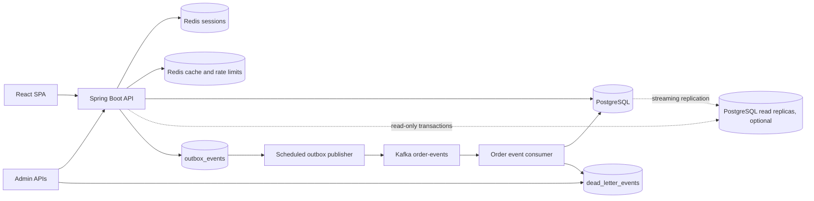
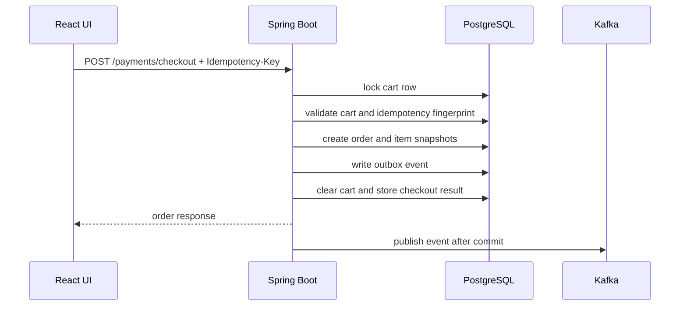

# Luc1fer's Food Bank

<p align="center">
  <strong>A production-shaped food ordering platform built around the hardest part of ordering software: making checkout correct.</strong>
</p>

<p align="center">
  
  
  
  
  
  
</p>

<p align="center">
  Browse restaurants, build a cart, simulate payment, track orders, receive notifications, and recover failed async work from admin APIs.
</p>

---

## What Makes It Interesting

Most demo food apps stop at CRUD. This one goes deeper into the failure modes that matter in real ordering systems:

- **Idempotent checkout** with durable request records and conflict detection
- **Cart-level concurrency control** using PostgreSQL row locks
- **Transactional outbox** so order changes and events commit together
- **Kafka-based async processing** with consumer-side deduplication
- **Persistent dead-letter storage and replay** for failed consumers
- **Failed outbox inspection and retry** for operator recovery
- **Redis-backed sessions, cache, and rate limiting**
- **OpenTelemetry tracing from the HTTP request through the outbox to the Kafka consumer**, Prometheus metrics, structured logs, Grafana dashboards and alert rules
- **Kubernetes manifests and a gated release pipeline** (coverage, SpotBugs, CodeQL, Trivy, SBOM, staged deploys); see [docs/operations.md](docs/operations.md)
- **A data tier ready to grow**: monthly-partitioned append-only tables with whole-month retention, Snowflake order
  numbers from leased worker ids, and a reviewed plan for sharding orders by customer ([Data Tier](#data-tier))
- **Focused tests** for checkout rollback, duplicate requests, order state transitions, outbox behavior, and security controls

The theme of the project is simple:

> Keep the critical business transaction correct first. Distribute side effects only after the database commit.

---

## Product Snapshot

| Area | What is included |
| --- | --- |
| Customer experience | Sign up, log in, browse restaurants, search menus, manage cart, checkout, view orders, cancel eligible orders, view notifications |
| Admin operations | Move orders through a guarded state machine, inspect failed outbox events, retry failed publishes, replay dead-lettered events |
| Reliability | Idempotency keys, row locking, transactional outbox, at-least-once event handling, deduplication tables, replay paths |
| Observability | OpenTelemetry traces (`X-Trace-Id` = trace id), structured logs with trace/span ids, Prometheus metrics on a separate management port, Grafana dashboard, alert rules, readiness and liveness probes |
| Local development | Docker Compose for PostgreSQL, Redis, and Kafka; H2 fallback profile; React dev server proxy |

---

## Architecture



### Checkout Flow



---

## Tech Stack

| Layer | Stack |
| --- | --- |
| Frontend | React 19, strict TypeScript, Vite, Vitest + React Testing Library, ESLint (typescript-eslint) + Prettier, browser session cookies |
| Backend | Java 17, Spring Boot 4.1 (Spring Framework 7), Spring MVC, Spring Security 7, Spring Data JDBC, Jackson 3, Gradle |
| Data | PostgreSQL, Flyway migrations, H2 fallback profile |
| Runtime state | Redis for Spring Session, cache, and distributed rate-limit counters |
| Messaging | Kafka, transactional outbox table, consumer deduplication table, dead-letter replay |
| Observability | Spring Boot Actuator, Micrometer, Micrometer Tracing + OpenTelemetry (OTLP), Prometheus, Tempo, Grafana, structured JSON logs |
| Delivery | Multi-stage non-root Docker image, Kubernetes (kustomize), GitHub Actions with JaCoCo, SpotBugs, CodeQL, dependency review, Trivy and SBOM |
| Verification | JUnit 6, Spring Boot tests, Testcontainers 2, GitHub Actions |

---

## Quick Start

### Prerequisites

- Java 17
- Node 24 LTS (22.22.2+ or 26+ also work)
- Docker Desktop or another Docker-compatible runtime

### 1. Start local infrastructure

```sh
(cd backend && docker compose up -d)
```

This starts:

| Service | Local address |
| --- | --- |
| PostgreSQL | `localhost:5433` |
| Redis | `localhost:6379` |
| Kafka | `localhost:9092` |

### 2. Install frontend dependencies

```sh
(cd frontend && npm ci)
```

### 3. Run the backend with demo data

```sh
(cd backend && FLYWAY_LOCATIONS=classpath:db/migration,classpath:db/demo ./gradlew bootRun)
```

Flyway applies the schema from `backend/src/main/resources/db/migration`. The extra `db/demo` location seeds demo restaurants, menus, and the demo account.

### 4. Run the frontend dev server

```sh
(cd frontend && npm start)
```

Open:

- Frontend dev server: [http://localhost:3000](http://localhost:3000)
- Backend / embedded UI: [http://localhost:8080](http://localhost:8080)
- Swagger UI: [http://localhost:8080/swagger-ui/index.html](http://localhost:8080/swagger-ui/index.html)

### Frontend workspaces

After sign-in the UI reads `roles` from `GET /me` and opens one workspace per role. Users with several roles switch
between them with the tabs under the header; guests and logins without a known role get the ordering page.

| Role | Workspace |
| --- | --- |
| `ROLE_USER`, guests | Order food: menus, cart, checkout, orders with their status history (`GET /orders/{id}/history`), notifications. Adding another restaurant's item (`409 CART_RESTAURANT_CONFLICT`) asks whether to clear the cart (`DELETE /cart`) and add it. |
| `ROLE_MERCHANT` | Merchant console: the restaurant's orders (`GET /merchant/orders`, status filter), accept, reject with a reason, mark preparing. |
| `ROLE_RIDER` | Rider console: on-duty switch, the rider's own deliveries, picked up and delivered. |
| `ROLE_ADMIN` | Admin console: list, create, and deactivate merchants (restaurant picked from the catalog) and riders; the manual order-status change and dead-letter replay. |

Switching workspaces keeps the ordering page and the admin console as they were, so a checkout, cancel, or status
change retried after a switch reuses its Idempotency-Key. The merchant and rider consoles poll every 15 seconds while
the tab is visible. A deactivated merchant or rider (the backend answers `403` on `/merchant/**` and `/rider/**`) gets
a notice instead of the raw error, polling stops, and Refresh checks again.

### Demo Account

| Field | Value |
| --- | --- |
| Email | `demo@laifood.com` |
| Password | `demo123` |
| Roles | `ROLE_USER`, `ROLE_ADMIN` |

---

## Lightweight H2 Mode

Use this when you want a smaller backend run without PostgreSQL or Kafka. Redis is still configured as the cache/session backend.

```sh
(cd backend && SPRING_PROFILES_ACTIVE=h2 ./gradlew bootRun)
```

The `h2` profile runs Flyway migrations and includes the demo seed callback by default.

---

## Core API Map

### Customer APIs

| Method | Path | Purpose |
| --- | --- | --- |
| `POST` | `/signup` | Create a customer account |
| `POST` | `/login` | Start a server-side session |
| `POST` | `/logout` | End the session |
| `GET` | `/me` | Read current session user: `roles`, plus the bound `merchant` / `rider` (or `null`) for staff logins |
| `GET` | `/restaurants/menu` | List restaurants with their menus (HTTP-cacheable, see [Catalog Caching](#catalog-caching)) |
| `GET` | `/restaurant/{restaurantId}/menu` | List menu items; `404` for an unknown restaurant (HTTP-cacheable) |
| `GET` | `/cart` | Read current cart |
| `POST` | `/cart` | Add menu item to cart |
| `PUT` | `/cart/items/{orderItemId}` | Update quantity |
| `DELETE` | `/cart/items/{orderItemId}` | Remove item |
| `DELETE` | `/cart` | Empty the cart (`204`, also when it is already empty or the account has no cart), for example after `409 CART_RESTAURANT_CONFLICT` |
| `POST` | `/cart/checkout` | Checkout cart with idempotency key |
| `POST` | `/payments/checkout` | Payment-style checkout with idempotency key |
| `GET` | `/orders` | List current user's orders; each carries `id` (the key the order paths take) and `order_no` (the public order number, a JSON string) |
| `POST` | `/orders/{orderId}/cancel` | Cancel an eligible order |
| `GET` | `/orders/{orderId}/history` | The order's status changes, oldest first (owner or admin; `404` for anyone else) |
| `GET` | `/notifications` | List order notifications |

### Admin and Recovery APIs

| Method | Path | Purpose |
| --- | --- | --- |
| `PATCH` | `/orders/{orderId}/status` | Move order through the status state machine |
| `GET` | `/admin/outbox/events/failed?limit=50` | Inspect failed outbox events |
| `POST` | `/admin/outbox/events/{eventId}/retry` | Reset failed outbox event to `PENDING` |
| `POST` | `/admin/outbox/events/{eventId}/abandon` | Give up on a failed event that can never be published (`{"reason": ...}`, audited), releasing the later events of its aggregate |
| `PATCH` | `/admin/menu-items/{menuItemId}` | Update a menu item's `name`, `description` or `price`; evicts that restaurant's cached menu after commit |
| `PATCH` | `/admin/restaurants/{restaurantId}` | Update a restaurant's `name`, `address`, `phone` or `image_url`; evicts the cached restaurant list after commit |
| `POST` | `/dead-letters/{deadLetterEventId}/replay` | Replay a stored dead-letter event |
| `GET`, `POST` | `/admin/merchants`, `/admin/riders` | List or provision merchant and rider logins (see [Provisioning merchants and riders](#provisioning-merchants-and-riders)) |
| `PATCH` | `/admin/merchants/{merchantId}`, `/admin/riders/{riderId}` | Activate or deactivate a merchant or rider, body `{"active": false}` |
| `GET` | `/admin/audit-log?limit=50&before_id=` | Audit log of the admin actions above and of the riders' own changes (see [Order State](#order-state)), newest first; pass the last entry's `id` as `before_id` for the next page |

### Operational APIs

| Method | Path | Purpose |
| --- | --- | --- |
| `GET` | `/actuator/health` | Aggregate health |
| `GET` | `/actuator/health/liveness` | Liveness probe |
| `GET` | `/actuator/health/readiness` | Readiness probe |
| `GET` | `/actuator/metrics` | Metric discovery |
| `GET` | `/actuator/prometheus` | Prometheus scrape endpoint |
| `GET` | `/v3/api-docs` | OpenAPI JSON |
| `GET` | `/swagger-ui/index.html` | Swagger UI |

With `MANAGEMENT_SERVER_PORT=8081` (set on Kubernetes and in the observability stack) the `/actuator` endpoints move
to that in-cluster port and need no session there; without it they stay on the application port and everything but
health and info requires `ROLE_ADMIN`. See [docs/operations.md](docs/operations.md).

API errors use a consistent JSON shape and include the OpenTelemetry trace id, which is also returned in the
`X-Trace-Id` header (send a W3C `traceparent` header to join an existing trace):

```json
{
  "code": "VALIDATION_FAILED",
  "message": "Request validation failed",
  "trace_id": "4bf92f3577b34da6a3ce929d0e0e4736",
  "status": 400,
  "path": "/signup",
  "timestamp": "2026-05-07T05:00:00Z"
}
```

---

## Correctness Model

### Checkout

- Checkout requires an `Idempotency-Key` header.
- The backend stores one durable idempotency record per customer, checkout scope, and key.
- Repeating the same logical request returns the stored order result.
- Reusing the same key with a different request fingerprint returns a conflict.
- Checkout locks the cart row, creates the order, snapshots order items, writes the outbox event, clears the cart, and stores the idempotency result in one database transaction.
- If the transaction fails before commit, all checkout writes roll back together.

### Money and currency

- **One type for arithmetic.** Cart, checkout and payment code compute with `Money`
  (`backend/src/main/java/.../money`): a `BigDecimal` amount at scale 2 plus an ISO 4217 `Currency`. Sums and
  multiples by a quantity are exact; where rounding is needed (a rate) it is `HALF_EVEN` to the currency's minor unit,
  so rounding many amounts has no upward bias. `Money.of` never rounds silently: 1.005 USD or 500.50 JPY is an error.
  Adding amounts of two currencies throws `CurrencyMismatchException`. Nothing on the money path uses `double` or
  `float` (the cart total used to be summed through `CAST(... AS DOUBLE PRECISION)`; it is now the `Money` sum of the
  lines).
- **Storage (V11).** Every amount is `NUMERIC(12,2)` with a non-negative check (largest 9,999,999,999.99) and has a
  `currency CHAR(3)` next to it, checked to be three upper-case letters: `restaurants`, `menu_items`, `carts`,
  `order_items`, `orders`, `order_history_items`, `merchant_orders`. The supported currencies are the rows of the
  `currencies` table (code and ISO 4217 minor units: USD, EUR, GBP and 20 more with 2, JPY and KRW with 0; never BHD,
  KWD or XXX, which `Money` rejects), and `restaurants.currency` references it; a JPY or KRW menu price must be whole.
  So the database holds no amount or currency that `Money` would refuse. Existing rows became USD; V11 stops, naming
  the rows, rather than round an existing amount with sub-cent digits (`docs/operations.md` section 10, which also has
  the rollout: no pods of the previous release next to it).
- **One currency per restaurant, cart and order.** A restaurant prices its menu in one currency, and composite keys
  make the database enforce the rest: a menu item has its restaurant's currency, a cart line its menu item's and its
  cart's. A cart is single-restaurant, so it is single-currency; an empty cart takes the currency of the next item
  added (and keeps its last currency while empty). Checkout copies the cart's currency onto the order and its items.
- **API.** Every amount keeps its name and JSON number and gets a sibling `currency`: `price` + `currency` on menu
  items, cart lines and order items, `total_price` + `currency` on carts, orders and merchant orders, plus the
  restaurant's `currency`. `PATCH /admin/menu-items/{id}` takes a `price` in the restaurant's currency only (an
  optional `currency` must match it, `400 CURRENCY_MISMATCH`; a JPY price with cents is `400 INVALID_AMOUNT`). A cart
  whose total would exceed the column is refused with `400 CART_TOTAL_TOO_LARGE`.
- **Events.** Order events carry the order's currency once, as `data.currency`; their line items carry none. A
  consumer reads an event without one (published before V11) as USD.
- **Frontend.** The DTO decoders validate every `currency` (`fieldsOf().currency`, a branded `CurrencyCode`; a
  response without one is USD), `formatMoney` in `src/lib/format.ts` is the only formatter (`Intl.NumberFormat`,
  `en-US`, the currency's own decimals: $12.78, €0.50, ¥950), and `lineTotal` multiplies a price by a quantity in
  integer hundredths.

### Order State

Allowed transitions:

```text
PLACED -> PAID / CANCELLED
PAID -> ACCEPTED / CANCELLED
ACCEPTED -> PREPARING / CANCELLED
PREPARING -> COMPLETED
COMPLETED and CANCELLED are terminal
```

Status changes and their outbox events commit together. Invalid transitions fail without side effects.

Every status change, including the creation at checkout, also writes one `order_status_history` row and moves
`orders.updated_at`, in the same transaction and through the same guarded transition (`OrderService`, the
`OrderLifecycleCommands` seam for the fulfilment modules). A row records `from_status` (null for the creation),
`to_status`, who did it (`actor_type` `CUSTOMER`, `ADMIN`, `MERCHANT`, `RIDER` or `SYSTEM` for timeouts, and
`actor_id`), the cancel `reason` and the request's trace id. `actor_id` depends on `actor_type`: the `customers.id`
of the login for `CUSTOMER`, `ADMIN` and `MERCHANT`, the `riders.id` for `RIDER` (the order module learns the rider
only from the `delivery.delivered` event), null for `SYSTEM`. A delivered order completed from `ACCEPTED` records both
steps for the rider, also when an admin marked the delivery delivered through `/admin/deliveries` (the audit log
records that admin). Same-status no-ops and idempotent retries write nothing. `GET /orders/{orderId}/history` serves
it; orders placed before V7_1 start with one `SYSTEM`/`backfill` row.

Admin actions (status changes, outbox retries, dead-letter replays, catalog edits, merchant and rider provisioning
and activation, delivery reassignment, the simulated rider actions) and the riders' own changes (going on or off duty,
picking up and delivering through `/rider/**`) are also written to `audit_log` by `AuditLogService.record` in the
action's transaction: the login (`actor_customer_id`, the customer id of the admin's or the rider's login), the role
(`ROLE_ADMIN`, `ROLE_RIDER`), the action, its target, a JSON `details` object and the trace id. The actions are
`order.status.update`, `outbox_event.retry`, `dead_letter.replay`, `menu_item.update`, `restaurant.update`,
`merchant.create`, `merchant.update`, `rider.create`, `rider.update`, `rider.availability`, `delivery.picked_up`,
`delivery.delivered` and `delivery.reassign` (`AuditActions`); staff entries carry the login's customer id and email,
never a password. Refused actions add no entry, and neither do a retry of `PATCH /orders/{id}/status` with the same
`Idempotency-Key` or a repeated action that changes nothing (the same flag again, a delivery move that already
happened). Every dead-letter replay request that is not refused is recorded with its outcome (`REPLAYED`,
`REPLAY_FAILED`, or `ALREADY_REPLAYED` when the event had been replayed before and nothing was sent). All keys are
64-bit (`BIGINT`) since V7; see [docs/operations.md](docs/operations.md) section 7 for the rollout of these
migrations, which must not run next to pods of an older version.

### Outbox and Kafka

- Order events are inserted into `outbox_events` inside the same transaction as the order change, after the event was
  checked against its published schema ("Event contracts" below).
- Each event gets the next sequence of its aggregate (`aggregate_sequence`, the envelope's `sequence`: 1, 2, 3, ... per
  order, delivery or merchant order, in commit order).
- A scheduled publisher claims `PENDING` or stale `PROCESSING` rows with `FOR UPDATE SKIP LOCKED`, but only the head
  of each aggregate: an event waits while an earlier event of its aggregate is `PENDING`, `PROCESSING` or `FAILED`. So
  an aggregate's events reach Kafka in sequence order, one acknowledgement after the other, across publisher instances.
- Successful publish marks the row `PUBLISHED`.
- Retryable failures return to `PENDING` until `app.outbox.max-attempts`.
- Max-attempt failures become `FAILED` and require admin retry after the root cause is fixed; until then the later
  events of the same aggregate wait (`onlineorder_outbox_blocked_aggregates`, alert `OnlineOrderOutboxAggregatesBlocked`).
  An event that can never be published is abandoned instead (`ABANDONED`, audited): its consumers never receive it and
  the later events go out ([docs/operations.md](docs/operations.md) section 8).
- After publishing a head the publisher claims again in the same run when its aggregate has a next event waiting, so a
  backlog of k events of one order goes out in one run rather than one per publish interval.
- Consumers use `processed_events` to deduplicate at-least-once Kafka delivery, and the consumers that keep
  per-aggregate state skip events older than the last one they applied ("Out-of-order events"). On PostgreSQL the
  table is partitioned by month, so no unique constraint spans it; the mark is serialized per key with an advisory
  lock and checked across all partitions (see [Data Tier](#data-tier)).
- Notification creation also has a database uniqueness safety net.

### Event contracts

Every event on `order-events`, `delivery-events` and `merchant-events` has a published, versioned JSON Schema (draft
2020-12) under `backend/src/main/resources/event-schemas/`:

```text
event-schemas/
|-- catalog.json                       every event type: its topic and schema versions (INITIAL, BACKWARD, BREAKING)
|-- SHA256SUMS                         checksum of every published schema file
|-- common/envelope/v1.json            event_id, event_version, event_type, aggregate_type, aggregate_id, sequence,
|                                      occurred_at, correlation_id, idempotency_key, data
|-- common/order-data/v1.json          order event data; money amounts with an optional ISO 4217 currency next to them
|-- common/delivery-data/v1.json       delivery event data
|-- order-events/<event_type>/v1.json      order.created ... order.cancelled (data.status fixed per type)
|-- delivery-events/<event_type>/v1.json   delivery.assigned ... delivery.reassigned
`-- merchant-events/merchant.order_received/v1.json
```

The JSON is snake_case with nulls omitted (the application ObjectMapper). `event_version` names the schema version of
the event's type the producer wrote; the payload records (`messaging.OrderEventPayload`, `OrderEventItem`,
`DeliveryEventPayload`, `MerchantEventPayload`) belong to the contract and no longer reuse REST DTOs. V1 is the shape
the events already had plus two optional fields: `sequence` (absent on events written before V9) and `currency` on the
order total and on each item price (absent until orders carry a currency).

**Validation.** `EventContracts` (networknt json-schema-validator 3.x, the line built on Jackson 3, so events are
checked as `tools.jackson` trees without a second JSON library; schemas refer to each other by `$id` under
`https://onlineorder.example/event-schemas/`, mapped to the classpath, so nothing is fetched over the network):

- Producer: `OrderEventOutboxService.enqueueEvent` serializes the envelope with its sequence and checks it against the
  exact published version it declares, in the producing transaction. An invalid event, an unpublished type or version,
  or a type sent to the wrong topic is a bug: `EventSchemaViolationException` rolls the transaction back (the request
  fails), the violations are logged as an error and `onlineorder_events_schema_violations_total{side="producer"}`
  counts it.
- Consumer: every listener reads its record through `EventContracts.read`. A record that is not JSON or breaks its
  schema throws `EventSchemaViolationException`, which the listener error handler classifies as not retryable: it goes
  to the DLT on the first attempt, with the violations in `dead_letter_events.error_message`
  (`side="consumer"`). A version newer than the instance knows is checked against the latest version it knows (schemas
  are open, so a compatible addition passes); an unknown event type only against the envelope, and the consumer skips
  it as before.

**Evolution rules** (checked by `EventSchemaContractTests` in the backend CI job, and by the "Published event schemas
are append-only" step of `config-lint` on pull requests):

- A published schema file never changes and is never deleted: `SHA256SUMS` lists its checksum. Change a contract by
  adding the next version file, `v<N+1>.json`, with its line in `SHA256SUMS` and its entry in `catalog.json`.
- `BACKWARD` versions only add optional properties. The test keeps sample events of every version under
  `backend/src/test/resources/event-samples/<topic>/<event_type>/v<N>/` and checks a `BACKWARD` version both ways
  against the versions before it (back to the last `BREAKING` one): it must accept their samples (new consumers read
  old events), and they must accept its samples, because a consumer that does not know the new version yet checks its
  events against the latest version it knows. That is what lets producers move to a `BACKWARD` version before every
  consumer knows it.
- Anything else (a removed, renamed or newly required property, a changed type or meaning, and also a relaxed
  constraint such as a lower minimum or a wider enum, which older consumers would reject) is `BREAKING`, a new major
  version: consumers must accept N and N-1, so ship consumers that handle N first, then switch the producer, and keep
  N-1 in the catalog (the test enforces it) until no N-1 event can still arrive. Retiring a version means removing it
  from `catalog.json` once no event of it can be in flight (outbox retention, stored dead letters); its file stays.

**Adding or evolving an event:** write the schema file (`$schema` draft 2020-12, `$id` under the base IRI, `$ref` to
the envelope), list it in `catalog.json`, add its checksum (`shasum -a 256 <file>` in `event-schemas/`; the test
prints the line to add), add sample events, give the producer the version constant, and send the event through
`OrderEventOutboxService.enqueueEvent(topic, key, envelope)`. Roll a new version out in the order the rules above
give. [docs/operations.md](docs/operations.md) section 8 shows how to mirror the schemas into a schema registry
(Confluent, Apicurio) without making the application depend on one.

### Catalog Caching

The public catalog reads (`GET /restaurants/menu`, `GET /restaurant/{restaurantId}/menu`) go through a two-level cache (`backend/src/main/java/.../cache`):

| Level | Store | Lifetime | Scope |
| --- | --- | --- | --- |
| L1 | Caffeine, bounded, `recordStats` | `app.cache.l1.ttl` (30s) | one instance |
| L2 | Redis, typed JSON | `spring.cache.redis.time-to-live` (10m) +/- `app.cache.l2.ttl-jitter` (15%) | all instances |

- **Granular keys.** `restaurants::all` holds the restaurant list (basic fields) and `menu::<restaurantId>` holds one menu. `GET /restaurants/menu` is composed from them, with the same JSON shape as before. Redis keys are `onlineorder:cache:<version>:<cache>::<key>`, for example `onlineorder:cache:v1:menu::3`.
- **Typed serialization.** Each cache has its own Jackson serializer bound to `CatalogRestaurantDto` or `CatalogMenuItemDto`: no default typing and no `@class` in Redis. When a cached DTO changes shape, bump its version in `CatalogCaches`; old and new code then use different keys during a rolling deploy, and an entry that cannot be read (including one with unknown fields) is treated as a miss. The cache mapper keeps declaration order and strict reads on Jackson 3, so its JSON is byte for byte what the Spring Boot 3 (Jackson 2) instances wrote (`CatalogCacheSerializationTests`).
- **Stampede, avalanche, penetration.** Cached methods use `@Cacheable(sync = true)`, and the L1 loads each key once per instance while concurrent callers wait (single flight). Redis TTLs are jittered so entries loaded together do not expire together. A menu request is first checked against the cached restaurant list. An id the list does not know gets one primary-key lookup in the database, at most once per `app.catalog.unknown-restaurant-recheck-interval` (1s) per instance: a restaurant inserted outside the admin API (SQL, a seed run) is served right away and the stale list is evicted, while a flood of random ids costs one lookup per second. Every other unknown id gets `404` from the cache, and nothing is cached for it.
- **Invalidation.** Admin writes update the database and delete the affected entries only after the transaction commits (`TransactionSynchronization#afterCommit`); a rollback deletes nothing. Deletion order is Redis, then the local L1, then a Redis pub/sub message (`onlineorder:cache:invalidation`) that makes the other instances drop their L1 copy. Instances clear their L1 whenever the subscription is (re)established, since messages sent while disconnected are lost; the L1 TTL bounds anything else that is missed.
- **Why cache-aside with delete-after-commit, not write-through.** Writing the new value into the cache from the write path means rebuilding the cached view (a whole menu) in the transaction, and two concurrent writers can store their snapshots out of order so the older one wins until the TTL. Deleting lets the next read rebuild from committed data. Deleting before the commit would let a reader cache the old row again. The remaining race is a reader that loaded the old row just before the commit and stores it just after the delete; a delayed double delete (`app.cache.delayed-double-delete`, 1s, `0` disables) removes that entry.
- **Redis failures.** A failed Redis read is a miss and a failed write, delete or publish is skipped; each is logged and counted in `onlineorder.cache.errors`, and requests are served from the database and L1. Startup does not need Redis: the invalidation subscription is retried in the background.
- **Hung or slow Redis.** A Redis that hangs instead of refusing connections makes every call wait for the 500ms command timeout (`spring.data.redis.timeout`). Without protection, every L1 miss would pay it twice (read and write-back), so a cold `GET /restaurants/menu`, composed of N+1 entries, would wait about (N+1) x 1s. A circuit breaker shared by the caches (`RemoteCacheCircuitBreaker`) therefore makes reads and write-backs skip Redis for `app.cache.l2.circuit-breaker.open-duration` (5s) after any Redis error, or after 3 consecutive calls slower than `slow-call-threshold` (200ms). Then one request probes Redis while the others keep skipping it, and a successful probe closes the breaker. An entry that cannot be deserialized does not count, since Redis answered. Deletes and invalidation broadcasts always go to Redis, because they keep it consistent with the database. A loaded value is written back after the single-flight section, so callers waiting for the same key are not held for the Redis write. `CatalogRedisHangIntegrationTests` pauses its Redis container and holds cold catalog reads of 43 restaurants to a 2.5s budget. Measured numbers are below the read benchmark: 0.53s instead of 44.6s.
- **What an outage still breaks.** Sessions also live in Redis, so during an outage authenticated requests (cart, checkout, admin catalog writes) fail in the session filter. Anonymous catalog reads (no session cookie) never touch the session store, with read replicas on as well.
- **HTTP caching.** Both endpoints send `Cache-Control: max-age=30, public` (`app.catalog.http-max-age`) and a strong `ETag` (SHA-256 of the JSON body), and answer a matching `If-None-Match` with `304`. Only these responses override Spring Security's `no-store`; CSP and the other security headers are unchanged.
- **Staleness budget after an admin write.** The writing instance serves the new data once the request returns (the rare reader race above lasts until the delayed second delete). Other instances drop their L1 copy when the pub/sub message arrives, or after the L1 TTL if it is lost. Browsers and shared caches may reuse a response for up to `max-age`.
- **Prices and checkout.** The cache only serves the catalog. Adding to the cart reads the menu item from the database and snapshots its price on the cart line (adding the same item again re-snapshots it), and checkout charges the cart-line snapshots. A price change therefore never reprices existing cart lines, and a client showing a cached menu for up to `max-age` still gets the current price when it adds the item.
- **Metrics.** Micrometer's cache meters with a `level` tag:
  - `cache.gets{level="l1", result="hit"|"miss"}`, plus `cache.puts`, `cache.evictions` and `cache.size` for L1.
  - `cache.gets{level="l2", result="hit"|"miss"|"error"|"skipped"}`: `error` is a Redis read that failed or timed out, and `skipped` is one not attempted because the breaker is open. A non-zero `skipped` rate means Redis is being bypassed.
  - `cache.load{level="l2", result="success"|"failure"}`: values loaded from the database because neither level had them. This is the database load. During an outage every L1 miss is an L2 `error` or `skipped` followed by a load, so the L2 miss count alone would look healthy.
  - `cache.puts{level="l2"}`, `cache.evictions{level="l2"}`, `onlineorder.cache.invalidations.received` and `onlineorder.cache.errors`.

  Overall hit ratio (reads that did not reach the database): `1 - sum(rate(cache_load_total{level="l2"}[5m])) / sum(rate(cache_gets_total{level="l1"}[5m]))`.

Read benchmark with `load-tests/catalog-read.js`: 50 VUs for 30s in a closed loop, half `GET /restaurants/menu` and half `GET /restaurant/{id}/menu`, on the demo data. PostgreSQL 16 and Redis 7.4 run in their own compose project, `load-tests/catalog-bench.compose.yml` (ports 45433 and 46379, nothing persisted); the backend runs from a boot jar on port 18080 with Kafka and rate limiting off. k6, the JVM and Docker Desktop shared one laptop with other builds running (load average 7 to 23), so compare the rows rather than reading the numbers as capacity. Each cell shows two alternating rounds.

| Build | Throughput | p95 | p99 |
| --- | --- | --- | --- |
| Before (`master`): one Redis key for the whole catalog, menu endpoint uncached | 16.1k / 18.0k req/s | 5.52 / 4.40 ms | 9.17 / 7.47 ms |
| After: two-level cache | 52.5k / 55.6k req/s | 1.71 / 1.51 ms | 2.78 / 2.35 ms |
| After, with `If-None-Match` (every response a `304`) | 59.6k / 64.4k req/s | 1.38 / 1.26 ms | 2.14 / 2.01 ms |

In the second "after" round, L1 answered 5.0M cache reads with 8 misses, and only 4 reads reached PostgreSQL (`cache_load_total{level="l2"}`). The usage lines at the top of the compose file show how to repeat it; add `CONDITIONAL=true` to the k6 run for the `304` case.

Hung Redis, same setup with 40 extra restaurants (43 in all): `docker pause` on the Redis container and wait out the 30s L1 TTL before each cold request. "Next request" is sent right after the cold one.

| Build | Cold `GET /restaurants/menu` | Next request | Cold `GET /restaurant/1/menu` |
| --- | --- | --- | --- |
| `master` (no L1, menu endpoint uncached) | 1.04s | 1.03s | 0.02s |
| Two-level cache without the circuit breaker | 44.6s | 44.6s (L1 never warms) | 2.03s |
| Two-level cache with the circuit breaker | 0.53s (3 concurrent: 0.54s each) | 0.003s (L1 hit) | 0.52s |

With the breaker, a cold request pays one 500ms command timeout per open period (the first Redis read times out and opens the breaker), then loads from PostgreSQL. `master` paid none on the menu endpoint because that endpoint was uncached.

### Read Replicas

Optional read/write splitting onto PostgreSQL streaming replicas, off unless `DATABASE_REPLICA_URLS` is set (details,
settings and failure modes: [docs/operations.md](docs/operations.md), section 8):

- **Opt-in per service method.** Only read-only transactions declared by the application (`@Transactional(readOnly =
  true)` or `ReadOnlyTransactions`) read a replica: catalog loads behind the cache, order and notification lists, the
  merchant inbox, the rider's deliveries and the admin lists. Writes, locks, idempotency checks, outbox claims,
  consumers, Flyway, login and Spring Data's implicit CRUD transactions stay on the primary. The routing decision waits
  for the first statement (`LazyConnectionDataSourceProxy`), when Spring has marked the transaction read-only.
- **Read-your-writes.** After a session commits a write, its reads use the primary for `sticky-window` (5s); the
  timestamp lives in the Redis-backed HTTP session, so it holds on every instance. A request keeps the replica its
  first read used (or the primary, once it had to read it), and a session picks its replica by its cookie, so reads do
  not go backwards within a request, nor across a session's requests while its replica stays routable.
- **Lag guard.** A monitor compares each replica's replayed WAL position with the primary's twice a second, on a thread
  per replica. Routability is a deadline checked on every read: a replica gets reads only while its data is less than
  `max-lag` (2s) old, so a replica whose replay stalls drops out at that deadline however slow the monitor is; an
  unreachable, hung or promoted one drops out at its next check. Its reads fall back to the primary until it recovers.
  Gauges and alerts for lag and routability, and a counter of reads per pool and reason.
- **Merchant and rider authorization stays fresh.** Their active check reads the primary before the replica read, so a
  deactivation still takes effect on the next request.

### Security and Abuse Controls

- Authentication uses server-side sessions backed by Redis, under a namespace that carries the session format version (`onlineorder:session:v2`), so pods of two releases never read each other's sessions during a rolling update or rollback.
- Customer accounts track status, failed login count, lockout time, last login, and audit timestamps.
- Login lookup is case-insensitive.
- Anonymous routes are rate-limited by remote IP.
- Authenticated checkout and admin routes (including merchant and rider provisioning) are rate-limited by user identity.
- Roles: `ROLE_USER` (customers), `ROLE_ADMIN`, `ROLE_MERCHANT` (`/merchant/**`, own restaurant only) and `ROLE_RIDER` (`/rider/**`, own deliveries only). Merchant and rider requests re-check the account's active flag, so a deactivation applies to existing sessions on their next request.
- Redis rate-limit store failures fail open and emit metrics instead of blocking core flows.

---

## Order Fulfilment (event-driven)

After payment, the order lifecycle is driven by Kafka. Separate modules inside the same Spring Boot app (a modular
monolith under `com.laioffer.onlineorder.fulfilment`) consume the events, each with its own consumer group and its
own tables:

| Module | Package | Owns | Reacts to |
| --- | --- | --- | --- |
| Order | `fulfilment.order` (+ `service.OrderService`) | `orders`, the order state machine | `delivery.delivered` |
| Merchant | `fulfilment.merchant` | `merchant_accounts`, `merchant_orders` (inbox) | `order.paid` and later order events |
| Timeout | `fulfilment.timeout` | `order_deadlines` | `order.created`, `order.paid`, later order events, `merchant.order_received` |
| Dispatch | `fulfilment.dispatch` | `riders` (rider logins, on duty), `deliveries`, `dispatch_orders` | `order.accepted`, `order.cancelled` |
| Notifications | `service.OrderNotificationService`, `fulfilment.notification` | `order_notifications` | order events, delivery events |

Every order now belongs to one restaurant: a cart only holds items of one restaurant (adding another restaurant's item
returns `409 CART_RESTAURANT_CONFLICT`) and checkout records `orders.restaurant_id`. Orders placed before this change
have no restaurant and stay on the admin-driven flow (`PATCH /orders/{id}/status`); the fulfilment modules ignore
their events.

> **The merchant accept timeout only applies to staffed restaurants.** It is on by default
> (`FULFILMENT_ACCEPT_TIMEOUT_ENABLED=true`) and cancels a paid order that no merchant accepts within `accept-timeout`
> (`MERCHANT_TIMEOUT`), but only when the order's restaurant had at least one **active** merchant account when the
> merchant inbox received the order. The merchant module decides that from its own `merchant_accounts` and announces
> it as `merchant.order_received`; the timeout module sets the `ACCEPT` deadline only from that event and never reads
> merchant tables. The deadline runs from when the inbox received the order (the event time of
> `merchant.order_received`), not from the payment, so an inbox that lagged behind `order.paid` (a backlog, a replayed
> dead letter) still gives the merchant the whole window instead of a deadline that is already due. A restaurant
> without staff (none provisioned, or all deactivated before the order arrived) therefore
> never gets its paid orders auto-cancelled: they stay `PAID` in its inbox until a merchant or an admin moves them, and
> `onlineorder.fulfilment.merchant.orders_received{staffing="unstaffed"}` counts them. A deadline set while the
> restaurant was staffed still fires if its merchant is deactivated afterwards. The payment timeout for unpaid `PLACED`
> orders runs as before. A paid order (`PAID` or `ACCEPTED`) that is cancelled, by anyone, gets an automatic refund:
> the cancel opens an `ORDER_CANCELLED` after-sales case and its refund of the order total in the same transaction
> (ADR 0002 D12), and the cancellation notice after a reject or an accept timeout says the payment will be refunded. An
> order without a captured payment (marked `PAID` by an admin, or paid before payments were recorded) or with a total
> of 0.00 gets none; for the former that notice still asks the customer to contact support.

### Event flow

```text
POST /payments/checkout            order PAID ---------------------- order.paid
                                                                        |-> merchant: inbox row (PAID); if the restaurant has an
                                                                        |      active merchant -> merchant.order_received
                                                                        |      `-> timeout: ACCEPT deadline = received_at + accept-timeout
                                                                        |-> timeout: PAYMENT deadline dropped
                                                                        `-> notifications: "Payment confirmed"
POST /merchant/orders/{id}/accept  order ACCEPTED ------------------ order.accepted
                                                                        |-> dispatch: least-loaded rider, delivery ASSIGNED
                                                                        |      `-> delivery.assigned -> notifications: "Rider assigned"
                                                                        |-> timeout: deadline dropped
                                                                        `-> merchant inbox, notifications
POST /merchant/orders/{id}/preparing  order PREPARING -------------- order.preparing
POST /rider/deliveries/{id}/picked-up delivery PICKED_UP ----------- delivery.picked_up -> notifications: "Order on the way"
POST /rider/deliveries/{id}/delivered delivery DELIVERED ----------- delivery.delivered
                                                                        |-> order: PREPARING -> COMPLETED ---- order.completed
                                                                        `-> notifications: "Order delivered"

no accept within accept-timeout   deadline poller: PAID -> CANCELLED (MERCHANT_TIMEOUT) -- order.cancelled
  (staffed restaurants only)
POST /merchant/orders/{id}/reject PAID -> CANCELLED (MERCHANT_REJECTED: <reason>) ------- order.cancelled
unpaid PLACED order               order.created -> PAYMENT deadline -> CANCELLED (PAYMENT_TIMEOUT)
customer cancels an ACCEPTED order order.cancelled -> dispatch cancels the delivery and releases the rider
```

Modules never read or write each other's tables or call each other's services; facts travel as events. The one
synchronous seam is the order module's command API, `OrderLifecycleCommands`: merchant commands and timeouts call it
so that the order row lock, the guarded transition and the outbox write happen in the caller's transaction. A merchant
accept and a timeout cancel therefore race on the same row lock and exactly one wins (the timeout only cancels an order
that is still `PAID`; a late accept gets `409 ORDER_STATUS_CONFLICT`). This is a deliberate exception to "events only":
the merchant's accept must answer with the order's real status, so it cannot be a fire-and-forget event. The merchant
controller resolves the login to a customer id like every other controller; the merchant module itself only reads its
own tables.

If the merchant never marked the order `PREPARING`, `delivery.delivered` moves it `ACCEPTED -> PREPARING -> COMPLETED`
in one transaction, emitting both events: delivered food was prepared, and both steps are guarded transitions. A
delivery event for a cancelled order is logged and ignored.

### Topics and consumer groups

| Topic | Published by | Consumer groups |
| --- | --- | --- |
| `order-events` (key: order id) | order module, via the outbox | `onlineorder` (notifications), `onlineorder-merchant`, `onlineorder-timeout`, `onlineorder-dispatch` |
| `delivery-events` (key: order id) | dispatch, via the outbox | `onlineorder-order-delivery`, `onlineorder-notification-delivery` |
| `merchant-events` (key: order id) | merchant, via the outbox | `onlineorder-timeout-merchant` |
| `order-events.dlt` | the listener error handler | `onlineorder-dlt` |

All events go through the transactional outbox (`OrderEventOutboxService.enqueueEvent` stores any aggregate type and
topic). Every new consumer uses the shared `orderEventKafkaListenerContainerFactory` (retries, then the DLT; a replay
goes back to the source topic and reaches every group there, which is safe because every consumer is idempotent:
a `processed_events` mark in the same transaction as its writes, plus unique keys such as `merchant_orders.order_id`,
`order_deadlines (order_id, deadline_type)` and `deliveries.order_id`). New consumer groups start from the earliest
offset, like the existing one.

### Out-of-order events (dead letters replayed late)

`processed_events` drops exact duplicates. The outbox publishes an aggregate's events in sequence order, but a dead
letter replayed after later events of the same order were applied still reaches a group out of order. The consumers
that keep per-aggregate state (merchant inbox, dispatch, timeout) therefore record the last sequence they applied per
order (`consumer_aggregate_sequences`, through `EventSequenceTracker`) and skip an event whose sequence is not above it
(`onlineorder_events_stale_skipped_total`). Only event types a consumer applies move its position: dispatch ignores
`order.preparing`, so an `order.accepted` dead-lettered for want of a rider and replayed after it still gets one.
Events without a sequence (written before V9) and positions older than the processed-events retention fall back on the
rules below, which still hold for every module when the order of two events flips:

- **Merchant inbox:** an order event that finds no inbox row creates it with the status it reports (`order.cancelled`
  leaves a cancelled tombstone) and no `paid_at`. The merchant only sees rows with a `paid_at`; the late `order.paid`
  then only sets it (also when it is stale by sequence: the payment time is a fact no later event carries). A replayed
  `order.paid` therefore shows the order as `CANCELLED` (or `ACCEPTED`, ...) instead of a stale `PAID` row that no
  merchant command could resolve. An order cancelled before it was ever paid keeps such a hidden row.
- **Dispatch:** `order.accepted` and `order.cancelled` both create and lock the order's `dispatch_orders` row before
  they touch deliveries, so they serialize per order even on different consumers. `order.cancelled` sets
  `cancelled_at` there even when no delivery exists yet, and an `order.accepted` handled afterwards (for example one
  dead-lettered because no rider was active, replayed after the customer cancelled) assigns no rider.
- **Timeout:** a late `order.created` with a sequence is skipped once a later order event was applied. A deadline
  written by a late event without one, or by a late `merchant.order_received`, fires as a no-op: the poller only
  cancels an order that is still in the status the deadline waits in. `merchant.order_received` and the later
  order events travel on different topics, so this also covers an order accepted before its announcement arrived.
- **Order completion:** a `delivery.delivered` for a cancelled order is ignored.

### Fulfilment APIs

| Method | Path | Role | Purpose |
| --- | --- | --- | --- |
| `GET` | `/merchant/orders?status=PAID&limit=50` | `MERCHANT` | The merchant's inbox (own restaurant only) |
| `POST` | `/merchant/orders/{orderId}/accept` | `MERCHANT` | `PAID -> ACCEPTED` |
| `POST` | `/merchant/orders/{orderId}/reject` | `MERCHANT` | `PAID -> CANCELLED`, body `{"reason": "..."}` (required) |
| `POST` | `/merchant/orders/{orderId}/preparing` | `MERCHANT` | `ACCEPTED -> PREPARING` |
| `GET` | `/rider/me` | `RIDER` | The rider's profile: `rider_id`, `name`, `phone`, `active`, `on_duty`, `active_deliveries` |
| `PUT` | `/rider/me/availability` | `RIDER` | Go on or off duty, body `{"on_duty": true}`; off duty only stops new assignments |
| `GET` | `/rider/deliveries?status=ASSIGNED,PICKED_UP` | `RIDER` | The rider's own deliveries (default: the open ones, `ASSIGNED` and `PICKED_UP`) with `restaurant_name` |
| `POST` | `/rider/deliveries/{deliveryId}/picked-up` | `RIDER` | `ASSIGNED -> PICKED_UP` (own deliveries only) |
| `POST` | `/rider/deliveries/{deliveryId}/delivered` | `RIDER` | `PICKED_UP -> DELIVERED` (own deliveries only) |
| `GET` | `/admin/deliveries?order_id=&rider_id=` | `ADMIN` | Deliveries: one order's, one rider's open ones (`ASSIGNED`, `PICKED_UP`), or the 50 most recent |
| `POST` | `/admin/deliveries/{deliveryId}/picked-up` | `ADMIN` | Ops and tests: any delivery `ASSIGNED -> PICKED_UP` (audited as `delivery.picked_up`) |
| `POST` | `/admin/deliveries/{deliveryId}/delivered` | `ADMIN` | Ops and tests: any delivery `PICKED_UP -> DELIVERED` (completes the order; audited as `delivery.delivered`) |
| `POST` | `/admin/deliveries/{deliveryId}/reassign` | `ADMIN` | Move an open delivery to another rider, body `{"rider_id": 7}` (see below; audited as `delivery.reassign`) |

Merchant commands are scoped to the merchant's restaurant (another restaurant's order is a `404`) and are idempotent:
repeating a command whose transition already happened returns the order unchanged. A reject of an order that was
cancelled for another reason (the customer, the accept timeout) is `409 ORDER_STATUS_CONFLICT`, not a successful
reject. Customers and admins get `403` on `/merchant/**`. Order responses (`GET /orders`) now also carry
`restaurant_id`, `cancel_reason` and `updated_at`.

Rider actions go through the same delivery state machine and outbox events as the admin endpoints and are idempotent
the same way; a delivery that cannot make the move is `409 DELIVERY_STATUS_CONFLICT`. A rider only reaches their own
deliveries: another rider's delivery is `404` (and absent from their list). Everyone but a rider gets `403` on
`/rider/**`.

Reassigning moves an open delivery (`ASSIGNED` or `PICKED_UP`; it keeps its status) to a rider who is active and on
duty, under the delivery row lock with both riders' rows locked in id order. The load moves with it and
`delivery.reassigned` is published (the order and notification consumers ignore it; the next delivery notification
names the new rider). Repeating it with the same `rider_id` returns the delivery unchanged; a finished delivery is
`409 DELIVERY_STATUS_CONFLICT`, an inactive or off-duty rider `409 RIDER_NOT_DISPATCHABLE`, an unknown delivery or rider
`404`. The previous rider no longer sees the delivery (`404` on it).

### Provisioning merchants and riders

Admins create merchant and rider logins through the API (`ROLE_ADMIN`; the POSTs and PATCHes are rate-limited per admin
like other admin writes). The login gets a BCrypt password through the shared `PasswordEncoder` and the same email and
password validation as `POST /signup`; an email any login already uses (in any letter case) is
`409 EMAIL_ALREADY_REGISTERED`.

| Method | Path | Body | Result |
| --- | --- | --- | --- |
| `POST` | `/admin/merchants` | `email`, `password`, `first_name`, `last_name`, `restaurant_id` | `201` merchant: a `ROLE_MERCHANT` login bound to the restaurant (`404` for an unknown restaurant) |
| `GET` | `/admin/merchants` | | `merchant_id`, `customer_id`, `email`, `first_name`, `last_name`, `restaurant_id`, `restaurant_name`, `active`, `created_at` |
| `PATCH` | `/admin/merchants/{merchantId}` | `{"active": false}` | the merchant |
| `POST` | `/admin/riders` | `email`, `password`, `first_name`, `last_name`, `phone` | `201` rider: a `ROLE_RIDER` login, active and off duty |
| `GET` | `/admin/riders` | | `rider_id`, `customer_id`, `email`, `first_name`, `last_name`, `name`, `phone`, `active`, `on_duty`, `active_deliveries`, `created_at` |
| `PATCH` | `/admin/riders/{riderId}` | `{"active": false}` and/or `{"on_duty": true}` | the rider: a left-out flag keeps its value, deactivating also takes them off duty, and an inactive rider cannot be put on duty (`409 RIDER_INACTIVE`) |

Every change here is in the audit log with the admin who made it (`merchant.create`, `merchant.update`,
`rider.create`, `rider.update`; a rider's own `PUT /rider/me/availability` is `rider.availability` with the rider's
login, see [Order State](#order-state)).

Accounts are deactivated, never deleted. Deactivation takes effect on the account's next request without touching its
session: the merchant and dispatch modules look the account up on every merchant or rider request and answer `403`
for an inactive one, while `GET /me` still lists the role and shows `"active": false`. A deactivated merchant no
longer makes its restaurant staffed (see the accept timeout above); a deactivated rider is never assigned, and a
rider's own availability change cannot put them back on duty even when it races the deactivation.

Deliveries a deactivated rider already holds stay assigned to them, and that rider can no longer move them (`403`).
The `active_deliveries` in the PATCH response shows how many there are. List them with
`GET /admin/deliveries?rider_id={riderId}`, then reassign each one to an on-duty rider
(`POST /admin/deliveries/{id}/reassign`) or reactivate the rider. An order that is still `ACCEPTED` can also be
cancelled (`PATCH /orders/{id}/status`, which cancels the delivery and releases the rider); a `PREPARING` one cannot.
Do not clear them with `POST /admin/deliveries/{id}/delivered`: that completes the customer's order and sends "Order
delivered" for food nobody delivered.

The orchestration lives in `com.laioffer.onlineorder.staff` (admin web layer): in one transaction it creates the login
through `CustomerService` and binds it through the merchant module's `MerchantAccountService` or the dispatch
module's `RiderService`; the modules still only touch their own tables.

Demo staff (seeded only with `classpath:db/demo`): merchants `merchant.burgerking@laifood.com`,
`merchant.sgdtofu@laifood.com`, `merchant.fashionwok@laifood.com` (password `merchant123`), and riders
`rider.alice@laifood.com`, `rider.bob@laifood.com`, `rider.carol@laifood.com` (password `rider123`, bound to Demo
Rider Alice, Bob and Carol, which start on duty). The seed only grants the role and binding to logins it created itself
(their seeded `{noop}` password): an account someone registered with one of these emails through `POST /signup` stays
a plain customer.

**No rider on duty.** Dispatch only assigns riders that are active and on duty (least-loaded first, `SKIP LOCKED` as
before). With none, `order.accepted` is retried and then dead-lettered (`OnlineOrderDeadLettersGrowing` fires, and
`onlineorder.fulfilment.dispatch.assignments{result="no_rider_attempt"}` grows). The operator first gets a rider on
duty: a rider does it with `PUT /rider/me/availability`, or an admin who knows the rider is working sets
`PATCH /admin/riders/{id}` `{"on_duty": true}` (add `"active": true` for a deactivated rider; a newly provisioned rider
starts off duty, and reactivating alone leaves a rider off duty). Check `GET /admin/riders` for `"active": true,
"on_duty": true`, then replay the dead letter with `POST /dead-letters/{id}/replay`. A replay before that fails again
and goes back to the dead-letter topic; a replay after the customer cancelled assigns no rider.

### Configuration

| Key | Default | Purpose |
| --- | --- | --- |
| `app.fulfilment.accept-timeout-enabled` (`FULFILMENT_ACCEPT_TIMEOUT_ENABLED`) | `true` | Run the accept timeout for staffed restaurants (see the note at the top of this section); switching it off also drops pending accept deadlines without cancelling |
| `app.fulfilment.accept-timeout` (`FULFILMENT_ACCEPT_TIMEOUT`) | `10m` | Cancel a `PAID` order not accepted in time (`MERCHANT_TIMEOUT`) |
| `app.fulfilment.payment-timeout` (`FULFILMENT_PAYMENT_TIMEOUT`) | `15m` | Cancel a `PLACED` order not paid in time (`PAYMENT_TIMEOUT`) |
| `app.fulfilment.deadline-poller.enabled` | follows `app.kafka.enabled` | Run the deadline poller |
| `app.fulfilment.deadline-poller.interval` | `1s` | Poll interval (timeout precision) |
| `app.fulfilment.deadline-poller.batch-size` | `100` | Deadlines fired per run, one transaction each |
| `app.fulfilment.deadline-poller.retry-backoff` | `30s` | Delay before retrying a deadline whose firing failed |
| `app.fulfilment.delivery-topic` (`KAFKA_DELIVERY_TOPIC`) | `delivery-events` | Delivery event topic |
| `app.fulfilment.merchant-topic` (`KAFKA_MERCHANT_TOPIC`) | `merchant-events` | Merchant event topic (`merchant.order_received`) |
| `app.fulfilment.*-group` | see the table above | Consumer group per module |
| `app.fulfilment.listener-concurrency` (`FULFILMENT_LISTENER_CONCURRENCY`) | `app.kafka.listener-concurrency` (3) | Consumer threads of each of the six fulfilment listeners |

Metrics: `onlineorder.fulfilment.merchant.decisions{decision=accepted|rejected|timeout}`,
`onlineorder.fulfilment.merchant.orders_received{staffing=staffed|unstaffed}`,
`onlineorder.fulfilment.timeouts{type=accept|payment,result=cancelled|skipped}`,
`onlineorder.fulfilment.dispatch.assignments{result=assigned|duplicate|cancelled|no_rider_attempt}`. `no_rider_attempt`
counts attempts, not orders: with no active rider each listener retry and each DLT replay counts once more.

Capacity: with Kafka on, the app runs 8 listener containers (the 6 fulfilment listeners, notifications, the DLT). At the
default concurrency of 3 that is 24 consumer threads, against 6 before these modules. A thread holds a pooled
connection only while it handles a record, but they share the 30-connection pool with HTTP requests, the outbox
publisher and the deadline poller, and every order event now costs one short transaction in each of the 4 groups on
`order-events` instead of 1. The k6 order flow has not been rerun with these consumers yet; if it shows connection
waits, lower `FULFILMENT_LISTENER_CONCURRENCY` before raising the pool.

### Timeouts: why a deadline table instead of a Kafka delay

Kafka has no delayed delivery: a consumer can only sleep or pause a partition, which blocks every later record behind
it and is bounded by `max.poll.interval.ms`. The usual alternatives each move the deadline out of the transaction that
decides it:

- **Delay topics** (for example one topic per delay tier, each consumer pausing until its head record is due) work for a
  few fixed delays, but need a topic and consumer per tier and still re-check the order on expiry.
- **Redis ZSET** (score = due time, claimed with `ZRANGEBYSCORE` plus an atomic Lua pop) is fast, but the `ZADD` is not
  in the database transaction, so a crash between commit and `ZADD` silently loses a deadline unless reconciled.
- **RocketMQ delay levels / timer messages** are native, but mean running a second broker for one feature.

Here the timeout consumer writes the deadline row in the same transaction as its `processed_events` mark, and the
poller claims due rows with `FOR UPDATE SKIP LOCKED` (several instances never fire the same deadline), cancels through
the guarded transition only if the order still waits, and deletes the row, all in one transaction with the
`order.cancelled` outbox event. The table only holds pending deadlines and is polled through its `due_at` index. The
poller runs on its own thread instead of the shared scheduler (4 threads), so a burst of due deadlines cannot delay
the outbox publisher.

Follow-ups: real rider location and ETA, refunds for cancelled paid orders, and a k6 run with the fulfilment consumers
on.

---

## Data Tier

One PostgreSQL primary carries the whole application, and the measured limit so far was the connection pool
(~1,000 orders/s on one machine), not the database. Three changes keep it that way for longer, and a plan exists for
when it is not enough:

- **Monthly partitions (V10).** `audit_log`, `order_status_history` and `processed_events` are range-partitioned by
  month on PostgreSQL. `PartitionMaintenanceService` keeps three months ahead, drops whole months past their
  retention instead of deleting rows (14 days for `processed_events`; the two audit trails are kept unless a retention
  is set), and runs on one instance at a time through an advisory lock. Because a unique constraint of a partitioned
  table must contain the partition column, `processed_events` deduplication is serialized per key with a
  transaction-scoped advisory lock and an insert that checks every partition, plus a unique index per partition. H2
  keeps plain tables. Gauges and alerts watch the months ahead and the default partitions.
- **Public order numbers (V10_1).** `orders.order_no` is a 64-bit Snowflake id (timestamp, worker id, sequence)
  assigned at checkout, returned by the order APIs (as a string) and used in notifications; the customer UI names
  orders by it, while the internal `id` stays the key of every table and API path.
  Existing orders were numbered from their creation time with a reserved worker id.
- **Worker ids (V10_2).** Each instance needs its own worker id: configured (`APP_IDS_WORKER_ID`) for single
  instances and StatefulSets, or leased from `snowflake_worker_leases` on Kubernetes, where a timestamp fence keeps a
  stalled pod and its successor apart. Clock steps back are waited out (up to 50 ms) or refused with `503`.
- **Sharding, deferred.** [docs/adr/0001-order-sharding.md](docs/adr/0001-order-sharding.md) plans the split of the
  order domain across databases by `customer_id` (co-located tables, application-level routing, per-shard outbox
  relays, a bucket-by-bucket migration with rollback) and says why it is not done yet.

Operations (retention settings, alerts, manual partition commands, worker-id setup) are in
[docs/operations.md](docs/operations.md) section 9.

---

## Testing and Verification

Run the normal backend verification path:

```sh
(cd backend && ./gradlew test -x buildFrontend -x syncFrontendBuild --no-daemon)
```

Type-check, lint, test, and build the React app:

```sh
(cd frontend && npm run typecheck && npm run lint && npm test && npm run build)
```

`npm run typecheck` runs `tsc --noEmit` (strict TypeScript). `npm test` runs Vitest with jsdom and React Testing Library against an in-memory fake API (login, cart and the clear-cart dialog, checkout success and failure, Idempotency-Key reuse on retry, session expiry, stale responses, polling, order status history, role-based workspaces, the merchant, rider, and admin consoles). `npm run build` writes `frontend/build` and fails if `index.html` contains an inline script, which the backend CSP would block.

Build the backend jar with embedded frontend assets:

```sh
(cd backend && ./gradlew bootJar --no-daemon)
```

The test suite covers:

- checkout idempotency, rollback, and concurrent checkout behavior
- order status transition rules and rollback behavior
- outbox publish success, retryable failure, max-attempt failure, and admin retry
- Kafka consumer deduplication and notification idempotency
- dead-letter replay behavior
- two-level catalog cache: L1/L2 hits, single-flight loading, TTL jitter, typed Redis round trips, pub/sub invalidation between instances, eviction only after commit, HTTP `ETag`/`304`, fallback to the database when Redis refuses connections, and latency bounds when Redis hangs (paused container)
- authentication, login lockout, session handling, and rate limiting
- API contract and operational metrics behavior
- order fulfilment: merchant scoping and authz, accept-versus-timeout races, concurrent deadline pollers and rider
  assignment, duplicate and out-of-order (replayed) event deliveries (`FulfilmentPostgresIntegrationTests`), and end
  to end on PostgreSQL, Redis and Kafka: pay -> accept -> deliver -> complete with and without the merchant's
  `PREPARING`, once through the rider API (`FulfilmentFlowContainerTests`), and the accept timeout at a staffed and an
  unstaffed restaurant and the payment timeout (`FulfilmentTimeoutContainerTests`)
- event contracts and order: every published schema unchanged, valid and listed, every version accepting its samples
  and `BACKWARD` versions compatible both ways with the versions before (`EventSchemaContractTests`, with fixture sets
  that break each rule); producer and consumer validation, including dead-lettering on the first attempt end to end
  (`ContainerizedOrderFlowTests`); two publishers with induced failures never publishing an aggregate's events out of
  order, a `FAILED` head blocking its aggregate until retried or abandoned, a backlog drained in one run, and
  sequences under concurrent writers (`OutboxAggregateOrderingPostgresTests`, on H2 `OutboxSequenceAllocatorH2Tests`); the V9 backlog numbering and head index (`OutboxAggregateSequenceMigration*Tests`);
  consumers skipping stale events (`StaleEventPostgresIntegrationTests`)
- staff accounts: provisioning, `GET /me`, the role matrix, deactivation on the next request, dispatch to active
  on-duty riders only, and a rider never reaching another rider's delivery (`StaffAccountsPostgresIntegrationTests`)
- read replicas, on a real primary and streaming replica (official image, `pg_basebackup`): which transactions read
  the replica, read-your-writes after a session's own write, lagging, stopped and hung replicas falling back to the
  primary (`ReadReplicaRoutingIntegrationTests`), and the whole order flow with routing on
  (`FulfilmentReplicaRoutingContainerTests`)
- 64-bit keys and the audit trails: an order with ids past 2^31 through checkout and fulfilment on PostgreSQL and H2
  (`LargeId*IntegrationTests`), upgrading a populated V6 database (`KeyWideningMigration*Tests`), the online key swap
  and history repair runbook (`SchemaRolloutPostgresTests`), order status history and its actors
  (`OrderLifecycleCommandsTests`, `FulfilmentPostgresIntegrationTests`), the audit log of admin and staff actions
  (`AuditLogIntegrationTests`, `StaffAuditIntegrationTests`), and `DELETE /cart` (`CartClearIntegrationTests`)
- the data tier: upgrading a populated V8 database to monthly partitions and numbered orders on PostgreSQL and H2
  (`ScaleMigration*Tests`), partition creation, row moves out of the default partition (also with a writer racing the
  move), the lock order against a status change, retention drops, the maintenance lock and metrics
  (`PartitionMaintenancePostgresIntegrationTests`), deduplication across partitions under concurrency, including two
  marks of one key racing into different months (`ProcessedEventDedupAcrossPartitionsPostgresTests`), the Snowflake generator's uniqueness, monotonicity,
  clock steps and worker-id bounds (`SnowflakeIdGeneratorTests`), leased worker ids with takeovers and clock skew
  (`WorkerIdLeasePostgresTests`), and order numbers through checkout and notifications (`OrderNumber*IntegrationTests`)
- money: `Money` arithmetic, HALF_EVEN rounding and currency rules (`MoneyTests`), upgrading a populated V8 database
  to currencies and `NUMERIC(12,2)`, including a price that does not fit (`MoneyCurrencyMigration*Tests`), a euro
  checkout with exact totals, its event and the database's single-currency carts on PostgreSQL and H2
  (`CurrencyCheckout*IntegrationTests`), the `currency` fields of the API (`ApiContractIntegrationTests`), and the
  frontend's decoding and formatting (`src/lib/format.test.ts`, `src/api/client.test.ts`, `src/App.test.tsx`)

Some integration tests use Testcontainers and require Docker. Tests annotated with `@Testcontainers(disabledWithoutDocker = true)` may skip when Docker is unavailable.

The backend runs on Spring Boot 4.1; [docs/spring-boot-4-migration.md](docs/spring-boot-4-migration.md) lists what changed from Spring Boot 3 (packages, Jackson 3, Spring Security 7, test annotations, configuration properties, the versioned session namespace, the H2 pin) for porting older code.

---

## Project Layout

```text
.
|-- frontend/                         React + TypeScript + Vite client (api/, hooks/, components/, pages/)
|-- backend/                          Spring Boot application
|   |-- src/main/java/.../controller   HTTP API surface
|   |-- src/main/java/.../service      business logic and transactions
|   |-- src/main/java/.../messaging    Kafka, outbox, DLT handling
|   |-- src/main/java/.../observability metrics and tracing
|   |-- src/main/resources/db          Flyway migrations and demo seed data
|   `-- src/test/java                  unit and integration tests
|-- load-tests/                        k6 order-flow load test
|-- deploy/observability/              OTel Collector, Tempo, Prometheus (alerts), Grafana (dashboards)
|-- deploy/k8s/                        kustomize base + staging/prod overlays
|-- docs/operations.md                 observability, deployment, CI/CD gates, data tier
|-- docs/adr/                          architecture decision records (0001: order sharding)
|-- Dockerfile                         full source build image
`-- README.md
```

---

## Useful Commands

| Task | Command |
| --- | --- |
| Start infrastructure | `cd backend && docker compose up -d` |
| Run backend tests | `cd backend && ./gradlew test -x buildFrontend -x syncFrontendBuild --no-daemon` |
| Run backend with demo seed | `cd backend && FLYWAY_LOCATIONS=classpath:db/migration,classpath:db/demo ./gradlew bootRun` |
| Run backend with H2 profile | `cd backend && SPRING_PROFILES_ACTIVE=h2 ./gradlew bootRun` |
| Start frontend dev server | `cd frontend && npm start` |
| Type-check, lint and test frontend | `cd frontend && npm run typecheck && npm run lint && npm test` |
| Build frontend | `cd frontend && npm run build` |
| Copy frontend build into backend | `cd frontend && npm run deploy:backend` |
| Build executable jar | `cd backend && ./gradlew bootJar --no-daemon` |
| Run load test | `k6 run load-tests/order-flow.js` |
| Backend CI gates | `cd backend && ./gradlew test jacocoTestReport jacocoTestCoverageVerification spotbugsMain -x buildFrontend -x syncFrontendBuild --no-daemon` |
| Observability stack + app | `ONLINEORDER_SCRAPE_TARGETS=./prometheus/targets/compose docker compose -f deploy/observability/docker-compose.yml --profile app up -d --build` (Grafana on 3001) |
| Build the image | `docker build -t onlineorder:local .` |
| Render Kubernetes manifests | `kubectl kustomize deploy/k8s/overlays/staging` |

---

## Honest Boundaries

This project is intentionally strong on backend correctness patterns, but it is still a demo application:

- Payment is simulated with local request validation. There is no real payment provider, authorization, capture, webhook, or settlement flow.
- There is no inventory reservation or stock decrement model.
- Amounts carry their currency, but there is no conversion: a restaurant prices in one currency and a cart or order stays in it. There are no taxes, discounts or tips, and no currencies with three minor digits.
- The merchant and rider consoles poll every 15 seconds instead of receiving pushed updates, and the rider console has no map, location, or ETA.
- Kafka delivery is treated as at-least-once with consumer-side idempotency, not end-to-end exactly-once delivery. The
  outbox keeps each aggregate's events in order on their way to Kafka, so one `FAILED` event stops its order until an
  operator retries it, or abandons it and reconciles what its consumers missed.
- Event schemas live in the repository (`event-schemas/`); there is no schema registry service.
- Failed outbox rows require explicit admin retry after the underlying cause is fixed.
- H2 is a lightweight local fallback, not the production-shaped runtime.
- With read replicas on, a user sees other users' changes (a merchant's accept, a notification) up to `max-lag` (2s) late, a session's reads can go back by up to that much when its replica drops out and it moves to another, and a read that is running on a replica when it dies fails instead of being retried on the primary.
- Catalog edits are limited to admin updates of existing restaurants and menu items. There is no create or delete API, so rows changed directly in the database show up once the cached entries expire. One exception: `GET /restaurant/{id}/menu` serves a directly inserted restaurant at once and evicts the stale list, because an id missing from the cached list is checked in the database (rate-limited) before the `404`. The demo seed matches rows by name, so renaming a demo restaurant or item makes the next startup with `db/demo` insert the original again.
- The architecture is a deliberate monolith. Service decomposition is deferred until the core transaction is correct and observable.
- The order data lives in one PostgreSQL database; sharding is planned ([ADR 0001](docs/adr/0001-order-sharding.md)), not built. Customers see only the public `order_no` (order history, checkout confirmation, notifications; the admin order tool shows both), but the merchant and rider consoles still name orders by the internal `id`: the order events do not carry `order_no` yet, so the merchant and dispatch projections cannot show it.

---

## Why This Repo Exists

Luc1fer's Food Bank is built to show how a familiar product surface - ordering food - can carry serious backend engineering ideas without becoming a microservice maze.

The result is a compact full-stack app where the frontend is usable, the backend is observable, and the checkout path is treated like real money is on the line.
