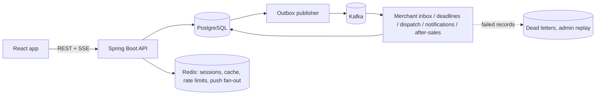

# Luc1fer's Food Bank

<p align="center">
  <strong>A production-shaped food ordering platform built around the hardest part of ordering software: making checkout correct.</strong>
</p>

<p align="center">
  
  
  
  
  
  
</p>

Customers order food, merchants accept and prepare it, riders deliver it, and admins handle refunds and recovery. All
four roles share one Spring Boot backend and one React app.

> Keep the critical business transaction correct first. Distribute side effects only after the database commit.

---

## Highlights

- **Correct checkout**: idempotency keys, row locks on the cart, and money stored with its currency.
- **Transactional outbox → Kafka**: order changes and their events commit together. Events stay in order per order,
  follow published JSON schemas, and are deduplicated by every consumer.
- **Event-driven fulfilment**: merchant inbox, deadlines, rider dispatch and order completion run as separate modules
  that only talk through events.
- **Declared state machines** for orders, deliveries, after-sales cases and refunds.
- **After-sales refunds**: merchant answers, counter-offers, platform arbitration, deadlines, and retried refunds.
- **Live consoles**: the server pushes change signals over SSE, and a slower poll is kept as a fallback.
- **Operable**: OpenTelemetry tracing, Prometheus metrics and alerts, Grafana, dead-letter replay, Kubernetes manifests
  and a gated CI/CD pipeline.

---

## Architecture



| Layer | Stack |
| --- | --- |
| Frontend | React 19, strict TypeScript, Vite, Vitest |
| Backend | Java 17, Spring Boot 4.1, Spring Security 7, Spring Data JDBC, Flyway |
| Data and messaging | PostgreSQL, Redis, Kafka |
| Observability and delivery | OpenTelemetry, Prometheus, Grafana, Docker, Kubernetes (kustomize), GitHub Actions |

---

## Quick Start

You need Java 17, Node 24 and Docker.

```sh
# 1. PostgreSQL (5433), Redis (6379) and Kafka (9092)
(cd backend && docker compose up -d)

# 2. Backend with demo restaurants and accounts
(cd backend && FLYWAY_LOCATIONS=classpath:db/migration,classpath:db/demo ./gradlew bootRun)

# 3. Frontend dev server
(cd frontend && npm ci && npm start)
```

Open:
- [http://localhost:3000](http://localhost:3000) for the app;
- [http://localhost:8080/swagger-ui/index.html](http://localhost:8080/swagger-ui/index.html) for the API.

| Demo login | Password | Roles |
| --- | --- | --- |
| `demo@laifood.com` | `demo123` | customer and admin |

The demo seed (`backend/src/main/resources/db/demo`) also creates a merchant login per restaurant and three rider
logins.

**Without PostgreSQL and Kafka:** `(cd backend && SPRING_PROFILES_ACTIVE=h2 ./gradlew bootRun)` runs the backend on
H2. Redis is still needed. Add the `demo` profile (`h2,demo`) for short after-sales deadlines; see
[docs/after-sales.md](docs/after-sales.md#after-sales-demo).

### What each role sees

| Role | Workspace |
| --- | --- |
| Customer | Menus, cart, checkout, orders with history, notifications, refund requests |
| Merchant | The restaurant's orders (accept, reject, prepare) and its refund requests |
| Rider | Duty switch and own deliveries (picked up, delivered) |
| Admin | Merchant and rider accounts, order tools, dead-letter replay, refund arbitration and retries |

A user with several roles switches between workspaces with tabs. Details:
[docs/frontend-workspaces.md](docs/frontend-workspaces.md).

---

## Tests

```sh
# Backend (Testcontainers suites need Docker)
(cd backend && ./gradlew test -x buildFrontend -x syncFrontendBuild --no-daemon)

# Frontend
(cd frontend && npm run typecheck && npm run lint && npm test && npm run build)
```

CI also runs coverage gates, SpotBugs, CodeQL and config linting. See [docs/testing.md](docs/testing.md) for every
command.

---

## Project Layout

```text
backend/        Spring Boot app: controllers, services, fulfilment modules, after-sales, messaging, Flyway migrations
frontend/       React + TypeScript client
deploy/         Kubernetes manifests and the observability stack (Prometheus, Grafana, Tempo)
load-tests/     k6 load tests
docs/           design notes, operations runbook and ADRs
```

---

## Documentation

| Topic | Where |
| --- | --- |
| REST endpoints | [docs/api.md](docs/api.md) |
| Checkout, money, time, order states, outbox, event contracts, caching, read replicas, security and rate limits | [docs/correctness.md](docs/correctness.md) |
| Order fulfilment: merchant inbox, deadlines, dispatch, out-of-order events | [docs/fulfilment.md](docs/fulfilment.md) |
| After-sales refunds and the after-sales demo | [docs/after-sales.md](docs/after-sales.md) |
| Push signals (SSE) | [docs/push-signals.md](docs/push-signals.md) |
| Data tier: partitions, order numbers, sharding plan | [docs/data-tier.md](docs/data-tier.md) |
| Frontend workspaces | [docs/frontend-workspaces.md](docs/frontend-workspaces.md) |
| Tests and useful commands | [docs/testing.md](docs/testing.md) |
| Deployment, observability, CI/CD, runbooks | [docs/operations.md](docs/operations.md) |
| Design decisions | [docs/adr/](docs/adr/) (0001 sharding, 0002 state machines and after-sales, 0003 push signals) |
| Known limitations | [docs/limitations.md](docs/limitations.md) |
| Working on the code | [AGENTS.md](AGENTS.md) |

---

## Limitations

This is a demo, so some parts are simulated or missing:

- **Simulated:** payment and refunds.
- **Missing:** inventory, taxes, discounts, tips and currency conversion.
- **Kafka** delivery is at-least-once, and consumers deduplicate.
- **Push** is best effort, with polling as the fallback.
- **Sharding** is planned, not built.

The full list is in [docs/limitations.md](docs/limitations.md).
