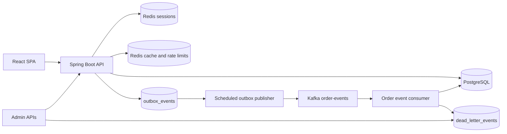
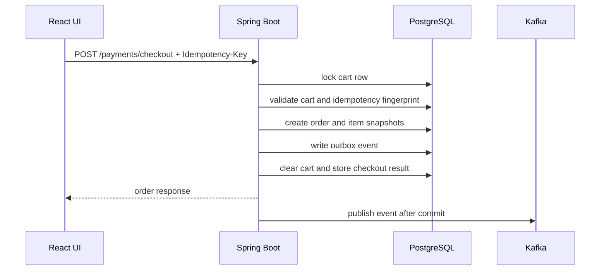

# Luc1fer's Food Bank

<p align="center">
  <strong>A production-shaped food ordering platform built around the hardest part of ordering software: making checkout correct.</strong>
</p>

<p align="center">
  
  
  
  
  
  
</p>

<p align="center">
  Browse restaurants, build a cart, simulate payment, track orders, receive notifications, and recover failed async work from admin APIs.
</p>

---

## What Makes It Interesting

Most demo food apps stop at CRUD. This one goes deeper into the failure modes that matter in real ordering systems:

- **Idempotent checkout** with durable request records and conflict detection
- **Cart-level concurrency control** using PostgreSQL row locks
- **Transactional outbox** so order changes and events commit together
- **Kafka-based async processing** with consumer-side deduplication
- **Persistent dead-letter storage and replay** for failed consumers
- **Failed outbox inspection and retry** for operator recovery
- **Redis-backed sessions, cache, and rate limiting**
- **OpenTelemetry tracing from the HTTP request through the outbox to the Kafka consumer**, Prometheus metrics, structured logs, Grafana dashboards and alert rules
- **Kubernetes manifests and a gated release pipeline** (coverage, SpotBugs, CodeQL, Trivy, SBOM, staged deploys); see [docs/operations.md](docs/operations.md)
- **Focused tests** for checkout rollback, duplicate requests, order state transitions, outbox behavior, and security controls

The theme of the project is simple:

> Keep the critical business transaction correct first. Distribute side effects only after the database commit.

---

## Product Snapshot

| Area | What is included |
| --- | --- |
| Customer experience | Sign up, log in, browse restaurants, search menus, manage cart, checkout, view orders, cancel eligible orders, view notifications |
| Admin operations | Move orders through a guarded state machine, inspect failed outbox events, retry failed publishes, replay dead-lettered events |
| Reliability | Idempotency keys, row locking, transactional outbox, at-least-once event handling, deduplication tables, replay paths |
| Observability | OpenTelemetry traces (`X-Trace-Id` = trace id), structured logs with trace/span ids, Prometheus metrics on a separate management port, Grafana dashboard, alert rules, readiness and liveness probes |
| Local development | Docker Compose for PostgreSQL, Redis, and Kafka; H2 fallback profile; React dev server proxy |

---

## Architecture



### Checkout Flow



---

## Tech Stack

| Layer | Stack |
| --- | --- |
| Frontend | React, Ant Design, Create React App, browser session cookies |
| Backend | Java 17, Spring Boot, Spring MVC, Spring Security, Spring Data JDBC, Gradle |
| Data | PostgreSQL, Flyway migrations, H2 fallback profile |
| Runtime state | Redis for Spring Session, cache, and distributed rate-limit counters |
| Messaging | Kafka, transactional outbox table, consumer deduplication table, dead-letter replay |
| Observability | Spring Boot Actuator, Micrometer, Micrometer Tracing + OpenTelemetry (OTLP), Prometheus, Tempo, Grafana, structured JSON logs |
| Delivery | Multi-stage non-root Docker image, Kubernetes (kustomize), GitHub Actions with JaCoCo, SpotBugs, CodeQL, dependency review, Trivy and SBOM |
| Verification | JUnit, Spring Boot tests, Testcontainers, GitHub Actions |

---

## Quick Start

### Prerequisites

- Java 17
- Node 20
- Docker Desktop or another Docker-compatible runtime

### 1. Start local infrastructure

```sh
(cd backend && docker compose up -d)
```

This starts:

| Service | Local address |
| --- | --- |
| PostgreSQL | `localhost:5433` |
| Redis | `localhost:6379` |
| Kafka | `localhost:9092` |

### 2. Install frontend dependencies

```sh
(cd frontend && npm ci --legacy-peer-deps)
```

### 3. Run the backend with demo data

```sh
(cd backend && FLYWAY_LOCATIONS=classpath:db/migration,classpath:db/demo ./gradlew bootRun)
```

Flyway applies the schema from `backend/src/main/resources/db/migration`. The extra `db/demo` location seeds demo restaurants, menus, and the demo account.

### 4. Run the frontend dev server

```sh
(cd frontend && npm start)
```

Open:

- Frontend dev server: [http://localhost:3000](http://localhost:3000)
- Backend / embedded UI: [http://localhost:8080](http://localhost:8080)
- Swagger UI: [http://localhost:8080/swagger-ui/index.html](http://localhost:8080/swagger-ui/index.html)

### Demo Account

| Field | Value |
| --- | --- |
| Email | `demo@laifood.com` |
| Password | `demo123` |
| Roles | `ROLE_USER`, `ROLE_ADMIN` |

---

## Lightweight H2 Mode

Use this when you want a smaller backend run without PostgreSQL or Kafka. Redis is still configured as the cache/session backend.

```sh
(cd backend && SPRING_PROFILES_ACTIVE=h2 ./gradlew bootRun)
```

The `h2` profile runs Flyway migrations and includes the demo seed callback by default.

---

## Core API Map

### Customer APIs

| Method | Path | Purpose |
| --- | --- | --- |
| `POST` | `/signup` | Create a customer account |
| `POST` | `/login` | Start a server-side session |
| `POST` | `/logout` | End the session |
| `GET` | `/me` | Read current session user |
| `GET` | `/restaurants/menu` | List restaurants |
| `GET` | `/restaurant/{restaurantId}/menu` | List menu items |
| `GET` | `/cart` | Read current cart |
| `POST` | `/cart` | Add menu item to cart |
| `PUT` | `/cart/items/{orderItemId}` | Update quantity |
| `DELETE` | `/cart/items/{orderItemId}` | Remove item |
| `POST` | `/cart/checkout` | Checkout cart with idempotency key |
| `POST` | `/payments/checkout` | Payment-style checkout with idempotency key |
| `GET` | `/orders` | List current user's orders |
| `POST` | `/orders/{orderId}/cancel` | Cancel an eligible order |
| `GET` | `/notifications` | List order notifications |

### Admin and Recovery APIs

| Method | Path | Purpose |
| --- | --- | --- |
| `PATCH` | `/orders/{orderId}/status` | Move order through the status state machine |
| `GET` | `/admin/outbox/events/failed?limit=50` | Inspect failed outbox events |
| `POST` | `/admin/outbox/events/{eventId}/retry` | Reset failed outbox event to `PENDING` |
| `POST` | `/dead-letters/{deadLetterEventId}/replay` | Replay a stored dead-letter event |

### Operational APIs

| Method | Path | Purpose |
| --- | --- | --- |
| `GET` | `/actuator/health` | Aggregate health |
| `GET` | `/actuator/health/liveness` | Liveness probe |
| `GET` | `/actuator/health/readiness` | Readiness probe |
| `GET` | `/actuator/metrics` | Metric discovery |
| `GET` | `/actuator/prometheus` | Prometheus scrape endpoint |
| `GET` | `/v3/api-docs` | OpenAPI JSON |
| `GET` | `/swagger-ui/index.html` | Swagger UI |

With `MANAGEMENT_SERVER_PORT=8081` (the container image and Kubernetes) the `/actuator` endpoints move to that
in-cluster port and need no session there; without it they stay on the application port and everything but health
and info requires `ROLE_ADMIN`. See [docs/operations.md](docs/operations.md).

API errors use a consistent JSON shape and include the OpenTelemetry trace id, which is also returned in the
`X-Trace-Id` header (send a W3C `traceparent` header to join an existing trace):

```json
{
  "code": "VALIDATION_FAILED",
  "message": "Request validation failed",
  "trace_id": "4bf92f3577b34da6a3ce929d0e0e4736",
  "status": 400,
  "path": "/signup",
  "timestamp": "2026-05-07T05:00:00Z"
}
```

---

## Correctness Model

### Checkout

- Checkout requires an `Idempotency-Key` header.
- The backend stores one durable idempotency record per customer, checkout scope, and key.
- Repeating the same logical request returns the stored order result.
- Reusing the same key with a different request fingerprint returns a conflict.
- Checkout locks the cart row, creates the order, snapshots order items, writes the outbox event, clears the cart, and stores the idempotency result in one database transaction.
- If the transaction fails before commit, all checkout writes roll back together.

### Order State

Allowed transitions:

```text
PLACED -> PAID / CANCELLED
PAID -> ACCEPTED / CANCELLED
ACCEPTED -> PREPARING / CANCELLED
PREPARING -> COMPLETED
COMPLETED and CANCELLED are terminal
```

Status changes and their outbox events commit together. Invalid transitions fail without side effects.

### Outbox and Kafka

- Order events are inserted into `outbox_events` inside the same transaction as the order change.
- A scheduled publisher claims `PENDING` or stale `PROCESSING` rows with `FOR UPDATE SKIP LOCKED`.
- Successful publish marks the row `PUBLISHED`.
- Retryable failures return to `PENDING` until `app.outbox.max-attempts`.
- Max-attempt failures become `FAILED` and require admin retry after the root cause is fixed.
- Consumers use `processed_events` to deduplicate at-least-once Kafka delivery.
- Notification creation also has a database uniqueness safety net.

### Security and Abuse Controls

- Authentication uses server-side sessions backed by Redis.
- Customer accounts track status, failed login count, lockout time, last login, and audit timestamps.
- Login lookup is case-insensitive.
- Anonymous routes are rate-limited by remote IP.
- Authenticated checkout and admin routes are rate-limited by user identity.
- Redis rate-limit store failures fail open and emit metrics instead of blocking core flows.

---

## Testing and Verification

Run the normal backend verification path:

```sh
(cd backend && ./gradlew test -x buildFrontend -x syncFrontendBuild --no-daemon)
```

Build the React app:

```sh
(cd frontend && npm run build)
```

Build the backend jar with embedded frontend assets:

```sh
(cd backend && ./gradlew bootJar --no-daemon)
```

The test suite covers:

- checkout idempotency, rollback, and concurrent checkout behavior
- order status transition rules and rollback behavior
- outbox publish success, retryable failure, max-attempt failure, and admin retry
- Kafka consumer deduplication and notification idempotency
- dead-letter replay behavior
- authentication, login lockout, session handling, and rate limiting
- API contract and operational metrics behavior

Some integration tests use Testcontainers and require Docker. Tests annotated with `@Testcontainers(disabledWithoutDocker = true)` may skip when Docker is unavailable.

---

## Project Layout

```text
.
|-- frontend/                         React + Ant Design client
|-- backend/                          Spring Boot application
|   |-- src/main/java/.../controller   HTTP API surface
|   |-- src/main/java/.../service      business logic and transactions
|   |-- src/main/java/.../messaging    Kafka, outbox, DLT handling
|   |-- src/main/java/.../observability metrics and tracing
|   |-- src/main/resources/db          Flyway migrations and demo seed data
|   `-- src/test/java                  unit and integration tests
|-- load-tests/                        k6 order-flow load test
|-- deploy/observability/              OTel Collector, Tempo, Prometheus (alerts), Grafana (dashboards)
|-- deploy/k8s/                        kustomize base + staging/prod overlays
|-- docs/operations.md                 observability, deployment, CI/CD gates
|-- Dockerfile                         full source build image
`-- README.md
```

---

## Useful Commands

| Task | Command |
| --- | --- |
| Start infrastructure | `cd backend && docker compose up -d` |
| Run backend tests | `cd backend && ./gradlew test -x buildFrontend -x syncFrontendBuild --no-daemon` |
| Run backend with demo seed | `cd backend && FLYWAY_LOCATIONS=classpath:db/migration,classpath:db/demo ./gradlew bootRun` |
| Run backend with H2 profile | `cd backend && SPRING_PROFILES_ACTIVE=h2 ./gradlew bootRun` |
| Start frontend dev server | `cd frontend && npm start` |
| Build frontend | `cd frontend && npm run build` |
| Copy frontend build into backend | `cd frontend && npm run deploy:backend` |
| Build executable jar | `cd backend && ./gradlew bootJar --no-daemon` |
| Run load test | `k6 run load-tests/order-flow.js` |
| Backend CI gates | `cd backend && ./gradlew test jacocoTestReport jacocoTestCoverageVerification spotbugsMain -x buildFrontend -x syncFrontendBuild --no-daemon` |
| Observability stack + app | `ONLINEORDER_SCRAPE_TARGETS=./prometheus/targets/compose docker compose -f deploy/observability/docker-compose.yml --profile app up -d --build` (Grafana on 3001) |
| Build the image | `docker build -t onlineorder:local .` |
| Render Kubernetes manifests | `kubectl kustomize deploy/k8s/overlays/staging` |

---

## Honest Boundaries

This project is intentionally strong on backend correctness patterns, but it is still a demo application:

- Payment is simulated with local request validation. There is no real payment provider, authorization, capture, webhook, or settlement flow.
- There is no inventory reservation or stock decrement model.
- Kafka delivery is treated as at-least-once with consumer-side idempotency, not end-to-end exactly-once delivery.
- Failed outbox rows require explicit admin retry after the underlying cause is fixed.
- H2 is a lightweight local fallback, not the production-shaped runtime.
- The architecture is a deliberate monolith. Service decomposition is deferred until the core transaction is correct and observable.

---

## Why This Repo Exists

Luc1fer's Food Bank is built to show how a familiar product surface - ordering food - can carry serious backend engineering ideas without becoming a microservice maze.

The result is a compact full-stack app where the frontend is usable, the backend is observable, and the checkout path is treated like real money is on the line.
