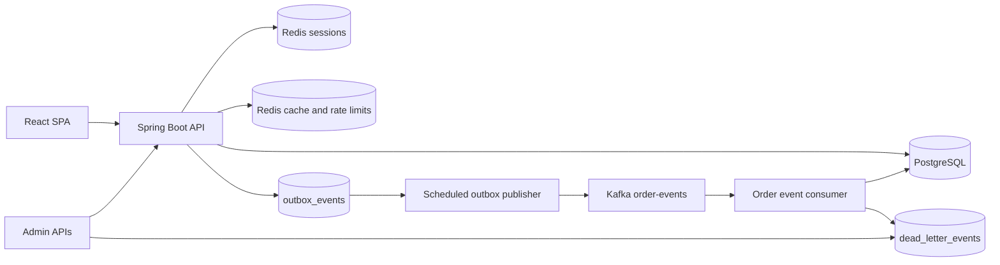
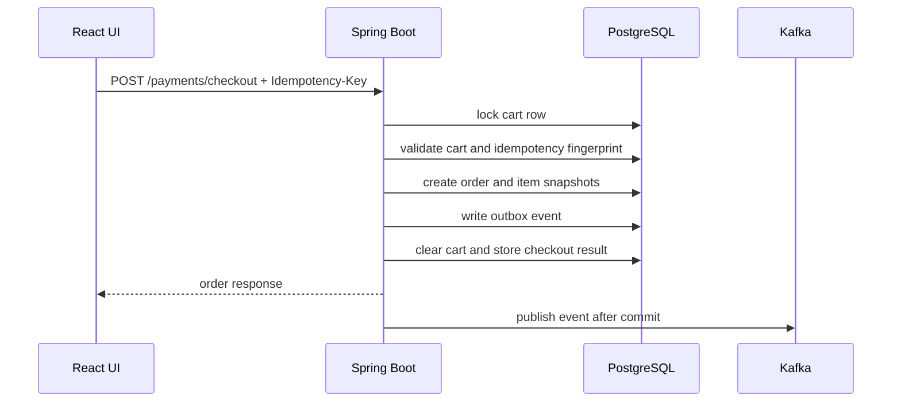

# Luc1fer's Food Bank

<p align="center">
  <strong>A production-shaped food ordering platform built around the hardest part of ordering software: making checkout correct.</strong>
</p>

<p align="center">
  
  
  
  
  
  
</p>

<p align="center">
  Browse restaurants, build a cart, simulate payment, track orders, receive notifications, and recover failed async work from admin APIs.
</p>

---

## What Makes It Interesting

Most demo food apps stop at CRUD. This one goes deeper into the failure modes that matter in real ordering systems:

- **Idempotent checkout** with durable request records and conflict detection
- **Cart-level concurrency control** using PostgreSQL row locks
- **Transactional outbox** so order changes and events commit together
- **Kafka-based async processing** with consumer-side deduplication
- **Persistent dead-letter storage and replay** for failed consumers
- **Failed outbox inspection and retry** for operator recovery
- **Redis-backed sessions, cache, and rate limiting**
- **OpenTelemetry tracing from the HTTP request through the outbox to the Kafka consumer**, Prometheus metrics, structured logs, Grafana dashboards and alert rules
- **Kubernetes manifests and a gated release pipeline** (coverage, SpotBugs, CodeQL, Trivy, SBOM, staged deploys); see [docs/operations.md](docs/operations.md)
- **Focused tests** for checkout rollback, duplicate requests, order state transitions, outbox behavior, and security controls

The theme of the project is simple:

> Keep the critical business transaction correct first. Distribute side effects only after the database commit.

---

## Product Snapshot

| Area | What is included |
| --- | --- |
| Customer experience | Sign up, log in, browse restaurants, search menus, manage cart, checkout, view orders, cancel eligible orders, view notifications |
| Admin operations | Move orders through a guarded state machine, inspect failed outbox events, retry failed publishes, replay dead-lettered events |
| Reliability | Idempotency keys, row locking, transactional outbox, at-least-once event handling, deduplication tables, replay paths |
| Observability | OpenTelemetry traces (`X-Trace-Id` = trace id), structured logs with trace/span ids, Prometheus metrics on a separate management port, Grafana dashboard, alert rules, readiness and liveness probes |
| Local development | Docker Compose for PostgreSQL, Redis, and Kafka; H2 fallback profile; React dev server proxy |

---

## Architecture



### Checkout Flow



---

## Tech Stack

| Layer | Stack |
| --- | --- |
| Frontend | React 19, Vite, Vitest + React Testing Library, ESLint + Prettier, browser session cookies |
| Backend | Java 17, Spring Boot, Spring MVC, Spring Security, Spring Data JDBC, Gradle |
| Data | PostgreSQL, Flyway migrations, H2 fallback profile |
| Runtime state | Redis for Spring Session, cache, and distributed rate-limit counters |
| Messaging | Kafka, transactional outbox table, consumer deduplication table, dead-letter replay |
| Observability | Spring Boot Actuator, Micrometer, Micrometer Tracing + OpenTelemetry (OTLP), Prometheus, Tempo, Grafana, structured JSON logs |
| Delivery | Multi-stage non-root Docker image, Kubernetes (kustomize), GitHub Actions with JaCoCo, SpotBugs, CodeQL, dependency review, Trivy and SBOM |
| Verification | JUnit, Spring Boot tests, Testcontainers, GitHub Actions |

---

## Quick Start

### Prerequisites

- Java 17
- Node 20.19+, 22.13+, or 24+
- Docker Desktop or another Docker-compatible runtime

### 1. Start local infrastructure

```sh
(cd backend && docker compose up -d)
```

This starts:

| Service | Local address |
| --- | --- |
| PostgreSQL | `localhost:5433` |
| Redis | `localhost:6379` |
| Kafka | `localhost:9092` |

### 2. Install frontend dependencies

```sh
(cd frontend && npm ci)
```

### 3. Run the backend with demo data

```sh
(cd backend && FLYWAY_LOCATIONS=classpath:db/migration,classpath:db/demo ./gradlew bootRun)
```

Flyway applies the schema from `backend/src/main/resources/db/migration`. The extra `db/demo` location seeds demo restaurants, menus, and the demo account.

### 4. Run the frontend dev server

```sh
(cd frontend && npm start)
```

Open:

- Frontend dev server: [http://localhost:3000](http://localhost:3000)
- Backend / embedded UI: [http://localhost:8080](http://localhost:8080)
- Swagger UI: [http://localhost:8080/swagger-ui/index.html](http://localhost:8080/swagger-ui/index.html)

### Demo Account

| Field | Value |
| --- | --- |
| Email | `demo@laifood.com` |
| Password | `demo123` |
| Roles | `ROLE_USER`, `ROLE_ADMIN` |

---

## Lightweight H2 Mode

Use this when you want a smaller backend run without PostgreSQL or Kafka. Redis is still configured as the cache/session backend.

```sh
(cd backend && SPRING_PROFILES_ACTIVE=h2 ./gradlew bootRun)
```

The `h2` profile runs Flyway migrations and includes the demo seed callback by default.

---

## Core API Map

### Customer APIs

| Method | Path | Purpose |
| --- | --- | --- |
| `POST` | `/signup` | Create a customer account |
| `POST` | `/login` | Start a server-side session |
| `POST` | `/logout` | End the session |
| `GET` | `/me` | Read current session user |
| `GET` | `/restaurants/menu` | List restaurants with their menus (HTTP-cacheable, see [Catalog Caching](#catalog-caching)) |
| `GET` | `/restaurant/{restaurantId}/menu` | List menu items; `404` for an unknown restaurant (HTTP-cacheable) |
| `GET` | `/cart` | Read current cart |
| `POST` | `/cart` | Add menu item to cart |
| `PUT` | `/cart/items/{orderItemId}` | Update quantity |
| `DELETE` | `/cart/items/{orderItemId}` | Remove item |
| `DELETE` | `/cart` | Empty the cart (`204`, also when it is already empty), for example after `409 CART_RESTAURANT_CONFLICT` |
| `POST` | `/cart/checkout` | Checkout cart with idempotency key |
| `POST` | `/payments/checkout` | Payment-style checkout with idempotency key |
| `GET` | `/orders` | List current user's orders |
| `POST` | `/orders/{orderId}/cancel` | Cancel an eligible order |
| `GET` | `/orders/{orderId}/history` | The order's status changes, oldest first (owner or admin; `404` for anyone else) |
| `GET` | `/notifications` | List order notifications |

### Admin and Recovery APIs

| Method | Path | Purpose |
| --- | --- | --- |
| `PATCH` | `/orders/{orderId}/status` | Move order through the status state machine |
| `GET` | `/admin/outbox/events/failed?limit=50` | Inspect failed outbox events |
| `POST` | `/admin/outbox/events/{eventId}/retry` | Reset failed outbox event to `PENDING` |
| `PATCH` | `/admin/menu-items/{menuItemId}` | Update a menu item's `name`, `description` or `price`; evicts that restaurant's cached menu after commit |
| `PATCH` | `/admin/restaurants/{restaurantId}` | Update a restaurant's `name`, `address`, `phone` or `image_url`; evicts the cached restaurant list after commit |
| `POST` | `/dead-letters/{deadLetterEventId}/replay` | Replay a stored dead-letter event |
| `GET` | `/admin/audit-log?limit=50&before_id=` | Audit log of the admin actions above, newest first; pass the last entry's `id` as `before_id` for the next page |

### Operational APIs

| Method | Path | Purpose |
| --- | --- | --- |
| `GET` | `/actuator/health` | Aggregate health |
| `GET` | `/actuator/health/liveness` | Liveness probe |
| `GET` | `/actuator/health/readiness` | Readiness probe |
| `GET` | `/actuator/metrics` | Metric discovery |
| `GET` | `/actuator/prometheus` | Prometheus scrape endpoint |
| `GET` | `/v3/api-docs` | OpenAPI JSON |
| `GET` | `/swagger-ui/index.html` | Swagger UI |

With `MANAGEMENT_SERVER_PORT=8081` (set on Kubernetes and in the observability stack) the `/actuator` endpoints move
to that in-cluster port and need no session there; without it they stay on the application port and everything but
health and info requires `ROLE_ADMIN`. See [docs/operations.md](docs/operations.md).

API errors use a consistent JSON shape and include the OpenTelemetry trace id, which is also returned in the
`X-Trace-Id` header (send a W3C `traceparent` header to join an existing trace):

```json
{
  "code": "VALIDATION_FAILED",
  "message": "Request validation failed",
  "trace_id": "4bf92f3577b34da6a3ce929d0e0e4736",
  "status": 400,
  "path": "/signup",
  "timestamp": "2026-05-07T05:00:00Z"
}
```

---

## Correctness Model

### Checkout

- Checkout requires an `Idempotency-Key` header.
- The backend stores one durable idempotency record per customer, checkout scope, and key.
- Repeating the same logical request returns the stored order result.
- Reusing the same key with a different request fingerprint returns a conflict.
- Checkout locks the cart row, creates the order, snapshots order items, writes the outbox event, clears the cart, and stores the idempotency result in one database transaction.
- If the transaction fails before commit, all checkout writes roll back together.

### Order State

Allowed transitions:

```text
PLACED -> PAID / CANCELLED
PAID -> ACCEPTED / CANCELLED
ACCEPTED -> PREPARING / CANCELLED
PREPARING -> COMPLETED
COMPLETED and CANCELLED are terminal
```

Status changes and their outbox events commit together. Invalid transitions fail without side effects.

Every status change, including the creation at checkout, also writes one `order_status_history` row and moves
`orders.updated_at`, in the same transaction and through the same guarded transition (`OrderService`, the
`OrderLifecycleCommands` seam for the fulfilment modules). A row records `from_status` (null for the creation),
`to_status`, who did it (`actor_type` `CUSTOMER`, `ADMIN`, `MERCHANT`, `RIDER` or `SYSTEM` for timeouts, and
`actor_id`), the cancel `reason` and the request's trace id. A delivered order completed from `ACCEPTED` records both
steps for the rider. Same-status no-ops and idempotent retries write nothing. `GET /orders/{orderId}/history` serves
it; orders placed before V7_1 start with one `SYSTEM`/`backfill` row.

Admin actions (status changes, outbox retries, dead-letter replay outcomes, catalog edits) are also written to
`audit_log` by `AuditLogService.record` in the action's transaction: the admin, the role, the action, its target, a
JSON `details` object and the trace id. Refused actions and idempotent retries add no entry. All keys are 64-bit
(`BIGINT`) since V7; see [docs/operations.md](docs/operations.md) section 7 for the rollout of these migrations.

### Outbox and Kafka

- Order events are inserted into `outbox_events` inside the same transaction as the order change.
- A scheduled publisher claims `PENDING` or stale `PROCESSING` rows with `FOR UPDATE SKIP LOCKED`.
- Successful publish marks the row `PUBLISHED`.
- Retryable failures return to `PENDING` until `app.outbox.max-attempts`.
- Max-attempt failures become `FAILED` and require admin retry after the root cause is fixed.
- Consumers use `processed_events` to deduplicate at-least-once Kafka delivery.
- Notification creation also has a database uniqueness safety net.

### Catalog Caching

The public catalog reads (`GET /restaurants/menu`, `GET /restaurant/{restaurantId}/menu`) go through a two-level cache (`backend/src/main/java/.../cache`):

| Level | Store | Lifetime | Scope |
| --- | --- | --- | --- |
| L1 | Caffeine, bounded, `recordStats` | `app.cache.l1.ttl` (30s) | one instance |
| L2 | Redis, typed JSON | `spring.cache.redis.time-to-live` (10m) +/- `app.cache.l2.ttl-jitter` (15%) | all instances |

- **Granular keys.** `restaurants::all` holds the restaurant list (basic fields) and `menu::<restaurantId>` holds one menu. `GET /restaurants/menu` is composed from them, with the same JSON shape as before. Redis keys are `onlineorder:cache:<version>:<cache>::<key>`, for example `onlineorder:cache:v1:menu::3`.
- **Typed serialization.** Each cache has its own Jackson serializer bound to `CatalogRestaurantDto` or `CatalogMenuItemDto`: no default typing and no `@class` in Redis. When a cached DTO changes shape, bump its version in `CatalogCaches`; old and new code then use different keys during a rolling deploy, and an entry that cannot be read is treated as a miss.
- **Stampede, avalanche, penetration.** Cached methods use `@Cacheable(sync = true)`, and the L1 loads each key once per instance while concurrent callers wait (single flight). Redis TTLs are jittered so entries loaded together do not expire together. A menu request is first checked against the cached restaurant list. An id the list does not know gets one primary-key lookup in the database, at most once per `app.catalog.unknown-restaurant-recheck-interval` (1s) per instance: a restaurant inserted outside the admin API (SQL, a seed run) is served right away and the stale list is evicted, while a flood of random ids costs one lookup per second. Every other unknown id gets `404` from the cache, and nothing is cached for it.
- **Invalidation.** Admin writes update the database and delete the affected entries only after the transaction commits (`TransactionSynchronization#afterCommit`); a rollback deletes nothing. Deletion order is Redis, then the local L1, then a Redis pub/sub message (`onlineorder:cache:invalidation`) that makes the other instances drop their L1 copy. Instances clear their L1 whenever the subscription is (re)established, since messages sent while disconnected are lost; the L1 TTL bounds anything else that is missed.
- **Why cache-aside with delete-after-commit, not write-through.** Writing the new value into the cache from the write path means rebuilding the cached view (a whole menu) in the transaction, and two concurrent writers can store their snapshots out of order so the older one wins until the TTL. Deleting lets the next read rebuild from committed data. Deleting before the commit would let a reader cache the old row again. The remaining race is a reader that loaded the old row just before the commit and stores it just after the delete; a delayed double delete (`app.cache.delayed-double-delete`, 1s, `0` disables) removes that entry.
- **Redis failures.** A failed Redis read is a miss and a failed write, delete or publish is skipped; each is logged and counted in `onlineorder.cache.errors`, and requests are served from the database and L1. Startup does not need Redis: the invalidation subscription is retried in the background.
- **Hung or slow Redis.** A Redis that hangs instead of refusing connections makes every call wait for the 500ms command timeout (`spring.data.redis.timeout`). Without protection, every L1 miss would pay it twice (read and write-back), so a cold `GET /restaurants/menu`, composed of N+1 entries, would wait about (N+1) x 1s. A circuit breaker shared by the caches (`RemoteCacheCircuitBreaker`) therefore makes reads and write-backs skip Redis for `app.cache.l2.circuit-breaker.open-duration` (5s) after any Redis error, or after 3 consecutive calls slower than `slow-call-threshold` (200ms). Then one request probes Redis while the others keep skipping it, and a successful probe closes the breaker. An entry that cannot be deserialized does not count, since Redis answered. Deletes and invalidation broadcasts always go to Redis, because they keep it consistent with the database. A loaded value is written back after the single-flight section, so callers waiting for the same key are not held for the Redis write. `CatalogRedisHangIntegrationTests` pauses its Redis container and holds cold catalog reads of 43 restaurants to a 2.5s budget. Measured numbers are below the read benchmark: 0.53s instead of 44.6s.
- **What an outage still breaks.** Sessions also live in Redis, so during an outage authenticated requests (cart, checkout, admin catalog writes) fail in the session filter. Anonymous catalog reads never touch the session store.
- **HTTP caching.** Both endpoints send `Cache-Control: max-age=30, public` (`app.catalog.http-max-age`) and a strong `ETag` (SHA-256 of the JSON body), and answer a matching `If-None-Match` with `304`. Only these responses override Spring Security's `no-store`; CSP and the other security headers are unchanged.
- **Staleness budget after an admin write.** The writing instance serves the new data once the request returns (the rare reader race above lasts until the delayed second delete). Other instances drop their L1 copy when the pub/sub message arrives, or after the L1 TTL if it is lost. Browsers and shared caches may reuse a response for up to `max-age`.
- **Prices and checkout.** The cache only serves the catalog. Adding to the cart reads the menu item from the database and snapshots its price on the cart line (adding the same item again re-snapshots it), and checkout charges the cart-line snapshots. A price change therefore never reprices existing cart lines, and a client showing a cached menu for up to `max-age` still gets the current price when it adds the item.
- **Metrics.** Micrometer's cache meters with a `level` tag:
  - `cache.gets{level="l1", result="hit"|"miss"}`, plus `cache.puts`, `cache.evictions` and `cache.size` for L1.
  - `cache.gets{level="l2", result="hit"|"miss"|"error"|"skipped"}`: `error` is a Redis read that failed or timed out, and `skipped` is one not attempted because the breaker is open. A non-zero `skipped` rate means Redis is being bypassed.
  - `cache.load{level="l2", result="success"|"failure"}`: values loaded from the database because neither level had them. This is the database load. During an outage every L1 miss is an L2 `error` or `skipped` followed by a load, so the L2 miss count alone would look healthy.
  - `cache.puts{level="l2"}`, `cache.evictions{level="l2"}`, `onlineorder.cache.invalidations.received` and `onlineorder.cache.errors`.

  Overall hit ratio (reads that did not reach the database): `1 - sum(rate(cache_load_total{level="l2"}[5m])) / sum(rate(cache_gets_total{level="l1"}[5m]))`.

Read benchmark with `load-tests/catalog-read.js`: 50 VUs for 30s in a closed loop, half `GET /restaurants/menu` and half `GET /restaurant/{id}/menu`, on the demo data. PostgreSQL 16 and Redis 7.4 run in their own compose project, `load-tests/catalog-bench.compose.yml` (ports 45433 and 46379, nothing persisted); the backend runs from a boot jar on port 18080 with Kafka and rate limiting off. k6, the JVM and Docker Desktop shared one laptop with other builds running (load average 7 to 23), so compare the rows rather than reading the numbers as capacity. Each cell shows two alternating rounds.

| Build | Throughput | p95 | p99 |
| --- | --- | --- | --- |
| Before (`master`): one Redis key for the whole catalog, menu endpoint uncached | 16.1k / 18.0k req/s | 5.52 / 4.40 ms | 9.17 / 7.47 ms |
| After: two-level cache | 52.5k / 55.6k req/s | 1.71 / 1.51 ms | 2.78 / 2.35 ms |
| After, with `If-None-Match` (every response a `304`) | 59.6k / 64.4k req/s | 1.38 / 1.26 ms | 2.14 / 2.01 ms |

In the second "after" round, L1 answered 5.0M cache reads with 8 misses, and only 4 reads reached PostgreSQL (`cache_load_total{level="l2"}`). The usage lines at the top of the compose file show how to repeat it; add `CONDITIONAL=true` to the k6 run for the `304` case.

Hung Redis, same setup with 40 extra restaurants (43 in all): `docker pause` on the Redis container and wait out the 30s L1 TTL before each cold request. "Next request" is sent right after the cold one.

| Build | Cold `GET /restaurants/menu` | Next request | Cold `GET /restaurant/1/menu` |
| --- | --- | --- | --- |
| `master` (no L1, menu endpoint uncached) | 1.04s | 1.03s | 0.02s |
| Two-level cache without the circuit breaker | 44.6s | 44.6s (L1 never warms) | 2.03s |
| Two-level cache with the circuit breaker | 0.53s (3 concurrent: 0.54s each) | 0.003s (L1 hit) | 0.52s |

With the breaker, a cold request pays one 500ms command timeout per open period (the first Redis read times out and opens the breaker), then loads from PostgreSQL. `master` paid none on the menu endpoint because that endpoint was uncached.

### Security and Abuse Controls

- Authentication uses server-side sessions backed by Redis.
- Customer accounts track status, failed login count, lockout time, last login, and audit timestamps.
- Login lookup is case-insensitive.
- Anonymous routes are rate-limited by remote IP.
- Authenticated checkout and admin routes are rate-limited by user identity.
- Redis rate-limit store failures fail open and emit metrics instead of blocking core flows.

---

## Order Fulfilment (event-driven)

After payment, the order lifecycle is driven by Kafka. Separate modules inside the same Spring Boot app (a modular
monolith under `com.laioffer.onlineorder.fulfilment`) consume the events, each with its own consumer group and its
own tables:

| Module | Package | Owns | Reacts to |
| --- | --- | --- | --- |
| Order | `fulfilment.order` (+ `service.OrderService`) | `orders`, the order state machine | `delivery.delivered` |
| Merchant | `fulfilment.merchant` | `merchant_accounts`, `merchant_orders` (inbox) | `order.paid` and later order events |
| Timeout | `fulfilment.timeout` | `order_deadlines` | `order.created`, `order.paid`, later order events |
| Dispatch | `fulfilment.dispatch` | `riders`, `deliveries`, `dispatch_orders` | `order.accepted`, `order.cancelled` |
| Notifications | `service.OrderNotificationService`, `fulfilment.notification` | `order_notifications` | order events, delivery events |

Every order now belongs to one restaurant: a cart only holds items of one restaurant (adding another restaurant's item
returns `409 CART_RESTAURANT_CONFLICT`) and checkout records `orders.restaurant_id`. Orders placed before this change
have no restaurant and stay on the admin-driven flow (`PATCH /orders/{id}/status`); the fulfilment modules ignore
their events.

> **The merchant accept timeout is off by default** (`FULFILMENT_ACCEPT_TIMEOUT_ENABLED=false`). When on, it cancels
> every paid order that no merchant accepts within `accept-timeout`. This repo has no merchant screen yet and only the
> demo seed creates merchant logins, so with it on, every order paid through the frontend would be cancelled 10 minutes
> later. With it off, a paid order nobody acts on stays `PAID` (as before these modules) until a merchant or an admin
> moves it; the payment timeout for unpaid `PLACED` orders still runs. Turn it on only where every restaurant has a
> merchant login that accepts orders (see "Provisioning merchants and riders"). Cancelled paid orders are not refunded
> automatically: the customer is told to contact support.

### Event flow

```text
POST /payments/checkout            order PAID ---------------------- order.paid
                                                                        |-> merchant: inbox row (PAID)
                                                                        |-> timeout: ACCEPT deadline = paid_at + accept-timeout
                                                                        |      (only with accept-timeout-enabled)
                                                                        `-> notifications: "Payment confirmed"
POST /merchant/orders/{id}/accept  order ACCEPTED ------------------ order.accepted
                                                                        |-> dispatch: least-loaded rider, delivery ASSIGNED
                                                                        |      `-> delivery.assigned -> notifications: "Rider assigned"
                                                                        |-> timeout: deadline dropped
                                                                        `-> merchant inbox, notifications
POST /merchant/orders/{id}/preparing  order PREPARING -------------- order.preparing
POST /admin/deliveries/{id}/picked-up delivery PICKED_UP ----------- delivery.picked_up -> notifications: "Order on the way"
POST /admin/deliveries/{id}/delivered delivery DELIVERED ----------- delivery.delivered
                                                                        |-> order: PREPARING -> COMPLETED ---- order.completed
                                                                        `-> notifications: "Order delivered"

no accept within accept-timeout   deadline poller: PAID -> CANCELLED (MERCHANT_TIMEOUT) -- order.cancelled
  (accept-timeout-enabled only)
POST /merchant/orders/{id}/reject PAID -> CANCELLED (MERCHANT_REJECTED: <reason>) ------- order.cancelled
unpaid PLACED order               order.created -> PAYMENT deadline -> CANCELLED (PAYMENT_TIMEOUT)
customer cancels an ACCEPTED order order.cancelled -> dispatch cancels the delivery and releases the rider
```

Modules never read or write each other's tables or call each other's services; facts travel as events. The one
synchronous seam is the order module's command API, `OrderLifecycleCommands`: merchant commands and timeouts call it
so that the order row lock, the guarded transition and the outbox write happen in the caller's transaction. A merchant
accept and a timeout cancel therefore race on the same row lock and exactly one wins (the timeout only cancels an order
that is still `PAID`; a late accept gets `409 ORDER_STATUS_CONFLICT`). This is a deliberate exception to "events only":
the merchant's accept must answer with the order's real status, so it cannot be a fire-and-forget event. The merchant
controller resolves the login to a customer id like every other controller; the merchant module itself only reads its
own tables.

If the merchant never marked the order `PREPARING`, `delivery.delivered` moves it `ACCEPTED -> PREPARING -> COMPLETED`
in one transaction, emitting both events: delivered food was prepared, and both steps are guarded transitions. A
delivery event for a cancelled order is logged and ignored.

### Topics and consumer groups

| Topic | Published by | Consumer groups |
| --- | --- | --- |
| `order-events` (key: order id) | order module, via the outbox | `onlineorder` (notifications), `onlineorder-merchant`, `onlineorder-timeout`, `onlineorder-dispatch` |
| `delivery-events` (key: order id) | dispatch, via the outbox | `onlineorder-order-delivery`, `onlineorder-notification-delivery` |
| `order-events.dlt` | the listener error handler | `onlineorder-dlt` |

All events go through the transactional outbox (`OrderEventOutboxService.enqueueEvent` stores any aggregate type and
topic). Every new consumer uses the shared `orderEventKafkaListenerContainerFactory` (retries, then the DLT; a replay
goes back to the source topic and reaches every group there, which is safe because every consumer is idempotent:
a `processed_events` mark in the same transaction as its writes, plus unique keys such as `merchant_orders.order_id`,
`order_deadlines (order_id, deadline_type)` and `deliveries.order_id`). New consumer groups start from the earliest
offset, like the existing one.

### Out-of-order events (dead letters replayed late)

`processed_events` drops exact duplicates. A dead letter replayed after later events of the same order were applied
reaches a group out of order, so each module also stays correct when the order of two events flips:

- **Merchant inbox:** an order event that finds no inbox row creates it with the status it reports (`order.cancelled`
  leaves a cancelled tombstone) and no `paid_at`. The merchant only sees rows with a `paid_at`; the late `order.paid`
  then only sets it. A replayed `order.paid` therefore shows the order as `CANCELLED` (or `ACCEPTED`, ...) instead of a
  stale `PAID` row that no merchant command could resolve. An order cancelled before it was ever paid keeps such a
  hidden row.
- **Dispatch:** `order.accepted` and `order.cancelled` both create and lock the order's `dispatch_orders` row before
  they touch deliveries, so they serialize per order even on different consumers. `order.cancelled` sets
  `cancelled_at` there even when no delivery exists yet, and an `order.accepted` handled afterwards (for example one
  dead-lettered because no rider was active, replayed after the customer cancelled) assigns no rider.
- **Timeout:** a deadline written by a late `order.created` or `order.paid` fires as a no-op: the poller only cancels an
  order that is still in the status the deadline waits in.
- **Order completion:** a `delivery.delivered` for a cancelled order is ignored.

### Fulfilment APIs

| Method | Path | Role | Purpose |
| --- | --- | --- | --- |
| `GET` | `/merchant/orders?status=PAID&limit=50` | `MERCHANT` | The merchant's inbox (own restaurant only) |
| `POST` | `/merchant/orders/{orderId}/accept` | `MERCHANT` | `PAID -> ACCEPTED` |
| `POST` | `/merchant/orders/{orderId}/reject` | `MERCHANT` | `PAID -> CANCELLED`, body `{"reason": "..."}` (required) |
| `POST` | `/merchant/orders/{orderId}/preparing` | `MERCHANT` | `ACCEPTED -> PREPARING` |
| `GET` | `/admin/deliveries?order_id=` | `ADMIN` | Deliveries (one order, or the 50 most recent) |
| `POST` | `/admin/deliveries/{deliveryId}/picked-up` | `ADMIN` | Simulated rider: `ASSIGNED -> PICKED_UP` |
| `POST` | `/admin/deliveries/{deliveryId}/delivered` | `ADMIN` | Simulated rider: `PICKED_UP -> DELIVERED` |

Merchant commands are scoped to the merchant's restaurant (another restaurant's order is a `404`) and are idempotent:
repeating a command whose transition already happened returns the order unchanged. A reject of an order that was
cancelled for another reason (the customer, the accept timeout) is `409 ORDER_STATUS_CONFLICT`, not a successful
reject. Customers and admins get `403` on `/merchant/**`. Order responses (`GET /orders`) now also carry
`restaurant_id`, `cancel_reason` and `updated_at`.

### Provisioning merchants and riders

Demo merchants (seeded only with `classpath:db/demo`, password `merchant123`): `merchant.burgerking@laifood.com`,
`merchant.sgdtofu@laifood.com`, `merchant.fashionwok@laifood.com`. The demo seed also adds three simulated riders.

Outside the demo there is no API for this yet. Like admin logins, merchants and riders are provisioned in SQL; the
merchant signs up as a customer first and logs in again afterwards:

```sql
INSERT INTO authorities (email, authority) VALUES ('owner@example.com', 'ROLE_MERCHANT');
INSERT INTO merchant_accounts (customer_id, restaurant_id)
SELECT id, 42 FROM customers WHERE email = 'owner@example.com';
INSERT INTO riders (name, phone) VALUES ('Rider One', '(408) 555-0100');
```

Without an active rider, dispatch retries `order.accepted` and then dead-letters it; replay it with
`POST /dead-letters/{id}/replay` once a rider exists.

### Configuration

| Key | Default | Purpose |
| --- | --- | --- |
| `app.fulfilment.accept-timeout-enabled` (`FULFILMENT_ACCEPT_TIMEOUT_ENABLED`) | `false` | Run the accept timeout at all (see the note at the top of this section); switching it off also drops pending accept deadlines without cancelling |
| `app.fulfilment.accept-timeout` (`FULFILMENT_ACCEPT_TIMEOUT`) | `10m` | Cancel a `PAID` order not accepted in time (`MERCHANT_TIMEOUT`) |
| `app.fulfilment.payment-timeout` (`FULFILMENT_PAYMENT_TIMEOUT`) | `15m` | Cancel a `PLACED` order not paid in time (`PAYMENT_TIMEOUT`) |
| `app.fulfilment.deadline-poller.enabled` | follows `app.kafka.enabled` | Run the deadline poller |
| `app.fulfilment.deadline-poller.interval` | `1s` | Poll interval (timeout precision) |
| `app.fulfilment.deadline-poller.batch-size` | `100` | Deadlines fired per run, one transaction each |
| `app.fulfilment.deadline-poller.retry-backoff` | `30s` | Delay before retrying a deadline whose firing failed |
| `app.fulfilment.delivery-topic` (`KAFKA_DELIVERY_TOPIC`) | `delivery-events` | Delivery event topic |
| `app.fulfilment.*-group` | see the table above | Consumer group per module |
| `app.fulfilment.listener-concurrency` (`FULFILMENT_LISTENER_CONCURRENCY`) | `app.kafka.listener-concurrency` (3) | Consumer threads of each of the five fulfilment listeners |

Metrics: `onlineorder.fulfilment.merchant.decisions{decision=accepted|rejected|timeout}`,
`onlineorder.fulfilment.timeouts{type=accept|payment,result=cancelled|skipped}`,
`onlineorder.fulfilment.dispatch.assignments{result=assigned|duplicate|cancelled|no_rider_attempt}`. `no_rider_attempt`
counts attempts, not orders: with no active rider each listener retry and each DLT replay counts once more.

Capacity: with Kafka on, the app runs 7 listener containers (the 5 fulfilment listeners, notifications, the DLT). At the
default concurrency of 3 that is 21 consumer threads, against 6 before these modules. A thread holds a pooled
connection only while it handles a record, but they share the 30-connection pool with HTTP requests, the outbox
publisher and the deadline poller, and every order event now costs one short transaction in each of the 4 groups on
`order-events` instead of 1. The k6 order flow has not been rerun with these consumers yet; if it shows connection
waits, lower `FULFILMENT_LISTENER_CONCURRENCY` before raising the pool.

### Timeouts: why a deadline table instead of a Kafka delay

Kafka has no delayed delivery: a consumer can only sleep or pause a partition, which blocks every later record behind
it and is bounded by `max.poll.interval.ms`. The usual alternatives each move the deadline out of the transaction that
decides it:

- **Delay topics** (for example one topic per delay tier, each consumer pausing until its head record is due) work for a
  few fixed delays, but need a topic and consumer per tier and still re-check the order on expiry.
- **Redis ZSET** (score = due time, claimed with `ZRANGEBYSCORE` plus an atomic Lua pop) is fast, but the `ZADD` is not
  in the database transaction, so a crash between commit and `ZADD` silently loses a deadline unless reconciled.
- **RocketMQ delay levels / timer messages** are native, but mean running a second broker for one feature.

Here the timeout consumer writes the deadline row in the same transaction as its `processed_events` mark, and the
poller claims due rows with `FOR UPDATE SKIP LOCKED` (several instances never fire the same deadline), cancels through
the guarded transition only if the order still waits, and deletes the row, all in one transaction with the
`order.cancelled` outbox event. The table only holds pending deadlines and is polled through its `due_at` index. The
poller runs on its own thread instead of the shared scheduler (4 threads), so a burst of due deadlines cannot delay
the outbox publisher.

Follow-ups: a merchant UI and a rider app (the frontend is unchanged; merchant and rider actions are API-only),
admin APIs to provision merchants and riders, real rider location and ETA, refunds for cancelled paid orders, and a
k6 run with the fulfilment consumers on.

---

## Testing and Verification

Run the normal backend verification path:

```sh
(cd backend && ./gradlew test -x buildFrontend -x syncFrontendBuild --no-daemon)
```

Check, test, and build the React app:

```sh
(cd frontend && npm run lint && npm test && npm run build)
```

`npm test` runs Vitest with jsdom and React Testing Library against an in-memory fake API (login, cart, checkout success and failure, Idempotency-Key reuse on retry, session expiry, stale menu responses, notification polling). `npm run build` writes `frontend/build` and fails if `index.html` contains an inline script, which the backend CSP would block.

Build the backend jar with embedded frontend assets:

```sh
(cd backend && ./gradlew bootJar --no-daemon)
```

The test suite covers:

- checkout idempotency, rollback, and concurrent checkout behavior
- order status transition rules and rollback behavior
- outbox publish success, retryable failure, max-attempt failure, and admin retry
- Kafka consumer deduplication and notification idempotency
- dead-letter replay behavior
- two-level catalog cache: L1/L2 hits, single-flight loading, TTL jitter, typed Redis round trips, pub/sub invalidation between instances, eviction only after commit, HTTP `ETag`/`304`, fallback to the database when Redis refuses connections, and latency bounds when Redis hangs (paused container)
- authentication, login lockout, session handling, and rate limiting
- API contract and operational metrics behavior
- order fulfilment: merchant scoping and authz, accept-versus-timeout races, concurrent deadline pollers and rider
  assignment, duplicate and out-of-order (replayed) event deliveries (`FulfilmentPostgresIntegrationTests`), and end
  to end on PostgreSQL, Redis and Kafka: pay -> accept -> deliver -> complete with and without the merchant's
  `PREPARING` (`FulfilmentFlowContainerTests`) and the accept and payment timeouts (`FulfilmentTimeoutContainerTests`)

Some integration tests use Testcontainers and require Docker. Tests annotated with `@Testcontainers(disabledWithoutDocker = true)` may skip when Docker is unavailable.

---

## Project Layout

```text
.
|-- frontend/                         React + Vite client (api/, hooks/, components/, pages/)
|-- backend/                          Spring Boot application
|   |-- src/main/java/.../controller   HTTP API surface
|   |-- src/main/java/.../service      business logic and transactions
|   |-- src/main/java/.../messaging    Kafka, outbox, DLT handling
|   |-- src/main/java/.../observability metrics and tracing
|   |-- src/main/resources/db          Flyway migrations and demo seed data
|   `-- src/test/java                  unit and integration tests
|-- load-tests/                        k6 order-flow load test
|-- deploy/observability/              OTel Collector, Tempo, Prometheus (alerts), Grafana (dashboards)
|-- deploy/k8s/                        kustomize base + staging/prod overlays
|-- docs/operations.md                 observability, deployment, CI/CD gates
|-- Dockerfile                         full source build image
`-- README.md
```

---

## Useful Commands

| Task | Command |
| --- | --- |
| Start infrastructure | `cd backend && docker compose up -d` |
| Run backend tests | `cd backend && ./gradlew test -x buildFrontend -x syncFrontendBuild --no-daemon` |
| Run backend with demo seed | `cd backend && FLYWAY_LOCATIONS=classpath:db/migration,classpath:db/demo ./gradlew bootRun` |
| Run backend with H2 profile | `cd backend && SPRING_PROFILES_ACTIVE=h2 ./gradlew bootRun` |
| Start frontend dev server | `cd frontend && npm start` |
| Lint and test frontend | `cd frontend && npm run lint && npm test` |
| Build frontend | `cd frontend && npm run build` |
| Copy frontend build into backend | `cd frontend && npm run deploy:backend` |
| Build executable jar | `cd backend && ./gradlew bootJar --no-daemon` |
| Run load test | `k6 run load-tests/order-flow.js` |
| Backend CI gates | `cd backend && ./gradlew test jacocoTestReport jacocoTestCoverageVerification spotbugsMain -x buildFrontend -x syncFrontendBuild --no-daemon` |
| Observability stack + app | `ONLINEORDER_SCRAPE_TARGETS=./prometheus/targets/compose docker compose -f deploy/observability/docker-compose.yml --profile app up -d --build` (Grafana on 3001) |
| Build the image | `docker build -t onlineorder:local .` |
| Render Kubernetes manifests | `kubectl kustomize deploy/k8s/overlays/staging` |

---

## Honest Boundaries

This project is intentionally strong on backend correctness patterns, but it is still a demo application:

- Payment is simulated with local request validation. There is no real payment provider, authorization, capture, webhook, or settlement flow.
- There is no inventory reservation or stock decrement model.
- The frontend is plain JavaScript (TypeScript is a follow-up) and only covers the customer and manual-admin flows; there is no merchant UI yet.
- Kafka delivery is treated as at-least-once with consumer-side idempotency, not end-to-end exactly-once delivery.
- Failed outbox rows require explicit admin retry after the underlying cause is fixed.
- H2 is a lightweight local fallback, not the production-shaped runtime.
- Catalog edits are limited to admin updates of existing restaurants and menu items. There is no create or delete API, so rows changed directly in the database show up once the cached entries expire. One exception: `GET /restaurant/{id}/menu` serves a directly inserted restaurant at once and evicts the stale list, because an id missing from the cached list is checked in the database (rate-limited) before the `404`. The demo seed matches rows by name, so renaming a demo restaurant or item makes the next startup with `db/demo` insert the original again.
- The architecture is a deliberate monolith. Service decomposition is deferred until the core transaction is correct and observable.

---

## Why This Repo Exists

Luc1fer's Food Bank is built to show how a familiar product surface - ordering food - can carry serious backend engineering ideas without becoming a microservice maze.

The result is a compact full-stack app where the frontend is usable, the backend is observable, and the checkout path is treated like real money is on the line.
