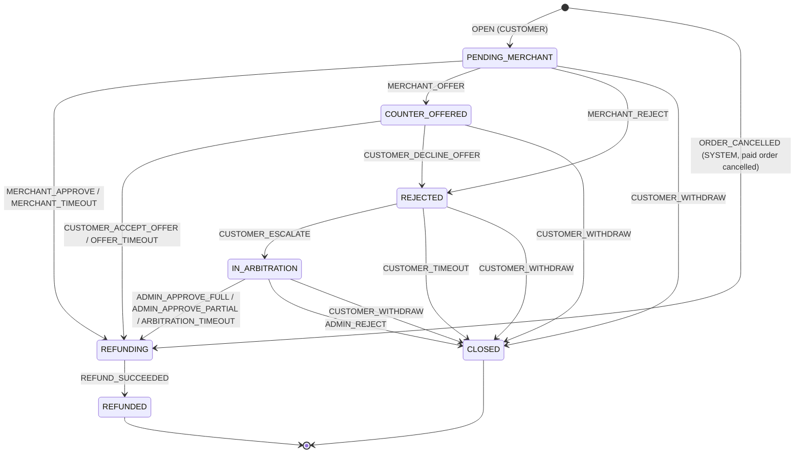

# ADR 0002：通用声明式状态机 + 外卖售后（仅退款）

- 状态：Accepted（2026-10-20）
- 实施：实际实现及其与本文设计的差异按阶段记录在第 21–26 节，第 27 节是汇总。
- 日期：2026-10-20
- 范围：后端（Spring Boot 4.1 / Java 17 / PostgreSQL + H2 / Kafka / Flyway）+ 前端（React 19 strict TS）
- 读者：在**全新会话**里按阶段实施的工程师。本文 + `AGENTS.md` 就是全部上下文。

路径缩写（下文所有 `path:line` 都相对仓库根 `/Users/luc1ferx/Desktop/Projects/Luc1fersFoodBank`）：

| 缩写 | 实际路径 |
|---|---|
| `B/` | `backend/src/main/java/com/laioffer/onlineorder/` |
| `R/` | `backend/src/main/resources/` |
| `T/` | `backend/src/test/java/com/laioffer/onlineorder/` |
| `TR/` | `backend/src/test/resources/` |
| `F/` | `frontend/src/` |

验证命令（每个阶段结束必须全部通过，Docker 必须在运行，否则 Testcontainers 测试会被跳过，JaCoCo 门槛就会失败）：

```sh
cd backend && ./gradlew test jacocoTestReport jacocoTestCoverageVerification spotbugsMain -x buildFrontend -x syncFrontendBuild --no-daemon
cd frontend && npm ci && npm run typecheck && npm run lint && npm test && npm run build
```

---

## 1. 背景（Context）

### 1.1 订单状态机现状
- 边表在枚举里：`PLACED->{PAID,CANCELLED}`、`PAID->{ACCEPTED,CANCELLED}`、`ACCEPTED->{PREPARING,CANCELLED}`、`PREPARING->{COMPLETED}`（`B/model/OrderStatus.java:21-28`）。
- 唯一写入者是 `OrderService.applyTransition`（`B/service/OrderService.java:418-445`）。它的问题有三个：
  - 写入是盲写 `orderRepository.save(withStatus)`（`:428`），没有 `WHERE status`。
  - 指标 `onlineorder.order.transition` 在**提交前**计数（`:443`）。
  - 正确性完全依赖调用方先做 `SELECT ... FOR UPDATE`（`B/repository/OrderRepository.java:38-53`）。
- 策略分散在各处：
  - 商家命令：`requiredStatus` 由 `MerchantOrderService` 传入（`B/fulfilment/merchant/MerchantOrderService.java:93-108`），在 `OrderService.transitionRestaurantOrder` 里检查（`B/service/OrderService.java:309-338`）。错误码是 `ORDER_STATUS_CONFLICT`。
  - 超时：`cancelIfStillIn`（`:355-366`），其中 `DeadlineType.waitingStatus` 定义在 `B/fulfilment/timeout/DeadlineType.java:16,21`。
  - 送达完成：`completeDeliveredOrder` 里的 switch（`:371-389`）。
  - 管理员 PATCH：`idempotentTransitionOrderStatus`（`:165-209`）。PATCH 到当前状态是 200 no-op，但仍会写一条 `changed=false` 的审计。
  - 客户取消：`idempotentCancelOrder`（`:228-258`）。
- 非法迁移的客户和管理员报错是 `ConflictException("Invalid order status transition: X -> Y")`，错误码为默认的 `CONFLICT`（`B/model/OrderStatus.java:59-66`）。

### 1.2 配送状态机现状
- 边表：`ASSIGNED->{PICKED_UP,CANCELLED}`、`PICKED_UP->{DELIVERED,CANCELLED}`（`B/fulfilment/dispatch/DeliveryStatus.java:22-27`）。
- `DispatchService.transition/applyTransition`（`B/fulfilment/dispatch/DispatchService.java:344-387`）的问题：
  - `updateStatus` 和 `updateRider` 只按 `WHERE id` 写，返回的行数被忽略（`B/fulfilment/dispatch/DeliveryRepository.java:87-114`）。
  - 骑手负载递减只看目标状态（`DispatchService.java:382-384`）。
  - `cancelDelivery` 用 `holdsRider()` 判断，不查边表（`:304-313`）。
  - `reassign` 先判断"同一骑手"再判断状态（`:171-222`）。

### 1.3 其它现状
- **商家收件箱。** `merchant_orders` 是一个只前进的投影，由事件驱动（`EventSequenceTracker` 加 CAS）。它必须容忍重放、乱序和 V9 之前的事件，因此**不进入严格引擎**。
- **并发测试。** 只有一个并发测试：商家接单 vs ACCEPT 超时（`T/fulfilment/FulfilmentPostgresIntegrationTests.java:324`）。
- **支付是模拟的。** `PaymentService.payAndCheckout` 只校验卡字段（`B/service/PaymentService.java:37-78`）。
  - 全仓库没有退款概念。
  - 已支付订单被取消后，通知文案是 "Please contact support about your payment."（`B/service/OrderNotificationService.java:28,187-200`）。
- **金额。** `Money` 没有 `minus` 和比较方法（`B/money/Money.java:160-193`）。
- **通知去重。** 依赖 `UNIQUE(order_id, event_type)`（`R/db/migration/V1__create_schema.sql:143`，`B/repository/OrderNotificationRepository.java:33`）。
- **安全配置。** 没有 `/admin/**` 的统配规则，每个 admin 路径单独列出（`B/AppConfig.java:100-114`）。
- **事件命名约束。** `event_type` 必须匹配 `^[a-z]+\.[a-z_]+$`，`aggregate_type` 必须匹配 `^[A-Z_]+$`（`R/event-schemas/common/envelope/v1.json`）。
- **topic 名唯一。** `EventContracts.topics(...)` 用 map 大小校验 topic 名互不相同（`B/messaging/contract/EventContracts.java:185-190`）。
- **最高迁移版本。** 最高的是 `V11__Money_with_currency`（Java 迁移，`backend/src/main/java/db/migration/`）。下一个版本是 **V12**。

---

## 2. 决策（Decisions）

**D1 通用状态机组件**
- 新包 `com.laioffer.onlineorder.statemachine`，纯 Java 17，不依赖 Spring，也不依赖任何状态机框架（Spring Statemachine、COLA、stateless4j、squirrel 都不用）。
- 定义由四个维度声明：状态 x 触发器（命令或事件） x 角色（actor） x 守卫（guard）。
- 引擎**只做决策**，是纯函数，不做 IO。
- 加锁、CAS 写、历史、事件、审计由各聚合自己的服务完成。这样锁顺序和事务边界保持原样。

**D2 订单与配送整体迁移（"全部迁移"）**
- `orders.status` 与 `deliveries.status` 的每一次写入都先经过引擎的 `decide`。
- 保留 `SELECT ... FOR UPDATE` 作为决策点。
- 写入改为 CAS：订单 `WHERE id AND status = :expected`；配送再加 `AND rider_id = :expectedRiderId`。
- 行数不等于 1 时抛出 `StaleTransitionException`（继承 `IllegalStateException`，事务回滚，返回 500）。在锁存在的情况下这应该永远不会发生，它是防御。
- 错误码和错误文案保持**字节兼容**。
- 每个命令显式声明"已完成"的语义（`alreadyDoneWhen`）。**不做**基于"可达性"的放宽，以保持 README.md:587-588 描述的"接单 vs 超时"语义。

**D3 售后核心放在订单域**
- 新包 `com.laioffer.onlineorder.aftersales`（方案 a），直接读 `orders` 和 `order_history_items`。
- 商家端在 `fulfilment.merchant`：
  - 商家决策**同步**经由 `OrderLifecycleCommands` 新增的一个方法。这是唯一允许的同步接缝，接受它变宽。
  - 商家列表读本模块的投影 `merchant_after_sales_cases`，投影由售后事件驱动。

**D4 退款状态不进入 `orders.status`**
- 订单状态集合和 order-data 契约都不变（加 `REFUNDED` 会是 BREAKING 变更）。

**D5 每个订单至多一张售后单**
- 约束 `UNIQUE(order_id)`。撤销或关闭后不能再申请（见"待决策"1）。
- 已支付订单被取消后的自动退款，也建模为一张售后单：`kind = ORDER_CANCELLED`，由 SYSTEM 创建，**直接进入 `REFUNDING`**。
- `COMPLETED` 与 `CANCELLED` 互斥，因此两类售后单不会冲突。
- 结论：一单至多一笔退款；退款金额由 D16 的支付记录封顶，并由第 19 节的组合外键把 `refunds.amount` 绑到售后单的 `approved_amount`。

**D6 售后状态共 7 个**
- `PENDING_MERCHANT`、`COUNTER_OFFERED`、`REJECTED`、`IN_ARBITRATION`、`REFUNDING`、`REFUNDED`、`CLOSED`。
- 不设"修改申请"回路；商家只有一次答复机会（同意、拒绝或还价，三选一）。

**D7 截止时间**
- 每个等待状态都有截止时间，存在售后单行上（`deadline_at`）。
- 截止是**硬截止**：过了 `deadline_at` 后，客户或商家的响应被守卫拒绝（409 `AFTER_SALES_DEADLINE_PASSED`），即使轮询器还没触发（见"待决策"5）。

**D8 退款执行模拟真实网关**
- 幂等键 `gateway_key`。
- 先 claim 并持有租约，然后在事务**外**调用网关，最后再开一个事务记录结果。
- 失败按指数退避重试；超过次数后标记 `FAILED`，由管理员手动重试。

**D9 事件**
- 新 topic `after-sales-events`，聚合类型 `AFTER_SALES_CASE`（aggregate_id = 售后单 id），record key = 订单 id。
- 7 个事件类型，每个状态对应一个：`aftersales.*`。

**D10 幂等**
- 客户命令和管理员裁决都要求 `Idempotency-Key`。实现上复用 `idempotency_requests` 表：`order_id` 存售后单所属订单的 id；因为一单一售后单，重放时按 order_id 返回**当前**售后单。
- 新组件 `IdempotentRequests` 承载这段逻辑。`OrderService` 自己的那份实现不动。
- 商家命令不带 key，靠状态保证幂等。

**D11 审计**
- 写 `audit_log` 的只有两件事：管理员裁决（`after_sales_case.arbitrate`）和管理员重试退款（`refund.retry`），且都只在确实有变化时写。
- 客户、商家、系统的每一步写入 `after_sales_case_history`，并带上 `OrderActor`。

**D12 取消退款同步创建**
- 订单从 `PAID` 或 `ACCEPTED` 变为 `CANCELLED` 时，在**同一事务**里同步创建售后单和退款。不经 Kafka，因此 h2 profile 下也成立。
- **只在存在已扣款的支付记录（D16）且金额大于 0 时创建**。没有支付记录（例如管理员把 PLACED 手动改成 PAID 的订单）或订单总额为 0.00 时，什么都不建，取消照常成功。否则 0 元订单的取消会撞上 `requested_amount > 0` 的 CHECK 而回滚，ACCEPT 超时会无限重试。

**D16 支付记录（审查后新增）**
- 新表 `order_payments`（订单域，放进 V12）：`id BIGSERIAL`、`order_id BIGINT NOT NULL UNIQUE`（FK → orders，`ON DELETE RESTRICT`）、`customer_id BIGINT NOT NULL`、`amount NUMERIC(12,2) NOT NULL CHECK (amount >= 0)`、`currency CHAR(3) NOT NULL`、`status TEXT NOT NULL CHECK (status IN ('CAPTURED'))`、`provider_reference TEXT NOT NULL`（模拟扣款号，如 `SIMPAY-…`）、`captured_at TIMESTAMP NOT NULL`。
- `PaymentService.payAndCheckout` 在创建 PAID 订单的**同一事务**里插入这一行（经 `CartService.checkoutInternal` 的 PAID 分支）；`POST /cart/checkout`（PLACED）和管理员 PATCH 不插入。
- 退款只针对已扣款的支付：取消退款和客户申请都要求存在 `order_payments` 行，金额上限是 `order_payments.amount`；`RefundGatewayRequest` 带上 `paymentReference`。
- 客户申请时没有支付记录 → 409 `AFTER_SALES_NOT_ELIGIBLE`，文案 `"Order has no captured payment"`。
- V12 之前已支付的订单没有支付记录，因此**不能**自动退款或申请售后；在 `docs/operations.md` 写明运维如何人工处理。

**D13 轮询器**
- 一个 `SmartLifecycle` 轮询器，线程名 `after-sales-poller`，同时负责售后截止时间和退款执行。
- 默认开关跟随 `app.kafka.enabled`。
- 不注册 `TaskScheduler` bean。

**D14 管理员 PATCH 保持现状**
- PATCH 到 `PLACED`：订单已是 `PLACED` 时是带审计的 no-op，其他状态返回 409。
- PATCH 到当前状态仍写 `changed=false` 审计。这是 AGENTS.md "只在变化时审计"规则的已知例外，在文档中写明。

**D15 指标修复**
- 修复提交前计数的转换指标：在 P2 里单独一个 commit，改成 `AfterCommit.run`。

---

## 3. 通用状态机组件 API（`com.laioffer.onlineorder.statemachine`）

### 3.1 类与签名

```java
package com.laioffer.onlineorder.statemachine;

/** An immutable, validated declaration of one aggregate's lifecycle. Thread-safe; declare as static final. */
public final class StateMachine<S extends Enum<S>, T extends Enum<T>, A extends Enum<A>, X> {

    public static <S extends Enum<S>, T extends Enum<T>, A extends Enum<A>, X> Builder<S, T, A, X> builder(
            String name, Class<S> states, Class<T> triggers, Class<A> actors, Class<X> context);

    /** Pure: no IO. Throws IllegalStateException when {@code actor} may not fire {@code trigger} (a programming error). */
    public Decision<S, T> decide(S current, T trigger, A actor, X context);

    public Transition<S, T, A, X> transition(T trigger);
    /** true when some non-stay transition moves from -> to (the old TRANSITIONS table). */
    public boolean canMove(S from, S to);
    public Set<S> targets(S from);
    public Set<S> initialStates();
    public Set<S> terminalStates();
    public List<Transition<S, T, A, X>> transitions();   // declaration order
    public String name();
    /** stateDiagram-v2 text, edges in declaration order (docs and tests). */
    public String toMermaid();

    public static final class Builder<S extends Enum<S>, T extends Enum<T>, A extends Enum<A>, X> {
        @SafeVarargs public final Builder<S, T, A, X> initial(S... states);
        @SafeVarargs public final Builder<S, T, A, X> terminal(S... states);
        public TransitionBuilder<S, T, A, X> on(T trigger);
        /** Validates the whole declaration; throws IllegalStateException listing every problem. */
        public StateMachine<S, T, A, X> build();
    }

    public static final class TransitionBuilder<S extends Enum<S>, T extends Enum<T>, A extends Enum<A>, X> {
        @SafeVarargs public final TransitionBuilder<S, T, A, X> from(S... states);
        public TransitionBuilder<S, T, A, X> to(S state);
        /** An internal transition: the command is legal from these states and keeps the state (e.g. reassign). */
        public TransitionBuilder<S, T, A, X> stay();
        @SafeVarargs public final TransitionBuilder<S, T, A, X> by(A... actors);
        /** Evaluated in declaration order after the from-state matched; first failure rejects. */
        public TransitionBuilder<S, T, A, X> guard(String name, Predicate<? super X> test);
        /** The command already happened (a retry): checked BEFORE the from-state. */
        public TransitionBuilder<S, T, A, X> alreadyDoneWhen(BiPredicate<S, ? super X> test);
        public Builder<S, T, A, X> add();
    }
}

public record Transition<S, T, A, X>(T trigger, Set<S> from, S to /* null for stay() */, Set<A> actors,
                                     List<Guard<X>> guards, BiPredicate<S, ? super X> alreadyDone /* nullable */) {
    public boolean stays() { return to == null; }
}

public record Guard<X>(String name, Predicate<? super X> test) { }

public sealed interface Decision<S, T> permits Decision.Apply, Decision.AlreadyDone, Decision.Rejected {
    record Apply<S, T>(T trigger, S from, S to) implements Decision<S, T> { }        // to == from for a stay
    record AlreadyDone<S, T>(T trigger, S current) implements Decision<S, T> { }
    record Rejected<S, T>(T trigger, S current, Reason reason, String guard /* null unless GUARD_FAILED */)
            implements Decision<S, T> { }
    enum Reason { NOT_FROM_CURRENT_STATE, GUARD_FAILED }
}

/** Raised when a CAS write did not change exactly one row: the row lock contract was broken. */
public final class StaleTransitionException extends IllegalStateException { ... }

public final class CompareAndSet {
    public static void expectOneRow(int rows, String aggregate, Object id, Object expectedState);
}
```

### 3.2 `decide` 语义（固定顺序）
1. 取出 `trigger` 对应的 `Transition`。`build()` 保证每个触发器常量都恰好声明一次。
2. 如果 `actor ∉ actors`，抛 `IllegalStateException("<machine>: <actor> may not fire <trigger>")`。这是编程错误：端点的安全配置本应拦截掉它。
3. 如果 `alreadyDone != null` 且 `alreadyDone.test(current, ctx)` 为真，返回 `AlreadyDone`。
4. 如果 `current ∉ from`，返回 `Rejected(NOT_FROM_CURRENT_STATE)`。
5. 按声明顺序执行守卫；第一个失败的守卫返回 `Rejected(GUARD_FAILED, name)`。
6. 返回 `Apply(trigger, current, stays ? current : to)`。

调用方用 `instanceof` 模式匹配处理 `Decision`。Java 17 的 switch 模式匹配还是预览特性，**不要用**。

### 3.3 `build()` 校验（全部失败一次性列出）
- 每个触发器常量恰好一个 `Transition`；`actors` 非空。
- 非 stay 的转换不能自环（`to ∉ from`）；`stay()` 必须有非空 `from`。
- `from` 为空只允许在声明了 `alreadyDoneWhen` 时出现，表示"永远只会是 no-op 的命令"，例如 `ADMIN_KEEP_PLACED`。
- 终态没有出边（`from ∩ terminal = ∅`），并且声明的 `terminal` 等于计算出的"无出边状态"集合。
- 从 `initial` 出发每个状态都可达，每个非终态都能到达某个终态。

`decide` 不做任何 IO。机器定义是 `static final` 常量，所以声明错误会在类初始化时让所有相关测试失败。

---

## 4. 订单与配送的声明（P2 迁移目标）

### 4.1 订单：`B/service/OrderStateMachine.java`、`B/service/OrderTrigger.java`、`B/service/OrderTransitionContext.java`

`OrderTransitionContext(String currentCancelReason, String requestedCancelReason)` 提供方法 `sameCancelReasonCode()`。它比较的是第一个 `:` 之前的部分，与现有 `cancelReasonCode` 逻辑一致（`OrderService.java:343-350`）。

| Trigger | From | To | Actors（`OrderActor.Type`） | alreadyDoneWhen | 调用方 / Rejected 时的映射（字节兼容） |
|---|---|---|---|---|---|
| `CUSTOMER_CANCEL` | PLACED, PAID, ACCEPTED | CANCELLED | CUSTOMER | `s == CANCELLED`（任何原因，保留原 reason） | `cancelOrder` / `idempotentCancelOrder`：409 `CONFLICT` `"Invalid order status transition: X -> CANCELLED"` |
| `MERCHANT_ACCEPT` | PAID | ACCEPTED | MERCHANT, SYSTEM | `s == ACCEPTED` | `transitionRestaurantOrder`：409 `ORDER_STATUS_CONFLICT` `"Order is X[ (CODE)]; only PAID orders can move to ACCEPTED"` |
| `MERCHANT_REJECT` | PAID | CANCELLED | MERCHANT, SYSTEM | `s == CANCELLED && ctx.sameCancelReasonCode()` | 同上格式，`...can move to CANCELLED` |
| `MERCHANT_START_PREPARING` | ACCEPTED | PREPARING | MERCHANT, SYSTEM | `s == PREPARING` | 同上格式，`only ACCEPTED orders can move to PREPARING` |
| `PAYMENT_TIMEOUT` | PLACED | CANCELLED | SYSTEM | （无） | `cancelIfStillIn(..., PLACED, ...)`：任何 `Rejected` 都返回 `Optional.empty()`（绝不抛异常） |
| `ACCEPT_TIMEOUT` | PAID | CANCELLED | SYSTEM | （无） | `cancelIfStillIn(..., PAID, ...)`：同上 |
| `DELIVERY_PREPARE` | ACCEPTED | PREPARING | RIDER, SYSTEM | （无） | `completeDeliveredOrder` 的 ACCEPTED 分支第 1 步 |
| `DELIVERY_COMPLETE` | PREPARING | COMPLETED | RIDER, SYSTEM | （无） | `completeDeliveredOrder`；五路映射 COMPLETED / ALREADY_COMPLETED / IGNORED / NOT_FOUND 仍留在调用方 switch 里 |
| `ADMIN_MARK_PAID` | PLACED | PAID | ADMIN, SYSTEM | `s == PAID` | 管理员 PATCH 与测试用的 `transitionOrderStatus` 重载：409 `CONFLICT` `"Invalid order status transition: X -> PAID"` |
| `ADMIN_ACCEPT` | PAID | ACCEPTED | ADMIN, SYSTEM | `s == ACCEPTED` | 同上（`-> ACCEPTED`） |
| `ADMIN_START_PREPARING` | ACCEPTED | PREPARING | ADMIN, SYSTEM | `s == PREPARING` | 同上 |
| `ADMIN_COMPLETE` | PREPARING | COMPLETED | ADMIN, SYSTEM | `s == COMPLETED` | 同上 |
| `ADMIN_CANCEL` | PLACED, PAID, ACCEPTED | CANCELLED | ADMIN, SYSTEM | `s == CANCELLED` | 同上；原因写 `ADMIN_CANCELLED` |
| `ADMIN_KEEP_PLACED` | （空） | PLACED | ADMIN, SYSTEM | `s == PLACED` | 对 PLACED 订单是 no-op（仍写 `changed=false` 审计）；其他状态 409 `"Invalid order status transition: X -> PLACED"` |

关于 actor 的说明：
- 测试会用 `OrderActor.system()` 调用商家命令和送达完成，例如 `T/fulfilment/order/OrderLifecycleCommandsTests.java:117,131,143,275`，以及 `T/fulfilment/FulfilmentPostgresIntegrationTests.java:692-693`。所以这些触发器必须包含 SYSTEM。
- 如果 P2 里有测试只因为 actor 校验而失败，只允许补充 SYSTEM。没有产品理由，不要放宽到其他 actor 类型。

`OrderStateMachine` 提供三个 static 帮助方法：
- `adminTrigger(OrderStatus target)`：每个目标状态各对应一个 ADMIN_* 触发器。
- `restaurantTrigger(OrderStatus required, OrderStatus target)`：`(PAID,ACCEPTED)`、`(PAID,CANCELLED)`、`(ACCEPTED,PREPARING)` 以外的组合都抛 `IllegalArgumentException`。同时断言该触发器的 `from` 等于 `{required}`。
- `timeoutTrigger(OrderStatus waiting)`：`PLACED → PAYMENT_TIMEOUT`，`PAID → ACCEPT_TIMEOUT`，其他抛 `IllegalArgumentException`。

**不变式**：所有非 stay 转换的边，其并集必须恰好等于旧 `OrderStatus.TRANSITIONS` 表，由 P1 的表驱动测试锁定。各 ADMIN_* 触发器合起来正好覆盖这张表。

**`OrderService` 改造（P2-4）**：
- **触发器由调用方决定并传入**，`transitionLockedOrder` / `applyTransition` 自己不推断（审查发现：按 actor 推断会把商家命令和超时都判成 ADMIN_*，商家接单全部变成 500）：
  - `idempotentCancelOrder` / `cancelOrder` → `CUSTOMER_CANCEL`
  - `transitionRestaurantOrder` → `restaurantTrigger(requiredStatus, targetStatus)`
  - `cancelIfStillIn` → `timeoutTrigger(waitingStatus)`
  - `completeDeliveredOrder` → `DELIVERY_PREPARE` / `DELIVERY_COMPLETE`
  - `idempotentTransitionOrderStatus` 与测试用的 `transitionOrderStatus` 重载 → `adminTrigger(target)`
  - P2 必须加一个用 `OrderActor.merchant(...)`（而不是 `system()`）走完商家接单、拒单、开始备餐的测试，以及用真实超时路径触发 `PAYMENT_TIMEOUT` / `ACCEPT_TIMEOUT` 的测试，锁住这一点。
- `applyTransition` 的写入改为：
  ```java
  int rows = orderRepository.compareAndSetStatus(order.id(), from.name(), to.name(), newCancelReason, now);
  CompareAndSet.expectOneRow(rows, "order", order.id(), from);
  ```
  新 SQL 位于 `B/repository/OrderRepository.java`：
  ```sql
  UPDATE orders SET status = :toStatus, cancel_reason = :cancelReason, updated_at = :updatedAt
  WHERE id = :id AND status = :fromStatus
  ```
  `cancel_reason` 只在目标为 CANCELLED 时替换，否则写回原值。
  内存里的实体用 `order.withStatus(...)` 构造，不再调用 `save`。
- 其余顺序不变：同一个 `now` 依次用于 CAS、`OrderStatusHistoryService.record`、`enqueueOrderEvent` 的 `occurredAt`，然后计指标。指标从 P2-1 起改为 `AfterCommit.run`。
- `OrderStatus` 删除 `TRANSITIONS`。`canTransitionTo` 委托给 `OrderStateMachine.DEFINITION.canMove`。`validateTransitionTo` 保留，并委托给它。
- 结账创建订单保持在引擎外：`CartService` 的 INSERT 和 `OrderNumberCallback` 都不动。由测试断言 `CHECKOUT_INITIAL_STATES == DEFINITION.initialStates()`。

**锁顺序不变**：第一把锁（idempotency_requests、merchant_orders、order_deadlines 的 SKIP LOCKED 或 processed_events 咨询锁）→ `orders` 的 FOR UPDATE → CAS UPDATE → `outbox_aggregate_sequences`（在 `enqueueEvent` 中）→ 审计、收件箱、`markSucceeded` 或删除 deadline。

### 4.2 配送：`B/fulfilment/dispatch/DeliveryStateMachine.java`、`DeliveryTrigger.java`、`DeliveryActor.java`、`DeliveryCommandContext.java`

- `DeliveryActor { RIDER, ADMIN, SYSTEM }` 是本模块自己的枚举，不引用订单模块的类型。
- `DeliveryCommandContext(Long currentRiderId, Long requestedRiderId)` 只供 `REASSIGN` 使用；其他触发器传 `null`。

| Trigger | From | To | Actors | alreadyDoneWhen | 调用方 / Rejected 时的映射 |
|---|---|---|---|---|---|
| `PICK_UP` | ASSIGNED | PICKED_UP | RIDER, ADMIN | `s == PICKED_UP` | `advanceForRider`（RIDER）、`markPickedUp`（ADMIN）：409 `DELIVERY_STATUS_CONFLICT` `"Delivery is X; it cannot move to PICKED_UP"` |
| `DELIVER` | PICKED_UP | DELIVERED | RIDER, ADMIN | `s == DELIVERED` | 同上（`...move to DELIVERED`） |
| `CANCEL_FOR_ORDER` | ASSIGNED, PICKED_UP | CANCELLED | SYSTEM | `s == CANCELLED` | `cancelDelivery`：Rejected（即 DELIVERED）时**静默忽略**；tombstone 始终设置 |
| `REASSIGN` | ASSIGNED, PICKED_UP | （stay） | ADMIN | `Objects.equals(ctx.currentRiderId, ctx.requestedRiderId)`（先于状态检查，DELIVERED 也返回 200） | `reassign`：409 `DELIVERY_STATUS_CONFLICT` `"Delivery is X; only an open delivery can be reassigned"` |

**CAS**（`B/fulfilment/dispatch/DeliveryRepository.java`）：删除 `updateStatus` 和 `updateRider`，改为以下两个方法。

```sql
-- int compareAndSetStatus(Long id, String expectedStatus, Long expectedRiderId, String status,
--                         LocalDateTime pickedUpAt, LocalDateTime deliveredAt, LocalDateTime cancelledAt, LocalDateTime updatedAt)
UPDATE deliveries SET status = :status, picked_up_at = :pickedUpAt, delivered_at = :deliveredAt,
       cancelled_at = :cancelledAt, updated_at = :updatedAt
WHERE id = :id AND status = :expectedStatus AND rider_id = :expectedRiderId

-- int compareAndSetRider(Long id, Long expectedRiderId, Long riderId, LocalDateTime updatedAt)
UPDATE deliveries SET rider_id = :riderId, updated_at = :updatedAt
WHERE id = :id AND rider_id = :expectedRiderId AND status IN ('ASSIGNED', 'PICKED_UP')
```

两处都用 `CompareAndSet.expectOneRow` 校验行数。

负载递减改为按"离开持有状态"判断：

```java
if (from.holdsRider() && !to.holdsRider()) riderRepository.decrementLoad(expectedRiderId, now)
```

`expectedRiderId` 是被 CAS 确认过的那位骑手。

以下保持不动：
- `assignRider` 的 INSERT，即 `insertAssignedIfAbsent`。
- `RiderService` 与 `DeliveryAdminService` 的审计逻辑。
- 锁顺序：配送行 → 骑手行（改派时按 id 顺序）→ outbox 序列行。

`DeliveryStatus.canTransitionTo` 改为委托 `DeliveryStateMachine.DEFINITION.canMove`；`holdsRider()` 保留，它是状态本身的属性。

---

## 5. 售后状态机（`com.laioffer.onlineorder.aftersales`）

### 5.1 状态

| 状态 | 中文 | 等待谁 | 截止时间 | 是否终态 |
|---|---|---|---|---|
| `PENDING_MERCHANT` | 待商家处理 | 商家 | 商家处理时限 24h | 否 |
| `COUNTER_OFFERED` | 商家提出部分退款方案，待用户确认 | 客户 | 客户处理时限 48h | 否 |
| `REJECTED` | 协商未达成（商家拒绝，或用户拒绝方案），可申请平台介入 | 客户 | 客户处理时限 48h | 否 |
| `IN_ARBITRATION` | 平台介入中 | 管理员 | 平台处理时限 72h | 否 |
| `REFUNDING` | 退款中（金额已确定，钱在路上） | 系统（退款执行器） | 无（退款自身有重试与失败） | 否 |
| `REFUNDED` | 已退款 | 无 | 无 | 是 |
| `CLOSED` | 已关闭（撤销、超时或平台驳回） | 无 | 无 | 是 |

- 初始状态有两个：`PENDING_MERCHANT`（`kind = CUSTOMER_REQUEST`，客户申请）和 `REFUNDING`（`kind = ORDER_CANCELLED`，系统在取消订单时创建）。
- "开放"状态（可撤销）记为 W = {PENDING_MERCHANT, COUNTER_OFFERED, REJECTED, IN_ARBITRATION}。

### 5.2 转换表（`AfterSalesTrigger`，actor 类型复用 `OrderActor.Type`）

上下文类型：

```java
record AfterSalesTransitionContext(AfterSalesCaseEntity current, LocalDateTime now, BigDecimal amount)
```

- `amount` 是本次命令输入的金额，只用于还价和部分裁决。
- 守卫 `beforeDeadline` 判断 `now.isBefore(current.deadlineAt())`。
- 守卫 `deadlineDue` 判断 `!now.isBefore(current.deadlineAt())`。

| Trigger | From | To | Actors | Guard | alreadyDoneWhen | 写入的字段 |
|---|---|---|---|---|---|---|
| `MERCHANT_APPROVE` | PENDING_MERCHANT | REFUNDING | MERCHANT | beforeDeadline | `merchant_decision == APPROVED` | merchant_decision=APPROVED，approved=requested，resolution=MERCHANT_APPROVED |
| `MERCHANT_REJECT` | PENDING_MERCHANT | REJECTED | MERCHANT | beforeDeadline | `merchant_decision == REJECTED` | merchant_decision=REJECTED，merchant_note=reason（必填） |
| `MERCHANT_OFFER` | PENDING_MERCHANT | COUNTER_OFFERED | MERCHANT | beforeDeadline | `merchant_decision == OFFERED && offered_amount == ctx.amount` | merchant_decision=OFFERED，offered_amount，merchant_note |
| `MERCHANT_TIMEOUT` | PENDING_MERCHANT | REFUNDING | SYSTEM | deadlineDue | （无） | approved=requested，resolution=MERCHANT_TIMEOUT |
| `CUSTOMER_ACCEPT_OFFER` | COUNTER_OFFERED | REFUNDING | CUSTOMER | beforeDeadline | `resolution == OFFER_ACCEPTED` | approved=offered，resolution=OFFER_ACCEPTED |
| `CUSTOMER_DECLINE_OFFER` | COUNTER_OFFERED | REJECTED | CUSTOMER | beforeDeadline | `s == REJECTED && merchant_decision == OFFERED` | （无额外字段） |
| `OFFER_TIMEOUT` | COUNTER_OFFERED | REFUNDING | SYSTEM | deadlineDue | （无） | approved=offered，resolution=OFFER_TIMEOUT（见"待决策"2） |
| `CUSTOMER_ESCALATE` | REJECTED | IN_ARBITRATION | CUSTOMER | beforeDeadline | `s == IN_ARBITRATION` | 可选 note 写入历史 |
| `CUSTOMER_TIMEOUT` | REJECTED | CLOSED | SYSTEM | deadlineDue | （无） | close_reason=CUSTOMER_TIMEOUT |
| `CUSTOMER_WITHDRAW` | PENDING_MERCHANT, COUNTER_OFFERED, REJECTED, IN_ARBITRATION | CLOSED | CUSTOMER | （无） | `s == CLOSED && close_reason == WITHDRAWN` | close_reason=WITHDRAWN |
| `ADMIN_APPROVE_FULL` | IN_ARBITRATION | REFUNDING | ADMIN | （无） | （无，key 负责重放） | approved=requested，resolution=ARBITRATION_FULL，admin_note |
| `ADMIN_APPROVE_PARTIAL` | IN_ARBITRATION | REFUNDING | ADMIN | （无） | （无） | approved=ctx.amount，resolution=ARBITRATION_PARTIAL，admin_note |
| `ADMIN_REJECT` | IN_ARBITRATION | CLOSED | ADMIN | （无） | （无） | close_reason=ARBITRATION_REJECTED，admin_note |
| `ARBITRATION_TIMEOUT` | IN_ARBITRATION | REFUNDING | SYSTEM | deadlineDue | （无） | approved=requested，resolution=ARBITRATION_TIMEOUT（见"待决策"3） |
| `REFUND_SUCCEEDED` | REFUNDING | REFUNDED | SYSTEM | （无） | `s == REFUNDED` | refunded_amount=refund.amount |

创建不是转换，由单一写入者的 `open(...)` 完成：
- `CUSTOMER_REQUEST` 创建为 PENDING_MERCHANT，历史 action 记为 `OPEN`。
- `ORDER_CANCELLED` 创建为 REFUNDING，`approved = requested = order_total`，`resolution = ORDER_CANCELLED`，历史 action 记为 `ORDER_CANCELLED`。

金额规则（服务层校验，失败返回 400 `BAD_REQUEST`；DB CHECK 作为兜底）：
- `requested_amount` 等于各行 `单价 x 数量` 之和，用 `Money` 精确相加，不做舍入。
- 还价金额满足 `0 < offered < requested`。
- 部分裁决金额满足 `0 < amount < requested`。
- 金额小数位超过币种的位数时 → 400 `"Amount must have at most N decimal places"`，由 `Money.of` 的 `IllegalArgumentException` 转换而来。

Rejected 的映射：
- `NOT_FROM_CURRENT_STATE` → 409 `AFTER_SALES_STATUS_CONFLICT`，文案为 `"After-sales case is {current}; only {from 以 ' or ' 连接} cases can be {verb}"`。
  - 例：`"After-sales case is REFUNDING; only PENDING_MERCHANT cases can be approved"`。
  - `verb` 来自 `AfterSalesTrigger.verb()`：approved / rejected / given a counter-offer / accepted / declined / escalated / withdrawn / arbitrated。
- `GUARD_FAILED(beforeDeadline)` → 409 `AFTER_SALES_DEADLINE_PASSED`，文案 `"The deadline of this after-sales step passed at {deadline_at}"`。
- 轮询器自己的 Rejected 计为 `skipped`，不抛异常。

### 5.3 Mermaid



### 5.4 退款状态机（`RefundStatus`、`RefundTrigger`、`RefundStateMachine`，actor 类型为 `OrderActor.Type`）

| Trigger | From | To | Actors | Guard / alreadyDone |
|---|---|---|---|---|
| `CLAIM` | PENDING | PROCESSING | SYSTEM | （无） |
| `RECLAIM` | PROCESSING | （stay） | SYSTEM | guard `leaseExpired`（`claimed_until <= now`） |
| `SUCCEED` | PROCESSING | SUCCEEDED | SYSTEM | alreadyDone `s == SUCCEEDED` |
| `RETRY_LATER` | PROCESSING | PENDING | SYSTEM | （无） |
| `GIVE_UP` | PROCESSING | FAILED | SYSTEM | （无） |
| `ADMIN_RETRY` | FAILED | PENDING | ADMIN | alreadyDone `s == PENDING`；Rejected → 409 `REFUND_STATUS_CONFLICT` `"Refund is X; only FAILED refunds can be retried"` |

- 初始状态 {PENDING}，终态 {SUCCEEDED}。FAILED 不是终态，可由管理员重试回到 PENDING。

### 5.5 各角色时间线（产品行为）

**客户**
1. 订单 COMPLETED 后 24h 内可以"申请售后"：选整单或按菜品和数量，填原因和描述。
2. 提交后看到"等待商家处理，截止 T+24h"。
3. 商家同意 → "退款中" → 几秒后"已退款 ¥X"，并收到通知。
4. 商家拒绝 → 看到拒绝理由，可在 48h 内"申请平台介入"或"撤销"。
5. 商家还价 → 48h 内选择接受或拒绝；不处理则自动接受方案。
6. 平台介入后 72h 内由管理员裁决；超时则按申请金额全额退款。
7. 任何开放步骤都能撤销。
8. 已支付订单被取消 → 订单下显示"自动退款 ¥X：退款中 / 已退款"。

**商家**
1. 控制台 "After-sales" 页签显示倒计时。
2. 只能答复一次：同意、拒绝（必须填理由）或部分退款还价（金额必须小于申请金额）。
3. 超时未处理即自动同意。
4. 账号被停用后，任何请求都返回 403。

**管理员**
1. Admin 控制台 "After-sales" 区块列出平台介入队列。
2. 详情里有完整协商历史。
3. 可裁决全额、部分或驳回，必须写说明，并会写审计。
4. 可在失败退款列表里手动重试。

---

## 6. 截止时间（Deadlines）

| 状态 | 属性 | 默认值 | 到期触发器 | 结果 |
|---|---|---|---|---|
| （申请窗口）COMPLETED 订单 | `app.after-sales.request-window` | `24h`，从 `orders.updated_at`（完成时刻）起算 | — | 超过窗口后申请返回 409 `AFTER_SALES_NOT_ELIGIBLE` |
| `PENDING_MERCHANT` | `app.after-sales.merchant-response-timeout` | `24h` | `MERCHANT_TIMEOUT` | REFUNDING，金额为申请金额 |
| `COUNTER_OFFERED` | `app.after-sales.customer-response-timeout` | `48h` | `OFFER_TIMEOUT` | REFUNDING，金额为还价金额 |
| `REJECTED` | `app.after-sales.customer-response-timeout` | `48h` | `CUSTOMER_TIMEOUT` | CLOSED（CUSTOMER_TIMEOUT） |
| `IN_ARBITRATION` | `app.after-sales.arbitration-timeout` | `72h` | `ARBITRATION_TIMEOUT` | REFUNDING，金额为申请金额 |

**存储方式**
- 截止时间存在售后单行上，不建单独的表：`deadline_at`、`deadline_retry_at`、`deadline_attempts`。
- 每次进入状态时由单一写入者重算：W 内的状态取 `now + 对应时限`，其他状态为 `NULL`；同时清零 `deadline_retry_at` 与 `deadline_attempts`。
- DB CHECK 保证"状态 ∈ W ⇔ `deadline_at IS NOT NULL`"。

**触发：`AfterSalesDeadlineProcessor.fireDueDeadlines()`**，照搬 `B/fulfilment/timeout/OrderDeadlineProcessor.java:74-156` 的模式：
1. 每个事务只处理一张单，用 `TransactionTemplate`。
2. claim 查询：
   ```sql
   SELECT * FROM after_sales_cases
   WHERE deadline_at <= :now AND (deadline_retry_at IS NULL OR deadline_retry_at <= :now)
   ORDER BY deadline_at, id LIMIT 1 FOR UPDATE SKIP LOCKED
   ```
3. 按当前状态选触发器，用 SYSTEM 身份调用 `decide`。
4. `Apply` → 交给 `AfterSalesTransitions` 写入。
5. `Rejected` → 计为 skipped。正常不会发生，因为 claim 时行已加锁。
6. 抛异常 → 在新事务里执行 `reschedule(caseId, now + retry-backoff, attempts + 1, error)`，写入 `deadline_retry_at`。真正的截止时间 `deadline_at` 不变，所以硬截止语义不受影响。
7. 提交后计指标：`onlineorder.aftersales.deadlines{trigger, outcome=fired|skipped|failed}`。

**竞态语义**：轮询器 claim 用 SKIP LOCKED，商家或客户命令用 `FOR UPDATE`，所以两者在同一行锁上串行，只会有一方胜出。截止时间已到时，商家或客户命令无论先拿到锁还是后拿到锁都会得到 409，最终结果总是超时那一方。

---

## 7. 模块边界（Module boundaries）

| 组件 | 包 | 读写的表 | 与他人的交互 |
|---|---|---|---|
| 售后核心（单一写入者、客户 API、管理员 API、截止时间、退款执行、取消退款） | `com.laioffer.onlineorder.aftersales` | 读写 `after_sales_cases`、`after_sales_case_lines`、`after_sales_case_history`、`refunds`；**读** `orders`、`order_history_items`（同属订单域）；写 `idempotency_requests`、`audit_log`、outbox | 由 `OrderService` 同步调用（同属订单域）：`CancellationRefunds.open(...)`、`AfterSalesMerchantCommands.decide(...)`；对外只发 `after-sales-events` |
| 商家售后 | `com.laioffer.onlineorder.fulfilment.merchant` | 读写 `merchant_after_sales_cases`；读 `merchant_accounts` | 消费 `after-sales-events`；决策经 `OrderLifecycleCommands.decideAfterSalesCase(...)` |
| 通知 | `com.laioffer.onlineorder.fulfilment.notification` | `processed_events`；经 `OrderNotificationService` 写 `order_notifications` | 消费 `after-sales-events` |
| 订单 | `com.laioffer.onlineorder.service.OrderService` | 不变，另在取消时调用 `CancellationRefunds` | 实现扩展后的 `OrderLifecycleCommands` |

**接缝扩展**（`B/fulfilment/order/OrderLifecycleCommands.java`）：

```java
String AFTER_SALES_STATUS_CONFLICT = "AFTER_SALES_STATUS_CONFLICT";
String AFTER_SALES_DEADLINE_PASSED = "AFTER_SALES_DEADLINE_PASSED";

/**
 * The merchant's one answer to an after-sales request on an order of {@code restaurantId}. Locks the case row, decides
 * with the after-sales machine (MERCHANT_APPROVE / MERCHANT_REJECT / MERCHANT_OFFER) and writes the transition, its
 * history row and its event in the caller's transaction. A repeat of the same answer returns changed=false.
 * @throws ResourceNotFoundException 404 "After-sales case not found" (missing, kind ORDER_CANCELLED, other restaurant)
 * @throws ConflictException AFTER_SALES_STATUS_CONFLICT / AFTER_SALES_DEADLINE_PASSED
 * @throws BadRequestException invalid offer amount
 */
AfterSalesDecision decideAfterSalesCase(Long caseId, Long restaurantId, AfterSalesResponse response, OrderActor actor);

record AfterSalesResponse(Type type, BigDecimal offerAmount, String note) { enum Type { APPROVE, REJECT, OFFER } }
record AfterSalesDecision(AfterSalesCasePayload snapshot, boolean changed) { }
```

- `OrderService` 实现该方法，直接委托给 `AfterSalesMerchantCommands`。`OrderService` 仍是唯一实现类。
- 返回的快照复用事件 payload 记录 `com.laioffer.onlineorder.messaging.AfterSalesCasePayload`。这样商家模块的投影只需要一个 upsert 入口，命令和消费者共用。

**遵守的规则**
- 不引入新的同步接缝。
- 订单域表到 catalog、identity 或模块表之间不新增外键；`after_sales_*` 表只引用 `orders` 和 `order_history_items`，都在订单域内。
- 订单域的每张新表都能找到 `customer_id`：售后单行自带，其他表经由 `case_id` 关联到售后单。
- 商家模块不读售后表，售后模块不读 `merchant_*` 表。

**ADR 0001 影响**：接缝多出一个方法。将来做 saga 化时，它按"商家命令"同类处理（见第 16 节"风险"）。

---

## 8. 数据模型（Data model）

### 8.1 `R/db/migration/V12__after_sales.sql`

```sql
-- After-sales (com.laioffer.onlineorder.aftersales, order domain). One case per order (uq_after_sales_case_order):
-- a customer refund request on a COMPLETED order, or the automatic refund of a paid order that was cancelled.
CREATE TABLE after_sales_cases
(
    id                BIGSERIAL PRIMARY KEY NOT NULL,
    order_id          BIGINT                NOT NULL,
    customer_id       BIGINT                NOT NULL,
    restaurant_id     BIGINT,
    kind              TEXT                  NOT NULL,
    status            TEXT                  NOT NULL,
    reason_code       TEXT,
    description       TEXT,
    order_total       NUMERIC(12,2)         NOT NULL,
    requested_amount  NUMERIC(12,2)         NOT NULL,
    offered_amount    NUMERIC(12,2),
    approved_amount   NUMERIC(12,2),
    refunded_amount   NUMERIC(12,2),
    currency          CHAR(3)               NOT NULL,
    merchant_decision TEXT,
    merchant_note     TEXT,
    resolution        TEXT,
    close_reason      TEXT,
    admin_note        TEXT,
    deadline_at       TIMESTAMP,
    deadline_retry_at TIMESTAMP,
    deadline_attempts INTEGER DEFAULT 0     NOT NULL,
    version           BIGINT                NOT NULL,
    created_at        TIMESTAMP             NOT NULL,
    updated_at        TIMESTAMP             NOT NULL,
    CONSTRAINT uq_after_sales_case_order UNIQUE (order_id),
    CONSTRAINT fk_after_sales_case_order FOREIGN KEY (order_id) REFERENCES orders (id) ON DELETE CASCADE,
    CONSTRAINT chk_after_sales_case_kind CHECK (kind IN ('CUSTOMER_REQUEST', 'ORDER_CANCELLED')),
    CONSTRAINT chk_after_sales_case_status CHECK (status IN ('PENDING_MERCHANT', 'COUNTER_OFFERED', 'REJECTED',
        'IN_ARBITRATION', 'REFUNDING', 'REFUNDED', 'CLOSED')),
    CONSTRAINT chk_after_sales_case_request CHECK (kind = 'ORDER_CANCELLED'
        OR (restaurant_id IS NOT NULL AND reason_code IS NOT NULL AND description IS NOT NULL)),
    CONSTRAINT chk_after_sales_case_reason CHECK (reason_code IS NULL OR reason_code IN ('MISSING_ITEM', 'WRONG_ITEM',
        'QUALITY_ISSUE', 'DAMAGED_PACKAGING', 'FOOD_SAFETY', 'LATE_DELIVERY', 'OTHER')),
    CONSTRAINT chk_after_sales_case_amounts CHECK (order_total >= 0 AND requested_amount > 0
        AND requested_amount <= order_total
        AND (offered_amount IS NULL OR (offered_amount > 0 AND offered_amount < requested_amount))
        AND (approved_amount IS NULL OR (approved_amount > 0 AND approved_amount <= requested_amount))
        AND (refunded_amount IS NULL OR refunded_amount = approved_amount)),
    CONSTRAINT chk_after_sales_case_money_state CHECK (status NOT IN ('REFUNDING', 'REFUNDED') OR approved_amount IS NOT NULL),
    CONSTRAINT chk_after_sales_case_refunded CHECK ((status = 'REFUNDED' AND refunded_amount IS NOT NULL)
        OR (status <> 'REFUNDED' AND refunded_amount IS NULL)),
    CONSTRAINT chk_after_sales_case_deadline CHECK (
        (status IN ('PENDING_MERCHANT', 'COUNTER_OFFERED', 'REJECTED', 'IN_ARBITRATION') AND deadline_at IS NOT NULL)
        OR (status IN ('REFUNDING', 'REFUNDED', 'CLOSED') AND deadline_at IS NULL)),
    CONSTRAINT chk_after_sales_case_merchant_decision CHECK (merchant_decision IS NULL
        OR merchant_decision IN ('APPROVED', 'REJECTED', 'OFFERED')),
    CONSTRAINT chk_after_sales_case_resolution CHECK (resolution IS NULL OR resolution IN ('MERCHANT_APPROVED',
        'MERCHANT_TIMEOUT', 'OFFER_ACCEPTED', 'OFFER_TIMEOUT', 'ARBITRATION_FULL', 'ARBITRATION_PARTIAL',
        'ARBITRATION_TIMEOUT', 'ORDER_CANCELLED')),
    CONSTRAINT chk_after_sales_case_close_reason CHECK (close_reason IS NULL
        OR close_reason IN ('WITHDRAWN', 'CUSTOMER_TIMEOUT', 'ARBITRATION_REJECTED'))
);
CREATE INDEX idx_after_sales_cases_customer_created ON after_sales_cases (customer_id, created_at, id);
CREATE INDEX idx_after_sales_cases_status_created ON after_sales_cases (status, created_at, id);
CREATE INDEX idx_after_sales_cases_deadline ON after_sales_cases (deadline_at, id);

CREATE TABLE after_sales_case_lines
(
    id             BIGSERIAL PRIMARY KEY NOT NULL,
    case_id        BIGINT                NOT NULL,
    order_item_id  BIGINT                NOT NULL,
    menu_item_name TEXT                  NOT NULL,
    unit_price     NUMERIC(12,2)         NOT NULL,
    quantity       INTEGER               NOT NULL,
    amount         NUMERIC(12,2)         NOT NULL,
    currency       CHAR(3)               NOT NULL,
    CONSTRAINT fk_after_sales_line_case FOREIGN KEY (case_id) REFERENCES after_sales_cases (id) ON DELETE CASCADE,
    CONSTRAINT fk_after_sales_line_order_item FOREIGN KEY (order_item_id) REFERENCES order_history_items (id) ON DELETE CASCADE,
    CONSTRAINT uq_after_sales_line_item UNIQUE (case_id, order_item_id),
    CONSTRAINT chk_after_sales_line_quantity CHECK (quantity > 0),
    CONSTRAINT chk_after_sales_line_amounts CHECK (unit_price >= 0 AND amount >= 0)
);

-- Append-only, low volume: deliberately not partitioned (AGENTS.md partitions high-volume tables only).
CREATE TABLE after_sales_case_history
(
    id          BIGSERIAL PRIMARY KEY NOT NULL,
    case_id     BIGINT                NOT NULL,
    from_status TEXT,
    to_status   TEXT                  NOT NULL,
    action      TEXT                  NOT NULL,
    actor_type  TEXT                  NOT NULL,
    actor_id    BIGINT,
    amount      NUMERIC(12,2),
    currency    CHAR(3)               NOT NULL,
    note        TEXT,
    trace_id    TEXT,
    occurred_at TIMESTAMP             NOT NULL,
    CONSTRAINT fk_after_sales_history_case FOREIGN KEY (case_id) REFERENCES after_sales_cases (id) ON DELETE CASCADE,
    CONSTRAINT chk_after_sales_history_actor CHECK (actor_type IN ('CUSTOMER', 'ADMIN', 'MERCHANT', 'RIDER', 'SYSTEM')),
    CONSTRAINT chk_after_sales_history_amount CHECK (amount IS NULL OR amount >= 0)
);
CREATE INDEX idx_after_sales_case_history_case ON after_sales_case_history (case_id, occurred_at, id);

-- One refund per case and per order: the order can never be refunded more than its total.
CREATE TABLE refunds
(
    id                 BIGSERIAL PRIMARY KEY NOT NULL,
    case_id            BIGINT                NOT NULL,
    order_id           BIGINT                NOT NULL,
    customer_id        BIGINT                NOT NULL,
    gateway_key        TEXT                  NOT NULL,
    amount             NUMERIC(12,2)         NOT NULL,
    currency           CHAR(3)               NOT NULL,
    status             TEXT                  NOT NULL,
    attempts           INTEGER DEFAULT 0     NOT NULL,
    next_attempt_at    TIMESTAMP,
    claimed_until      TIMESTAMP,
    provider_reference TEXT,
    last_error         TEXT,
    version            BIGINT                NOT NULL,
    created_at         TIMESTAMP             NOT NULL,
    updated_at         TIMESTAMP             NOT NULL,
    succeeded_at       TIMESTAMP,
    CONSTRAINT uq_refund_case UNIQUE (case_id),
    CONSTRAINT uq_refund_order UNIQUE (order_id),
    CONSTRAINT uq_refund_gateway_key UNIQUE (gateway_key),
    CONSTRAINT fk_refund_case FOREIGN KEY (case_id) REFERENCES after_sales_cases (id) ON DELETE CASCADE,
    CONSTRAINT chk_refund_status CHECK (status IN ('PENDING', 'PROCESSING', 'SUCCEEDED', 'FAILED')),
    CONSTRAINT chk_refund_amount CHECK (amount > 0),
    CONSTRAINT chk_refund_succeeded CHECK ((status = 'SUCCEEDED' AND provider_reference IS NOT NULL AND succeeded_at IS NOT NULL)
        OR (status <> 'SUCCEEDED' AND succeeded_at IS NULL))
);
CREATE INDEX idx_refunds_due ON refunds (status, next_attempt_at, id);

-- Merchant module (com.laioffer.onlineorder.fulfilment.merchant): the merchant's after-sales inbox, built from
-- after-sales-events by its own consumer group. No foreign keys: the module never reads the order domain's tables.
CREATE TABLE merchant_after_sales_cases
(
    id                BIGSERIAL PRIMARY KEY NOT NULL,
    case_id           BIGINT                NOT NULL,
    order_id          BIGINT                NOT NULL,
    order_no          BIGINT,
    restaurant_id     BIGINT                NOT NULL,
    customer_id       BIGINT                NOT NULL,
    status            TEXT                  NOT NULL,
    reason_code       TEXT                  NOT NULL,
    description       TEXT                  NOT NULL,
    lines             TEXT                  NOT NULL,
    requested_amount  NUMERIC(12,2)         NOT NULL,
    offered_amount    NUMERIC(12,2),
    approved_amount   NUMERIC(12,2),
    currency          CHAR(3)               NOT NULL,
    merchant_decision TEXT,
    merchant_note     TEXT,
    deadline_at       TIMESTAMP,
    case_version      BIGINT                NOT NULL,
    opened_at         TIMESTAMP             NOT NULL,
    updated_at        TIMESTAMP             NOT NULL,
    CONSTRAINT uq_merchant_after_sales_case UNIQUE (case_id),
    CONSTRAINT chk_merchant_after_sales_amounts CHECK (requested_amount >= 0
        AND (offered_amount IS NULL OR offered_amount >= 0) AND (approved_amount IS NULL OR approved_amount >= 0))
);
CREATE INDEX idx_merchant_after_sales_restaurant_status ON merchant_after_sales_cases (restaurant_id, status, opened_at, id);
CREATE INDEX idx_merchant_after_sales_restaurant ON merchant_after_sales_cases (restaurant_id, opened_at, id);
```

所有键都是 `BIGSERIAL` 或 `BIGINT`，满足 `T/AbstractLargeIdIntegrationTests.java:124-137`。所有 DDL 都能在 H2 的 PostgreSQL 模式下运行（`BIGSERIAL` 已在 V9_2 中用过）。

### 8.2 `backend/src/main/java/db/migration/V12_1__After_sales_currency_checks.java`
- 照搬 `V11__Money_with_currency.upperCaseCodeCheck` 的方言分支：PostgreSQL 用 `currency ~ '^[A-Z]{3}$'`，H2 用 `REGEXP_LIKE(currency, '^[A-Z]{3}$')`。
- 依次执行 `ALTER TABLE ... ADD CONSTRAINT` 的表与约束名：

| 表 | 约束名 |
|---|---|
| `after_sales_cases` | `chk_after_sales_case_currency` |
| `after_sales_case_lines` | `chk_after_sales_line_currency` |
| `after_sales_case_history` | `chk_after_sales_history_currency` |
| `refunds` | `chk_refund_currency` |
| `merchant_after_sales_cases` | `chk_merchant_after_sales_currency` |

- SQL 字符串全部由类内常量拼成。如果 SpotBugs 报 `SQL_NONCONSTANT_STRING_PASSED_TO_EXECUTE`，就在 `backend/config/spotbugs/exclude.xml` 照 V11 的写法加一条 `<Match>`，并附说明注释。

### 8.3 实体与仓库
所有实体都是 record，风格同 `B/entity/OrderEntity.java`。

**售后实体与仓库**
- `AfterSalesCaseEntity`：带 `@Version Long version`。Spring Data JDBC 的 `save` 生成 `UPDATE ... WHERE id = ? AND version = ?`，行数为 0 时抛 `OptimisticLockingFailureException`，这就是售后单的 CAS。
- `AfterSalesCaseLineEntity`、`AfterSalesCaseHistoryEntity`。
- `RefundEntity`：同样带 `@Version`。
- `AfterSalesCaseRepository`：
  - `lockById`、`lockByIdAndCustomerId`、`lockByIdAndRestaurantId`，都是 `FOR UPDATE`。
  - `findByOrderId`。
  - `findPageByCustomerId(customerId, limit)`、`findPageByStatus(status, limit)`、`findRecent(limit)`。
  - `claimNextDue(now)`。
  - `@Modifying rescheduleDeadline(id, retryAt, attempts)`。
  - `findEligibleOrders(customerId, completedAfter, limit)`。这条查询读 `orders`：`status='COMPLETED' AND updated_at >= :completedAfter`，并且没有对应的售后单（`NOT EXISTS`）。
- `RefundRepository`：
  - `lockById`。
  - `claimNextDue(now)`：
    ```sql
    WHERE (status = 'PENDING' AND next_attempt_at <= :now) OR (status = 'PROCESSING' AND claimed_until <= :now)
    ORDER BY id LIMIT 1 FOR UPDATE SKIP LOCKED
    ```
  - `findByCaseIdIn`、`findPageByStatus`。

**商家模块实体与仓库**
- `MerchantAfterSalesEntity`。
- `MerchantAfterSalesRepository`：
  - `insertIfAbsent(...)`：用无目标的 `ON CONFLICT DO NOTHING`，与 `B/fulfilment/dispatch/DeliveryRepository.java` 中的写法一致。
  - `updateIfNewer(..., caseVersion)`：
    ```sql
    UPDATE ... WHERE case_id = :caseId AND case_version < :caseVersion
    ```
  - `lockByCaseIdAndRestaurantId`，`FOR UPDATE`。
  - `findPageByRestaurantId`、`findPageByRestaurantIdAndStatus`。

### 8.4 `Money` 补充（`B/money/Money.java`）
- `Money minus(Money other)`：精确计算，要求同币种，否则抛 `CurrencyMismatchException`。结果可以为负，与该类型现有行为一致。
- `Money implements Comparable<Money>`，`compareTo` 同样要求同币种。
- `boolean isPositive()`。

---

## 9. 退款执行（Refund execution）

1. **创建**
   - 单一写入者在进入 `REFUNDING` 的同一事务里插入 `refunds` 行：`status=PENDING`、`next_attempt_at=now`、`amount=approved_amount`、`gateway_key="after-sales-case:" + caseId`。
   - gateway_key 是确定性的，所以重复创建会被 UNIQUE 约束拒绝；网关侧也按这个键去重。
2. **claim 事务**
   - `RefundRepository.claimNextDue(now)`。
   - 状态为 PENDING 时用 `CLAIM`；状态为 PROCESSING 且租约已过期时用 `RECLAIM`（stay）。
   - `save`：`status=PROCESSING`、`attempts+1`、`claimed_until=now+claim-timeout`。
   - 记下 `(id, version, attempts)`，然后提交。
3. **调用网关（事务外）**：`RefundGateway.refund(new RefundGatewayRequest(gatewayKey, orderId, Money amount, attempts))`。网关抛出的任何 `RuntimeException` 都按 `RetryableFailure` 处理。
4. **记录事务**：先 `lockById(refundId)`。
   - 如果 `version != claimed.version`：说明租约过期，已被别的实例重新 claim。丢弃本次结果，计 `outcome=superseded`。网关是幂等的，另一次尝试会记录同一个成功结果。
   - `Succeeded(ref)` → `SUCCEED`：
     - `status=SUCCEEDED`、`provider_reference`、`succeeded_at`。
     - 然后 `AfterSalesCaseRepository.lockById(caseId)` → `REFUND_SUCCEEDED` → 售后单变为 REFUNDED，`refunded_amount = amount`，写历史（SYSTEM），发事件 `aftersales.case_refunded`。
   - `RetryableFailure`，且 `attempts < max-attempts` → `RETRY_LATER`：`status=PENDING`、`next_attempt_at = now + min(retry-backoff x 2^(attempts-1), retry-backoff-max)`、`last_error`（截断到 1000 字符）。
   - 其他情况 → `GIVE_UP`：`status=FAILED`、`last_error`，打 ERROR 日志，计 `onlineorder.aftersales.refunds{outcome=failed}`。售后单停留在 REFUNDING，等管理员重试。
5. **管理员重试**（`POST /admin/refunds/{refundId}/retry`）
   - `lockById` → `ADMIN_RETRY` → `status=PENDING`、`attempts=0`、`next_attempt_at=now`。
   - 写审计 `refund.retry`，details 为 `{case_id, order_id, previous_attempts, last_error}`。
   - 已经是 PENDING 时返回 200 且不写审计；其他状态返回 409。

**锁顺序**：记录事务的顺序是 `refunds` → `after_sales_cases` → outbox 序列行（`AFTER_SALES_CASE`）。其他持有售后单行锁的事务只会**插入新的** refunds 行，不会等待已有的 refunds 行，因此不会形成环。

**模拟网关**：`SimulatedRefundGateway`（`@Component`，实现 `RefundGateway`）。
- 正常返回 `Succeeded("SIMREF-" + sha256(gatewayKey) 的前 20 个十六进制字符)`。结果是确定的，因此天然幂等。
- 当 `attempt <= app.after-sales.refund-gateway.fail-first-attempts`（默认 0）时，返回 `RetryableFailure("simulated gateway timeout")`，供演示和测试用。
- 测试里可以用 `@MockitoBean RefundGateway` 替换。

**结果类型**：

```java
sealed interface RefundGatewayResult {
    record Succeeded(String providerReference) implements RefundGatewayResult { }
    record RetryableFailure(String error) implements RefundGatewayResult { }
    record PermanentFailure(String error) implements RefundGatewayResult { }
}
```

**轮询器**：`AfterSalesPoller implements SmartLifecycle`。
- 线程名 `after-sales-poller`，用 `Executors.newSingleThreadScheduledExecutor`，照搬 `B/fulfilment/timeout/OrderDeadlinePoller.java` 的写法。
- 每个 tick 依次执行 `deadlineProcessor.fireDueDeadlines()` 和 `refundExecutor.runDueRefunds()`，两者各自 try/catch，永不抛出异常。
- `@ConditionalOnProperty(name = "app.after-sales.poller.enabled", havingValue = "true", matchIfMissing = true)`。
- **不是** `TaskScheduler` bean，`T/SchedulingConfigurationTests.java:31-47` 必须继续通过。

**配置**（`R/application.yml`，加在 `app:` 下）：

```yaml
  after-sales:
    topic: ${KAFKA_AFTER_SALES_TOPIC:after-sales-events}
    merchant-group: ${AFTER_SALES_MERCHANT_GROUP:onlineorder-merchant-aftersales}
    notification-group: ${AFTER_SALES_NOTIFICATION_GROUP:onlineorder-notification-aftersales}
    request-window: ${AFTER_SALES_REQUEST_WINDOW:24h}
    merchant-response-timeout: ${AFTER_SALES_MERCHANT_RESPONSE_TIMEOUT:24h}
    customer-response-timeout: ${AFTER_SALES_CUSTOMER_RESPONSE_TIMEOUT:48h}
    arbitration-timeout: ${AFTER_SALES_ARBITRATION_TIMEOUT:72h}
    poller:
      # Own thread, not the shared scheduler. Follows Kafka like the fulfilment deadline poller; set
      # AFTER_SALES_POLLER_ENABLED=true to run deadlines and refunds in the h2 profile.
      enabled: ${AFTER_SALES_POLLER_ENABLED:${app.kafka.enabled:true}}
      interval: ${AFTER_SALES_POLL_INTERVAL:1s}
      batch-size: ${AFTER_SALES_POLL_BATCH_SIZE:100}
      retry-backoff: ${AFTER_SALES_DEADLINE_RETRY_BACKOFF:30s}
    refund:
      max-attempts: ${AFTER_SALES_REFUND_MAX_ATTEMPTS:8}
      retry-backoff: ${AFTER_SALES_REFUND_RETRY_BACKOFF:10s}
      retry-backoff-max: ${AFTER_SALES_REFUND_RETRY_BACKOFF_MAX:10m}
      claim-timeout: ${AFTER_SALES_REFUND_CLAIM_TIMEOUT:60s}
    refund-gateway:
      fail-first-attempts: ${AFTER_SALES_REFUND_GATEWAY_FAIL_FIRST_ATTEMPTS:0}
```

同时更新 `app.fulfilment.listener-concurrency` 上方的注释：listener 容器从 8 个变为 10 个，仍然共享 Hikari 连接池。

---

## 10. 事件（Events）

### 10.1 topic 接入清单（P3-4）
- `B/messaging/contract/EventTopic.java`：新增 `AFTER_SALES_EVENTS("after-sales-events")`。
- `B/messaging/contract/EventContracts.java`：
  - 构造函数新增参数 `@Value("${app.after-sales.topic:after-sales-events}") String afterSalesTopic`。
  - `topics(...)` 加入它，并把错误文案改为 "The order, delivery, merchant and after-sales topics must have different names"。
- `B/messaging/EventEnvelope.java`：在 sealed `permits` 中加入 `AfterSalesEventEnvelope`。
- `B/messaging/AfterSalesEventEnvelope.java`：字段与 `MerchantEventEnvelope` 完全相同，只是 `data` 的类型是 `AfterSalesCasePayload`。字段相同是为了让 DLT 工具能读出 event_id。
- `B/messaging/AfterSalesCasePayload.java` 和 `AfterSalesCaseLinePayload.java`：组件全部用包装类型，因为 `JsonInputTypesTests` 要求。
- `B/aftersales/AfterSalesKafkaConfig.java`：一个 `NewTopic` bean，带 `@ConditionalOnProperty(app.kafka.enabled)`，分区数取 `app.kafka.partitions`。必须与订单 topic 分区数相同，因为 DLT 恢复器保留源分区号（`B/KafkaListenerConfig.java:52-55`）。
- `B/fulfilment/FulfilmentEvents.java`：新增 7 个常量，AGENTS.md 要求如此。
  - `AFTER_SALES_CASE_OPENED = "aftersales.case_opened"`
  - `AFTER_SALES_OFFER_MADE = "aftersales.offer_made"`
  - `AFTER_SALES_REQUEST_REJECTED = "aftersales.request_rejected"`
  - `AFTER_SALES_CASE_ESCALATED = "aftersales.case_escalated"`
  - `AFTER_SALES_REFUND_APPROVED = "aftersales.refund_approved"`
  - `AFTER_SALES_CASE_REFUNDED = "aftersales.case_refunded"`
  - `AFTER_SALES_CASE_CLOSED = "aftersales.case_closed"`
- 事件类型的确定：创建时一律是 `case_opened`；之后由 `AfterSalesStatus.eventType()` 按目标状态给出：COUNTER_OFFERED→offer_made，REJECTED→request_rejected，IN_ARBITRATION→case_escalated，REFUNDING→refund_approved，REFUNDED→case_refunded，CLOSED→case_closed。
- 生产者版本常量：`AfterSalesEvents.AFTER_SALES_EVENT_VERSION = 1`，`AGGREGATE_TYPE = "AFTER_SALES_CASE"`。
- 发布调用：`enqueueEvent(afterSalesTopic, String.valueOf(orderId), envelope)`。
  - `correlation_id` 取幂等键，没有键时取 event_id，与订单事件的规则一致。
  - `idempotency_key` 取本次请求的键（如果有）。

### 10.2 Schema 文件（全部是 INITIAL，追加到 `R/event-schemas/catalog.json` 和 `SHA256SUMS`）
- `R/event-schemas/common/after-sales-case-data/v1.json`（data 部分）：
  - **required**：`case_id`、`order_id`、`customer_id`、`kind`、`status`、`action`、`actor_type`、`version`、`requested_amount`、`currency`、`lines`、`opened_at`。
  - **optional**：`order_no`（string，`^[0-9]+$`）、`restaurant_id`、`reason_code`、`description`（maxLength 1000）、`offered_amount`、`approved_amount`、`refunded_amount`、`merchant_decision`、`merchant_note`、`resolution`、`close_reason`、`deadline_at`、`actor_id`。
  - **lines** 的每一项：required `order_item_id`、`menu_item_name`、`quantity`（≥1）、`unit_price`、`amount`。行上没有 currency，消费者使用 `data.currency`。
  - 金额：`type: number`、`minimum: 0`；`currency` 必填，匹配 `^[A-Z]{3}$`。
- 7 个类型 schema：`R/event-schemas/after-sales-events/aftersales.<type>/v1.json`。每个都 `$ref` 到 `../../common/envelope/v1.json`，用 `const` 固定 `event_type`，`aggregate_type` 固定为 `"AFTER_SALES_CASE"`，`data` 再 `$ref` 到 `../../common/after-sales-case-data/v1.json`。
- 样例：`TR/event-samples/after-sales-events/aftersales.<type>/v1/current.json`，每个类型至少一个。
  - `case_opened` 另加 `order-cancelled.json`（`kind=ORDER_CANCELLED`，`status=REFUNDING`）。
- 已发布的 `common/envelope/v1.json` 描述里只提到三个 topic。**不要改它**，已发布的 schema 文件永不变更。

### 10.3 消费者

| 消费者 | listener id | group 属性 | 处理的类型 | 规则 |
|---|---|---|---|---|
| `MerchantAfterSalesConsumer` → `MerchantAfterSalesInboxService.handle` | `merchant-aftersales` | `app.after-sales.merchant-group` | 全部 7 种，但只处理 `kind=CUSTOMER_REQUEST` 的事件 | ORDER_CANCELLED 的事件在打 mark **之前**直接返回。之后依次：`processedEventService.markIfUnseen(...)`（6 参数版本，与 `DeliveryNotificationService` 相同）、`EventSequenceTracker.advance("merchant-aftersales-consumer", event)`；返回 false 时跳过，否则 `insertIfAbsent` + `updateIfNewer(case_version)` |
| `AfterSalesNotificationConsumer` → `AfterSalesNotificationService.handle` → `OrderNotificationService.recordAfterSalesEvent` | `aftersales-notification` | `app.after-sales.notification-group` | 见下 | 先打 processed_events mark，然后 `insertIfAbsent(order_id, customer_id, event_type, ...)` |

两个 listener 的公共配置：
- 都用 `containerFactory = "orderEventKafkaListenerContainerFactory"`，`concurrency = "${app.fulfilment.listener-concurrency:${app.kafka.listener-concurrency:3}}"`。
- 记录用 `EventContracts.read(EventTopic.AFTER_SALES_EVENTS, payload, AfterSalesEventEnvelope.class)` 读取。

**通知文案**（英文，与现有 UI 一致；订单编号一律用 `order_no`）：
- `offer_made`："Partial refund offered"，内容 "The restaurant offers {money} for order #{no}. Reply by {deadline}."
- `request_rejected`：只在 `action=MERCHANT_REJECT` 时发。标题 "Refund request declined"，内容 "...: {merchant_note}. You can ask the platform to step in by {deadline}."
- `refund_approved`："Refund approved"。
- `case_refunded`："Refund completed"，内容 "{money} for order #{no} was refunded."。ORDER_CANCELLED 类型的单也会发这条。
- `case_closed`：`close_reason != WITHDRAWN` 时才发，标题 "After-sales request closed"，带原因。
- 不发通知的：`case_opened` 和 `case_escalated`，因为都是客户自己的动作。

**去重**：按 D5，每个订单的每个事件类型至多出现一次，所以 `uq_notification_order_event` 足够，不需要迁移。

**取消通知文案**（`B/service/OrderNotificationService.java:28,187-200`）：把 `PAYMENT_SUPPORT_NOTE` 换成 `"Your payment will be refunded automatically."`。

**DLT**：`DeadLetterProcessingService` 把任何死信按 `OrderEventEnvelope` 读出 event_id（`B/service/DeadLetterProcessingService.java:45-77`）。售后信封字段相同，应能读出。在 `T/DeadLetterProcessingServiceTests.java` 里加一个售后 payload 的用例来确认。

---

## 11. API

### 11.1 新错误码

| 错误码 | HTTP | 场景 |
|---|---|---|
| `AFTER_SALES_NOT_ELIGIBLE` | 409 | 订单不是 COMPLETED、超出申请窗口、或订单没有 restaurant |
| `AFTER_SALES_CASE_EXISTS` | 409 | 该订单已有售后单 |
| `AFTER_SALES_STATUS_CONFLICT` | 409 | 售后单当前状态不允许此命令 |
| `AFTER_SALES_DEADLINE_PASSED` | 409 | 当前步骤的截止时间已过 |
| `REFUND_STATUS_CONFLICT` | 409 | 退款当前状态不允许重试 |

- 常量放在 `B/aftersales/AfterSalesErrors.java`。其中两个同时定义在 `OrderLifecycleCommands` 上，见第 7 节。
- 已有的 404 `NOT_FOUND`、400 `BAD_REQUEST`、400 `VALIDATION_FAILED`、409 `CONFLICT`（幂等）沿用。

### 11.2 客户端点（已登录即可，由 `anyRequest().authenticated()` 覆盖；归属在服务层检查，别人的单返回 404）

| Method + Path | Key | Body | 响应 | 说明 |
|---|---|---|---|---|
| `GET /after-sales/cases?limit=50` | — | — | `AfterSalesOverviewDto { cases: AfterSalesCaseDto[], eligible_orders: EligibleOrderDto[] }` | `@Transactional(readOnly = true)`；cases 不含 history；`EligibleOrderDto(order_id, order_no, request_deadline)` |
| `GET /after-sales/cases/{caseId}` | — | — | `AfterSalesCaseDto`（含 history） | 只读 |
| `POST /orders/{orderId}/after-sales` | 必填 | `OpenAfterSalesBody` | `AfterSalesCaseDto` | scope `after-sales-open:v1:{orderId}` |
| `POST /after-sales/cases/{caseId}/accept-offer` | 必填 | — | dto | `after-sales-accept-offer:v1:{caseId}` |
| `POST /after-sales/cases/{caseId}/decline-offer` | 必填 | — | dto | `after-sales-decline-offer:v1:{caseId}` |
| `POST /after-sales/cases/{caseId}/escalate` | 必填 | 可选 `EscalateAfterSalesBody { note ≤1000 }` | dto | `after-sales-escalate:v1:{caseId}` |
| `POST /after-sales/cases/{caseId}/withdraw` | 必填 | — | dto | `after-sales-withdraw:v1:{caseId}` |

**`OpenAfterSalesBody`**（record，组件全部用包装类型）：

```java
record OpenAfterSalesBody(
        @NotBlank String scope,                     // WHOLE_ORDER | ITEMS
        List<@Valid OpenAfterSalesLine> lines,
        @NotBlank String reasonCode,
        @NotBlank @Size(max = 1000) String description) {}

record OpenAfterSalesLine(@NotNull Long orderItemId, @NotNull @Min(1) Integer quantity) {}
```

**校验规则**（400 `BAD_REQUEST`）：
- `WHOLE_ORDER` 时 `lines` 必须为空。
- `ITEMS` 时至少 1 行，`order_item_id` 不能重复且必须属于该订单，`1 ≤ quantity ≤ 下单数量`。
- 原因码必须在枚举内。

**`open` 的执行顺序**（`@Transactional`）：
1. 规范化幂等键并计算请求哈希。canonical 包含：operation、method、route、orderId、actorId、scope、按 id 排序后的 `id:qty` 列表、reason_code、sha256(description)。
2. 进入 `IdempotentRequests.run`。
3. `orderRepository.lockByIdAndCustomerId`，找不到则 404 "Order not found"。
4. 状态检查：status 不是 COMPLETED → 409 NOT_ELIGIBLE "Only COMPLETED orders can get after-sales; this order is X"；`restaurant_id` 为空 → 409 NOT_ELIGIBLE "This order has no restaurant"。
5. 窗口检查：`now > updated_at + window` → 409 NOT_ELIGIBLE "The after-sales window of this order closed at {ts}"。
6. 已有售后单 → 409 `AFTER_SALES_CASE_EXISTS` "Order already has an after-sales case"。
7. 读取订单行，构建售后行，调用 `AfterSalesTransitions.open(...)`。
8. 幂等记录 `markSucceeded(orderId)`。

锁顺序：`idempotency_requests` → `orders` → 插入 `after_sales_cases` → outbox 序列行。

**客户命令**：先 `lockByIdAndCustomerId(caseId, customerId)`，找不到为 404 "After-sales case not found"。之后调用引擎，再调用写入者。

**重放语义**：同一个 key 再次请求时，返回该订单**当前**的售后单。这与订单命令的重放语义一致（`OrderService.java:291-296`）。

### 11.3 商家端点（ROLE_MERCHANT，已由 `AppConfig.java:107` 覆盖；每个请求都先查一次账号，未绑定或已停用返回 403）

| Method + Path | Body | 响应 |
|---|---|---|
| `GET /merchant/after-sales?status=&limit=50` | — | `MerchantAfterSalesCaseDto[]`，通过 `ReadOnlyTransactions.read("MerchantAfterSalesService.getCases", ...)` 读取 |
| `POST /merchant/after-sales/{caseId}/approve` | — | `MerchantAfterSalesCaseDto` |
| `POST /merchant/after-sales/{caseId}/reject` | `RejectAfterSalesBody { @NotBlank @Size(max=500) reason }` | 同上 |
| `POST /merchant/after-sales/{caseId}/offer` | `OfferAfterSalesBody { @NotNull BigDecimal amount, @Size(max=500) note }` | 同上 |

**命令执行流程**（`MerchantAfterSalesService`，`@Transactional`）：
1. `MerchantAccounts.requireActiveRestaurantId(merchantAccountRepository, merchantCustomerId)`。这是新的包内 static 帮助方法，文案与 `MerchantOrderService.java:173-184` 相同；`MerchantOrderService.requireRestaurantId` 改为调用它，构造函数不变。不满足时返回 403。
2. `lockByCaseIdAndRestaurantId`，找不到为 404 "After-sales case not found"。
3. 调用 `orderLifecycleCommands.decideAfterSalesCase(caseId, restaurantId, response, OrderActor.merchant(merchantCustomerId))`。
4. 用返回的快照执行 `updateIfNewer`。
5. `changed` 为真时，提交后计 `onlineorder.aftersales.merchant_decisions{decision}`。

**DTO**：`MerchantAfterSalesCaseDto` 的字段为 `(case_id, order_id, order_no[string], status, reason_code, description, lines, requested_amount, offered_amount, approved_amount, currency, merchant_decision, merchant_note, deadline_at, opened_at, updated_at)`。

**显示规则**：售后事件带了 `order_no`，所以商家售后页显示 `order_no`。商家订单页仍按 AGENTS.md 显示内部 id。

### 11.4 管理员端点（在 `B/AppConfig.java` 新增 matcher）

```java
.requestMatchers("/admin/after-sales/**", "/admin/after-sales").hasRole("ADMIN")
.requestMatchers("/admin/refunds/**", "/admin/refunds").hasRole("ADMIN")
```

| Method + Path | Key | Body | 响应 | 审计 |
|---|---|---|---|---|
| `GET /admin/after-sales?status=IN_ARBITRATION&limit=50` | — | — | `AfterSalesCaseDto[]`（只读） | — |
| `GET /admin/after-sales/{caseId}` | — | — | `AfterSalesCaseDto`（含 history） | — |
| `POST /admin/after-sales/{caseId}/arbitrate` | 必填 | `ArbitrateAfterSalesBody { @NotBlank decision (FULL / PARTIAL / REJECT), BigDecimal amount, @NotBlank @Size(max=1000) note }` | dto | `after_sales_case.arbitrate`，目标 `AFTER_SALES_CASE`，details 为 `{order_id, decision, amount, currency, from_status, to_status, idempotency_key}`；只在真正发生转换时写，重放不写 |
| `GET /admin/refunds?status=FAILED&limit=50` | — | — | `RefundDto[]` | — |
| `POST /admin/refunds/{refundId}/retry` | — | — | `RefundDto` | `refund.retry`，目标 `REFUND`；只在发生变化时写 |

- 裁决的金额规则：FULL 和 REJECT 不能带 amount；PARTIAL 需满足 `0 < amount < requested`。
- `B/audit/AuditActions.java` 新增：`AFTER_SALES_CASE_ARBITRATE`、`REFUND_RETRY`、`TARGET_AFTER_SALES_CASE = "AFTER_SALES_CASE"`、`TARGET_REFUND = "REFUND"`。
- 审计调用在服务层事务方法内进行；`AuditLogService.record` 的传播级别是 MANDATORY（`B/audit/AuditLogService.java:55-56`）。

### 11.5 DTO 字段顺序（声明顺序即 JSON 顺序，由 `ApiContractIntegrationTests` 锁定）

```java
AfterSalesCaseDto(Long id, Long orderId, @JsonFormat(shape = STRING) Long orderNo, Long restaurantId, String kind,
    String status, String reasonCode, String description, BigDecimal requestedAmount, BigDecimal offeredAmount,
    BigDecimal approvedAmount, BigDecimal refundedAmount, String currency, List<AfterSalesLineDto> lines,
    String merchantDecision, String merchantNote, String resolution, String closeReason, String adminNote,
    LocalDateTime deadlineAt, RefundDto refund, List<AfterSalesHistoryDto> history, LocalDateTime createdAt,
    LocalDateTime updatedAt)

AfterSalesLineDto(Long orderItemId, String menuItemName, Integer quantity, BigDecimal unitPrice, BigDecimal amount,
    String currency)

AfterSalesHistoryDto(String action, String fromStatus, String toStatus, String actorType, BigDecimal amount,
    String currency, String note, LocalDateTime occurredAt)

RefundDto(Long id, Long caseId, Long orderId, @JsonFormat(shape = STRING) Long orderNo, BigDecimal amount,
    String currency, String status, Integer attempts, String lastError, String providerReference,
    LocalDateTime nextAttemptAt, LocalDateTime createdAt, LocalDateTime succeededAt)
```

- 每个对象的金额都有同级的 `currency`。
- `history` 只在详情接口里填充；列表接口为 `null`，会被省略。

---

## 12. 前端（P4）

### 12.1 API 层
**`F/api/dto.ts`**
- 常量：`AFTER_SALES_STATUSES`、`AFTER_SALES_REASONS`、`AFTER_SALES_KINDS`、`REFUND_STATUSES`。
- 接口：`AfterSalesLine`、`AfterSalesHistoryEntry`、`Refund`、`AfterSalesCase`、`EligibleOrder`、`AfterSalesOverview`、`MerchantAfterSalesCase`，配套 `decode*`。
- 解码约定：
  - 用 `fieldsOf()` 解码，币种用 `.currency()`。
  - 可空字段的类型是 `T | null`，用 `optional*` 读取。
  - `order_no` 解码为 `string | null`。
  - `history` 用 `arrayOrEmpty`。
- `ERROR_CODES` 新增：`afterSalesNotEligible`、`afterSalesCaseExists`、`afterSalesStatusConflict`、`afterSalesDeadlinePassed`、`refundStatusConflict`。

**`F/api/endpoints.ts`** 新增端点函数：

| 角色 | 函数 |
|---|---|
| 客户 | `getAfterSalesOverview({limit, signal})`、`getAfterSalesCase(caseId, {signal})`、`openAfterSalesCase(orderId, body, key)`、`acceptAfterSalesOffer(caseId, key)`、`declineAfterSalesOffer(caseId, key)`、`escalateAfterSalesCase(caseId, note, key)`、`withdrawAfterSalesCase(caseId, key)` |
| 商家 | `getMerchantAfterSalesCases({status, signal})`、`approveMerchantAfterSales(caseId)`、`rejectMerchantAfterSales(caseId, reason)`、`offerMerchantAfterSales(caseId, amount, note)` |
| 管理员 | `getAdminAfterSalesCases({status, signal})`、`getAdminAfterSalesCase(caseId, {signal})`、`arbitrateAfterSalesCase(caseId, body, key)`、`getAdminRefunds({status, signal})`、`retryRefund(refundId)` |

**其他文件**
- `F/api/proxyPaths.ts`：新增 `"/after-sales"`。
- `F/api/client.test.ts`：把每个新端点函数加入调用列表（`:140-217`）。
- `F/api/dto.test.ts`：覆盖新的解码器，包括非法状态值和缺失 currency 的情况。

### 12.2 客户（`OrderingPage`，保持挂载）
**`F/hooks/useAfterSales.ts`**
- 在 `F/pages/OrderingPage.tsx` 中与 `useOrders` 并列创建，不放在 ErrorBoundary 内部的组件里。
- 状态：`overview`、`loading`、`error`、`pending: ReadonlyMap<string, AfterSalesAction>`。
- 读取：`load()` 通过 `useLatestRequest` 丢弃过期响应。
- 命令：`open(order, draft)`、`acceptOffer(c)`、`declineOffer(c)`、`escalate(c, note)`、`withdraw(c)`。
- 幂等键：`keysRef: Map<slot, {payload: string; key: string}>`。
  - slot 为 `open:{orderId}` 或 `{action}:{caseId}`。
  - payload 是请求体的稳定序列化。payload 变了就换新 key；成功后删除；失败重试时复用同一个 key。
  - 写法与 `useAdminTools` 的 statusKeyRef / statusPayloadRef 相同。
- 命令成功后：用返回的单替换列表里的对应项，并调用 `onChanged`，刷新通知。

**组件**
- `F/components/AfterSalesRequestForm.tsx`：
  - 范围选择：整单 / 按菜品。按菜品时每行有数量步进器，上限是下单数量。
  - 原因 `<select>`、描述 `<textarea>`。
  - 金额预览：用 `lineTotal` 求和，再用 `formatMoney` 显示。
  - 提交按钮。
- `F/components/AfterSalesCaseView.tsx`：
  - 显示状态标签、各金额（`formatMoney`）、截止时间（`formatDateTime`）、商家或平台说明、退款状态和协商历史。
  - 按状态显示按钮：COUNTER_OFFERED 显示接受 / 拒绝方案；REJECTED 显示申请平台介入；W 内状态都显示撤销。撤销要经过 `ConfirmDialog` 确认。
- `F/components/OrdersPanel.tsx`：
  - 每张订单卡渲染售后区：可申请时显示按钮（按 `eligible_orders` 判断）；已有售后单时显示 `AfterSalesCaseView`。
  - ORDER_CANCELLED 类型的单显示为 "Automatic refund {money}: {Refunding|Refunded}"。
  - 订单编号一律用 `orderLabel`。
- props 传递链：`OperationsPanel` → `OrdersPanel` 新增 `afterSales: AfterSalesState`。

**`F/lib/labels.ts`**：新增 `AFTER_SALES_STATUS_LABELS`、`AFTER_SALES_REASON_LABELS`、`REFUND_STATUS_LABELS`。UI 文案用英文，与现有 UI 一致。

### 12.3 商家（`MerchantConsole`，会重新挂载，不持有 key）
- `F/hooks/useMerchantAfterSales.ts`：基于 `useLiveResource` 和 `usePolling`，间隔 15s。
  - 403 时设置 `forbidden`，停止轮询，显示通知。
  - 命令不带 key；成功后 `applyAndReload`；遇到 404 或 409 重新读取列表。
  - 结构照搬 `F/hooks/useMerchantOrders.ts`。
- `F/components/MerchantAfterSalesList.tsx`：
  - 卡片显示 order_no、申请金额和各行、原因与描述、截止时间。
  - 按钮：同意；拒绝（需填理由）；还价（金额输入按 `^\d+(\.\d{1,2})?$` 校验，且必须小于申请金额）。
  - 截止时间已过时禁用按钮。
- `F/pages/MerchantConsole.tsx`：新增页签 "Orders" / "After-sales"，状态放在本地 `useState`。

### 12.4 管理员（`AdminConsole`，保持挂载）
- `F/hooks/useAfterSalesAdmin.ts`：在 `F/pages/AdminConsole.tsx` 顶层与 `useAdminTools` 并列创建。
  - 维护介入队列、当前详情和失败退款列表。
  - `arbitrate(caseId, decision, amount, note)` 按 payload `${caseId}:${decision}:${amount}:${note}` 复用 key。
  - `retryRefund(id)` 不带 key。
- `F/components/AfterSalesAdminPanel.tsx`；`SECTIONS` 新增 `["after-sales", "After-sales"]`。

### 12.5 Fake backend 与测试
**Fake backend**
- 新文件 `F/test/fakeAfterSales.ts`，导出 `afterSalesRoutes(ctx: FakeContext): FakeRoute[]`，以及 `afterSalesCaseFixture`。
- `FakeState` 新增 `afterSalesCases`、`refunds`、`afterSalesKeys`（key → payload）。同一个 key 搭配不同 payload 时返回 409。
- 角色校验用 `ctx.requireRole`。商家账号停用时返回 403，写法同 `F/test/fakeFulfilment.ts:66-72`。
- 在 `F/test/fakeBackend.ts` 的路由表（`:402-408`）中注册这些路由。

**测试**

| 文件 | 覆盖内容 |
|---|---|
| `F/App.test.tsx` | 售后申请失败后重试复用同一个 key；撤销重试复用 key；过期的 overview 响应被丢弃 |
| `F/Workspaces.test.tsx` | 失败的申请或裁决，在切换工作区再切回后仍复用原 key |
| `F/pages/MerchantConsole.test.tsx` | 同意、拒绝、还价；409 后重新读取；403 时显示通知并停止轮询；过期响应被丢弃 |
| `F/pages/AdminConsole.test.tsx` | 裁决复用 key；payload 变化时换新 key；重试退款 |
| 组件测试 | 表单数量上限与金额预览；按状态显示的按钮 |

---

## 13. 迁移计划与不变量（Migration plan with invariants）

### 13.1 阶段与提交
- **P1 安全网**：只加测试，不改生产代码。
- **P2 引擎 + 订单/配送迁移**：共 4 个 commit，依次是 metric 修复 → 引擎 → 配送 → 订单。
- **P3 售后后端**：每个步骤一个 commit，阶段末跑全量门禁。
- **P4 前端**。
- **P5 文档**。

每个阶段结束都必须：全量后端命令（带 Docker）和前端命令通过，然后提交。

### 13.2 必须保持的不变量（P1 锁定，P2 之后仍须通过）

**订单状态与写入**
- **I1** 订单边集 = 旧 `TRANSITIONS`；COMPLETED 与 CANCELLED 是终态；结账只能创建 PLACED 或 PAID。
- **I2** 一次生效的变更在同一事务内写入：status、`updated_at`、恰好一条 history、恰好一个 `eventType(target)` 事件（key = 订单 id）。并且 `updated_at == history.occurred_at == event.occurredAt`。
- **I3** `cancel_reason` 只在变为 CANCELLED 时改变。history 的 reason：取消时是取消原因，送达完成的两步是 `DELIVERED`，其余为 null。
- **I4** 同状态（alreadyDone）不写库、不写历史、不发事件、不计指标。唯一例外：管理员 PATCH 的 no-op 审计。
- **I5** 非法边：客户和管理员收到 409 `CONFLICT` "Invalid order status transition: X -> Y"，且什么都不落库（status、history、outbox、idempotency 行、audit）。
- **I6** outbox 写入失败或 schema 校验失败时全部回滚（`T/OrderStatusTransitionRollbackTests.java:80,103`）。
- **I7** 同一订单或配送上的竞争命令在行锁上串行；后到者基于胜者已提交的状态做决定。

**各命令的语义**
- **I8** 管理员 PATCH：
  - 允许任意边；actor 为 ADMIN；取消原因为 ADMIN_CANCELLED。
  - 每个 key 首次执行写一条审计，no-op 也写（`changed=false`）。
  - 同 key 重试返回当前订单。
  - 未知状态返回 400，且不写 idempotency 行；非管理员 403。
  - PATCH 到 PLACED 的行为见 D14。
- **I9** 客户取消：
  - 只有本人可取消，别人的订单返回 404。
  - 取消原因为 CUSTOMER_CANCELLED。
  - 已取消的订单再取消：200 no-op，保留原 reason。
  - PREPARING 或 COMPLETED → 409。
  - 不写审计。
- **I10** 商家命令：
  - 两层餐厅作用域，不属于本餐厅返回 404；账号停用在加任何锁之前返回 403。
  - 使用精确的 requiredStatus。
  - reject 只有在原因码相同时才算重复。
  - 冲突时返回 409 `ORDER_STATUS_CONFLICT`，文案格式固定。
  - 收件箱在同一事务内更新；决策指标在提交后计数，且只在 changed 时计。
- **I11** 超时：
  - 只在 waitingStatus 时取消；其他任何情况返回 `Optional.empty`，绝不抛异常。
  - 同一事务内删除 deadline；指标在提交后计数。
- **I12** 送达完成：PREPARING 走一步；ACCEPTED 走两步；COMPLETED 返回 ALREADY_COMPLETED；其他状态返回 IGNORED；找不到返回 NOT_FOUND。

**接缝与锁**
- **I13** `OrderLifecycleCommands` 的每个方法都带 `OrderActor`（`T/fulfilment/order/OrderLifecycleCommandsTests.java:389`）。
- **I14** 锁顺序见 4.1 与 4.2；序列行总是在聚合行锁之后分配。
- **I15** `onlineorder.order.transition` 每个生效的步骤计一次，并且只在提交后计（P2-1 起）。

**配送**
- **I16** 配送边集 = 旧表；只通过 `insertAssignedIfAbsent` 创建。
- **I17** 配送同状态：200 不变，不写库、不发事件、不递减负载、不写审计。
- **I18** 非法配送移动：409 `DELIVERY_STATUS_CONFLICT` "Delivery is X; it cannot move to Y"。
- **I19** 目标状态对应的时间戳设为 now，其他时间戳保持不变。
- **I20** 骑手负载：
  - 离开 {ASSIGNED, PICKED_UP} 时恰好递减一次，作用在 CAS 确认过的那位骑手身上。
  - 改派时负载随配送移动。
  - 始终满足 Σ load = 未完成配送数（检查 SQL 见 `T/fulfilment/FulfilmentPostgresIntegrationTests.java:752-758`）。
- **I21** 骑手路径：校验 active，否则 403；只能操作自己的配送，否则 404，改派走后也是 404；只在变化时写 ROLE_RIDER 审计。
- **I22** 改派：
  - 同一骑手先于状态检查，直接返回 200。
  - 只允许未完成的配送，否则 409。
  - 目标骑手不可派单时返回 `RIDER_NOT_DISPATCHABLE`。
  - 骑手行按 id 顺序加锁；只发一个事件、只写一条审计。
- **I23** order.cancelled 消费者：
  - 总是设置 tombstone；只取消持有骑手的配送；DELIVERED 保持不变。
  - 迟到的 accepted 不再派单。

**已知取舍与运行环境**
- **I24** 记录在案的取舍保持不变：
  - 已取消的订单可能对应一个 DELIVERED 的配送：完成步骤为 IGNORED，但送达通知仍会发出。
  - 管理员把 PREPARING 改为 COMPLETED 后，配送不会关闭。
- **I25** 商家收件箱仍是宽容的、只前进的投影，不进入引擎。
- **I26** 同一套代码在 H2 和 PostgreSQL 上运行；写入永不进入只读事务。

**售后（P3 新增）**
- **I27** 一单至多一个售后单、一笔退款；退款金额 ≤ 批准金额 ≤ 申请金额 ≤ 订单总额，全部由 DB 约束保证。
- **I28** 进入 REFUNDING 恰好插入一条 refunds 记录；REFUNDED 当且仅当退款 SUCCEEDED。
- **I29** 每次售后转换都在同一事务内完成：`@Version` CAS、一条 history、一个事件、截止时间重算。
- **I30** 状态 ∈ W 当且仅当 `deadline_at` 非空。
- **I31** 已支付订单（PAID 或 ACCEPTED）的取消，在同一事务内恰好开一张 ORDER_CANCELLED 售后单；PLACED 订单的取消和 no-op 取消都不开单。

### 13.3 P2 会打破、需要重新对准的测试
（清单来自代码调查，行号已核对过；没有列出的测试应当原样通过。）

**`T/OrderServiceTests.java`**
- `:89`（stub `:106`，verify `:113`）、`:140`（`:143`）、`:160`（`:164`）：改为 stub `orderRepository.compareAndSetStatus(...)` 返回 1。
- `:129`（`:135`）、`:194`（`:202`）：把 `never().save` 改成 `never().compareAndSetStatus(...)`。

**`T/fulfilment/order/OrderLifecycleCommandsTests.java`**
- stub 了 `save` 的测试：`:90,:214,:233,:271,:288,:332,:343,:370,:425,:443,:471`，改为 stub CAS。
- `:343` 的断言 updatedAt == occurredAt：改为捕获 CAS 的 `updatedAt` 参数。
- `never().save` 出现在 `:120,:147,:161,:179,:208,:255,:316,:326,:420`：改成 never-CAS。

**`T/fulfilment/dispatch/DispatchServiceTests.java`**
- `:204`（verify `:213`）：改为 8 参数的 `compareAndSetStatus`。
- `:252`、`:288`：stub CAS 返回 1。
- `:268`（`:276`）、`:305`（`:307-308`）：改为 never-CAS。
- `:331`（`:344-347`，InOrder）：改为 `compareAndSetRider`。
- `:369`：stub `compareAndSetRider` 返回 1。
- `:384`、`:411`：never-`compareAndSetRider`。
- `:223` 的 `verifyNoMoreInteractions(deliveryRepository)` 必须保持通过：引擎是纯函数，不会产生额外的仓库调用。

**`T/OrderStatusTransitionRollbackTests.java:80,103`**：`doThrow` 打在 `enqueueOrderEvent(any, anyList, isNull, any)` 上。P2 中出站调用不变，应当原样通过。

**P3 构造函数变化**：P3 会给 `OrderService` 的构造函数加两个依赖（`AfterSalesMerchantCommands`、`CancellationRefunds`）。直接 new `OrderService` 的单元测试要补上这两个 mock，涉及 `OrderServiceTests`、`OrderLifecycleCommandsTests`，以及其他直接构造它的测试（用 grep `new OrderService(` 查找）。

---

## 14. 测试计划

### P1（只加测试；P1 完成时必须对现有代码全绿）

**单元级字节精确锁定**

`T/OrderServiceTests.java` 新增：
- `adminPatch_illegalEdge_shouldConflictWithTheExactMessage`：COMPLETED→CANCELLED，code `CONFLICT`，文案 "Invalid order status transition: COMPLETED -> CANCELLED"；不写库、不写历史、不发 outbox、不写审计。
- `adminPatch_unknownStatus_shouldBeBadRequestBeforeTheIdempotencyRow`：文案 "Unsupported order status: SHIPPED"，并 verify `idempotencyRequestInitializer` 从未被调用。
- `adminPatch_placedOnAPlacedOrder_shouldBeAnAuditedNoOp`：审计 `changed=false`，不写库。
- `adminPatch_placedOnAPaidOrder_shouldConflict`：文案 "Invalid order status transition: PAID -> PLACED"。
- `adminPatch_cancelled_shouldRecordAdminCancelled`：实体、history reason、事件三处都是 `ADMIN_CANCELLED`。
- `customerCancel_ofAnOrderTheTimeoutCancelled_withANewKey_shouldKeepTheReason`：MERCHANT_TIMEOUT 被保留，不写任何东西。
- `customerCancel_ofAPreparingOrder_shouldConflictWithTheExactMessage`。

`T/fulfilment/order/OrderLifecycleCommandsTests.java` 新增：
- `transitionRestaurantOrder_conflicts_shouldKeepTheirExactMessages`（参数化）：
  - "Order is CANCELLED (CUSTOMER_CANCELLED); only PAID orders can move to ACCEPTED"
  - "Order is ACCEPTED; only PAID orders can move to CANCELLED"
  - "Order is PAID; only ACCEPTED orders can move to PREPARING"
- `completeDeliveredOrder_fromPlacedOrPaid_shouldBeIgnoredWithoutWrites`。
- `completeDeliveredOrder_forAMissingOrder_shouldBeNotFound`。
- `cancelIfStillIn_forAMissingOrder_shouldBeEmpty`。

新文件：
- `T/OrderStatusTransitionTableTests.java`：36 对 `canTransitionTo`、`normalizeForCheckout`、`eventType`。
- `T/fulfilment/dispatch/DeliveryStatusTransitionTableTests.java`：16 对加上 `holdsRider`。

`T/fulfilment/dispatch/DispatchServiceTests.java` 新增：
- 精确文案："Delivery is DELIVERED; it cannot move to PICKED_UP"、"Delivery is CANCELLED; only an open delivery can be reassigned"、"Rider 9 is not active and on duty"。
- `reassign_toTheCurrentRiderOfADeliveredDelivery_shouldReturnItUnchanged`：不调用 `updateRider`、不锁骑手、不发事件。
- `orderCancelled_forADeliveredDelivery_shouldOnlySetTheTombstone` 和 `orderCancelled_forACancelledDelivery_shouldOnlySetTheTombstone`：不调用 `updateStatus`、不调用 `decrementLoad`、不发 outbox。

**PostgreSQL 竞态测试**

全部写在 `T/fulfilment/FulfilmentPostgresIntegrationTests.java` 里，复用它的容器、`paidOrderAt`、`deliverOrderEvent`、`awaiting`、`statusHistory`、`orderEventTypes`、`totalRiderLoad` 等工具，并采用 `:324` 测试的写法：多轮执行、`CountDownLatch`，断言结果是两种串行结局之一，并检查全局不变量。

1. `customerCancelRacingMerchantAccept_shouldEndInOneOfTheTwoSerialOutcomes`（6 轮）。两种结局：
   - 接单 409 `ORDER_STATUS_CONFLICT`，文案 "Order is CANCELLED (CUSTOMER_CANCELLED); only PAID orders can move to ACCEPTED"；事件为 [paid, cancelled]；history 2 条；收件箱仍为 PAID。
   - 两者都成功；事件为 [paid, accepted, cancelled]；history 3 条。

   客户永远不会收到 409。
2. `adminPatchPaidRacingThePaymentTimeout_shouldHaveExactlyOneWinner`。准备 PLACED 订单，用 `deliverOrderEvent(..., "order.created", orderDeadlineService::handle)` 写入 PAYMENT deadline，再用 SQL 把 `due_at` 改到过去。并发执行 `idempotentTransitionOrderStatus(adminId, id, "PAID", key)` 与 `orderDeadlineProcessor.fireDueDeadlines()`。两种结局：
   - 订单 PAID，deadline 已删除，审计 `changed=true`。
   - 订单 CANCELLED（PAYMENT_TIMEOUT）；管理员收到 409 "Invalid order status transition: CANCELLED -> PAID"；没有审计，也没有 idempotency 行。
3. `deliveryCompletionRacingAdminPatchCompleted_shouldCompleteOnce`，分 PREPARING 与 ACCEPTED 两个变体。要求恰好一个 `order.completed` 和一条 `->COMPLETED` 历史。
   - ACCEPTED 变体里，管理员先执行时收到 409 "ACCEPTED -> COMPLETED"。
4. `customerCancelRacingTheAcceptTimeout_shouldKeepTheWinnersReason`。
5. `twoAdminsPatchingTheSameTargetWithDifferentKeys_shouldAuditOneChange`：一条 `changed=true`，一条 `changed=false`。
6. `riderDeliveredRacingAdminReassign_shouldKeepRiderLoadsConsistent`。使用 demo 种子骑手 `rider.alice@laifood.com`，以及另一位在岗骑手；调用 `RiderService.markDelivered(customerId, deliveryId)` 与 `DeliveryAdminService.reassign(deliveryId, riderId, AuditActor.admin(...))`。两种结局：
   - 配送 DELIVERED，改派 409。
   - 骑手 404，配送 PICKED_UP 且归骑手 B，发出 `delivery.reassigned`。

   两种结局都满足：Σ load 不变量成立，审计恰好 1 条。
7. `riderDeliveredRacingOrderCancelled_shouldReleaseTheRiderOnce`。两种结局：
   - 配送 DELIVERED、tombstone 已设、没有 `delivery.cancelled`；之后 `deliveryCompletionService.handle` 让订单保持 CANCELLED；"Order delivered" 通知存在。
   - 配送 CANCELLED，骑手收到 409 "Delivery is CANCELLED; it cannot move to DELIVERED"。

   两种结局下负载都只递减一次。
8. 刻画性测试：
   - `adminPatchCompletedFromPreparing_shouldLeaveTheDeliveryOpen`。
   - `eventSequences_shouldGrowByOnePerAppliedTransition`。

### P2
- `T/statemachine/StateMachineTests.java`：
  - `build()` 的每一条校验，都需要各自对应的失败用例。
  - `decide` 的执行顺序：actor → alreadyDone → from → guards。
  - stay 转换、`canMove`、`targets`、`toMermaid` 的输出是确定的。
- `T/service/OrderStateMachineTests.java`：边集等于 P1 的表；每个触发器的 actor 集合；三个 static 帮助方法的映射与异常。
- `T/fulfilment/dispatch/DeliveryStateMachineTests.java`：同类内容。
- `T/OrderStatusTransitionRollbackTests.java` 新增 `transitionMetric_shouldNotCountARolledBackTransition`（P2-1）：outbox 失败后，`onlineorder.order.transition` 计数不变。
- 第 13.3 节列出的测试改为对准 CAS。
- P1 的全部测试原样通过。

### P3
- **单元测试**：
  - `MoneyTests`（minus、compareTo、isPositive）。
  - `AfterSalesStateMachineTests`：表驱动，覆盖所有 (状态 x 触发器)；守卫在截止时间两侧的结果；alreadyDone。
  - `RefundStateMachineTests`。
  - `AfterSalesTransitionsTests`：
    - 每个目标状态对应的事件类型和截止时间。
    - 进入 REFUNDING 时插入 refund；进入 REFUNDED 时写 `refunded_amount`。
    - 指标在提交后计数。
    - 发生 `OptimisticLockingFailureException` 时整体回滚。
  - `AfterSalesCustomerServiceTests`：资格规则、行校验、金额、重放返回当前单、key / hash 冲突。
  - `IdempotentRequestsTests`。
  - `AfterSalesMerchantCommandsTests`。
  - `MerchantAfterSalesServiceTests`：403 发生在加锁之前；别家餐厅 404；按 version 守护的投影更新；409 时不更新投影。
  - `MerchantAfterSalesInboxServiceTests`：忽略 ORDER_CANCELLED 的事件；打 mark；过期事件跳过；version 守护。
  - `AfterSalesAdminServiceTests`。
  - `AfterSalesDeadlineProcessorTests`。
  - `RefundExecutorTests`：成功；退避重试；达到上限后 FAILED；被替代的结果丢弃；网关异常视为可重试。
  - `SimulatedRefundGatewayTests`。
  - `AfterSalesPollerTests`。
  - `OrderNotificationServiceTests`：新增各类型通知，并更新取消通知的文案。
  - `DeadLetterProcessingServiceTests`：售后 payload 能读出 event_id。
- **契约测试**：
  - `EventSchemaContractTests.everyEventTypeTheApplicationPublishes_shouldHaveAContractOnItsTopic`：加上 7 个类型，并更新数量。
  - `EventTestSupport` 的 topics 增加 after-sales。
  - `JsonInputTypesTests` 的 `CONSUMED_TYPES` 加入 `AfterSalesEventEnvelope`。
  - CI 步骤 "Published event schemas are append-only" 必须通过。
- **Schema 测试**：
  - 新增抽象基类 `T/AbstractAfterSalesSchemaTests.java`，以及子类 `AfterSalesSchemaH2Tests`、`AfterSalesSchemaPostgresTests`。
  - 每个 CHECK 和 UNIQUE 都必须拒绝违规行，包括：超退、approved > requested、offered ≥ requested、refund ≤ 0、小写 currency、同一订单第二张售后单、同一订单第二笔退款、违反截止时间不变式。
  - `AbstractLargeIdIntegrationTests` 必须自动覆盖这些新表。
- **PostgreSQL 竞态测试**（`T/aftersales/AfterSalesPostgresIntegrationTests.java`，配置照抄 FulfilmentPostgresIntegrationTests，Kafka 关闭，直接调用处理器）：
  1. 商家同意 vs MERCHANT_TIMEOUT（截止已到）：商家总是 409（`DEADLINE_PASSED` 或 `STATUS_CONFLICT`）；最终 REFUNDING（MERCHANT_TIMEOUT），恰好 1 笔退款，恰好 1 条转换历史。
  2. 客户撤销 vs 商家同意（截止未到）：要么 CLOSED / WITHDRAWN 加商家 409，要么 REFUNDING 加客户 409；退款笔数为 0 或 1，与结局一致。
  3. 客户接受方案 vs OFFER_TIMEOUT：最终批准金额都等于还价金额，恰好 1 笔退款。
  4. 两个不同 key 并发申请：一个 200，另一个 409 `AFTER_SALES_CASE_EXISTS`。
  5. 同一个 key 并发申请：一个成功，另一个 409 "still processing" 或返回重放结果。
  6. 管理员裁决 vs 客户撤销。
  7. 两个退款执行器并发处理同一笔退款：只成功一次，只发一个 `case_refunded` 事件。
  8. 租约过期后重新 claim：网关以相同的 gateway_key 再被调用一次；第一次的过期结果被丢弃；只成功一次。
  9. 已支付订单的客户取消 vs 商家拒绝：无论哪个结局都恰好一张 ORDER_CANCELLED 单，退款金额 = 订单总额。
  10. PLACED 订单取消时不开单。
- **重放与安全**：
  - `T/fulfilment/StaleEventPostgresIntegrationTests.java` 新增：在商家决策之后重放的 `case_opened` 不会让投影回退。
  - 角色矩阵与越权（IDOR）：客户访问 `/admin/after-sales` 返回 403；匿名访问返回 401；B 客户读取 A 的单返回 404；别家商家返回 404；停用的商家返回 403。
- **审计**：`T/AuditLogIntegrationTests.java` 新增：裁决每个 key 只审计一次；被拒绝的裁决不写审计；重试只在有变化时审计。
- **API 契约**：`T/ApiContractIntegrationTests.java` 新增：`AfterSalesCaseDto` 的字段顺序，以及每个金额都有同级 currency（h2）。
- **Kafka 端到端**：`T/fulfilment/AfterSalesFlowContainerTests.java` 继承 `FulfilmentContainerTestSupport`（自带 `@DirtiesContext`），并带 `@Testcontainers(disabledWithoutDocker = true)`，打开轮询器，配置短时限。
  - 完成订单 → 开售后单 → 商家投影经 Kafka 出现 → 商家 HTTP 同意 → 轮询器执行退款 → 产生 "Refund completed" 通知。
  - 已支付订单被取消 → 自动退款并产生通知。

### P4
- 第 12 节列出的前端测试。
- `client.test.ts` 的代理覆盖测试。
- `dto.test.ts`。
- `cspBuild.test.ts` 不受影响。

---

## 15. 发布（Rollout）

**P1 / P2**
- 只改代码，行为保持不变，可正常滚动发布。
- CAS SQL 与旧版本 pod 兼容：表结构相同，旧 pod 仍是盲写，行锁照常保护。

**P3**
- V12 和 V12_1 只做建表和加约束，可以在线执行。（**已更正**：V12 替换了 order_notifications 的唯一键，不能在线执行，见第 27 节偏差 12 和 `docs/operations.md` 的售后章节。）
- 新 topic 由 `NewTopic` bean 创建；消费者与生产者在同一个版本里上线。
- **不要让旧版本 pod 与新版本并存**（与 `docs/operations.md` 第 7 节的做法一致）：
  - 旧 pod 取消已支付订单时不会自动退款。
  - 旧 pod 的 `EventContracts` 不认识售后 topic；虽然旧 pod 本身不会发布售后事件，但窗口期内取消的订单会漏掉退款。
- 推荐的发布方式：先缩容旧版本，或者使用 Recreate 策略。
- 回滚：新表保留，影响无害；处于开放状态的售后单会停住，直到再次前滚，因为截止时间和退款只有新版本处理。（**已更正**：V12 之后回滚并不无害，上一版本写通知会失败并进死信，见第 27 节偏差 12。）
- 运维检查项：
  - `onlineorder.aftersales.refunds{outcome=failed}` 必须为 0；FAILED 的退款到 `/admin/refunds?status=FAILED` 处理。
  - `after_sales_cases` 中不应有 `deadline_at < now() - 5min` 的行，有则说明轮询器停摆。

**P4**
- 执行 `npm run deploy:backend` 重新生成嵌入的前端产物，随后端一起发布。

---

## 16. 风险

1. **接缝变宽**：`OrderLifecycleCommands` 新增一个方法，ADR 0001 做 saga 化时要多覆盖它。缓解：它的形状与 `transitionRestaurantOrder` 完全同构（餐厅作用域 404、409、changed 标志）。
2. **硬截止与订单"接单 vs 超时"语义不同**：订单那边是谁先拿到锁谁赢，售后这边一旦到期就是超时方赢。缓解：在 README 写明；见"待决策"5。
3. **JaCoCo 门槛是全局的**：行覆盖 0.87、分支覆盖 0.72，实测 88.6% / 73.9%。P3 新增大量代码，单元测试必须覆盖每个分支，每个步骤都要跑覆盖率。
4. **连接池压力**：新增 2 个 listener 容器和 1 个轮询线程，共享 30 个 Hikari 连接。缓解：每个消费者只在处理记录时占用连接；轮询器是单线程。
5. **一单一售后单是硬约束**：将来放开需要部分唯一索引（Java 迁移）、订单级累计上限（需锁 orders 行），以及通知去重的迁移。
6. **网关调用放在事务外**：进程在调用后、记录前崩溃时，依赖租约过期后重新 claim，以及网关幂等（gateway_key）来保证不重复退款。模拟网关天然满足；接入真实网关时必须同样按幂等键去重。
7. **CAS 行数检查把静默的丢失更新变成 500**：这是有意为之。如果线上出现 `StaleTransitionException`，说明有路径没先加锁，应当修代码，而不是重试。
8. **商家投影存在延迟**：商家时限从开单时刻起算，而不是从投影到达时起算（与 ACCEPT 截止时间不同）。24h 远大于消费延迟，可以接受。
9. **多实例时钟偏差**：硬截止依赖应用实例的时钟，偏差是秒级，相对小时级的时限可以忽略。
10. **actor 校验可能让 P2 的测试失败**：有些测试用 SYSTEM 调用商家或送达命令，已在声明里包含 SYSTEM。遇到其他情况，按 4.1 节末尾的规则处理。

---

## 17. 刻意不做（Deliberately left out）

- 退货退款、上门取件。
- 凭证或图片上传：没有文件存储，v1 只支持文字描述。
- 修改申请、二次申请、一单多次售后。
- 裁决后的商家申诉。
- 给商家的结算或扣款台账：平台直接退款。
- 优惠券和运费的分摊：本项目没有这些概念。
- 退款到余额或钱包。
- 防滥用：频率限制、高风险转人工。
- 中文 UI 与 i18n。
- 退款 FAILED 时给客户发通知：只做运维告警和管理员重试。
- 真实支付渠道和回调（webhook）。
- 订单事件增加 `order_no`（order-data v2）。
- 售后历史表分区，以及售后单和退款的保留期清理。
- 把 `OrderService` 自己的幂等实现迁到 `IdempotentRequests`。
- 结账创建和派单 INSERT 进入引擎。
- Spring Statemachine、COLA 等框架。

---

## 18. 阶段与步骤总览

| 步骤 | 内容 | 依赖 |
|---|---|---|
| P1-1 | 订单单元级锁定 + 转换表测试 | — |
| P1-2 | 配送单元级锁定 + 转换表测试 | — |
| P1-3 | 订单 PostgreSQL 竞态与刻画性测试 | P1-1 |
| P1-4 | 配送 PostgreSQL 竞态测试 | P1-2 |
| P1-5 | P1 门禁 + commit | P1-1..4 |
| P2-1 | 转换指标改为提交后计数 | P1-5 |
| P2-2 | 通用引擎包 | P1-5 |
| P2-3 | 配送迁移 + CAS | P2-2 |
| P2-4 | 订单迁移 + CAS | P2-1, P2-2 |
| P2-5 | P2 门禁 + commit | P2-3, P2-4 |
| P3-1 | Money 补充 | P2-5 |
| P3-2 | V12/V12_1 + 实体与仓库 + schema 测试 | P3-1 |
| P3-3 | 售后与退款状态机声明 | P2-2, P3-2 |
| P3-4 | 事件契约与 topic 接入 | P3-2 |
| P3-5 | 单一写入者 + 客户 API + 幂等 | P3-3, P3-4 |
| P3-6 | 取消自动退款 + 通知文案 | P3-5 |
| P3-7 | 接缝扩展 + 商家投影、消费者与 API | P3-5 |
| P3-8 | 管理员裁决、退款管理与审计 | P3-5 |
| P3-9 | 截止时间、退款执行器、网关与轮询器 | P3-5 |
| P3-10 | 通知消费者 | P3-4, P3-5 |
| P3-11 | 集成、竞态与 E2E 测试 + P3 门禁 + commit | P3-6..10 |
| P4-1..6 | 前端 API、fake backend、客户 / 商家 / 管理员 UI、门禁 + commit | P3-11 |
| P5-1..2 | 文档 + 最终门禁 + commit | P4-6 |

---

## 19. 审查后的修正（优先于前文；实施时逐条落实）

设计完成后做了一轮对抗审查，结论是"方向正确，需要修正"。三个阻断问题已改进前文（4.1 触发器由调用方传入；D12 跳过无支付或 0 元订单；D16 支付记录）。其余修正如下，与前文冲突时以本节为准。

**截止时间与竞态**
1. 硬截止只适用于客户和商家的**响应**（approve / reject / offer / accept / decline / escalate）。`CUSTOMER_WITHDRAW` 和所有 `ADMIN_*` 是软截止：轮询器触发前，谁先拿到行锁谁生效。第 6 节"截止后结果总是超时那一方"的说法据此收窄。
2. 守卫用的 `now` 必须在 `FOR UPDATE` **之后**读取（现有 `OrderService` 在加锁前取时间，新代码不要照抄）。
3. 截止时间重试的 `reschedule` 必须带 `WHERE id = :id AND version = :version`，避免把重试字段写到已经被命令推进的新状态上；错误只写日志和指标，不加列。

**金额**
4. `after_sales_cases` 加 `UNIQUE (id, approved_amount, currency)`；`refunds (case_id, amount, currency)` 用组合外键引用它。退款执行器在调用网关**之前**再校验一次 `amount == approved_amount ≤ order_payments.amount`，不符就 `GIVE_UP` 并告警。
5. 金额比较一律用 `Money` 或 `compareTo`，不用 `BigDecimal.equals`（5.0 和 5.00 不相等）。小数位按币种校验（0 位小数的币种不接受分），400 文案由服务层显式给出，不直接透传 `Money` 的异常文案。
6. 客户申请时各行金额之和为 0 → 400 `"Refund amount must be greater than zero"`，在任何插入之前拒绝。
7. `ORDER_CANCELLED` 售后单也写 `after_sales_case_lines`：订单全部行、全部数量。
8. 退款是财务记录：`refunds → after_sales_cases`、`after_sales_cases → orders` 的外键用 `ON DELETE RESTRICT`，不级联删除。需要清表的测试先删售后相关表。

**退款执行**
9. `RECLAIM` 也计入 `attempts`；达到 `max-attempts` 时改走 `GIVE_UP`（FAILED），不再无限重领。
10. 网关调用超时 `app.after-sales.refund-gateway.timeout`（默认 10s）必须小于 `claim-timeout`（60s），启动时校验，不满足就拒绝启动。
11. refunds 的 claim 查询加普通复合索引 `(status, next_attempt_at, id)` 和 `(status, claimed_until, id)`，H2 和 PostgreSQL 都能建，不需要部分索引。

**订单 / 配送迁移**
12. `OrderStateMachine` 放在 `com.laioffer.onlineorder.model`，和 `OrderStatus` 同包，避免 model 依赖 service。
13. P2-1 的指标回归测试必须在修复前失败：让 `applyTransition` **之后**的步骤抛异常（例如审计写入或幂等 `markSucceeded`），而不是让 outbox 抛（outbox 在计指标之前，今天就不会多计）。P3-6 的回滚测试同理：让售后事件的 `enqueueEvent` 抛异常。
14. 新增一个 `@SpringBootTest` 断言上下文里**恰好一个** `TaskScheduler`；现有 `SchedulingConfigurationTests` 不加载应用 bean，发现不了第二个。
15. P1 测试 `customerCancel_ofAnOrderTheTimeoutCancelled_withANewKey` 的断言要允许新 key 写入的幂等行（插入并标记 SUCCEEDED）。
16. 第 13.3 节的行号已经漂移；以 `grep` 为准。删除 `updateStatus` / `updateRider` 后，所有引用都会编译失败，必须全部改掉（包括 `DispatchServiceTests` 里的 `never().updateStatus`）。

**产品策略（已定，写进文档）**
17. 商家超时自动同意对所有餐厅生效，包括没有商家账号或账号已停用的餐厅（平台兜底，与外卖平台一致）。
18. 顾客在骑手取餐后取消 ACCEPTED 订单仍会全额自动退款（现有规则允许这种取消）。这是已知的资金风险，作为后续改进项记录：限制取餐后的取消。

**前端**
19. 币种解码统一用 `fieldsOf().currency`（缺失时按 USD），删掉"缺少 currency 必须报错"的测试要求。
20. 客户的售后单在开放状态或 REFUNDING 时用 `useLiveResource` 轮询，到终态停止。
21. 商家列表接口：先在事务外做账号检查（403），再用 `ReadOnlyTransactions.read` 读列表，和 `MerchantOrderService.getOrders` 一样；不要把整个方法标成 readOnly。

**其他**
22. CI 的"事件 schema 只能追加"检查只在 PR 上运行；本地用 `git diff --name-status master -- backend/src/main/resources/event-schemas` 确认只有新增文件。

---

## 20. 产品决策（2026-10-20 已定；优先于前文和第 19 节）

1. **撤销后可以再申请一次**（替换 D5 的"一单一张售后单"）。
   - `after_sales_cases` 去掉 `UNIQUE (order_id)`，新增 `attempt_no SMALLINT NOT NULL`，约束 `CHECK (attempt_no IN (1, 2))` 和 `UNIQUE (order_id, kind, attempt_no)`。`ORDER_CANCELLED` 单固定 `attempt_no = 1`。普通唯一约束即可，H2 和 PostgreSQL 都能建，不需要部分索引。
   - 开单时先锁订单行（`orders ... FOR UPDATE`），在锁内检查：
     - 第 1 次：该订单没有 `CUSTOMER_REQUEST` 单。
     - 第 2 次：第 1 张单是 `CLOSED` 且 `close_reason = WITHDRAWN`，且仍在申请窗口内（窗口从订单完成时刻算，不重新计时）。
     - 其他情况 → 409 `AFTER_SALES_NOT_ELIGIBLE`，文案分别为 `"An after-sales case is already open for this order"`、`"This order cannot be submitted for after-sales again"`。
     - 两个并发的第 2 次申请：订单行锁串行化；万一绕过锁，`UNIQUE (order_id, kind, attempt_no)` 兜底，唯一冲突映射为同一个 409。
   - 只有被**撤销**的单允许再申请；被平台驳回（`ARBITRATION_REJECTED`）或顾客超时关闭（`CUSTOMER_TIMEOUT`）的不行。撤销的单从未退款，所以每个订单最多一张单进入 `REFUNDING`，累计退款不会超过扣款金额。服务层仍显式校验"该订单已退款金额 + 本次 ≤ `order_payments.amount`"，并有测试。
   - 幂等：D10 里"按 order_id 返回当前售后单"改为按幂等记录绑定的售后单 id 返回（`idempotency_requests` 的作用域写成 `after-sales:v1:{orderId}:{attempt}` 一类，具体由 P3-5 定，必须保证第 2 次申请用新 key 不会拿到第 1 张单）。
   - 通知去重：`order_notifications` 新增 `dedup_scope TEXT NOT NULL DEFAULT ''`，唯一约束从 `(order_id, event_type)` 改为 `(order_id, event_type, dedup_scope)`。订单事件仍写 `''`，售后通知写 `'case:' || case_id`。放在 V12 里，纯 SQL，两种数据库都能执行。
   - 前端：第 1 张单被撤销且仍在窗口内时，订单上显示"重新申请售后"，并标明"仅剩 1 次"。
2. **还价超时自动接受方案**：维持第 5、6 节的 `OFFER_TIMEOUT` → REFUNDING（按还价金额）。
3. **平台介入超时全额退款**：维持 `ARBITRATION_TIMEOUT` → REFUNDING（按申请金额）。
4. **时限默认值不变，另加演示配置**：
   - 默认：申请窗口 24h，商家处理 24h，顾客处理 48h，平台处理 72h。
   - 新增 `backend/src/main/resources/application-demo.yml`（profile `demo`，可与 `h2` 组合：`SPRING_PROFILES_ACTIVE=h2,demo`）：`request-window: 2h`、`merchant-response-timeout: 2m`、`customer-response-timeout: 3m`、`arbitration-timeout: 5m`，并设 `app.after-sales.poller.enabled: true`，让 h2 下也会触发超时和执行退款。
   - README 写明演示步骤：下单 → 完成 → 申请售后 → 等 2 分钟看商家超时自动同意。

---

## 21. P1 实施记录（提交 39c0f84；P2 开始前必读）

P1 只加测试，全量门禁通过（873 个测试，0 失败，0 跳过）。实施中发现的、与前文描述不一致或 P2 需要知道的地方：

1. **no-op 也会写幂等行。** 经 `runIdempotentOrderOperation` 的 no-op（管理员 PATCH 到当前状态、顾客重复取消）不写 orders、history、事件和指标，但会插入并标记一条 SUCCEEDED 的 `idempotency_requests` 行。13.2 里"no-op 什么都不写"只针对订单本身。
2. **竞态 2 管理员先执行时，PATCH 本身不删 deadline。** 之后轮询器触发，`cancelIfStillIn` 返回 empty，`OrderDeadlineProcessor` 照样执行 `deleteById`。测试断言的是"两者都结束后 deadline 不存在"。
3. **商家重复命令也会改写收件箱行。** `MerchantOrderService.decide` 在 `changed=false` 时也会重写 `merchant_orders` 的 status、cancel_reason、updated_at。
4. **P2-4 会按预期打破的测试（13.3 未列全）：**
   - `OrderServiceTests#adminPatch_shouldLockAndWriteInTheDocumentedOrder`、`#customerCancel_shouldLockAndWriteInTheDocumentedOrder`（InOrder 里 stub 并校验 `orderRepository.save`）、`#adminPatch_cancelled_shouldRecordAdminCancelled`。
   - `DispatchServiceTests#advance_illegalMoves_shouldConflictWithTheExactMessage`（`never().updateStatus`，删掉 `updateStatus` 后编译失败）。
   - 处理方式：把 `save` / `updateStatus` 换成新的 `compareAndSetStatus`，**保留**原有的顺序断言和"不写库"断言。
5. **"不写库"断言改成 `verifyNoMoreInteractions`。** 新增测试在显式校验加锁调用后用 `verifyNoMoreInteractions(orderRepository)`，所以 P2 换成 CAS 后仍然有效。旧测试里的 `never().save(...)`（如 `OrderServiceTests` 约 138、205 行）在 P2 后会变成空断言，P2 要一并改掉。
6. **竞态测试改成强制串行顺序。** 竞态测试用 `T/PostgresRowLocks.java` 先持有订单行锁，按固定顺序让两个命令排队，再放锁，每轮交替顺序，所以两种结局每次都会跑到。它依赖连接池的 `lock_timeout`（3000 ms，`application.yml`）。
7. **骑手负载递减有下限保护。** `RiderRepository.decrementLoad` 带 `AND active_deliveries > 0`，重复释放会被截在 0。负载总和断言（`assertEveryRiderLoadMatchesTheirOpenDeliveries`）能发现重复释放，P2 不能删这个断言。
8. **13.2、13.3、14 节的行号已漂移**，以 `grep` 为准。

---

## 22. P2 实施记录（提交 7d1204a、64fc095、292e931、d804199；P3 开始前必读）

对抗审查结论：通过，没有必须修复的问题。每个生产调用方都自己传入触发器和允许的 actor；与 P2 之前（cbdab99）的代码逐个分支对比，409 的错误码和文案、no-op 结果、历史原因、cancel_reason、事件、审计、幂等行、骑手负载和 tombstone 都保持一致。P1 测试只做了允许范围内的调整：`save`、`updateStatus`、`updateRider` 换成 CAS 方法，原有的顺序断言和"不写库"断言都保留。

**与前文的偏差**
1. `OrderTrigger`、`OrderTransitionContext` 和 `OrderStateMachine` 都放在 `com.laioffer.onlineorder.model`，没有按 4.1 标题放在 service 包。私有的 `cancelReasonCode` 移到了 `OrderTransitionContext.cancelReasonCode`（public static）。
2. `restaurantTrigger` 和 `timeoutTrigger` 在加锁**之前**选定触发器：在同一族（`MERCHANT_*` 或 `*_TIMEOUT`）里取第一个 from 集合和目标都匹配的。三种商家命令以外的组合，以及 PLACED、PAID 以外的等待状态，直接抛 `IllegalArgumentException`，不加锁。旧代码会接受任何合法边，但没有调用方会传这些参数。
3. `decide()` 最先检查 actor：表里不允许的 actor 会得到 `IllegalStateException`（500），例如用 CUSTOMER 调 `transitionRestaurantOrder`。生产代码里没有这种调用。
4. 配送用 `DeliveryStateMachine.advanceTrigger` 把目标状态映射成触发器；目标不是 PICKED_UP 或 DELIVERED 时，在加锁之后、写入之前抛 `IllegalArgumentException`。
5. CAS 失败的文案：`"Compare-and-set of <aggregate> <id> from <expected> changed <rows> rows instead of 1"`；配送的 expected 写成 `"<from> with rider <riderId>"`。
6. 新增两个 PostgreSQL 级 CAS 测试：订单 `orderCompareAndSet_shouldOnlyChangeARowThatIsStillInTheExpectedStatus`，配送一个对应的。只有它们在真实数据库上验证了 0 行的情况。
7. "上下文里恰好一个 `TaskScheduler`"的断言在 `FulfilmentFlowContainerTests` 里。它需要 Docker，没有 Docker 的机器上会被跳过；CI 有 Docker。
8. `OrderStatus.CHECKOUT_INITIAL_STATES` 改为包级可见的不可变集合，供测试断言它等于 `DEFINITION.initialStates()`。

**P3 需要知道的**
- 处理 `Decision` 用 `instanceof` 模式匹配（`Decision.Apply` / `AlreadyDone` / `Rejected`），不要用 switch 模式匹配。`decide()` 的顺序是 actor → alreadyDoneWhen → from 状态 → 守卫。
- 机器定义是 `static final DEFINITION`，集合都是不可变副本；`canMove` 和 `targets` 不包含 stay 转换和 from 为空的转换。
- **包循环**：`model.OrderStateMachine` 引用 `fulfilment.order.OrderActor`，而 `fulfilment.order.OrderLifecycleCommands` 本来就引用 `model`。售后状态机放在 `aftersales` 包，不要加深这个循环；以后可以考虑把 `OrderActor` 移到中立的包。
- P3 要扩展 `OrderLifecycleCommands`。届时在它的 Javadoc 里写清楚状态机在运行时强制的规则（每个方法允许的 actor 和状态），审查指出现在没写。
- 留给后续的小问题：
  - `completeDeliveredOrder` 忽略了第一步的 `TransitionOutcome`。如果将来声明变化导致 `DELIVERY_PREPARE` 被拒，第二步会拿到旧订单。
  - `firingOnlyFrom` 在同一族里出现两个 from 和目标都相同的触发器时会有歧义。
  - `DispatchService` 里 `from.holdsRider()` 为假的分支不可达，是一个永久的 JaCoCo 未覆盖分支。

---

## 23. P3a 实施记录（提交 0bf521e 到 8ce1e60；P3b 开始前必读）

对抗审查结论：通过，没有必须修复的问题。审查逐项尝试推翻以下几类问题，都没有成立：超退（单行、总额、跨两次申请）、H2 与 PostgreSQL 一致性、支付记录只写一次、守卫与 alreadyDone 语义、开单并发与第二次申请规则、幂等绑定、事件契约，以及订单与配送的既有行为。

**已完成**
- `Money` 增加 `minus`，以及 `compareTo`、`isPositive`、`isGreaterThan` 等比较方法，都会校验币种。
- 迁移：
  - V12 建出 P3 需要的全部表：售后单、行、历史、退款、`order_payments`、`merchant_after_sales_cases`，以及 `order_notifications.dedup_scope` 和新的唯一键。
  - V12_1 加币种检查。
  - V12_2 给 `idempotency_requests` 加 `case_id`，用来做售后的幂等绑定。
- 付款下单时，在同一事务里写一条 `order_payments`（CAPTURED，`SIMPAY-…`）。重放和普通下单都不写。
- 状态机：
  - 售后和退款两个状态机放在 `aftersales` 包。
  - 用新的 `AfterSalesActor` 枚举（CUSTOMER、MERCHANT、ADMIN、SYSTEM），不用 `OrderActor.Type`，以免加深包循环。服务层用 `AfterSalesActor.valueOf(orderActor.type().name())` 转换。
  - 守卫按第 19.1 条只放在顾客和商家的响应上。`RECLAIM` 带 `leaseExpired` 和 `attemptsLeft` 两个守卫。
- 新 topic `after-sales-events`，7 个事件类型，均为 INITIAL；附 schema、catalog、SHA256SUMS 和 13 个 samples。事件数据带 `attempt_no`；每行都带 currency；`lines` 至少一行。
- 单一写入者 `AfterSalesTransitions`：
  - `fire()` 覆盖第 5.2 节全部 15 个触发器，P3b 和 P3c 只需新增调用方。
  - CAS 条件是 `id + status + version`，写入时 version + 1，并清空截止时间的重试字段。
  - 每次进入新状态都重算 `deadline_at`。
  - 指标 `onlineorder.aftersales.steps` 在提交后计数。
- 顾客接口 `AfterSalesController`：开单、总览（`{cases, eligible_orders}`）、详情、接受还价、拒绝还价、申请平台介入、撤销。资格检查都在订单行锁内完成。

**与前文的偏差**
1. 不再定义 `AFTER_SALES_CASE_EXISTS`。按第 20 节，所有“已有售后单”的情况都返回 409 `AFTER_SALES_NOT_ELIGIBLE`。
2. 申请金额超过“扣款金额减去本订单所有已批准金额”时，返回 409 `AFTER_SALES_NOT_ELIGIBLE`，文案是 `"A refund of X USD would exceed the Y USD left of the order's captured payment"`。
3. `AfterSalesCaseDto` 在 `kind` 后面加了 `attempt_no`。`EligibleOrderDto` 的字段是 `(order_id, order_no, attempt_no, request_deadline)`。
4. 约束比第 8.1 节多出几条：
   - attempt 只能是 1 或 2，且 ORDER_CANCELLED 单固定为 1。
   - 状态为 CLOSED 当且仅当填了 `close_reason`。
   - 行金额 = 单价 × 数量。
   - refunds 的几个状态一致性检查。
   - `order_payments.provider_reference` 唯一。
5. `rescheduleDeadline(id, version, retryAt, attempts)` 只在 version 匹配时更新（第 19.3 条）。
6. `application-demo.yml` 还没有加。它需要打开轮询器，留给 P3b。

**P3b 需要知道 / 待决定**
- ORDER_CANCELLED 开单：在 `AfterSalesTransitions` 里增加一个开单方法，插入一张单：REFUNDING、attempt 1、`requested = approved = order_total`、resolution 为 ORDER_CANCELLED、包含全部订单行；历史由 SYSTEM 记为 ORDER_CANCELLED；同时插入 refund。没有支付记录或金额为 0 时，什么都不建（D12）。
- **包循环**：`aftersales` 已经依赖 `service` 和 `model`，目前还没有人依赖 `aftersales`。P3b 让 `OrderService` 调用 `CancellationRefunds`、P3c 让 `OrderService` 委托商家命令之后，会形成 `service` ↔ `aftersales` 的循环。实现时要么接受并在文档里写明，要么用接口反转依赖。
- 轮询器调用 `fire()` 时传入已 claim 的售后单，触发器用 `AfterSalesStateMachine.timeoutTrigger(status)`。退款执行器用 `RefundTransitionContext(lockedRefund, now, maxAttempts)`。
- **待定**：`RefundDto.last_error` 目前会通过售后单详情返回给顾客。推荐只对管理员显示，P3b 实现退款执行器时一起改。

**留给 P4 和 P5**
- P4：在前端 `proxyPaths.ts` 加 `/after-sales`。第二次申请必须用**新的** Idempotency-Key：复用第一次的 key 和请求体，会重放第一张（已撤销的）单。
- P5：V12 里替换 `order_notifications` 唯一键需要重建索引，**不是**在线安全的操作，第 15 节“可以在线执行”的说法要改。其他待写进文档的内容：V12_2 的外键检查、新指标、取消 `AFTER_SALES_CASE_EXISTS`、eligible 列表包含 0.00 的已付订单（`open()` 会返回 400）。

---

## 24. P3b 实施记录（提交 d2fa479、1adce61、3bc6e6c、6445dc6、61017e9；P3c 开始前必读）

对抗审查结论：通过，没有必须修复的问题。审查尝试从这几方面推翻实现：重复付款或超额付款、取消退款的完整性、P1/P2 订单行为、硬截止和软截止、SKIP LOCKED、version 守卫、网关调用在事务外、RECLAIM 上限、锁顺序、轮询器规则、`last_error` 隐私。都没有找到失败场景。全量门禁 1351 个测试，0 失败，0 跳过。

**已完成**
- **取消自动退款**
  - 订单模块自己定义接口 `service.CancellationRefunds`，由 `aftersales.OrderCancellationRefunds` 实现，`service` 包不 import `aftersales`。
  - `OrderService.applyTransition` 在 PAID/ACCEPTED → CANCELLED 时调用它。调用时机：订单自身的 outbox 事件之后，转换指标、审计和幂等标记之前。
  - 加锁顺序：订单行 → ORDER 的 outbox 序列行 → 新建售后单、行、历史、退款 → AFTER_SALES_CASE 的 outbox 序列行。
  - 先判断总额是否大于 0，再查支付记录。有付款状态但没有扣款记录的订单记 WARN 日志，正常取消，不建售后单。
- **截止时间**：`AfterSalesDeadlineProcessor` 加 `AfterSalesPoller`（`SmartLifecycle`，独立线程 `after-sales-poller`）。
- **退款执行器**：`RefundExecutor`、`RefundGateway` 和 `SimulatedRefundGateway`。
  - 网关调用在独立的线程池里执行，线程名 `refund-gateway-N`，用 `Future.get(timeout)` 等待，超时就中断。
  - 启动时校验配置：max-attempts ≥ 1，所有时长为正，retry-backoff-max ≥ retry-backoff，网关超时 < claim-timeout。
- **演示配置**：`application-demo.yml`。
- **测试 JVM 堆**：提到 1 GB。默认 512 MB 时，缓存的 Spring 测试上下文会撑爆内存。

**与前文的偏差**
1. 第 19.4 条的金额校验放在 claim 事务里、写租约之前。另外要求 `refunds.payment_reference` 等于 `order_payments.provider_reference`，比 ADR 更严格。不一致时直接放弃（FAILED），不调用网关。
2. ORDER_CANCELLED 单在开单时不和扣款金额比较。扣款金额更小的情况，由执行器的金额校验让它 FAILED。
3. 只有商家拒单和接单超时的通知会加上 "Your payment will be refunded automatically."（前提是扣款金额大于 0）。顾客取消、管理员取消、支付超时的通知文案没有改。
4. 新增配置 `app.after-sales.refund-gateway.timeout`，默认 10s。
5. 指标的 outcome 取值：
   - `onlineorder.aftersales.refunds`：succeeded、retried、failed、superseded、unrecorded、skipped。
   - `onlineorder.aftersales.deadlines`：fired、skipped、failed。
6. `RefundDto.forCustomer` 去掉了 `last_error`，P3a 遗留的这一项已经关闭。管理员视图仍然带这个字段。
7. "上下文里恰好一个 TaskScheduler"的断言另外放进了 `AfterSalesDeadlinePostgresIntegrationTests` 和 `AfterSalesDemoProfileTests`。后者不需要 Docker。

**P3c 应一并处理（审查给出的稳健性建议）**
1. 截止时间处理器遇到 skipped 时，和退款执行器一样结束本轮。否则时钟回拨时，同一张单会在一轮里被重复 claim 最多 batch-size 次。对应测试 `refusedTimeout_shouldCountAsSkippedAndBackNothingOff` 把第二次 claim 打桩成 null，掩盖了这个问题，要一起修。
2. `RefundRepository.claimNextDue` 是 `ORDER BY id` 加上两个 OR 条件，表大了可能扫过所有 SUCCEEDED 行。拆成两条查询：PENDING 按 `next_attempt_at`，PROCESSING 按 `claimed_until`。
3. claim 事务里某一条退款抛异常时，只让这一条退避，不要卡住它后面所有的退款。
4. 网关线程池加上限；每个 tick 设时间预算，避免网关挂起时截止时间被拖延太久。
5. 补一个 H2 测试，覆盖 SKIP LOCKED 真的会跳过被锁的行。
6. 改写 application.yml 里 `refund-gateway.timeout` 的注释：超时之后的安全性靠网关按 `gateway_key` 幂等来保证。
7. 统一通知文案：只要是已扣款的取消，都提示"将自动退款"。和 P3-10 的通知消费者一起做。
8. 开单时如果订单总额大于扣款金额，记日志或指标，让客服在退款失败之前就能看到。

---

## 25. P3c 实施记录（提交 045039d 到 1ebafd4；P4、P5 开始前必读）

做法：四块工作在各自的 worktree 里并行完成，分别是稳健性、商家端、管理员端和通知；之后按顺序 cherry-pick 到 `feature/after-sales`，过程中没有文本冲突。端到端测试和只读审查同时进行。

对抗审查结论：通过，没有必须修复的问题。端到端测试 `AfterSalesFlowContainerTests` 在真实的 PostgreSQL、Redis 和 Kafka 上跑通了 6 条完整流程：
- 同意退款
- 还价后接受
- 拒绝后申请平台介入，管理员部分退款
- 商家超时，自动同意
- 已付款订单取消后自动退款
- 撤销后用新 key 再次申请

每条流程的模拟网关都先失败一次，再重试成功。测试一次就通过，没有发现生产代码的缺陷。

**已完成**
- 稳健性（第 24 节第 1–6、8 条）：
  - 截止时间处理器遇到 skipped 就结束本轮。
  - 退款 claim 拆成两条有索引的查询：先领过期租约，再领到期的 PENDING。
  - claim 失败时只让这一条退款退避，指标 outcome 记为 `backed_off`，不计尝试次数。
  - 网关线程池加上限 `app.after-sales.refund-gateway.max-threads`（默认 4）。
  - 每个 tick 设时间预算 `app.after-sales.poller.tick-budget`（默认 5s）。
  - 新增 H2 上验证 SKIP LOCKED 的测试。
  - 少扣款的取消会在提交后记 WARN，并计数 `onlineorder.aftersales.cancellations.undercaptured`。
- 商家端：
  - 同步接口 `OrderLifecycleCommands.decideAfterSalesCase`。依赖反转：`service.AfterSalesMerchantCommands` 由 `aftersales.AfterSalesMerchantDecisions` 实现。
  - 投影消费者 `MerchantAfterSalesConsumer`，消费组 `app.after-sales.merchant-group`，按 `data.version` 只前进。
  - 接口 `/merchant/after-sales`：列表、approve、reject、offer。
- 管理员端：
  - `/admin/after-sales`：队列、详情、`arbitrate`（需要 Idempotency-Key），审计 `after_sales_case.arbitrate`。
  - `/admin/refunds`：列表和 `{id}/retry`，审计 `refund.retry`。
  - AppConfig 为这两类路径加了显式的 ROLE_ADMIN 匹配规则。
- 通知：消费者在 `fulfilment.notification`，消费组 `app.after-sales.notification-group`，`dedup_scope = 'case:' + caseId`。所有已扣款且金额大于 0 的取消通知，都统一写"将自动退款"。

**与前文的偏差**
1. 通知范围比第 10.3 节宽：开单、申请平台介入、所有关闭原因（包括 WITHDRAWN）、顾客拒绝还价都会通知。case_closed 的标题是 "Refund request closed"。
2. 商家命令要求投影行已经存在：消费者处理到这张单之前，商家操作返回 404。所以在 h2 profile（Kafka 关闭）下，商家看不到售后单，也无法处理，和商家订单收件箱的现状一致；商家超时仍会自动同意。
3. 商家端没有详情接口（第 11.3 节没有定义）。状态过滤值会转成大写；管理员的过滤值区分大小写，两边不一致（见待办）。
4. 管理员重试写在 `AfterSalesAdminService`（加锁 → `ADMIN_RETRY` → 带 version 的 save），重试后 `last_error` 保留到下一次尝试。管理员队列里，开放状态按截止时间由近到远排序。
5. 通知代码在 `service` 包里，用字符串字面量比较售后的 kind、action、resolution，以免引入包循环。
6. listener 容器从 8 个增加到 10 个。在默认并发 3 的情况下是 30 个消费线程，等于默认 Hikari 连接池的 30；但 prod overlay 的连接池只有 20。

**待办（审查给出，非阻断）**
- **P4 前端需要知道的**：
  - `proxyPaths.ts` 加 `/after-sales`（`/merchant`、`/admin` 已有）。
  - 顾客命令和管理员仲裁需要 Idempotency-Key，重试时复用同一个 key；第二次申请必须用新 key。商家命令不带 key。
  - h2 下商家收件箱是空的。
  - 新的 DTO 要和后端的字段顺序一致，其中 `MerchantAfterSalesCaseDto` 和管理员的 `RefundDto[]` 列表还没有纳入 `ApiContractIntegrationTests`。
- **P5 文档和运维**：
  - 在 docs/operations.md 写运行手册：FAILED 退款、`backed_off`、少扣款的取消、V12 的 order_notifications 唯一键不能在线执行。
  - 加 promtool 告警规则：refunds `outcome=failed`、undercaptured。
  - README 的模块表加上售后模块。
  - AGENTS.md 的容器测试列表加上 `AfterSalesFlowContainerTests`。
  - 在 10 个 listener 的情况下重跑 k6 order-flow，并评估 prod 连接池 20 是否够用。
- **小修**：
  - 新的 POST 接口（arbitrate、refund retry、商家的 approve/reject/offer）还没有限流规则。
  - 管理员状态过滤改为不区分大小写。
  - 一直失败的 claim 只会无限退避，永远不会变成 FAILED，需要设上限。
  - 网关线程全部被卡住时，要能观察到这种状态。
  - `AuditLogIntegrationTests` 中 `refund.retry` 断言真实的 order_id。
  - application.yml 里 `refund.retry-backoff` 的注释补上"claim 失败也用这个间隔"。
  - 售后通知没有过期事件保护：从死信重放的旧事件仍会写通知，这一点和订单通知的现状一致。

---

## 26. P4 实施记录（提交 6017b71 到 ddaa775；P5 开始前必读）

做法：先单独提交共享 API 层和 fake backend（6017b71），再让顾客、商家、管理员三块界面在各自的 worktree 里并行完成，按商家（b0f8b06）、管理员（f583ce4）、顾客（c983903）的顺序 cherry-pick 到 `feature/after-sales`。只有 `App.css` 末尾追加的样式有文本冲突，两边都保留。之后做了一轮只读审查（78a2262），最后用 `npm run deploy:backend` 重新生成后端内嵌的前端产物（ddaa775）。

门禁：在 `frontend/` 下依次运行 `npm ci`、`typecheck`、`lint`、`npm test`、`build`，全部通过。前端测试从 111 个增加到 161 个，0 失败。新代码里没有 `any`、`as` 断言（`as const` 除外）和 `!`。

对抗审查只读三件事：幂等 key 的复用、过期响应的丢弃、解码的严格程度。结论如下：
- 必须修的有两处，都已修复（78a2262）：
  - 管理员仲裁的响应会中止**当时选中的另一张单**的详情读取，那张单会一直停在 "Loading"。它还会中止期间切换过去的其他状态的列表读取，导致列表显示为空。
  - 修复后：只有响应对应的单仍被选中时，才替换详情；列表改为重新读取，而不是中止。退款重试也同样改为重新读取。
  - 新增回归测试 "keeps loading another case selected while an arbitration was answered"。已确认这个测试在修复前失败、修复后通过。
- 另修了一个不稳定的测试：48 小时的倒计时只允许显示 "1d 23h"，但 `useNow` 的时钟可能比 fake 的时钟慢一拍，显示成 "2d 0h"。
- 其余项逐一检查后没有发现问题：
  - 三处的 key 都按 payload 复用：失败后重试用同一个 key；payload 变了就换新 key；成功后丢弃。
  - 第二次申请的 slot 带 attempt，所以一定会用新 key。
  - 读取都经过 `useLiveResource` 或 `useLatestRequest`，命令结果会丢弃在它之前发出的读取。
  - 解码器全部是严格的。

**已完成**
- API 层（6017b71）：
  - `dto.ts` 新增常量：`AFTER_SALES_STATUSES`、`AFTER_SALES_OPEN_STATUSES`、`AFTER_SALES_FINAL_STATUSES`、`AFTER_SALES_REASONS`、`AFTER_SALES_KINDS`、`AFTER_SALES_MERCHANT_DECISIONS`、`AFTER_SALES_RESOLUTIONS`、`AFTER_SALES_CLOSE_REASONS`、`AFTER_SALES_ACTIONS`、`AFTER_SALES_ACTOR_TYPES`、`REFUND_STATUSES`、`AFTER_SALES_SCOPES`、`ARBITRATION_DECISIONS`。
  - 对应的接口和解码器有 `decodeAfterSalesLine`、`decodeAfterSalesHistoryEntry`、`decodeRefund`、`decodeAfterSalesCase`、`decodeEligibleOrder`、`decodeAfterSalesOverview`、`decodeMerchantAfterSalesCase`。
  - `ERROR_CODES` 新增四个错误码。
  - `endpoints.ts` 新增第 12.1 节列出的全部 16 个端点函数。顾客命令和仲裁都要求传 key，商家命令和退款重试不带 key。
  - `proxyPaths.ts` 新增 `/after-sales`。
- Fake backend：`src/test/fakeAfterSales.ts`，在 `fakeBackend.ts` 的路由表末尾注册。它实现了：
  - 角色检查：顾客只要登录即可，别人的单返回 404；商家每次请求都检查账号是否启用，未启用返回 403；管理员需要 ROLE_ADMIN。
  - 第 5.2 节的转换，以及 alreadyDone 的判断顺序。
  - 409 的 code 和文案，与后端逐字一致。
  - 硬截止（顾客和商家的应答）。
  - 幂等重放：同一个 key 返回该 key 绑定的单的**当前**状态；同一个 key 搭配不同请求返回 409 CONFLICT；失败的请求不记录 key。
  - 已付款订单取消时，自动开一张 ORDER_CANCELLED 单。
- 共享的界面工具（第 12 节没有列出）：
  - `components/Countdown.tsx`、`hooks/useNow.ts`
  - `lib/format.ts` 的 `timeLeft`
  - `lib/forms.ts` 的 `parseAmountInput`、`isPartialAmount`
  - `lib/labels.ts` 中状态、原因、退款状态、历史动作、resolution、关闭原因的英文标签
  - `App.css` 中共享的售后样式
- 商家（b0f8b06）：
  - `MerchantConsole` 增加 "Orders" / "After-sales" 页签。
  - `useMerchantAfterSales` 每 15s 轮询一次；403 时停止轮询并显示停用提示；命令不带 key；遇到 404、409 或 403 时重新读取列表。
  - `MerchantAfterSalesList` 提供倒计时；截止后按钮禁用；拒绝必须填理由；还价金额必须小于申请金额。
- 管理员（f583ce4）：
  - `AdminConsole` 的 `SECTIONS` 新增 After-sales。
  - `useAfterSalesAdmin` 在顶层创建，与 `useAdminTools` 并列。
  - `AfterSalesAdminPanel` 包括：按状态查看的队列；详情，含完整历史、退款的 attempts 和 `last_error`；仲裁表单，说明必填，PARTIAL 金额必须小于申请金额，带 key；失败退款表格和重试按钮。
- 顾客（c983903）：
  - `useAfterSales` 在 `OrderingPage` 创建，与 `useOrders` 并列。
  - `AfterSalesRequestForm` 支持整单或按菜品申请；数量上限是下单数量；有金额预览。
  - `AfterSalesCaseView` 包括：状态、各项金额、倒计时、商家和平台的说明、退款状态，以及可展开的历史（按需读取详情接口）；各状态对应的按钮；撤销前要确认。
  - 撤销后在窗口内显示 "Request a refund again (1 left)"。
  - ORDER_CANCELLED 单显示为 "Automatic refund {金额}: Refunding / Refunded"。
- 新增测试：
  - API 和 fake：`client.test.ts` 新增 1 个，`dto.test.ts` 新增 6 个，`fakeAfterSales.test.ts` 6 个，`format.test.ts` 新增 4 个。
  - 商家：`MerchantConsole.test.tsx` 新增 9 个。
  - 管理员：`AdminConsole.test.tsx` 新增 7 个（其中 1 个是审查时补的）。
  - 顾客：`AfterSalesRequestForm.test.tsx` 3 个，`AfterSalesCaseView.test.tsx` 7 个，`App.test.tsx` 新增 5 个，访客测试另外断言不会请求 `/after-sales`。
  - 切换工作区：`Workspaces.test.tsx` 新增 2 个，失败的申请和失败的仲裁在切换工作区后仍复用原 key。

**与前文的偏差**
1. `ERROR_CODES` 没有 `afterSalesCaseExists`：后端已取消这个错误码（第 23 节偏差 1）。`AfterSalesCase` 和 `EligibleOrder` 带 `attempt_no`（第 23 节偏差 3）。
2. 历史的 `action` 按 `AFTER_SALES_ACTIONS` 中的 17 个值严格解码。后端以后新增动作时，必须先发布能识别它的前端。状态、kind、退款状态也一样严格。
3. 端点签名：
   - `escalateAfterSalesCase(caseId, note | null, key)`：说明为空时不带请求体。
   - `offerMerchantAfterSales(caseId, amount, note | null)`：note 为空时请求体里不写这个字段。
   - 金额以 JSON 数字发送。
4. Fake 的数据结构和第 12.5 节不同：
   - 退款嵌在所属的单里，没有单独的 `refunds` 数组，管理员的退款列表由单派生。
   - `afterSalesKeys` 的值是 `{fingerprint, caseId}`。
   - 另有 `afterSalesRequestDeadline` 和 `nextAfterSalesId`。
   - `FakeContext` 新增 `requireSession`。
   - 商家收件箱直接由单派生，所以 fake 里商家**立刻**就能看到新单；真实后端要等 Kafka 投影写入（h2 下为空，见第 25 节偏差 2）。
   - fake 不跑超时，测试直接改 state 来模拟。
5. 顾客：
   - `open(order, attemptNo, draft)` 比第 12.2 节多一个 `attemptNo`，slot 写成 `open:{orderId}:{attempt}`。
   - `pending` 和 `errors` 按目标分别保存。
   - 页面可见、且有开放或 REFUNDING 的单时，每 10s 轮询一次。
   - overview 在取消订单后、页面重新显示时、以及点 Refresh 时重新读取。
   - 截止后禁用接受、拒绝还价和申请平台介入；撤销是软截止（第 19.1 条），截止后仍可用。
   - 遇到 404 或 409 时重新读取。
   - 历史由同一文件里的 `useAfterSalesCaseDetail` 读取。
6. 商家：
   - 每个页签的 section 各自创建 hook。所以打开 After-sales 时订单列表不再轮询，切换页签会重置过滤条件。
   - 倒计时文案随状态变化。
   - 前端只校验"最多两位小数"；0 位小数的币种由后端返回 400。
7. 管理员：
   - key 的 payload 用解析后的金额和去掉首尾空格的说明拼成。
   - 仲裁成功后重新读取队列，已裁决的单离开 IN_ARBITRATION 列表。
   - 退款重试的错误显示在表格上方。
   - 不轮询，打开页签和点 Refresh 时读取。
8. 后端内嵌的前端产物按以往做法重新生成。`processResources` 排除 `public/**`，打包时总是使用新构建的产物，所以这一步不影响 jar 的内容。

**待办（非阻断）**
- 时间戳是不带时区的 LocalDateTime，前端按浏览器本地时间解析。浏览器和服务器不在同一时区时，倒计时会有偏差。现有的其他时间戳也有这个问题。
- 顾客只在有开放或退款中的单时才轮询。订单刚变成 COMPLETED 时，"Request a refund" 要等页面重新显示或点 Refresh 后才出现。
- 管理员仲裁沿用 `useAdminTools` 的单 slot 写法：在两次重试之间去仲裁另一张单，会丢掉第一张单的 key。之后再重试第一张单，会拿到 409 状态冲突，而不是重放结果。
- 第 25 节的后端待办仍未处理：`MerchantAfterSalesCaseDto` 和管理员的 `RefundDto[]` 还没有纳入 `ApiContractIntegrationTests`；管理员状态过滤区分大小写（前端只发送精确的枚举值，不受影响）。
- P5 写文档时一并说明：前端的售后入口和 h2 下商家收件箱为空。

---

## 27. 实施总结（提交 e8b5f77 到 55119c0；P5 写）

P5 开始时，`git log --oneline master..HEAD` 共 38 个提交。每个阶段先提交代码，再单独提交一次实施记录：

| 阶段 | 代码提交 | 实施记录 | 内容 |
|---|---|---|---|
| 设计 | e8b5f77 | — | 本 ADR |
| P1 | 39c0f84 | cbdab99（第 21 节） | 迁移前锁定订单和配送转换行为的测试 |
| P2 | 7d1204a、64fc095、292e931、d804199 | 383b9b5（第 22 节） | 转换指标改为提交后计数；状态机组件；配送和订单迁移到状态机，写入改为 CAS |
| P3a | 0bf521e 到 8ce1e60，共 7 个 | bb41f2f（第 23 节） | `Money` 补充；V12、V12_1、V12_2；支付记录；售后和退款状态机；事件契约；单一写入者；顾客 API |
| P3b | d2fa479、1adce61、3bc6e6c、6445dc6、61017e9 | 4241868（第 24 节） | 取消自动退款；截止时间轮询器；退款执行器；demo profile；测试 JVM 堆 |
| P3c | 045039d 到 1ebafd4，共 8 个 | 0d8e2d1（第 25 节） | 轮询器稳健性；管理员端；通知；商家端；端到端、竞态和角色测试 |
| P4 | 6017b71 到 ddaa775，共 6 个 | 55119c0（第 26 节） | 前端 API 层和 fake backend；商家、管理员、顾客界面；审查修复；重新生成内嵌产物 |

P5 的文档提交在这个范围之后。

**最终状态**
- **通用组件**：`com.laioffer.onlineorder.statemachine` 共 6 个类（`StateMachine`、`Transition`、`Guard`、`Decision`、`CompareAndSet`、`StaleTransitionException`），只依赖 JDK。四个声明都是 `static final DEFINITION`：`model.OrderStateMachine`、`fulfilment.dispatch.DeliveryStateMachine`、`aftersales.AfterSalesStateMachine`、`aftersales.RefundStateMachine`。
- **订单与配送迁移**：
  - `orders.status` 和 `deliveries.status` 的每次写入都先 `decide`，再用 CAS 写（`OrderRepository.compareAndSetStatus`；`DeliveryRepository.compareAndSetStatus`、`compareAndSetRider`），行数不为 1 时抛 `StaleTransitionException`。`SELECT ... FOR UPDATE` 仍是决策点。
  - 409 的错误码和文案、no-op、历史、事件和审计与迁移前一致（第 22 节）。`onlineorder.order.transition` 改为提交后计数。
- **售后后端**：
  - 迁移：V12 建售后单、行、历史、`refunds`、`order_payments`、`merchant_after_sales_cases`，并给 `order_notifications` 加 `dedup_scope`；V12_1（Java）加币种检查；V12_2 给 `idempotency_requests` 加 `case_id`。
  - 写入：`AfterSalesTransitions` 是售后单的单一写入者，CAS 条件是 `id + status + version`。已付款订单取消时，经 `service.CancellationRefunds` 在同一事务里开 ORDER_CANCELLED 单和退款。商家决策经 `OrderLifecycleCommands.decideAfterSalesCase` 同步进入。
  - 接口共 16 个：
    - 顾客：`POST /orders/{orderId}/after-sales`、`GET /after-sales/cases`、`GET /after-sales/cases/{caseId}`，以及 `POST /after-sales/cases/{caseId}/` 下的 `accept-offer`、`decline-offer`、`escalate`、`withdraw`。顾客的 POST 都要求 `Idempotency-Key`。
    - 商家：`GET /merchant/after-sales`，`POST /merchant/after-sales/{caseId}/` 下的 `approve`、`reject`、`offer`，不带 key。
    - 管理员：`GET /admin/after-sales`、`GET /admin/after-sales/{caseId}`、`POST /admin/after-sales/{caseId}/arbitrate`（要求 key）、`GET /admin/refunds`、`POST /admin/refunds/{refundId}/retry`。
  - 新错误码 4 个：`AFTER_SALES_NOT_ELIGIBLE`、`AFTER_SALES_STATUS_CONFLICT`、`AFTER_SALES_DEADLINE_PASSED`、`REFUND_STATUS_CONFLICT`。审计动作 2 个：`after_sales_case.arbitrate`、`refund.retry`。
  - 事件：topic `after-sales-events`，7 个 `aftersales.*` 事件类型，都是 INITIAL。消费组 `onlineorder-merchant-aftersales` 维护商家投影（只前进），`onlineorder-aftersales-notification` 写顾客通知。
  - 执行：轮询器 `AfterSalesPoller`（线程 `after-sales-poller`）每个 tick 先触发到期的截止时间（`AfterSalesDeadlineProcessor`），再执行到期的退款（`RefundExecutor`，网关调用在事务外，网关是 `SimulatedRefundGateway`）。开关 `app.after-sales.poller.enabled` 默认跟随 `app.kafka.enabled`；`demo` profile 缩短时限并打开轮询器。
  - 指标：`onlineorder.aftersales.steps{action,from,to}`、`onlineorder.aftersales.deadlines{trigger,outcome}`、`onlineorder.aftersales.refunds{outcome}`、`onlineorder.aftersales.cancellations.undercaptured`、`onlineorder.aftersales.merchant_decisions{decision}`。
- **前端**：
  - API 层：`proxyPaths.ts` 加 `/after-sales`；`dto.ts` 加 DTO 和严格解码器；`endpoints.ts` 加 16 个端点函数；fake backend 是 `src/test/fakeAfterSales.ts`。
  - 顾客在 `OrderingPage` 的订单上申请和跟进（`AfterSalesRequestForm`、`AfterSalesCaseView`、`useAfterSales`）。
  - 商家在 `MerchantConsole` 的 After-sales 页签处理（`MerchantAfterSalesList`、`useMerchantAfterSales`）。
  - 管理员在 `AdminConsole` 的 After-sales 区块仲裁和重试退款（`AfterSalesAdminPanel`、`useAfterSalesAdmin`）。
  - 后端内嵌的前端产物已重新生成（ddaa775）。
- **文档**：P5 更新 README.md、AGENTS.md、docs/operations.md（第 12 节是售后的运行手册），在 `deploy/observability/prometheus/` 加售后告警，并把本 ADR 改为 Accepted。

**测试**
- 后端：最后一次全量门禁 1527 个测试，0 失败，0 跳过。P1 结束时是 873 个，P3b 结束时是 1351 个。
  - 状态机：`StateMachineTests`、`OrderStateMachineTests`、`DeliveryStateMachineTests`、`AfterSalesStateMachineTests`、`RefundStateMachineTests`。
  - 售后的 schema、顾客 API、管理员、截止时间、取消退款、退款执行器、商家和通知，各有 H2 和 PostgreSQL 两套集成测试。
  - 端到端：`AfterSalesFlowContainerTests`（第 25 节的 6 条流程）。
- 前端：17 个测试文件，161 个测试，P4 之前是 111 个。

**与原设计的主要偏差**（细节见括号里的节）
1. **声明的位置和 actor 类型**：订单的 `OrderTrigger`、`OrderTransitionContext`、`OrderStateMachine` 在 `model` 包，不在 `service`（第 19.12 条、第 22 节）。售后和退款状态机用自己的 `AfterSalesActor`（CUSTOMER、MERCHANT、ADMIN、SYSTEM），不复用 `OrderActor.Type`（第 23 节）。
2. **触发器由调用方选定**，而且在加锁之前选定。`decide()` 最先检查 actor，不允许的 actor 得到 `IllegalStateException`（500）（第 19 节、第 22 节）。
3. **每单至多两次顾客申请**，替换 D5 的 `UNIQUE (order_id)`：
   - 第 1 张被撤销后，可以在原窗口内再申请一次（`attempt_no`，`UNIQUE (order_id, kind, attempt_no)`）。
   - `refunds` 仍有 `UNIQUE (order_id)`，所以每单至多一笔退款。
   - 售后的幂等记录经 `idempotency_requests.case_id`（V12_2）绑定到售后单；通知去重加了 `dedup_scope`（第 20、23 节）。
4. **错误码**：没有 `AFTER_SALES_CASE_EXISTS`。已有售后单和超出可退余额都返回 409 `AFTER_SALES_NOT_ELIGIBLE`（第 23 节）。
5. **截止时间**：硬截止只适用于顾客和商家的应答。撤销和管理员命令是软截止，谁先拿到行锁谁生效（第 19.1 条）。
6. **支付记录与取消退款**：
   - 新增 `order_payments`（D16，审查后加入）。没有扣款记录或总额为 0 的已付订单，取消时不建售后单（D12）。
   - ORDER_CANCELLED 单开单时不和扣款金额比较。扣款少于订单总额时，提交后记 WARN 并计数 `onlineorder.aftersales.cancellations.undercaptured`，执行器在调用网关前把这笔退款判为 FAILED（第 24、25 节）。
7. **退款执行比第 9 节更严**（第 24、25 节）：
   - claim 事务里校验金额，并要求 `payment_reference` 等于支付记录的 `provider_reference`。
   - 网关调用在有上限的线程池上：`app.after-sales.refund-gateway.timeout` 默认 10s，`app.after-sales.refund-gateway.max-threads` 默认 4。
   - 每个 tick 有时间预算 `app.after-sales.poller.tick-budget`，默认 5s。
   - claim 拆成两条查询：先领过期租约，再领到期的 PENDING。
   - claim 事务失败时只让这一条退避，outcome 记为 `backed_off`，不计尝试次数。
8. **依赖反转**：订单模块定义 `service.CancellationRefunds` 和 `service.AfterSalesMerchantCommands`，由 `aftersales` 实现，`service` 包不 import `aftersales`（第 24、25 节）。
9. **商家端**：命令要求投影行已经存在，否则返回 404。所以 h2 profile（Kafka 关闭）下，商家看不到也处理不了售后单，商家超时仍会自动同意。没有商家详情接口（第 25 节）。
10. **通知**：范围比第 10.3 节宽，开单、申请平台介入、所有关闭原因和顾客拒绝还价都会通知。已扣款且金额大于 0 的取消，通知都写"将自动退款"（第 25 节）。
11. **退款的 `last_error` 只给管理员**：顾客看到的 `RefundDto` 不带这个字段（第 24 节）。
12. **发布**（运维步骤见 `docs/operations.md` 第 12 节"Rollout (V12-V12_2)"）：
    - 第 15 节"V12 可以在线执行"的说法不成立。V12 给 `order_notifications` 换唯一键要建唯一索引（第 23 节）。
    - 第 15 节"回滚：新表保留，影响无害"也不成立。V12 删掉了旧键 `uq_notification_order_event`，上一版本写通知用的 `ON CONFLICT (order_id, event_type)` 会被 PostgreSQL 拒绝。回滚后，直到再次前滚，上一版本的消费者会把每个订单事件，以及 `delivery.assigned`、`delivery.picked_up`、`delivery.delivered`，都送进死信；它取消的已付订单不建售后单，也就不会自动退款。旧版本 pod 与新版本并存时也是这样。
    - 把旧键 `UNIQUE (order_id, event_type)` 加回去，只在没有任何订单有两条同类型通知时可行；一个订单的第二次售后申请就会产生这样的两条。所以优先前滚。
13. **前端**：
    - 历史的 `action`、状态、kind、退款状态都严格解码。后端新增取值之前，必须先发布能识别它的前端。
    - 顾客有开放或 REFUNDING 的单时每 10s 轮询，商家每 15s 轮询，管理员不轮询。
    - fake backend 的数据结构与第 12.5 节不同（第 26 节）。

**后续事项**（汇总第 19、22–26 节；"已完成"一栏已对照代码核实）

| # | 事项 | 来源 | 状态 |
|---|---|---|---|
| 1 | `OrderLifecycleCommands` 的 Javadoc 写清状态机在运行时强制的规则 | 第 22 节 | 已完成：Javadoc 里有每个命令的触发器、状态、actor 和"已完成"语义的表 |
| 2 | `service` ↔ `aftersales` 的包循环 | 第 23 节 | 已完成：见偏差 8 |
| 3 | `RefundDto.last_error` 不返回给顾客 | 第 23 节 | 已完成（P3b，`RefundDto.forCustomer`） |
| 4 | 轮询器稳健性：skipped 结束本轮、claim 拆成两条查询、claim 失败只退避这一条、网关线程上限、tick 预算、H2 的 SKIP LOCKED 测试、少扣款的取消可观测 | 第 24 节第 1–6、8 条 | 已完成（P3c） |
| 5 | 已扣款的取消，通知统一写"将自动退款" | 第 24 节第 7 条 | 已完成（P3c） |
| 6 | 前端代理 `/after-sales`、失败重试复用 key、第二次申请换新 key | 第 23、25 节 | 已完成（P4） |
| 7 | 新 POST 接口的限流 | 第 25 节 | 未处理：`RateLimitingFilter` 没有任何售后路径的规则，顾客、商家、管理员的 POST 都没有 |
| 8 | 管理员状态过滤不区分大小写 | 第 25、26 节 | 未处理：`AfterSalesAdminService` 直接 `valueOf`，小写的值返回 400；商家端会先 trim 并转大写 |
| 9 | 一直 claim 失败的退款需要上限 | 第 25 节 | 未处理：`backed_off` 不计尝试次数，这样的退款永远不会变成 FAILED。P5 加的告警 `OnlineOrderRefundsBackingOff` 让它们可见，但没有上限 |
| 10 | 网关线程全部被卡住时要能观察到 | 第 25 节 | 未处理：只有 `RefundExecutor` 的一条 WARN 日志（线程恢复时一条 INFO），没有指标 |
| 11 | `refund.retry` 的审计测试断言真实的 order_id | 第 25 节 | 未处理：`AuditLogIntegrationTests` 仍只断言 `order_id > 0` |
| 12 | `app.after-sales.refund.retry-backoff` 的注释补上"claim 失败也用这个间隔" | 第 25 节 | 已完成（P5，`application.yml` 的注释） |
| 13 | 售后通知的过期事件保护 | 第 25 节 | 未处理：`AfterSalesNotificationService` 不调用 `EventSequenceTracker`（商家投影调用了），从死信重放的旧事件仍会写通知；订单通知现状也是这样 |
| 14 | `ApiContractIntegrationTests` 覆盖 `MerchantAfterSalesCaseDto` 和管理员的 `RefundDto[]` 列表 | 第 25、26 节 | 未处理：目前只锁定顾客的售后单、退款和 overview |
| 15 | 10 个 listener 容器下重跑 k6 order-flow，评估 prod 连接池 | 第 25 节 | 未处理：默认并发 3 时有 30 个消费线程；prod overlay 是 `DATABASE_POOL_MAX_SIZE=20`，base 是 30。k6 没有重跑；不跑压测的分析和两种限制办法见 `docs/operations.md` 第 12 节"Connections: listener threads and the pool" |
| 16 | promtool 告警规则：`onlineorder.aftersales.refunds{outcome=failed}`、`onlineorder.aftersales.cancellations.undercaptured` | 第 25 节 | 已完成（P5）：`alerts.yml` 加了 `OnlineOrderRefundsGivenUp`、`OnlineOrderRefundsBackingOff`、`OnlineOrderCancellationsUndercaptured`，`alerts.test.yml` 加了 5 组测试。仍未处理：`onlineorder.aftersales.deadlines{outcome=failed}` 没有告警，网关线程被占满没有指标（见第 10 条） |
| 17 | 限制骑手取餐后的取消 | 第 19.18 条 | 未处理：`CUSTOMER_CANCEL` 仍允许从 ACCEPTED 取消，取消后全额自动退款 |
| 18 | P2 留下的小问题：`completeDeliveredOrder` 忽略第一步的 `TransitionOutcome`；`firingOnlyFrom` 在同族出现两个相同的 from 和目标时有歧义；`DispatchService` 里 `from.holdsRider()` 为假的分支不可达；把 `OrderActor` 移到中立的包，解开 `model` ↔ `fulfilment.order` 的循环 | 第 22 节 | 未处理 |
| 19 | 时间戳是不带时区的 LocalDateTime，浏览器和服务器不在同一时区时倒计时有偏差 | 第 26 节 | 未处理（现有的其他时间戳也一样） |
| 20 | 订单刚变成 COMPLETED 时，"Request a refund" 要等页面重新显示或点 Refresh 才出现 | 第 26 节 | 未处理：顾客只在有开放或 REFUNDING 的单时轮询 |
| 21 | 管理员仲裁是单 slot 的 key：两次重试之间去仲裁另一张单，会丢掉第一张单的 key | 第 26 节 | 未处理 |
| 22 | 运行手册：FAILED 退款和 `backed_off`、少扣款的取消、V12 不能在线执行、V12_2 的外键检查、V12 之前的已付订单没有支付记录时的人工处理、新指标 | D16、第 23、25 节 | 由 P5 的 docs/operations.md 处理 |
| 23 | README 的模块表和前端售后入口、h2 下商家售后收件箱为空、取消 `AFTER_SALES_CASE_EXISTS`、eligible 列表包含扣款 0.00 的订单（申请会返回 400）；AGENTS.md 的容器测试列表加上 `AfterSalesFlowContainerTests` | 第 23、25、26 节 | 由 P5 的 README.md 和 AGENTS.md 处理 |
