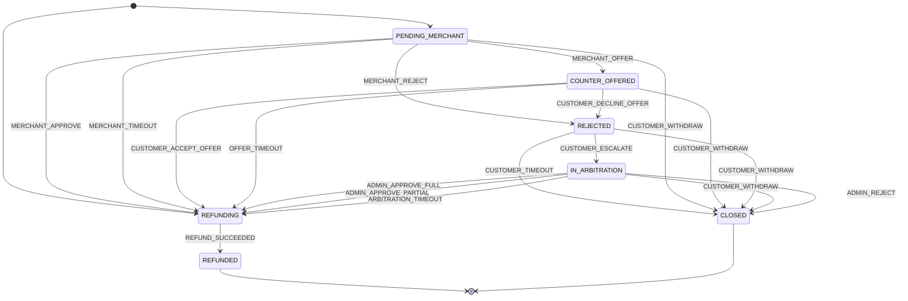
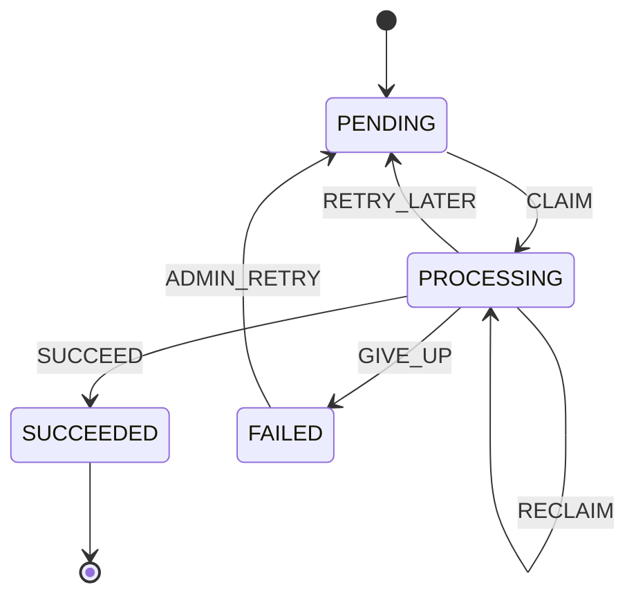

# After-Sales Refunds

After-sales covers refunds only: a customer asks for money back on a completed order, the restaurant answers once,
the platform arbitrates a dispute, and every step that waits for someone has a deadline. A paid order that is
cancelled is refunded through the same cases. The module is `com.laioffer.onlineorder.aftersales`
(cases, refunds, the deadline and refund poller, the customer and admin APIs); the merchant's side lives in
`fulfilment.merchant` and the customer notifications in `fulfilment.notification`. Migrations: `V12` (the tables,
`order_payments` included), `V12_1` (currency checks, Java), `V12_2` (idempotency records bound to a case) and
`V12_3` (a refund's failed claims in a row) and `V12_4` (`orders.picked_up_at`, the pickup that makes a customer's
cancel refund only a share). Design
and the record of what was built: [ADR 0002](adr/0002-after-sales-state-machine.md). To try it on H2, see
[After-sales demo](#after-sales-demo).

| Who | What they can do |
| --- | --- |
| Customer | Ask for a refund of their `COMPLETED` order that has a restaurant and a captured payment, within `request-window` of its completion: the whole order or chosen lines (at most the quantities ordered), a reason (`MISSING_ITEM`, `WRONG_ITEM`, `QUALITY_ISSUE`, `DAMAGED_PACKAGING`, `FOOD_SAFETY`, `LATE_DELIVERY`, `OTHER`) and a description. Accept or decline a counter-offer, ask the platform to step in after a rejection, withdraw an open case, and ask once more after withdrawing a request the merchant had not answered or had made a counter-offer on. |
| Merchant | Answer each request on their restaurant's orders once, before its deadline: approve the requested amount, reject with a reason, or offer a partial refund (more than 0, less than requested). |
| Admin | Read any case with its whole history, arbitrate an escalated case (`FULL`, `PARTIAL` with an amount, or `REJECT`, each with a note the customer sees), list refunds by status with their last error, retry a `FAILED` refund. |
| System | Fire the timeout of each waiting status, open the automatic refund of a cancelled paid order, execute refunds. |

## Case states

The declaration in `AfterSalesStateMachine`, drawn by its `toMermaid()` (pinned by `AfterSalesStateMachineTests`):



- A customer's request (`kind` `CUSTOMER_REQUEST`) opens in `PENDING_MERCHANT`; the automatic refund of a cancelled
  order (`ORDER_CANCELLED`) opens in `REFUNDING`. Opening is not a trigger: `AfterSalesTransitions`, the single writer
  of cases, inserts it.
- Entering `REFUNDING` fixes the approved amount and its `resolution`: the requested amount for `MERCHANT_APPROVE`,
  `MERCHANT_TIMEOUT`, `ADMIN_APPROVE_FULL` and `ARBITRATION_TIMEOUT`, the offered amount for `CUSTOMER_ACCEPT_OFFER` and
  `OFFER_TIMEOUT`, the admin's amount for `ADMIN_APPROVE_PARTIAL`. The refund row is inserted in the same transaction.
  `CLOSED` carries a `close_reason`: `WITHDRAWN`, `CUSTOMER_TIMEOUT` or `ARBITRATION_REJECTED`.
- An answer repeated after it happened returns the case unchanged (a counter-offer only with the same amount); a
  command the status does not allow is `409 AFTER_SALES_STATUS_CONFLICT` ("After-sales case is REFUNDING; only
  PENDING_MERCHANT cases can be approved").
- Every applied step writes, in one transaction: the case with a compare-and-set on its status and version, an
  `after_sales_case_history` row with the actor (`CUSTOMER`, `MERCHANT`, `ADMIN`, `SYSTEM`), the refund when entering
  `REFUNDING`, and the step's event to the outbox.

Refunds have their own machine (`RefundStateMachine`, pinned by `RefundStateMachineTests`):



## Deadlines

A case gets a `deadline_at` every time it enters a waiting status, from the settings below (a changed value applies to
the steps taken after the change). The after-sales poller fires the timeout once it is due:

| Waiting in | Deadline (default) | When it passes |
| --- | --- | --- |
| `PENDING_MERCHANT` | `merchant-response-timeout` (24h) | `MERCHANT_TIMEOUT`: approved at the requested amount, `REFUNDING` |
| `COUNTER_OFFERED` | `customer-response-timeout` (48h) | `OFFER_TIMEOUT`: the offer is taken, `REFUNDING` at the offered amount |
| `REJECTED` | `customer-response-timeout` (48h) | `CUSTOMER_TIMEOUT`: `CLOSED` without a refund |
| `IN_ARBITRATION` | `arbitration-timeout` (72h) | `ARBITRATION_TIMEOUT`: approved at the requested amount, `REFUNDING` |

- A request is accepted until `request-window` (24h) after the order completed (`orders.updated_at` of the
  `COMPLETED` order).
- Deadlines are hard for the customer's and the merchant's answers: from `deadline_at` on they are refused with
  `409 AFTER_SALES_DEADLINE_PASSED`, whether the poller has fired yet or not. Withdrawing and arbitrating have no
  deadline: until the poller fires the timeout, whoever locks the case first wins.
- `deadline_at` and `request_deadline` are UTC, like every timestamp (see "Timestamps and time zone"): in any browser
  zone a countdown, and the answer buttons it disables, end when the backend's hard deadline does.
- The merchant timeout applies to every restaurant, also one without an active merchant account (unlike the order
  accept timeout, which only runs for staffed restaurants).
- The poller (`AfterSalesPoller`) runs on its own thread, `after-sales-poller`, not on the shared scheduler, on every
  instance where it is enabled (by default wherever Kafka is). Each tick it fires the due deadlines, most overdue first,
  one case per transaction, claimed with `FOR UPDATE SKIP LOCKED`, then executes the due refunds, so a refund a timeout
  created runs in the same tick; both share `tick-budget`. A firing that fails rolls back and the case is retried after
  `retry-backoff`; its `deadline_at` does not move, so late answers stay refused meanwhile.

## Asking again after a withdrawal

An order gets at most two customer requests (`attempt_no` 1 and 2). The second is accepted only when the customer
withdrew the first while it was `PENDING_MERCHANT` or `COUNTER_OFFERED` (the `from_status` of its `CUSTOMER_WITHDRAW`
history step), and only within the same request window (counted from the completion, not restarted). A first request
withdrawn after a rejection (`REJECTED`, whether the merchant rejected it or the customer declined the offer) or from
`IN_ARBITRATION` allows no other: a second request would restart the merchant's clock, whose timeout refunds in full,
and so bypass the rejection or the platform. Neither does a request rejected by arbitration, closed by the customer
timeout, or refunded: `409 AFTER_SALES_NOT_ELIGIBLE` "This order cannot be submitted for after-sales again"; while
one is open it is "An after-sales case is already open for this order". `eligible_orders` applies the same rule, so
the order is not offered again. The order's row lock serializes two concurrent requests, and
`UNIQUE (order_id, kind, attempt_no)` turns one that slipped past it into the same `409`. A withdrawn case was never
refunded, so at most one case of an order reaches `REFUNDING`. The second request needs a new `Idempotency-Key`: a
request's key is scoped to the order, so the first request's key with the same body replays the withdrawn case, and
with another body is `409 CONFLICT`.

Every request must add up to more than 0 (`400` "Refund amount must be greater than zero") and stay within the order's
captured payment minus what was already approved for it (`409 AFTER_SALES_NOT_ELIGIBLE`). `GET /after-sales/cases`
lists the orders that can get a request now, with the `attempt_no` the next one would have and its `request_deadline`.
The list does not look at amounts: a completed order whose total and capture are 0.00 is listed too, but every request
on it is `400` "Refund amount must be greater than zero".

## Automatic refund of a cancelled paid order

When a `PAID` or `ACCEPTED` order is cancelled (the customer's cancel, the merchant's reject, the accept timeout or an
admin's `PATCH`), `OrderService` calls `CancellationRefunds` in the cancel's transaction, under the order's row lock and
after the order's own event: an `ORDER_CANCELLED` case opens straight in `REFUNDING` with every order line, the order
total requested, and its refund of what it approves (resolution `ORDER_CANCELLED`): the whole total, except after the
pickup for a customer's cancel, which approves `AFTER_SALES_PICKED_UP_CANCEL_REFUND_PERCENT` (50) of it, half-even, and
opens nothing when that is 0.00. A failure there rolls the cancel back.

- **It needs an `order_payments` row.** `POST /payments/checkout` records the capture (`CAPTURED`, a `SIMPAY-`
  reference) in the transaction that creates the `PAID` order. `POST /cart/checkout` creates a `PLACED` order without
  one, so an order an admin later moved to `PAID` has none, nor do orders paid before V12. Such an order, or one with a
  total of 0.00, is cancelled without a case (a missing capture is logged as a WARN) and keeps the old cancellation
  notices; with a capture above 0.00 every cancellation notice says the payment will be refunded automatically, and
  a customer's cancel after the pickup says how much ("8.04 USD of your 16.09 USD payment will be refunded
  automatically.", or that nothing is).
- A refund above the capture still opens the case, logs a WARN and counts
  `onlineorder.aftersales.cancellations.undercaptured`; the refund executor then gives that refund up before calling
  the gateway (see below), for support to refund by hand.
- `ORDER_CANCELLED` cases never reach the merchant and notify the customer only once refunded ("Refund completed").

## Refund execution

A refund is inserted `PENDING` and due at once when its case enters `REFUNDING`: exactly the approved amount, against
the order's payment (`payment_reference`), with the gateway key `after-sales-case:{caseId}`, the same for every
attempt. The poller's refund job (`RefundExecutor`) takes one refund at a time in three parts:

1. **Claim** (a transaction, `FOR UPDATE SKIP LOCKED`): a `PROCESSING` refund whose lease expired first (`RECLAIM`),
   otherwise a due `PENDING` one (`CLAIM`). Either counts as an attempt and leases the refund for `claim-timeout`.
   Before any money moves the refund is checked once more: its case is `REFUNDING`, its amount is the case's approved
   amount, it names the order's payment, and that payment captured at least as much. A refund that fails the check, or
   whose lease expired on its last attempt, becomes `FAILED` without a gateway call.
2. **Gateway call**, outside any transaction, waited for at most `refund-gateway.timeout` (which must be shorter than
   `claim-timeout`, checked at startup) on at most `refund-gateway.max-threads` threads. While every thread is held by
   a call that outlived its timeout, nothing is claimed.
3. **Record** (a transaction, the refund's row lock): a success makes the refund `SUCCEEDED` and the case `REFUNDED`
   (`REFUND_SUCCEEDED`, `aftersales.case_refunded`); a retryable failure moves it back to `PENDING` after
   `retry-backoff` x 2^(attempts - 1), at most `retry-backoff-max`, while fewer than `max-attempts` were made; a
   permanent failure, or one with no attempt left, makes it `FAILED` with its `last_error`. A result for a refund that
   another executor reclaimed meanwhile is discarded. A claim transaction that fails backs only that refund off by
   `retry-backoff`, without using an attempt; once `max-claim-failures` of its claims failed in a row, the last one
   gives it up (`FAILED`, attempts unchanged) instead of backing it off again. Any other step of the refund starts
   that count over.

A `FAILED` refund leaves its case in `REFUNDING` until an operator acts: `GET /admin/refunds` (by default the
`FAILED` ones) shows `last_error`, which customers never see, and `POST /admin/refunds/{refundId}/retry` moves the
refund back to `PENDING`, due at once, with its attempts starting over (audited as `refund.retry`; a refund already
`PENDING` is returned unchanged, any other status is `409 REFUND_STATUS_CONFLICT`). The gateway must be idempotent per
gateway key, so a retry after an attempt that did refund gets the same refund back instead of paying twice.

The gateway here is `SimulatedRefundGateway`. It refunds every request with the reference `SIMREF-` followed by the
first 20 hex digits of the SHA-256 of the gateway key (so the same key always gets the same refund), and fails the
first `refund-gateway.fail-first-attempts` attempts of every refund with a retryable "simulated gateway timeout". It
never fails permanently. A real provider would implement `RefundGateway`.

## After-sales APIs

Customers reach only their own orders and cases (anyone else's is `404`). Merchants reach only their restaurant's cases
and are checked for an active account on every request (`403`), like the merchant order commands.

| Method | Path | Role | Idempotency-Key | Purpose |
| --- | --- | --- | --- | --- |
| `GET` | `/after-sales/cases?limit=50` | signed in | | `{"cases": [...], "eligible_orders": [...]}`: the newest cases without history, and the orders that can get a request now (`order_id`, `order_no`, `attempt_no`, `request_deadline`; a 0.00 order is listed but refused with `400`) |
| `GET` | `/after-sales/cases/{caseId}` | signed in | | One case with its lines, its refund (no `last_error`) and its history |
| `POST` | `/orders/{orderId}/after-sales` | signed in | required | Ask for a refund: `{"scope": "WHOLE_ORDER", "reason_code": "MISSING_ITEM", "description": "..."}`, or `"scope": "ITEMS"` with `"lines": [{"order_item_id": 12, "quantity": 1}]` |
| `POST` | `/after-sales/cases/{caseId}/accept-offer` | signed in | required | `COUNTER_OFFERED -> REFUNDING` at the offered amount |
| `POST` | `/after-sales/cases/{caseId}/decline-offer` | signed in | required | `COUNTER_OFFERED -> REJECTED` |
| `POST` | `/after-sales/cases/{caseId}/escalate` | signed in | required | `REJECTED -> IN_ARBITRATION`, optional body `{"note": "..."}` |
| `POST` | `/after-sales/cases/{caseId}/withdraw` | signed in | required | Any waiting status `-> CLOSED` (`WITHDRAWN`); only a first request withdrawn from `PENDING_MERCHANT` or `COUNTER_OFFERED` leaves the order a second one |
| `GET` | `/merchant/after-sales?status=&limit=50` | `MERCHANT` | | The restaurant's requests, newest first (status filter in any letter case) |
| `POST` | `/merchant/after-sales/{caseId}/approve` | `MERCHANT` | | `PENDING_MERCHANT -> REFUNDING` at the requested amount |
| `POST` | `/merchant/after-sales/{caseId}/reject` | `MERCHANT` | | `PENDING_MERCHANT -> REJECTED`, body `{"reason": "..."}` (required) |
| `POST` | `/merchant/after-sales/{caseId}/offer` | `MERCHANT` | | `PENDING_MERCHANT -> COUNTER_OFFERED`, body `{"amount": 4.50, "note": "..."}` |
| `GET` | `/admin/after-sales?status=IN_ARBITRATION&limit=50` | `ADMIN` | | Cases of one status (any letter case; 400 for an unknown status); the waiting ones by deadline, the others newest first |
| `GET` | `/admin/after-sales/{caseId}` | `ADMIN` | | Any case with its history and its refund's `last_error` |
| `POST` | `/admin/after-sales/{caseId}/arbitrate` | `ADMIN` | required | `{"decision": "FULL" \| "PARTIAL" \| "REJECT", "amount": 4.50, "note": "..."}` (`amount` for `PARTIAL` only); audited as `after_sales_case.arbitrate` |
| `GET` | `/admin/refunds?status=FAILED&limit=50` | `ADMIN` | | Refunds of one status (any letter case; 400 for an unknown status) |
| `POST` | `/admin/refunds/{refundId}/retry` | `ADMIN` | | `FAILED -> PENDING` (see above); audited as `refund.retry` |

- **Idempotency.** A customer command or an arbitration runs once per login, key and scope (the order for a request,
  the case and command otherwise); its idempotency record is bound to the case it opened or changed, and a replay
  answers with that case as it is now. The same key with another request is `409 CONFLICT`. Merchant answers and the
  refund retry take no key: repeating one that already happened returns the case or refund unchanged.
- **Rate limits.** Per login: the customer's five commands share one bucket (20, one more every 3 s, like the cart
  checkout), the merchant's approve, reject and offer another (30, one every 2 s), and arbitration and the refund retry
  have one each (10, one every 6 s). The limit runs before the idempotency check, so a replay with the same key takes a
  token too; a command refused with `429 RATE_LIMITED` did not run, and retrying it later with its key is safe. Like
  every rate-limited route, these take their ids as decimal digits only (`+42`, `0x2A` and the like are `404`), so no
  spelling of an id gets past the limit.
- **Errors.** `409 AFTER_SALES_NOT_ELIGIBLE` (the order cannot get a request: not `COMPLETED`, no restaurant, no
  captured payment, the window closed, a request open or none left, or more than the capture allows),
  `409 AFTER_SALES_STATUS_CONFLICT`, `409 AFTER_SALES_DEADLINE_PASSED`, `409 REFUND_STATUS_CONFLICT`, and `400` for a
  malformed request (an unknown scope or reason, a line not on the order or above its quantity, an offer or a partial
  arbitration not between 0 and the requested amount, more decimals than the currency has).
- **The merchant's inbox is a projection.** Merchant commands lock their row in `merchant_after_sales_cases`, which the
  merchant consumer group fills from `after-sales-events`; until that group has consumed the case's first event the
  case is `404` for the merchant, and with Kafka off it never appears.

## Events and notifications

Every step publishes one event on `after-sales-events` (key: the order id; aggregate `AFTER_SALES_CASE` with the case
id, sequenced per case) carrying the whole case after the step: amounts with their currency, the lines, `attempt_no`,
`version`, the `action` and actor, and the deadline of the status entered. Each type has its schema under
`event-schemas/` (see [Event contracts](correctness.md#event-contracts)).

| Event type | Published when the case | Customer notification |
| --- | --- | --- |
| `aftersales.case_opened` | is opened (either kind) | "Refund requested", with the merchant's deadline (customer requests only) |
| `aftersales.offer_made` | enters `COUNTER_OFFERED` | "Partial refund offered" |
| `aftersales.request_rejected` | enters `REJECTED` | "Refund request declined", or "Offer declined" when the customer declined the offer |
| `aftersales.case_escalated` | enters `IN_ARBITRATION` | "Platform review requested" |
| `aftersales.refund_approved` | enters `REFUNDING` | "Refund approved" |
| `aftersales.case_refunded` | enters `REFUNDED` | "Refund completed" (also for an automatic refund) |
| `aftersales.case_closed` | enters `CLOSED` | "Refund request closed", worded by the close reason |

Two consumer groups read the topic, both through `orderEventKafkaListenerContainerFactory` and idempotent like the
others:

- `onlineorder-merchant-aftersales` (merchant module) upserts the merchant's inbox row from each event of a customer
  request and drops those of `ORDER_CANCELLED` cases. An event older by sequence than the last one it applied for the
  case is skipped, and the upsert never moves a row back to an older case `version`, also for an event without a
  sequence.
- `onlineorder-aftersales-notification` (notifications) writes `order_notifications`, one per order, event type and
  case (`dedup_scope = 'case:' || case_id`), so a redelivered event adds nothing while the second request of an order
  notifies again.

## After-sales configuration and metrics

| Key | Default | Purpose |
| --- | --- | --- |
| `app.after-sales.topic` (`KAFKA_AFTER_SALES_TOPIC`) | `after-sales-events` | After-sales event topic |
| `app.after-sales.merchant-group` (`AFTER_SALES_MERCHANT_GROUP`) | `onlineorder-merchant-aftersales` | The merchant inbox's consumer group |
| `app.after-sales.notification-group` (`AFTER_SALES_NOTIFICATION_GROUP`) | `onlineorder-aftersales-notification` | The notifications' consumer group |
| `app.after-sales.request-window` (`AFTER_SALES_REQUEST_WINDOW`) | `24h` (demo `2h`) | How long after completion an order can get a request, the second one included |
| `app.after-sales.merchant-response-timeout` (`AFTER_SALES_MERCHANT_RESPONSE_TIMEOUT`) | `24h` (demo `2m`) | The merchant's deadline |
| `app.after-sales.customer-response-timeout` (`AFTER_SALES_CUSTOMER_RESPONSE_TIMEOUT`) | `48h` (demo `3m`) | The customer's deadline on a counter-offer or a rejection |
| `app.after-sales.arbitration-timeout` (`AFTER_SALES_ARBITRATION_TIMEOUT`) | `72h` (demo `5m`) | The platform's deadline |
| `app.after-sales.poller.enabled` (`AFTER_SALES_POLLER_ENABLED`) | follows `app.kafka.enabled` (demo `true`) | Run the deadline and refund poller |
| `app.after-sales.poller.interval` (`AFTER_SALES_POLL_INTERVAL`) | `1s` | Delay between ticks |
| `app.after-sales.poller.batch-size` (`AFTER_SALES_POLL_BATCH_SIZE`) | `100` | Cases fired, and refunds executed, per tick |
| `app.after-sales.poller.retry-backoff` (`AFTER_SALES_DEADLINE_RETRY_BACKOFF`) | `30s` | Delay before a deadline whose firing failed is tried again |
| `app.after-sales.poller.tick-budget` (`AFTER_SALES_POLL_TICK_BUDGET`) | `5s` | Time a tick may spend claiming, deadlines and refunds together (one item at least each) |
| `app.after-sales.refund.max-attempts` (`AFTER_SALES_REFUND_MAX_ATTEMPTS`) | `8` | Gateway calls before a refund is given up (a reclaim counts) |
| `app.after-sales.refund.retry-backoff` (`AFTER_SALES_REFUND_RETRY_BACKOFF`) | `10s` | First wait after a failed call, doubling per attempt; also the back-off of a failed claim |
| `app.after-sales.refund.retry-backoff-max` (`AFTER_SALES_REFUND_RETRY_BACKOFF_MAX`) | `10m` | Longest wait between attempts |
| `app.after-sales.refund.claim-timeout` (`AFTER_SALES_REFUND_CLAIM_TIMEOUT`) | `60s` | Lease of a claimed refund |
| `app.after-sales.refund.max-claim-failures` (`AFTER_SALES_REFUND_MAX_CLAIM_FAILURES`) | `10` | Failed claims in a row before a refund is given up (no attempt used up) |
| `app.after-sales.refund-gateway.timeout` (`AFTER_SALES_REFUND_GATEWAY_TIMEOUT`) | `10s` | Wait for one gateway call; must be shorter than `claim-timeout` |
| `app.after-sales.refund-gateway.max-threads` (`AFTER_SALES_REFUND_GATEWAY_MAX_THREADS`) | `4` | Gateway calls running at once, timed-out ones included |
| `app.after-sales.refund-gateway.fail-first-attempts` (`AFTER_SALES_REFUND_GATEWAY_FAIL_FIRST_ATTEMPTS`) | `0` | Simulated gateway: fail the first N attempts of every refund (retryable) |

Startup refuses a time limit, back-off or budget that is not positive, `max-attempts`, `max-claim-failures` or
`max-threads` below 1, a negative `fail-first-attempts`, `retry-backoff-max` below `retry-backoff`, and a gateway
timeout not shorter than `claim-timeout`. `poller.interval` and `poller.batch-size` are not checked: an interval below
1 ms runs as 1 ms, a batch size below 1 as 1. The `demo` profile (`application-demo.yml`) sets the demo values above.
The two listeners use `app.fulfilment.listener-concurrency` (see the capacity note under
[Configuration](fulfilment.md#configuration)).

Metrics (tag values are lower case):

- `onlineorder.aftersales.steps{action, from, to}`: committed steps; `action` is the trigger, or `open` /
  `order_cancelled` for an opening (`from="none"`).
- `onlineorder.aftersales.deadlines{trigger, outcome=fired|skipped|failed}`: `skipped` is a timeout the machine
  refused (only when the clock went back), `failed` one that rolled back and backs off.
- `onlineorder.aftersales.refunds{outcome=succeeded|retried|failed|superseded|unrecorded|skipped|backed_off}`:
  `failed` refunds wait for an admin retry; `backed_off` is a claim transaction that failed.
- `onlineorder.aftersales.refund_gateway.threads.busy` and `.threads.max` (gauges), and
  `onlineorder.aftersales.refund_gateway.saturated`: runs that claimed nothing because every gateway thread was held by
  a call past its timeout (alert `OnlineOrderRefundGatewaySaturated`).
- `onlineorder.aftersales.merchant_decisions{decision=approved|rejected|offered}`: answers that changed a case (not
  retries).
- `onlineorder.aftersales.cancellations.undercaptured`: automatic refunds whose order total exceeds the capture.

The alerts `OnlineOrderRefundsGivenUp`, `OnlineOrderRefundsBackingOff`, `OnlineOrderRefundGatewaySaturated` and
`OnlineOrderCancellationsUndercaptured` watch these refunds, and `OnlineOrderAfterSalesDeadlinesFailing` deadlines that
keep rolling back; [docs/operations.md](operations.md) section 12 has
their runbook, the V12-V12_4 rollout and the connection pool sizing for the after-sales listeners.


## After-sales demo

The `demo` profile (`backend/src/main/resources/application-demo.yml`) shortens the after-sales time limits, which
otherwise default to a 24-hour request window and 24, 48 and 72 hours to answer: a request window of 2 hours, 2 minutes
for the merchant, 3 for the customer and 5 for the platform. It also turns on the after-sales poller, which follows
Kafka and is therefore off in the plain `h2` profile, so that the deadlines fire and refunds go through the simulated
refund gateway.

```sh
(cd backend && SPRING_PROFILES_ACTIVE=h2,demo ./gradlew bootRun)
```

1. Sign in as `demo@laifood.com` (a customer and an admin), add a menu item to the cart and pay with
   `POST /payments/checkout` (with an `Idempotency-Key`).
2. Complete the order as the admin: `PATCH /orders/{orderId}/status` with `{"status": "ACCEPTED"}`, then `PREPARING`,
   then `COMPLETED`, each with its own `Idempotency-Key`.
3. Ask for a refund: `POST /orders/{orderId}/after-sales` with
   `{"scope": "WHOLE_ORDER", "reason_code": "MISSING_ITEM", "description": "..."}` and an `Idempotency-Key`.
4. Leave it unanswered for 2 minutes. The poller then fires the merchant timeout, which approves the requested amount,
   and executes the refund in the same tick: `GET /after-sales/cases/{caseId}` shows the case `REFUNDED` and its
   refund `SUCCEEDED`.

Add `AFTER_SALES_REFUND_GATEWAY_FAIL_FIRST_ATTEMPTS=2` to watch the refund fail twice and back off (10 s, then 20 s)
before it succeeds. The same steps work in the UI (`npm start`): the admin console's "Order tools" for step 2 and the
order list's "Request a refund" for step 3.

What `h2` cannot show: with Kafka off there is no outbox publisher and no consumer. The merchant's after-sales inbox is
filled from `after-sales-events`, so it stays empty and merchants cannot answer a request (their commands are `404`);
the merchant timeout still approves the request when its deadline passes, because the poller fires it from the
database. No notifications are written either. Run the full stack (Quick Start) to see the merchant's side, the
counter-offer and the arbitration.
