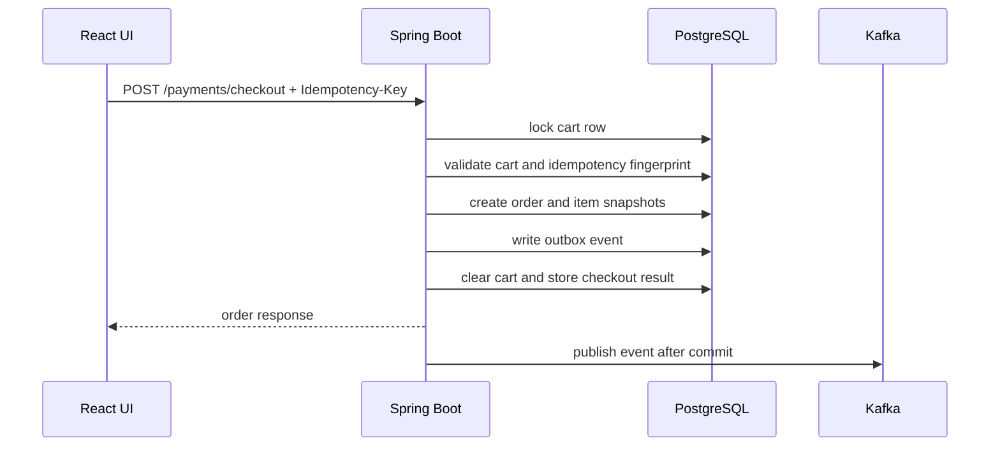

# Correctness Model

## Checkout

- Checkout requires an `Idempotency-Key` header.
- The backend stores one durable idempotency record per customer, checkout scope, and key.
- Repeating the same logical request returns the stored order result.
- Reusing the same key with a different request fingerprint returns a conflict.
- Checkout locks the cart row, creates the order, snapshots order items, writes the outbox event, clears the cart, and stores the idempotency result in one database transaction.
- If the transaction fails before commit, all checkout writes roll back together.



## Money and currency

- **One type for arithmetic.** Cart, checkout and payment code compute with `Money`
  (`backend/src/main/java/.../money`): a `BigDecimal` amount at scale 2 plus an ISO 4217 `Currency`. Sums and
  multiples by a quantity are exact; where rounding is needed (a rate) it is `HALF_EVEN` to the currency's minor unit,
  so rounding many amounts has no upward bias. `Money.of` never rounds silently: 1.005 USD or 500.50 JPY is an error.
  Adding amounts of two currencies throws `CurrencyMismatchException`. Nothing on the money path uses `double` or
  `float` (the cart total used to be summed through `CAST(... AS DOUBLE PRECISION)`; it is now the `Money` sum of the
  lines).
- **Storage (V11).** Every amount is `NUMERIC(12,2)` with a non-negative check (largest 9,999,999,999.99) and has a
  `currency CHAR(3)` next to it, checked to be three upper-case letters: `restaurants`, `menu_items`, `carts`,
  `order_items`, `orders`, `order_history_items`, `merchant_orders`. The supported currencies are the rows of the
  `currencies` table (code and ISO 4217 minor units: USD, EUR, GBP and 20 more with 2, JPY and KRW with 0; never BHD,
  KWD or XXX, which `Money` rejects), and `restaurants.currency` references it; a JPY or KRW menu price must be whole.
  So the database holds no amount or currency that `Money` would refuse. Existing rows became USD; V11 stops, naming
  the rows, rather than round an existing amount with sub-cent digits (`docs/operations.md` section 10, which also has
  the rollout: no pods of the previous release next to it).
- **One currency per restaurant, cart and order.** A restaurant prices its menu in one currency, and composite keys
  make the database enforce the rest: a menu item has its restaurant's currency, a cart line its menu item's and its
  cart's. A cart is single-restaurant, so it is single-currency; an empty cart takes the currency of the next item
  added (and keeps its last currency while empty). Checkout copies the cart's currency onto the order and its items.
- **API.** Every amount keeps its name and JSON number and gets a sibling `currency`: `price` + `currency` on menu
  items, cart lines and order items, `total_price` + `currency` on carts, orders and merchant orders, plus the
  restaurant's `currency`. `PATCH /admin/menu-items/{id}` takes a `price` in the restaurant's currency only (an
  optional `currency` must match it, `400 CURRENCY_MISMATCH`; a JPY price with cents is `400 INVALID_AMOUNT`). A cart
  whose total would exceed the column is refused with `400 CART_TOTAL_TOO_LARGE`.
- **Events.** Order events carry the order's currency once, as `data.currency`; their line items carry none. A
  consumer reads an event without one (published before V11) as USD.
- **Frontend.** The DTO decoders validate every `currency` (`fieldsOf().currency`, a branded `CurrencyCode`; a
  response without one is USD), `formatMoney` in `src/lib/format.ts` is the only formatter (`Intl.NumberFormat`,
  `en-US`, the currency's own decimals: $12.78, €0.50, ¥950), and `lineTotal` multiplies a price by a quantity in
  integer hundredths.

## Timestamps and time zone

- **The server runs in UTC.** `OnlineOrderApplication.main` makes UTC the JVM's default zone before Spring starts,
  whatever the host, the image or `-Duser.timezone` say; the Gradle `test` task and `bootRun` start their JVM in UTC
  too, since tests do not run `main`. Every timestamp is a `LocalDateTime` from `LocalDateTime.now()` in a `TIMESTAMP`
  column, so it is UTC wall-clock time, and the PostgreSQL driver opens each session in the JVM's zone, so
  `CURRENT_TIMESTAMP` stored into a `TIMESTAMP` column (column defaults, the login lockout, the demo seed) is UTC as
  well (`ServerTimeZoneTests`, `ServerTimeZonePostgresTests`).
- **The JSON keeps its format.** Timestamps are still ISO dates and times without an offset
  (`"2026-10-20T12:00:00"`, with fractional seconds when there are any); they mean UTC.
- **Frontend.** `parseTimestamp` in `src/lib/format.ts` is the only parser of backend timestamps (ESLint rejects
  `Date.parse` and `new Date(value)` elsewhere): an offset-less date and time is read as UTC, one with `Z` or an offset
  keeps it. `formatDateTime` shows the time in the browser's zone and locale, and countdowns and deadline checks are
  exact whatever the browser's zone. The UI tests run in `America/New_York` against a fake backend that writes UTC,
  so reading a timestamp as local time fails them.
- **Times inside texts name their zone.** A deadline the backend writes into a message, a notification
  (`"Reply by 2026-10-23 16:00 UTC"`) or a 409 (`AFTER_SALES_DEADLINE_PASSED`, `AFTER_SALES_NOT_ELIGIBLE`: `"... passed
  at 2026-10-23T16:00:00 UTC"`), ends with `UTC`, since the UI shows messages as they come next to times it converts.
  Notifications stored before keep their unlabelled text.
- Rows written earlier by a server in another zone keep that zone's wall-clock time (`docs/operations.md`
  section 3).

## Order State

Allowed transitions:

```text
PLACED -> PAID / CANCELLED
PAID -> ACCEPTED / CANCELLED
ACCEPTED -> PREPARING / CANCELLED
PREPARING -> COMPLETED
COMPLETED and CANCELLED are terminal
```

Status changes and their outbox events commit together. Invalid transitions fail without side effects.

The order, delivery, after-sales case and refund lifecycles are each declared once with the generic `StateMachine` of
`com.laioffer.onlineorder.statemachine` (`model.OrderStateMachine`, `fulfilment.dispatch.DeliveryStateMachine`,
`aftersales.AfterSalesStateMachine`, `aftersales.RefundStateMachine`). A declaration names, per trigger (a command or an
event), the states it fires from, its target (or `stay()` for an internal transition such as a reassignment), the actor
types allowed, its guards, and when it already happened (a retry that answers unchanged). `build()` refuses an invalid
table at class initialization, listing every problem: a trigger declared twice or not at all, a transition out of a
terminal state, a state no initial state reaches or that cannot reach a terminal one. `decide()` is pure; the service
locks the row, decides, and writes the new state with a compare-and-set on the state it read (`CompareAndSet`: any row
count but 1 rolls back). `toMermaid()` draws a machine; the tests pin each drawing. Moving the order and delivery paths
onto the declarations kept their 409 codes and messages, no-ops, history, events and audit as they were. Design and
implementation record: [ADR 0002](adr/0002-after-sales-state-machine.md).

Every status change, including the creation at checkout, also writes one `order_status_history` row and moves
`orders.updated_at`, in the same transaction and through the same guarded transition (`OrderService`, the
`OrderLifecycleCommands` seam for the fulfilment modules). A row records `from_status` (null for the creation),
`to_status`, who did it (`actor_type` `CUSTOMER`, `ADMIN`, `MERCHANT`, `RIDER` or `SYSTEM` for timeouts, and
`actor_id`), the cancel `reason` and the request's trace id. `actor_id` depends on `actor_type`: the `customers.id`
of the login for `CUSTOMER`, `ADMIN` and `MERCHANT`, the `riders.id` for `RIDER` (the order module learns the rider
only from the `delivery.delivered` event), null for `SYSTEM`. A delivered order completed from `ACCEPTED` records both
steps for the rider, also when an admin marked the delivery delivered through `/admin/deliveries` (the audit log
records that admin). Same-status no-ops and idempotent retries write nothing. `GET /orders/{orderId}/history` serves
it; orders placed before V7_1 start with one `SYSTEM`/`backfill` row.

Admin actions (status changes, outbox retries and abandons, dead-letter replays, catalog edits, merchant and rider
provisioning and activation, delivery reassignment, the simulated rider actions, after-sales arbitrations and refund
retries) and the riders' own changes (going on or off duty, picking up and delivering through `/rider/**`) are also
written to `audit_log` by `AuditLogService.record` in the action's transaction: the login (`actor_customer_id`, the
customer id of the admin's or the rider's login), the role (`ROLE_ADMIN`, `ROLE_RIDER`), the action, its target, a JSON
`details` object and the trace id. The actions are `order.status.update`, `outbox_event.retry`, `outbox_event.abandon`,
`dead_letter.replay`, `menu_item.update`, `restaurant.update`, `merchant.create`, `merchant.update`, `rider.create`,
`rider.update`, `rider.availability`, `delivery.picked_up`, `delivery.delivered`, `delivery.reassign`,
`after_sales_case.arbitrate` and `refund.retry` (`AuditActions`); staff entries carry the login's customer id and email,
never a password. Refused actions add no entry, and neither do a retry of `PATCH /orders/{id}/status` with the same
`Idempotency-Key` or a repeated action that changes nothing (the same flag again, a delivery move that already
happened). Every dead-letter replay request that is not refused is recorded with its outcome (`REPLAYED`,
`REPLAY_FAILED`, or `ALREADY_REPLAYED` when the event had been replayed before and nothing was sent). All keys are
64-bit (`BIGINT`) since V7; see [docs/operations.md](operations.md) section 7 for the rollout of these migrations,
which must not run next to pods of an older version.

## Outbox and Kafka

- Order events are inserted into `outbox_events` inside the same transaction as the order change, after the event was
  checked against its published schema ("Event contracts" below).
- Each event gets the next sequence of its aggregate (`aggregate_sequence`, the envelope's `sequence`: 1, 2, 3, ... per
  order, delivery, merchant order or after-sales case, in commit order).
- A scheduled publisher claims `PENDING` or stale `PROCESSING` rows with `FOR UPDATE SKIP LOCKED`, but only the head
  of each aggregate: an event waits while an earlier event of its aggregate is `PENDING`, `PROCESSING` or `FAILED`. So
  an aggregate's events reach Kafka in sequence order, one acknowledgement after the other, across publisher instances.
- Each claim writes a token of its own (`claim_token`, V13), and every outcome below is written only while the row is
  still `PROCESSING` under that token. A publisher whose claim expired mid-batch (`app.outbox.claim-timeout`) can then
  neither undo a publish by the instance that reclaimed the event nor release that instance's claim; its event may
  still be sent twice, which consumers deduplicate.
- Successful publish marks the row `PUBLISHED`.
- Retryable failures return to `PENDING` until `app.outbox.max-attempts`.
- Max-attempt failures become `FAILED` and require admin retry after the root cause is fixed; until then the later
  events of the same aggregate wait (`onlineorder_outbox_blocked_aggregates`, alert `OnlineOrderOutboxAggregatesBlocked`).
  An event that can never be published is abandoned instead (`ABANDONED`, audited): its consumers never receive it and
  the later events go out ([docs/operations.md](operations.md) section 8).
- After publishing a head the publisher claims again in the same run when its aggregate has a next event waiting, so a
  backlog of k events of one order goes out in one run rather than one per publish interval.
- Consumers use `processed_events` to deduplicate at-least-once Kafka delivery, and the consumers that keep
  per-aggregate state skip events older than the last one they applied ("Out-of-order events"). On PostgreSQL the
  table is partitioned by month, so no unique constraint spans it; the mark is serialized per key with an advisory
  lock and checked across all partitions (see [Data Tier](data-tier.md#data-tier)).
- Notification creation also has a database uniqueness safety net.

## Event contracts

Every event on `order-events`, `delivery-events`, `merchant-events` and `after-sales-events` has a published, versioned
JSON Schema (draft 2020-12) under `backend/src/main/resources/event-schemas/`:

```text
event-schemas/
|-- catalog.json                       every event type: its topic and schema versions (INITIAL, BACKWARD, BREAKING)
|-- SHA256SUMS                         checksum of every published schema file
|-- common/envelope/v1.json            event_id, event_version, event_type, aggregate_type, aggregate_id, sequence,
|                                      occurred_at, correlation_id, idempotency_key, data
|-- common/order-data/v1.json          order event data; money amounts with an optional ISO 4217 currency next to them
|-- common/order-data/v2.json          v1 plus the optional order_no (the public order number, a string)
|-- common/delivery-data/v1.json       delivery event data
|-- common/after-sales-case-data/v1.json  the whole after-sales case after its step, lines with their currency
|-- order-events/<event_type>/v1.json      order.created ... order.cancelled (data.status fixed per type)
|-- order-events/<event_type>/v2.json      the same on order-data v2 (BACKWARD); what the producer writes since V14
|-- delivery-events/<event_type>/v1.json   delivery.assigned ... delivery.reassigned
|-- merchant-events/merchant.order_received/v1.json
`-- after-sales-events/<event_type>/v1.json  aftersales.case_opened ... aftersales.case_closed
```

The JSON is snake_case with nulls omitted (the application ObjectMapper). `event_version` names the schema version of
the event's type the producer wrote; the payload records (`messaging.OrderEventPayload`, `OrderEventItem`,
`DeliveryEventPayload`, `MerchantEventPayload`, `AfterSalesCasePayload`) belong to the contract and no longer reuse
REST DTOs. V1 is the shape the events already had plus two optional fields: `sequence` (absent on events written
before V9) and `currency` on the order total and on each item price (absent until orders carry a currency). The six
order events are at v2, a `BACKWARD` version that adds the optional `data.order_no`: the order's public number as a
JSON string (it exceeds 2^53), which the merchant inbox and dispatch keep so that the merchant and rider consoles can
show it (V14). Consumers read a v1 event as one without a number, and a consumer that knows only v1 reads a v2 event
as a v1 one (see the rules below); [docs/operations.md](operations.md) section 8 has the rollout.

The description of the published `aftersales.case_opened` v1 schema says an `ORDER_CANCELLED` case approves the order
total. Since V12_4 that holds except for a customer's cancel after the pickup, whose case still requests the total but
approves and refunds only a share (ADR 0002 section 27, follow-up 17). No property changed, so no new version was
published (a published schema file never changes): read what a case refunds from `approved_amount` and
`refunded_amount`, never from `requested_amount`.

**Validation.** `EventContracts` (networknt json-schema-validator 3.x, the line built on Jackson 3, so events are
checked as `tools.jackson` trees without a second JSON library; schemas refer to each other by `$id` under
`https://onlineorder.example/event-schemas/`, mapped to the classpath, so nothing is fetched over the network):

- Producer: `OrderEventOutboxService.enqueueEvent` serializes the envelope with its sequence and checks it against the
  exact published version it declares, in the producing transaction. An invalid event, an unpublished type or version,
  or a type sent to the wrong topic is a bug: `EventSchemaViolationException` rolls the transaction back (the request
  fails), the violations are logged as an error and `onlineorder_events_schema_violations_total{side="producer"}`
  counts it.
- Consumer: every listener reads its record through `EventContracts.read`. A record that is not JSON or breaks its
  schema throws `EventSchemaViolationException`, which the listener error handler classifies as not retryable: it goes
  to the DLT on the first attempt, with the violations in `dead_letter_events.error_message`
  (`side="consumer"`). A version newer than the instance knows is checked against the latest version it knows (schemas
  are open, so a compatible addition passes); an unknown event type only against the envelope, and the consumer skips
  it as before.

**Evolution rules** (checked by `EventSchemaContractTests` in the backend CI job, and by the "Published event schemas
are append-only" step of `config-lint` on pull requests):

- A published schema file never changes and is never deleted: `SHA256SUMS` lists its checksum. Change a contract by
  adding the next version file, `v<N+1>.json`, with its line in `SHA256SUMS` and its entry in `catalog.json`.
- `BACKWARD` versions only add optional properties. The test keeps sample events of every version under
  `backend/src/test/resources/event-samples/<topic>/<event_type>/v<N>/` and checks a `BACKWARD` version both ways
  against the versions before it (back to the last `BREAKING` one): it must accept their samples (new consumers read
  old events), and they must accept its samples, because a consumer that does not know the new version yet checks its
  events against the latest version it knows. That is what lets producers move to a `BACKWARD` version before every
  consumer knows it.
- Anything else (a removed, renamed or newly required property, a changed type or meaning, and also a relaxed
  constraint such as a lower minimum or a wider enum, which older consumers would reject) is `BREAKING`, a new major
  version: consumers must accept N and N-1, so ship consumers that handle N first, then switch the producer, and keep
  N-1 in the catalog (the test enforces it) until no N-1 event can still arrive. Retiring a version means removing it
  from `catalog.json` once no event of it can be in flight (outbox retention, stored dead letters); its file stays.

**Adding or evolving an event:** write the schema file (`$schema` draft 2020-12, `$id` under the base IRI, `$ref` to
the envelope), list it in `catalog.json`, add its checksum (`shasum -a 256 <file>` in `event-schemas/`; the test
prints the line to add), add sample events, give the producer the version constant, and send the event through
`OrderEventOutboxService.enqueueEvent(topic, key, envelope)`. Roll a new version out in the order the rules above
give. [docs/operations.md](operations.md) section 8 shows how to mirror the schemas into a schema registry
(Confluent, Apicurio) without making the application depend on one.

## Catalog Caching

The public catalog reads (`GET /restaurants/menu`, `GET /restaurant/{restaurantId}/menu`) go through a two-level cache (`backend/src/main/java/.../cache`):

| Level | Store | Lifetime | Scope |
| --- | --- | --- | --- |
| L1 | Caffeine, bounded, `recordStats` | `app.cache.l1.ttl` (30s) | one instance |
| L2 | Redis, typed JSON | `spring.cache.redis.time-to-live` (10m) +/- `app.cache.l2.ttl-jitter` (15%) | all instances |

- **Granular keys.** `restaurants::all` holds the restaurant list (basic fields) and `menu::<restaurantId>` holds one menu. `GET /restaurants/menu` is composed from them, with the same JSON shape as before. Redis keys are `onlineorder:cache:<version>:<cache>::<key>`, for example `onlineorder:cache:v1:menu::3`.
- **Typed serialization.** Each cache has its own Jackson serializer bound to `CatalogRestaurantDto` or `CatalogMenuItemDto`: no default typing and no `@class` in Redis. When a cached DTO changes shape, bump its version in `CatalogCaches`; old and new code then use different keys during a rolling deploy, and an entry that cannot be read (including one with unknown fields) is treated as a miss. The cache mapper keeps declaration order and strict reads on Jackson 3, so its JSON is byte for byte what the Spring Boot 3 (Jackson 2) instances wrote (`CatalogCacheSerializationTests`).
- **Stampede, avalanche, penetration.** Cached methods use `@Cacheable(sync = true)`, and the L1 loads each key once per instance while concurrent callers wait (single flight). Redis TTLs are jittered so entries loaded together do not expire together. A menu request is first checked against the cached restaurant list. An id the list does not know gets one primary-key lookup in the database, at most once per `app.catalog.unknown-restaurant-recheck-interval` (1s) per instance: a restaurant inserted outside the admin API (SQL, a seed run) is served right away and the stale list is evicted, while a flood of random ids costs one lookup per second. Every other unknown id gets `404` from the cache, and nothing is cached for it.
- **Invalidation.** Admin writes update the database and delete the affected entries only after the transaction commits (`TransactionSynchronization#afterCommit`); a rollback deletes nothing. Deletion order is Redis, then the local L1, then a Redis pub/sub message (`onlineorder:cache:invalidation`) that makes the other instances drop their L1 copy. Instances clear their L1 whenever the subscription is (re)established, since messages sent while disconnected are lost; the L1 TTL bounds anything else that is missed.
- **Why cache-aside with delete-after-commit, not write-through.** Writing the new value into the cache from the write path means rebuilding the cached view (a whole menu) in the transaction, and two concurrent writers can store their snapshots out of order so the older one wins until the TTL. Deleting lets the next read rebuild from committed data. Deleting before the commit would let a reader cache the old row again. The remaining race is a reader that loaded the old row just before the commit and stores it just after the delete; a delayed double delete (`app.cache.delayed-double-delete`, 1s, `0` disables) removes that entry.
- **Redis failures.** A failed Redis read is a miss and a failed write, delete or publish is skipped; each is logged and counted in `onlineorder.cache.errors`, and requests are served from the database and L1. Startup does not need Redis: the invalidation subscription is retried in the background.
- **Hung or slow Redis.** A Redis that hangs instead of refusing connections makes every call wait for the 500ms command timeout (`spring.data.redis.timeout`). Without protection, every L1 miss would pay it twice (read and write-back), so a cold `GET /restaurants/menu`, composed of N+1 entries, would wait about (N+1) x 1s. A circuit breaker shared by the caches (`RemoteCacheCircuitBreaker`) therefore makes reads and write-backs skip Redis for `app.cache.l2.circuit-breaker.open-duration` (5s) after any Redis error, or after 3 consecutive calls slower than `slow-call-threshold` (200ms). Then one request probes Redis while the others keep skipping it, and a successful probe closes the breaker. An entry that cannot be deserialized does not count, since Redis answered. Deletes and invalidation broadcasts always go to Redis, because they keep it consistent with the database. A loaded value is written back after the single-flight section, so callers waiting for the same key are not held for the Redis write. `CatalogRedisHangIntegrationTests` pauses its Redis container and holds cold catalog reads of 43 restaurants to a 2.5s budget. Measured numbers are below the read benchmark: 0.53s instead of 44.6s.
- **What an outage still breaks.** Sessions also live in Redis, so during an outage authenticated requests (cart, checkout, admin catalog writes) fail in the session filter. Anonymous catalog reads (no session cookie) never touch the session store, with read replicas on as well.
- **HTTP caching.** Both endpoints send `Cache-Control: max-age=30, public` (`app.catalog.http-max-age`) and a strong `ETag` (SHA-256 of the JSON body), and answer a matching `If-None-Match` with `304`. Only these responses override Spring Security's `no-store`; CSP and the other security headers are unchanged.
- **Staleness budget after an admin write.** The writing instance serves the new data once the request returns (the rare reader race above lasts until the delayed second delete). Other instances drop their L1 copy when the pub/sub message arrives, or after the L1 TTL if it is lost. Browsers and shared caches may reuse a response for up to `max-age`.
- **Prices and checkout.** The cache only serves the catalog. Adding to the cart reads the menu item from the database and snapshots its price on the cart line (adding the same item again re-snapshots it), and checkout charges the cart-line snapshots. A price change therefore never reprices existing cart lines, and a client showing a cached menu for up to `max-age` still gets the current price when it adds the item.
- **Metrics.** Micrometer's cache meters with a `level` tag:
  - `cache.gets{level="l1", result="hit"|"miss"}`, plus `cache.puts`, `cache.evictions` and `cache.size` for L1.
  - `cache.gets{level="l2", result="hit"|"miss"|"error"|"skipped"}`: `error` is a Redis read that failed or timed out, and `skipped` is one not attempted because the breaker is open. A non-zero `skipped` rate means Redis is being bypassed.
  - `cache.load{level="l2", result="success"|"failure"}`: values loaded from the database because neither level had them. This is the database load. During an outage every L1 miss is an L2 `error` or `skipped` followed by a load, so the L2 miss count alone would look healthy.
  - `cache.puts{level="l2"}`, `cache.evictions{level="l2"}`, `onlineorder.cache.invalidations.received` and `onlineorder.cache.errors`.

  Overall hit ratio (reads that did not reach the database): `1 - sum(rate(cache_load_total{level="l2"}[5m])) / sum(rate(cache_gets_total{level="l1"}[5m]))`.

Read benchmark with `load-tests/catalog-read.js`: 50 VUs for 30s in a closed loop, half `GET /restaurants/menu` and half `GET /restaurant/{id}/menu`, on the demo data. PostgreSQL 16 and Redis 7.4 run in their own compose project, `load-tests/catalog-bench.compose.yml` (ports 45433 and 46379, nothing persisted); the backend runs from a boot jar on port 18080 with Kafka and rate limiting off. k6, the JVM and Docker Desktop shared one laptop with other builds running (load average 7 to 23), so compare the rows rather than reading the numbers as capacity. Each cell shows two alternating rounds.

| Build | Throughput | p95 | p99 |
| --- | --- | --- | --- |
| Before (`master`): one Redis key for the whole catalog, menu endpoint uncached | 16.1k / 18.0k req/s | 5.52 / 4.40 ms | 9.17 / 7.47 ms |
| After: two-level cache | 52.5k / 55.6k req/s | 1.71 / 1.51 ms | 2.78 / 2.35 ms |
| After, with `If-None-Match` (every response a `304`) | 59.6k / 64.4k req/s | 1.38 / 1.26 ms | 2.14 / 2.01 ms |

In the second "after" round, L1 answered 5.0M cache reads with 8 misses, and only 4 reads reached PostgreSQL (`cache_load_total{level="l2"}`). The usage lines at the top of the compose file show how to repeat it; add `CONDITIONAL=true` to the k6 run for the `304` case.

Hung Redis, same setup with 40 extra restaurants (43 in all): `docker pause` on the Redis container and wait out the 30s L1 TTL before each cold request. "Next request" is sent right after the cold one.

| Build | Cold `GET /restaurants/menu` | Next request | Cold `GET /restaurant/1/menu` |
| --- | --- | --- | --- |
| `master` (no L1, menu endpoint uncached) | 1.04s | 1.03s | 0.02s |
| Two-level cache without the circuit breaker | 44.6s | 44.6s (L1 never warms) | 2.03s |
| Two-level cache with the circuit breaker | 0.53s (3 concurrent: 0.54s each) | 0.003s (L1 hit) | 0.52s |

With the breaker, a cold request pays one 500ms command timeout per open period (the first Redis read times out and opens the breaker), then loads from PostgreSQL. `master` paid none on the menu endpoint because that endpoint was uncached.

## Read Replicas

Optional read/write splitting onto PostgreSQL streaming replicas, off unless `DATABASE_REPLICA_URLS` is set (details,
settings and failure modes: [docs/operations.md](operations.md), section 11):

- **Opt-in per service method.** Only read-only transactions declared by the application (`@Transactional(readOnly =
  true)` or `ReadOnlyTransactions`) read a replica: catalog loads behind the cache, order and notification lists, the
  merchant inbox, the rider's deliveries and the admin lists. Writes, locks, idempotency checks, outbox claims,
  consumers, Flyway, login and Spring Data's implicit CRUD transactions stay on the primary. The routing decision waits
  for the first statement (`LazyConnectionDataSourceProxy`), when Spring has marked the transaction read-only.
- **Read-your-writes.** After a session commits a write, its reads use the primary for `sticky-window` (5s); the
  timestamp lives in the Redis-backed HTTP session, so it holds on every instance. A request keeps the replica its
  first read used (or the primary, once it had to read it), and a session picks its replica by its cookie, so reads do
  not go backwards within a request, nor across a session's requests while its replica stays routable.
- **Lag guard.** A monitor compares each replica's replayed WAL position with the primary's twice a second, on a thread
  per replica. Routability is a deadline checked on every read: a replica gets reads only while its data is less than
  `max-lag` (2s) old, so a replica whose replay stalls drops out at that deadline however slow the monitor is; an
  unreachable, hung or promoted one drops out at its next check. Its reads fall back to the primary until it recovers.
  Gauges and alerts for lag and routability, and a counter of reads per pool and reason.
- **Merchant and rider authorization stays fresh.** Their active check reads the primary before the replica read, so a
  deactivation still takes effect on the next request.

## Security and Abuse Controls

- Authentication uses server-side sessions backed by Redis, under a namespace that carries the session format version (`onlineorder:session:v2`), so pods of two releases never read each other's sessions during a rolling update or rollback.
- Customer accounts track status, failed login count, lockout time, last login, and audit timestamps.
- Login lookup is case-insensitive.
- Every write endpoint of the API controllers has a token bucket (`POST /logout` and the dev-only H2 console have none) in `RateLimitingFilter` (Redis): login and signup per remote IP, the rest per login (per IP when the request is anonymous, before its `401`). Each bucket refills fully in a minute; a refused request answers `429 RATE_LIMITED` before its handler runs, with `Retry-After` in seconds, and counts in `onlineorder_security_rate_limit_rejected_total{route}`. `Retry-After` is the time one request's tokens take to come back, ceil(cost x refill period / refill tokens) in whole seconds and at least 1, so with every request costing one token it is the refill interval of the table below (1 for `cart`, 3 for `cart-checkout`, 6 for `login`, 12 for `signup`). It is an upper bound: the refusal takes no token, and the bucket may already hold part of one. The UI tells the user to try again in that many seconds. A replay with the same `Idempotency-Key` takes a token like any request. The ids of these routes are decimal digits only (`{id:\d+}` in the mapping), so another spelling of the same number (`+42`, `0x2A`) is `404` instead of reaching the handler past the limit. `RateLimitedRouteMappingTests` checks both for every controller mapping.

  | Bucket | Requests | Capacity, refill |
  | --- | --- | --- |
  | `login` (IP) | `POST /login` | 10, one every 6 s |
  | `signup` (IP) | `POST /signup` | 5, one every 12 s |
  | `cart` | `POST /cart`, `DELETE /cart`, `PUT` and `DELETE /cart/items/{id}` | 60, one every second |
  | `cart-checkout` | `POST /cart/checkout` | 20, one every 3 s |
  | `payment-checkout` | `POST /payments/checkout` | 10, one every 6 s |
  | `order-cancel` | `POST /orders/{id}/cancel` | 20, one every 3 s |
  | `customer-after-sales` | `POST /orders/{id}/after-sales`, `POST /after-sales/cases/{id}/accept-offer`, `decline-offer`, `escalate`, `withdraw` | 20, one every 3 s |
  | `merchant-orders` | `POST /merchant/orders/{id}/accept`, `reject`, `preparing` | 60, one every second |
  | `merchant-after-sales` | `POST /merchant/after-sales/{id}/approve`, `reject`, `offer` | 30, one every 2 s |
  | `rider-deliveries` | `POST /rider/deliveries/{id}/picked-up`, `delivered` | 30, one every 2 s |
  | `rider-availability` | `PUT /rider/me/availability` | 10, one every 6 s |
  | `order-status` | `PATCH /orders/{id}/status` (admin) | 30, one every 2 s |
  | `admin-deliveries` | `POST /admin/deliveries/{id}/picked-up`, `delivered`, `reassign` | 60, one every second |
  | `admin-catalog` | `PATCH /admin/menu-items/{id}`, `PATCH /admin/restaurants/{id}` | 30, one every 2 s |
  | `admin-provisioning` | `POST /admin/merchants`, `POST /admin/riders` | 10, one every 6 s |
  | `admin-staff-status` | `PATCH /admin/merchants/{id}`, `PATCH /admin/riders/{id}` | 30, one every 2 s |
  | `after-sales-arbitrate` | `POST /admin/after-sales/{id}/arbitrate` | 10, one every 6 s |
  | `refund-retry` | `POST /admin/refunds/{id}/retry` | 10, one every 6 s |
  | `outbox-retry`, `outbox-abandon` | `POST /admin/outbox/events/{id}/retry`, `abandon` (one bucket each) | 10, one every 6 s |
  | `dead-letter-replay` | `POST /dead-letters/{id}/replay` | 10, one every 6 s |
- Roles: `ROLE_USER` (customers), `ROLE_ADMIN`, `ROLE_MERCHANT` (`/merchant/**`, own restaurant only) and `ROLE_RIDER` (`/rider/**`, own deliveries only). Merchant and rider requests re-check the account's active flag, so a deactivation applies to existing sessions on their next request.
- Redis rate-limit store failures fail open and emit metrics instead of blocking core flows: when the bucket check fails (Redis down, unreachable, slower than `REDIS_TIMEOUT`, or refusing the script), the request goes through unchecked, logs a WARN and counts in `onlineorder_security_rate_limit_store_failure_total{route}`. Only the requests whose check failed go unlimited; when every check fails (Redis down for all instances) no bucket refuses anything, login and signup included. Failures seen in 8 of the last 20 half-minutes raise `OnlineOrderRateLimiterFailingOpen`: about 4 minutes into an outage, or within about 8 minutes when sparse traffic keeps failing (one rate-limited request every 3 minutes); a blip of up to about a minute and a half does not, and it resolves about 8.5 minutes after the last failure (runbook in [docs/operations.md](operations.md) section 2).
